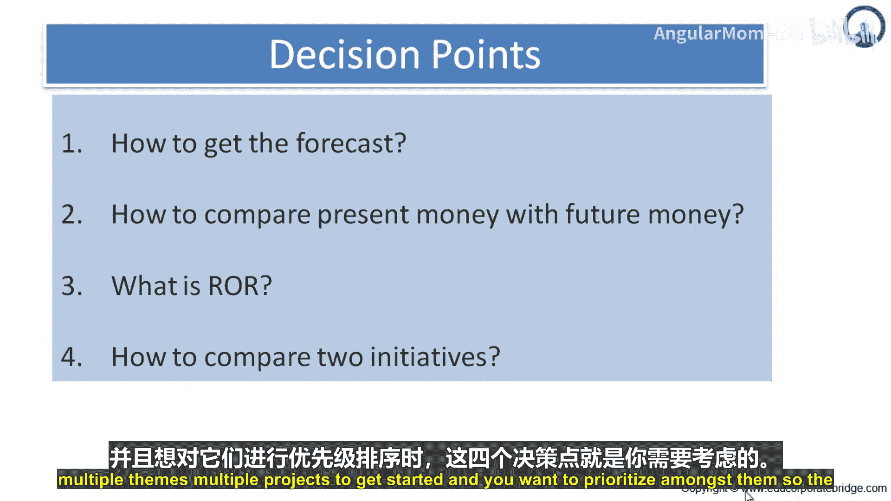
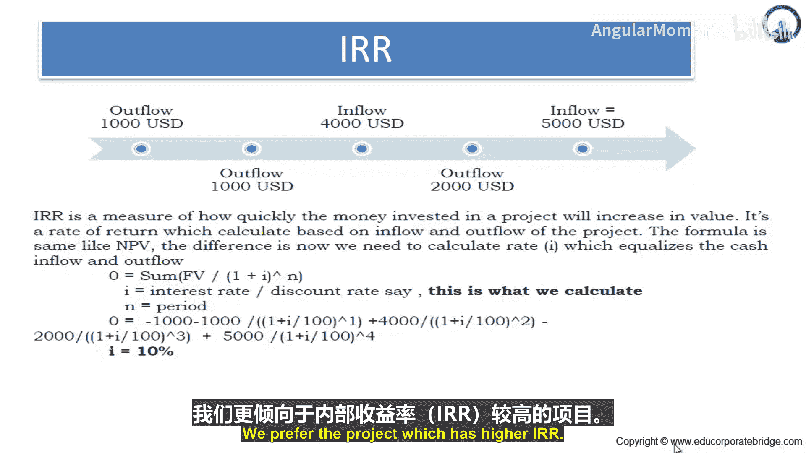
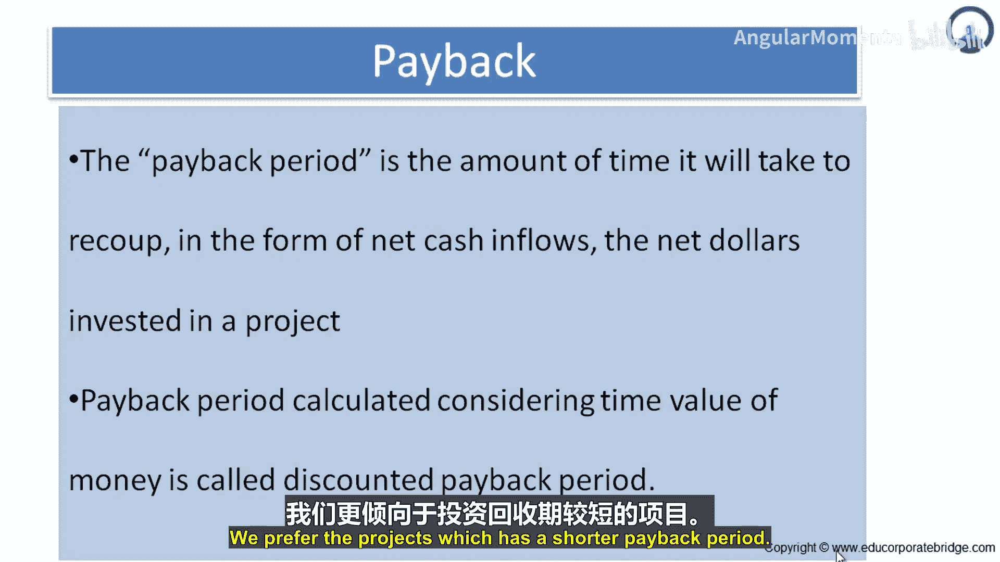
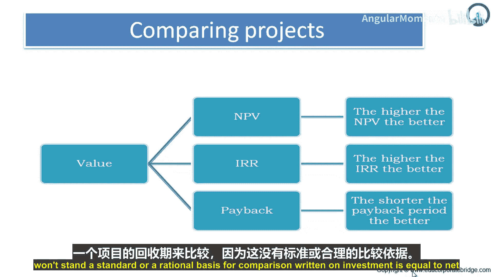
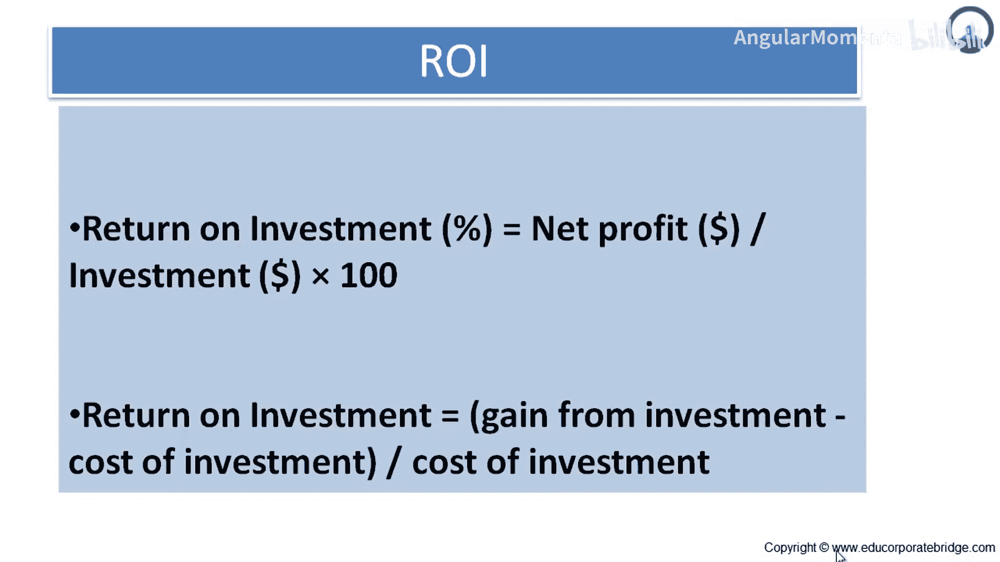

# 【EDUCBA】从思维模式出发的应用、评估与优化 ｜ Agile Practices： Apply, Evaluate & Optimize from Mind p42 04_01_06_内部收益率 净现值 投资回收期 -BV1TLcTzJEXS_p42-

Now I always understand the decision points where the decision is taken about which features which seems to be taken for prioritization so how to get the forecast is one of the decision point how to compare present money with future money that is the net positive net present value internal rate of written payback for is R R and how to compare to initiatives so these are the four decision points to decide upon when you have got multiple themes multiple projects to get started and you want to prioritize amongst them so the first one is time value of money to determine the value today of a future amount of money we think in terms of how much money would have to be put in the bank today for it to grow to the future amount the amount I have to invest。

Today to have a known amount of in future is called present value as a simple case if I can earn 10% on my money and want to have 1k a year from now I need to invest 910 today in other words with 10% interest rate 910 is the present value of 1000 in a year if I could earn 20% on my money then I need to invest only 830 today the process of moving future amounts back into the present value is known as discounting clearly the interest rate that is used for discounting future amount is critical to determining the present value of a future amount the rate at which organizations discount future money is known as their opportunity cost and reflects the percent。

Re that is passed up to make this investment We all individuals and organizations have various opportunities for investing our money。

 I can put my money into bank savings account or I can invest in stocks I can invest in real estate or I can put it under my mattress organization can invest their money in these same ways or they can invest money on various projects if an organization has typically earn 20% on past projects a new project should be assessed against this same 20% the organization's opportunity cost is 20% because an investment in a new project means that the organization gave up opportunity to invest in the same other projects that would have earn 20% net present value net present value is a measure of how much money a project can be expected。

To return in today's present value it is the sum of inflow and outflow in a present value term to determine the net present value sum the present value of each item in a stream of future values the formula for doing so is where I is interest rate and n is the period F is the future value the formula is NPV is equal to sum future value dividederted by 1 plus I as the interest rate rest to 1 by n that is n is the period so if you have got 4000 rupees。

 the net present value of it is 3309 if the interest rate is 10% using net present value to compare and priorize things has the advantage of being easy to calculate and easy to understand the primary。

Advantage of NPV is that comparing the values of two different cash flow streams can be misleading suppose we are trying to choose between two projects first project requires huge upfront investment but has an NPV of hundred0 k the second project requires only small upfront investment but also has an NPV of 100 k  clearly we would prefer to make investment in the theme that ties up less cash but that has the same NPV what we would really like is to express the written on theme in percentage terms so that we can compare things directly we prefer projects which are with higher NPVs internal rate of written is a measure of how quickly the money invested in a project will increase in value It rate of written which calculate best on inflow and outflow of the project。

The formula is same like NPV， the difference is how we need to calculate rate。

Wwhichch is which equalizes the cash inflow and outflow。

 So if sum if we divide by1 plus I rest to1 by n I interest rate or discount rate and n is the period IR provides the way of expressing written on project in percentage terms whenever NPV is a major of how much money project can be expected to return Irr is the measure of how quickly the money invested in project will increase in value with IRr。

 we can more readily compare the projects B project we prefer the project。

 which has higher Ir R Payback period is the amount of time It will take to recoup and the form of a net cash inflows and the net dollars invested in a project Payback period calculated considering time value of money。

 Its called discounted payback。

Through NPV we can look at a cash flow stream as a single present value amount alternatively we can look at a cash flow stream as an interest rate through IRR an additional way of looking at a cash flow stream is the amount of the time required to earn back the initial investment this is known as payback period。

 we prefer the projects which has a shorter payback period so comparing projects best on the value we've got three parameters NPV IRR payback chooseose the project with the highest NPV the better chooseose the project with higher IR is the better chooseose the project with the shorter payback period is the better。

You should compare the projects with the same parameters。

 don't compare the projects with one NPV and other with payback because it won't stand a standard or a rational basis for comparison written on investment is equal to net profit divided by interest multiplied by 100。

So， it gives you indication about how your investment is written back at what pace you investment is converting cash and filling your investment cost。

😊。

