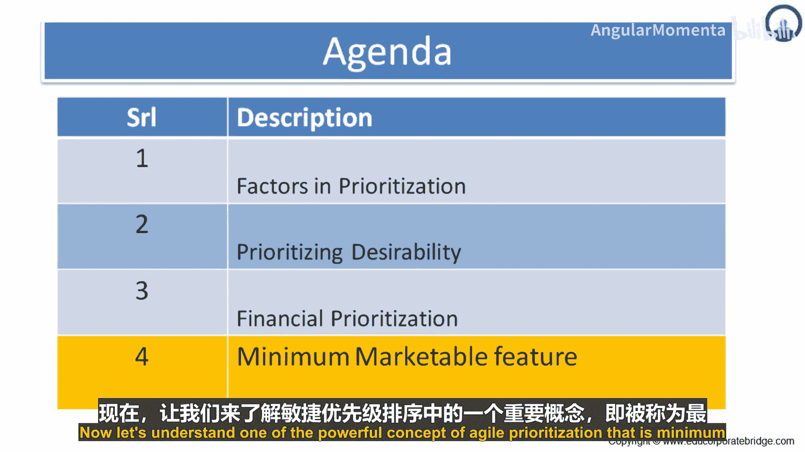
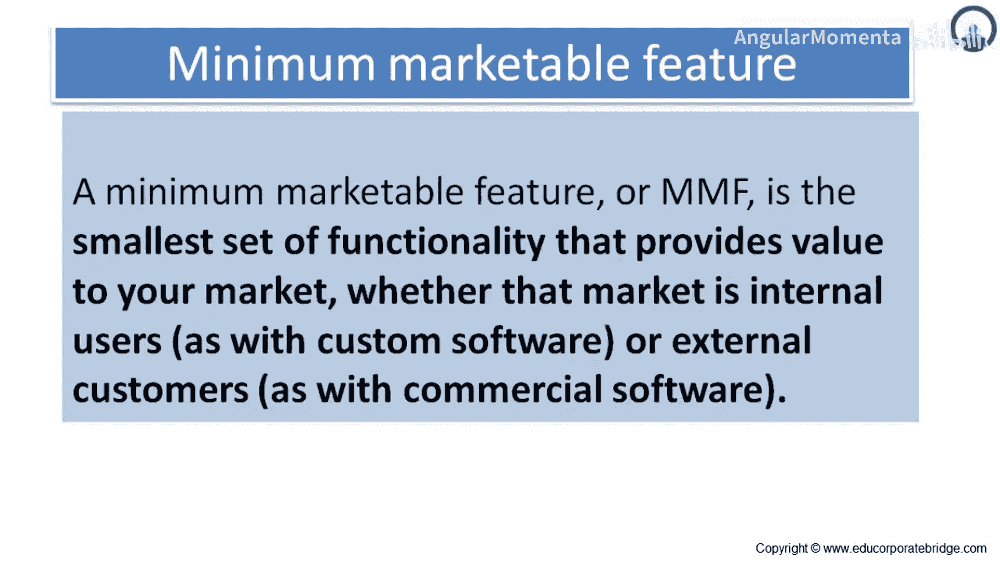

# 【EDUCBA】从思维模式出发的应用、评估与优化 ｜ Agile Practices： Apply, Evaluate & Optimize from Mind p43 04_02_01_最小可市场化特性 1 -BV1TLcTzJEXS_p43-

Now let's understand one of the powerful concept of agile prioritization that is minimum marketable feature called MMmF。

 a minimum marketable feature or MMmF is the smallest set of functionality that provides value to your market。

 whether that market is internal user as with custom software or external customers as with the commercial software the smallest set of functionality that must be realized in order for customer to perceive value MMmF is characterized by three attributes minimum marketable and feature a feature is something that is perceived or itself as value by the user marketable means that it provides significant value to the customer value may include revenue generation cost savings competitive differentiation。

 brand name projection or enhanced customer。😊。

Lo a release is a collection of MMmfs that can be delivered together within the time frame。

 So now first understand the minimum concept split would result in a story so that it couldn't be marked to your customers then split shouldn't be made to help with this decision always ask whether this feature would justify its own bullet point in an imaginary customer email summarizing the feature of new release if the answer is no than don't split it MMmF only prescribes the desire size of feature at the time we start work on it Usually MMmF is the descendant of a series of larger features Fe that weve broken apart in order to give more detail as they ascend the backlog indicating their growing importance。

 For example， a feature called geoota photo is descendant。Of photo sharing。

 which in turn is descendant of iPhone clch， which again was a descendant on the original feature called mobile support The feature mobile support iPhone clientan photo sharing may no longer be in the backlog。

 but it dozens of their descendants are this is the evolution of a feature whereby addition of a greater detail is organic。

