# 【EDUCBA】从思维模式出发的应用、评估与优化 ｜ Agile Practices： Apply, Evaluate & Optimize from Mind p44 04_02_02_最小可市场化特性 2 -BV1TLcTzJEXS_p44-

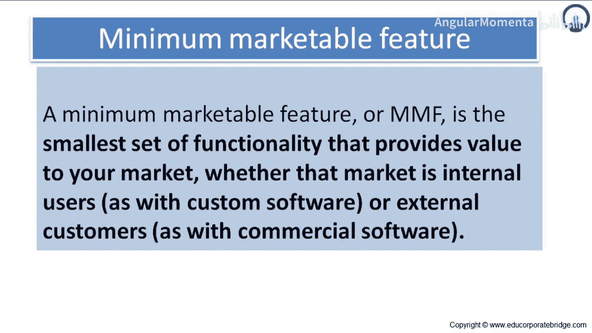

Now let understand the marketable ask yourself whether the feature is marketable， if answer is no。

 then you should probably give it a job as it creates no additional value for the customers。

 Steve jobs and other visionaries have the ability to know their customers need before they know themselves。

 but for the rest of us models， creating features that don't create recognized customer value should at very least trigger red flags。

 flashing lights and loud sirens。😊。

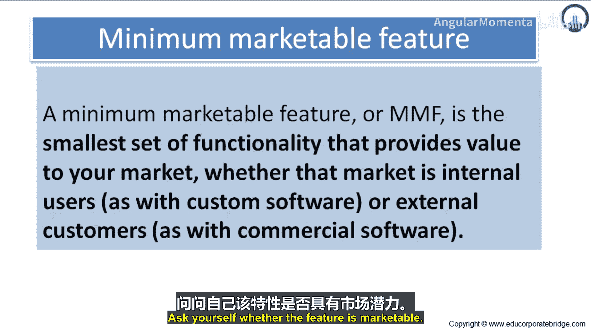

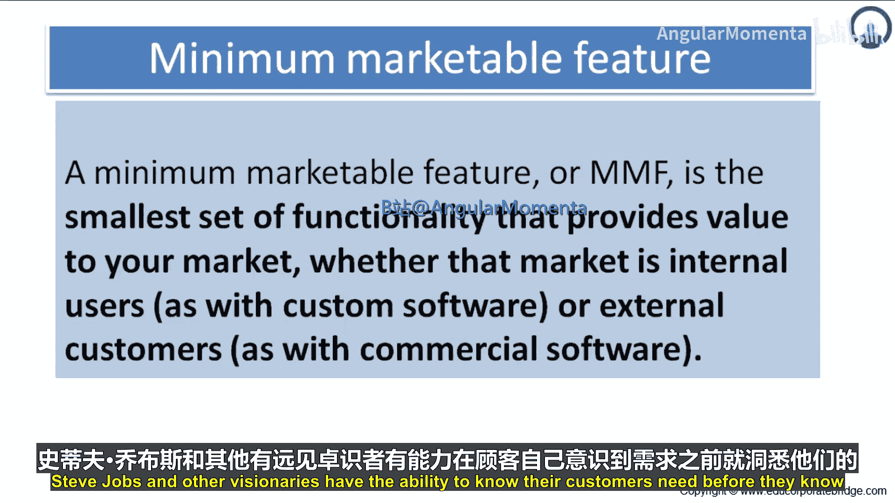

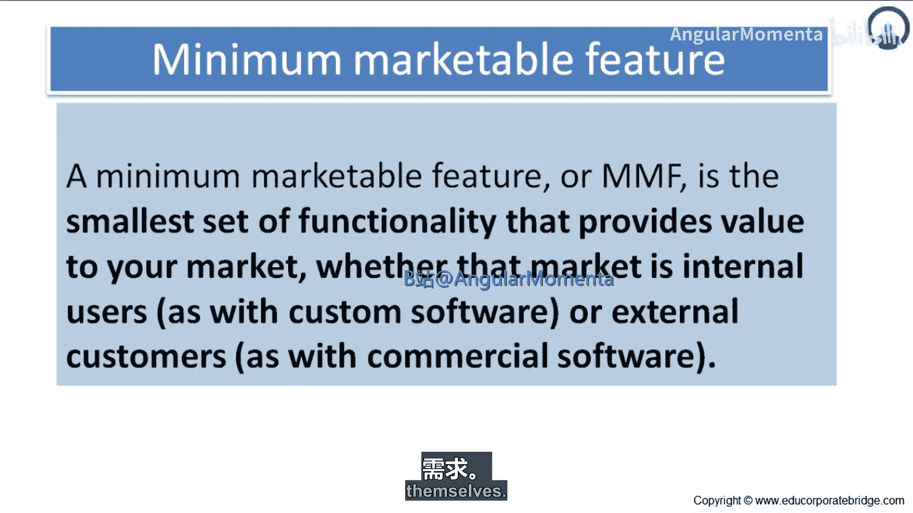

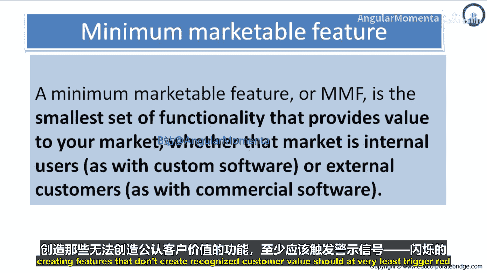

The third element is feature feature demonstratestrs， behavior of the product， for example。

 feature called chopping cart or 3。5 mm headphone jack are acceptable whilst that design database schema or injection molding research are not。

 although database schema design or injection molding research might be valid and necessary activities if they are not features in their own right they are things that may need to be done in order to implement a feature there is a difference。

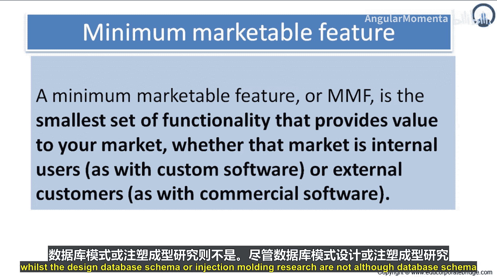

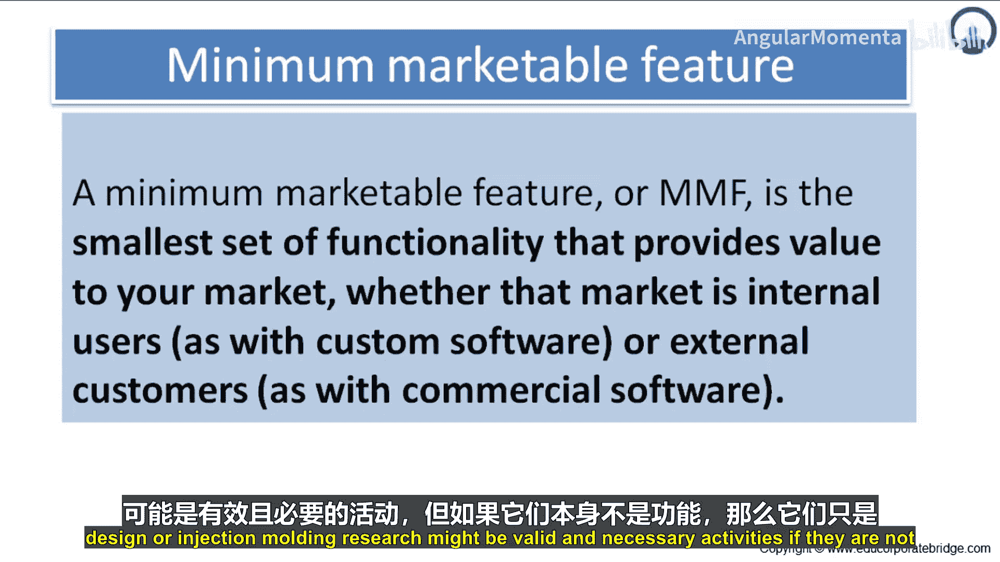

An MMmF is different than typical user story in Scrum or extreme programming。

 where multiple user stories might colcate to form single marketable feature MMmF are a little bit bigger。

 Often there is a release after each MMmF is completed。

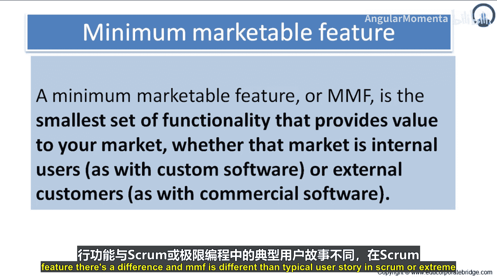

And MMmF doesn't decompose down into smaller a featured， but it is big enough to launch on its own。

 A MMmf can be represented by a user story a short one sentence description The format of user story is as a user I want something so that I can achieve some good but in contrast how a user story is typically used the team would not break down the user story into smaller user stories when using MMmfs think in this way gathered up all stories that share same so that clause that's your MMmF。

 Now let's understand the workflow involved in MMmf。

 the MMmf workflow is a customer facing portion of your development process our work changes in this area have had biggest impact upon our clients and have made a positive response。

 It has allowed us to isolate。

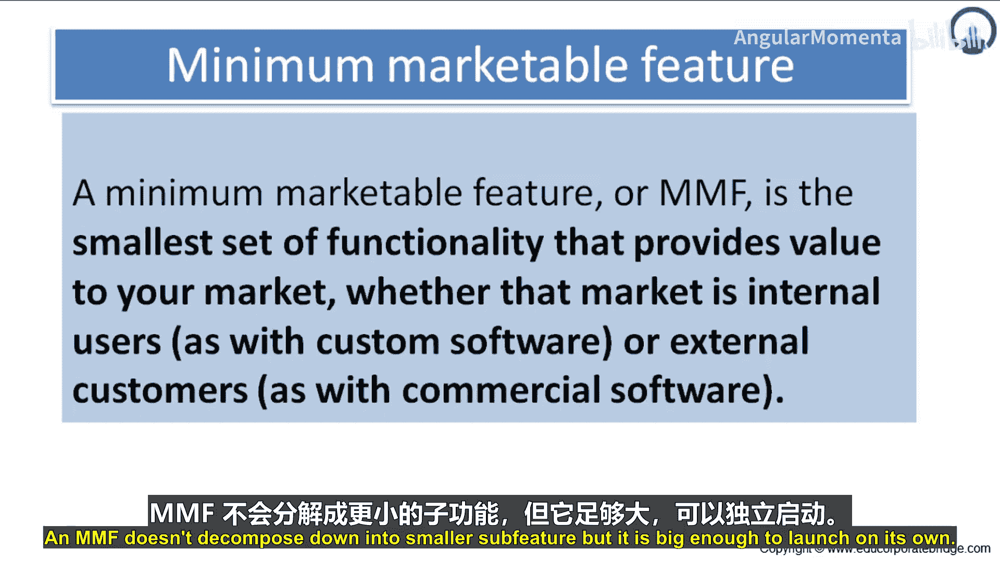

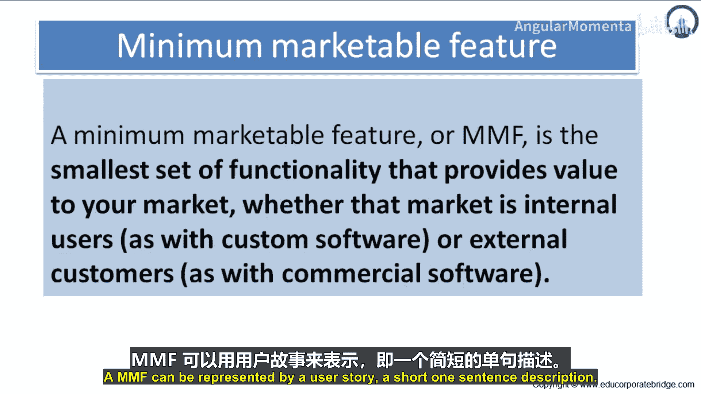

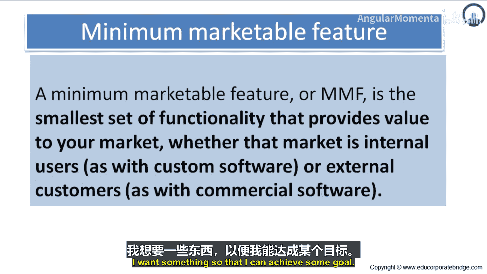

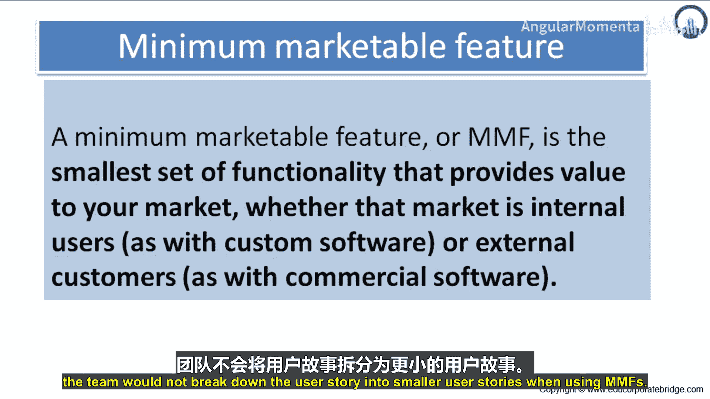

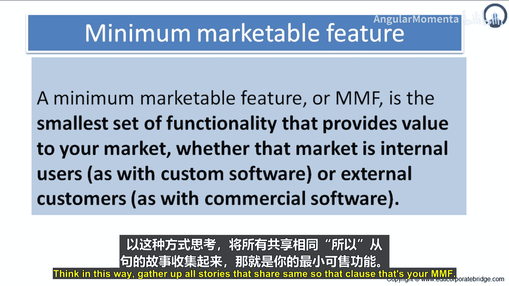

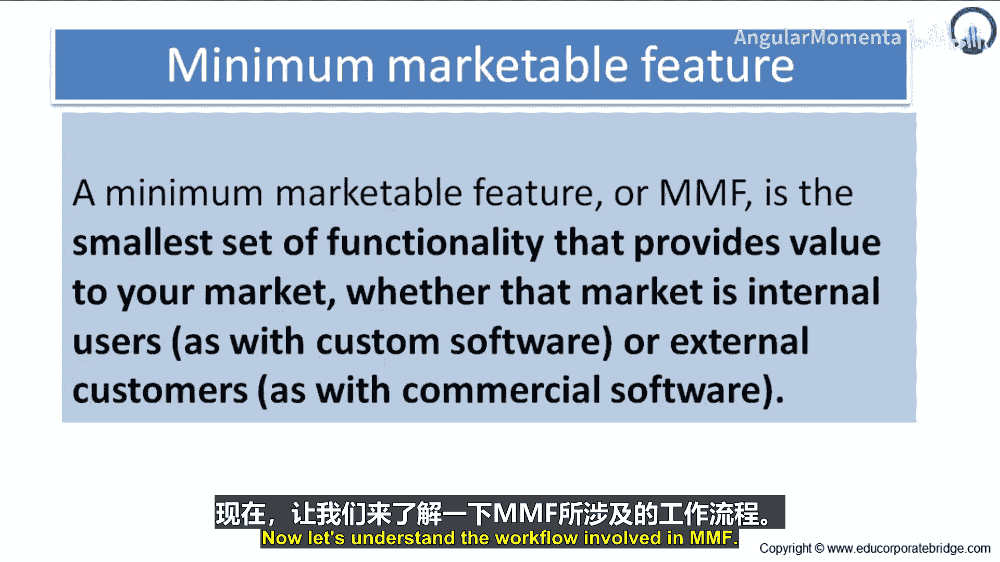

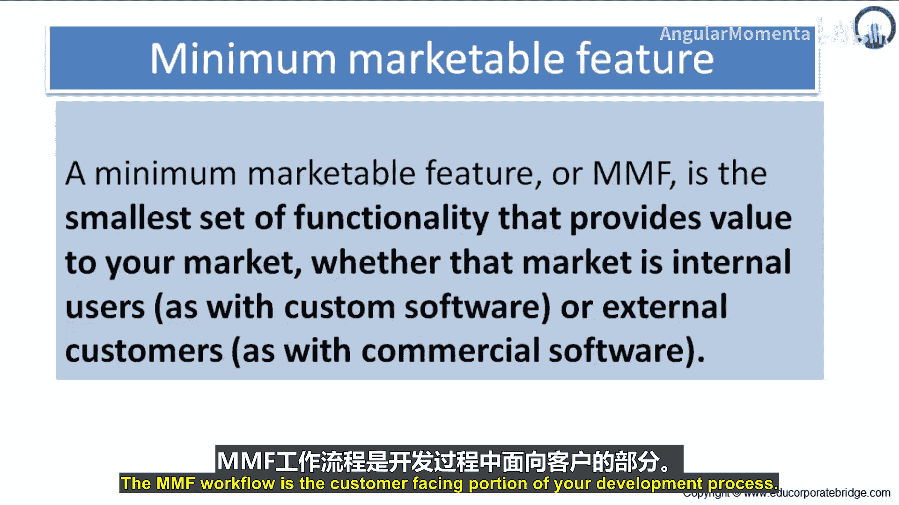

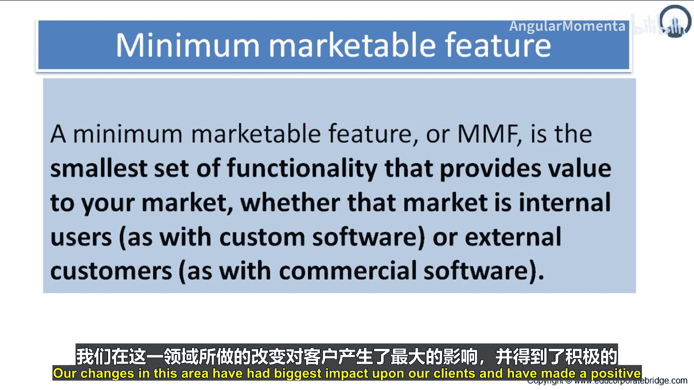

Our clients from implementation and remain focused on behavior of their application。

 our transmission to a lean development process was the first exposure most of our clients had to any type of ag environment。

 understandably。

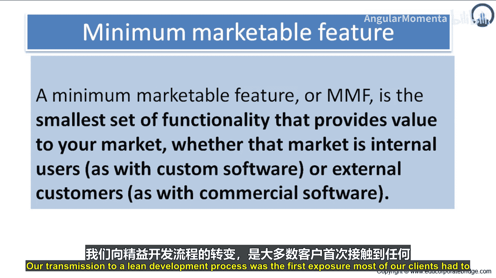

