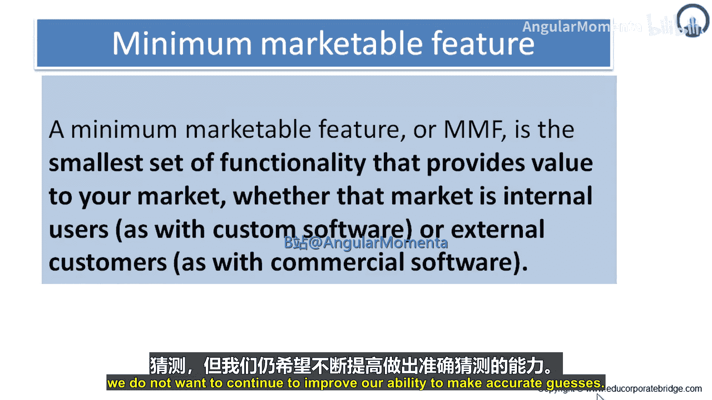
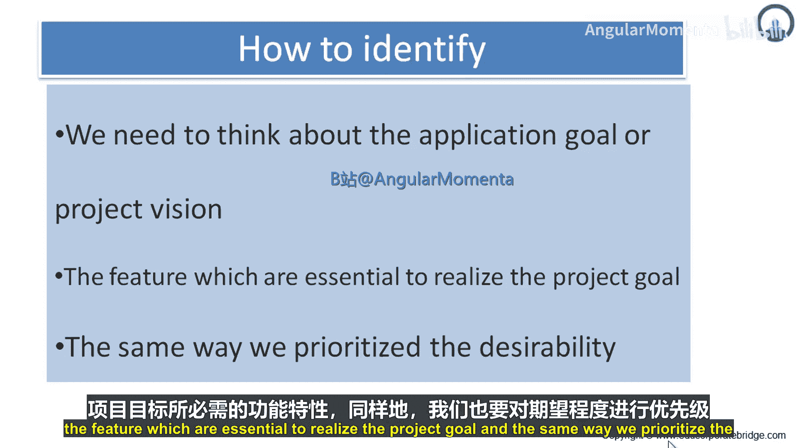
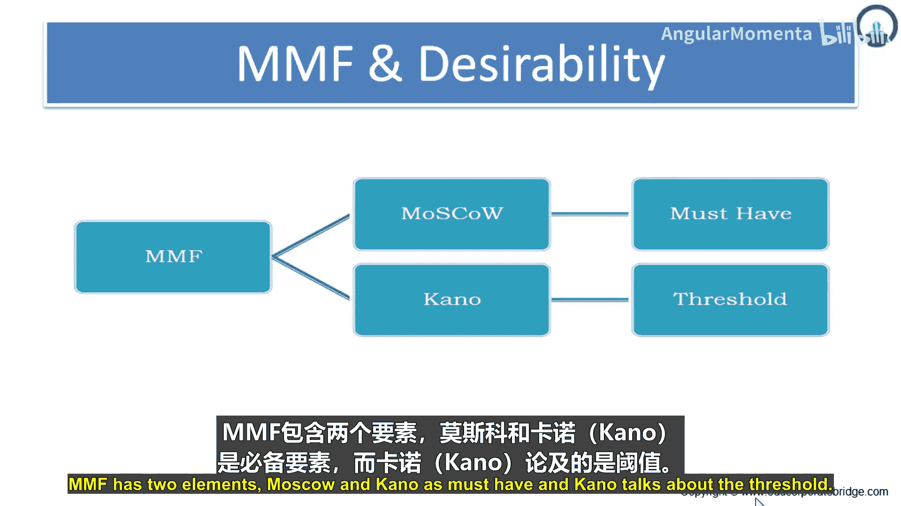
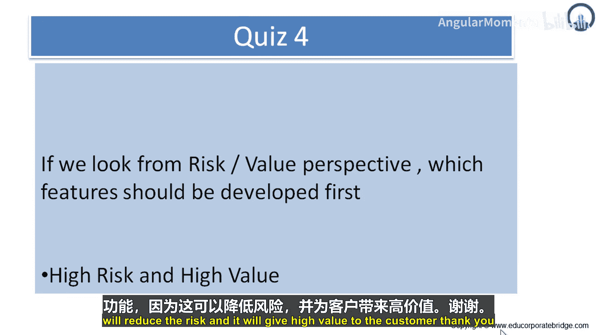

# 【EDUCBA】从思维模式出发的应用、评估与优化 ｜ Agile Practices： Apply, Evaluate & Optimize from Mind p45 04_02_03_最小可上市功能 3 -BV1TLcTzJEXS_p45-

Let's understand the MMF workflow the MMF workflow is a customer facing portion of our development process our changes in this area have had biggest impact upon our clients have made a positive response it has allowed us to isolate our clients from implementation and women focused on the behavior of their application our transition to lean development process was the first exposure most of our client had to any type of agile environment understandably many of them failed out of their element and truthfully we felt the same way we really made the transition successful for us and our clients was was a trust that came from good relationship we maintained being very transparent with our clients went fair in cementing that trust we let them know that this was a major。

😊，Change for us too， and that where learning and refining our process since our clients are very much part of the project team。

 we should openly solicit input from them how we could improve the process。 estimating MMmF。

 each MMmF is given a shared size or small medium large or extra large。

 this estimates are assigned at any time while MMmF is in the backlog queue。

 Sometimes estimates are assigned when an MMmF is adding to the backlog。

 Other time at MMmF does not receive its estimate until we are about to pull it into the pending queue。

 there is no specific method for determining the shared size of a given MMmF。

 it is a simple process of assigning gut feel best or the description of the MMmF。

 even though there is a normal process of calculating them。

 Some of the clients have found them quite valuable in helping determining priority。

We've had a clients make the decisions that combine value of three small MmF outweighed the value one large M MF and pull them into pending queue ahead of it。

 Once M MF have pulled into pending queue， The estimate serves as a primary tool by which we can answer the client's question。

 How long until I have this estimates are not carved in stone as we look。

 we understand the scope of M MF better and uncover knowledge。

 upon which we are able to make better estimates。 Sometimes the development of a higher priority MmF will impact the estimate of M MF farther back in the workflow。

 The more accurate our estimates， the more valuable and useful they are。

 we update our estimates as necessary for overall good of the system。

 A change of more than one size such as small or to large or exc to medium does bigger just trigger a review。

😊，As to why we are making such significant change to our original estimates。

 even though process of setting an estimate is one of the educated gate。

 we do not want to continue to improve our ability to make accurate guesses。 Now。

 let's understand how to identify the MM MF， We need to think about application or goal or the project vision。

 the feature which are essential to realize the project goal and the same way we prior the desirablesirability。

Let' also understand minimum minimum marketable product to create a new product we need to peek into future and anticipate the product will roughly look like a。

😊，For anyone not blessed with the perfect foresight。

 predicting the future correctly is not orly difficult。 After all。

 the one thing certain about the future is that it is not uncertain。

 no market research technique can deliver a forecast that is0 person accurate。

 and in case of deive innovation， It is not possible at all to make sound prediction as Claton Christtenen observes in his book the innovator's Ddema market that does not exist cannot be analyzed。

 investing in a new product hence always involves risk。

 We may have targeted the wrong market segment En the wrong product or wrong features or market may have changed by the time product is launched。

😊，Envising a lean minimal product， a great strategy to minimize the investment risk is to envision a lean minimal product with smallest possible features said。

 referred to such product is the minimal marketable product。😊。

It contains just enough functionality to be viable to launch。

 market and sell the product successfully。Developing a minimal product is quicker and cheaper than more ambitious feature reached one。

 If the product bomb tells time， money is lost。 if it is a success product starts earning money sooner。

 Additionally， a minimal product allows us to receive feedback earlier。

 So we adapt product quicker to the market response。

 rather than trying to create the perfect product， we follow motorto get it out and get it right。

 note that product quality must right from start。 Otherwise。

 it may be difficult to adapt the product， bugs may hinder its adoption。 And even though damage。

 the brand steps towards minimal marketable product to create a lean minimal product limit the target group and build a product for few。

 not the many。😊，As the Steve Bla recommend in his book， the four steps of ifanning。 For instance。

 if you use personas to describe members in your target group。

 consider the impact of removing persona。 would the product still sell， If yes。

 reduce the target group by dropping the persona。 once you have done a great job for your early customer。

 you are in a position to build the initial success with new incremental release that attracts new customers。

 Second， understand your product's value proposition and only select features that are essential to address the needs of the target group。

 have the courage and discipline to discard all others for now。

 selecting the minimal sale of features does not mean creating a plan boring or simplistic product。

 It means focusing on those priorities that are essential for the product success。

 If you work on your。😊，Stories for instant， review its story or epic and ask yourself if the product can be shipped without it。

 If yes， exclude the story as the French writer and poet An Tony do sent put it perfection is achieved。

 not when there is nothing more to add， but when there is nothing left to take away。

 So let's also understand MmF and desirablesirability。

 MmF has two element Moscowsco and can as must have and cano talks about the threshold。 So with this。

 we've completed the MmF feature now let's get into some all quiz。

 does MmF and release spelling has some relation。 the answer is yes， the release should include MMmF。

 When you try to make release， it should be a minimum marketable features。

 There has to be several features that is appealing to the customer to。😊。

Apt or you have some value for a customer to get recognized who identify theme value Its a product owner who identifies the theme value because it is the cutod of the product and he has the knowledge skill and expertise to identify the theme value What is meant by cost of the the the cost it takes to developed story point estimate can represent the cost so so it's the money which is required to get the theme developed the amount of investment that is incurred to get the the developed if you look from the risk value perspective which features should be developed first it is high risk high value features those should be developed first because it will reduce the risk and it will give high value to the customer Thank you。

😊。

