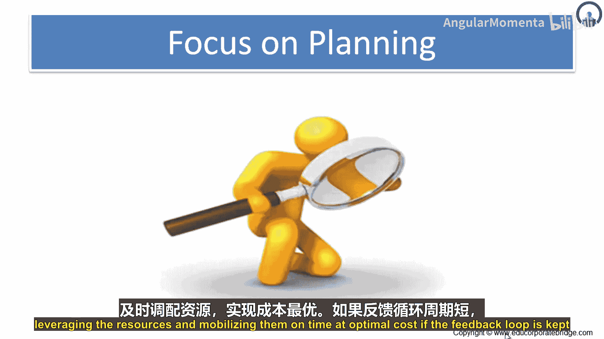
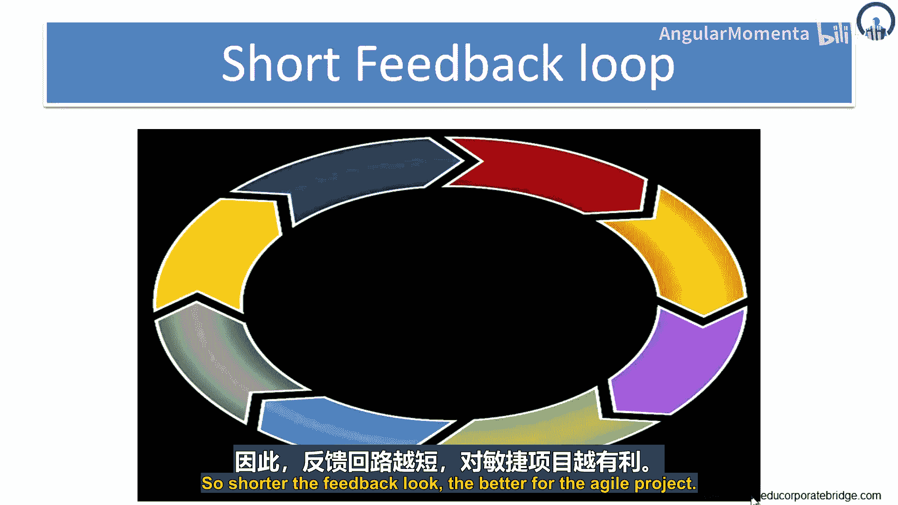
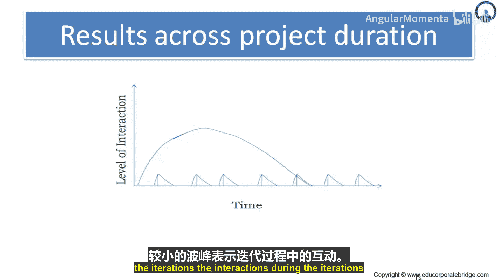

# 【EDUCBA】从思维模式出发的应用、评估与优化 ｜ Agile Practices： Apply, Evaluate & Optimize from Mind p46 04_03_01_规划学导论 -BV1TLcTzJEXS_p46-

Hello and welcome all for Cha 6。Planning in agile project management， if you fail to plan。

 you plan to fail said by the most prominent leaders。

 so planning carries very important with respect to managing agile projects。

As you know there are several ress behind failure of the plan nearly two third of the projects significantly overrun their cost estimates it is supported by PMI one of the leading project management body。

😊，So 2 third of the projects significantly overrun the cost estimate 64% of the features included in products are rarely or never used and the average project exceeds it scheduled by 100% so there is a delay with respect to time there is a cost overrun。

😊，And the functionality produced by project is not in use。 So these are the。

Most important reason for the failure of the project and the numbers or the percentage is quite high。

 which is area of improvement for the project managers。

So planning needs focus planning needs accurate understanding of the customer taste and preferences。

It also gives understanding of the team skills。😊，The cultural background。

 the likes and dislikes of the team， how to navigate the project taking team along the customer testing preferences the likely change in the industry vertical at which the。

Project is operating。 It needs traditional and scientific forecasting。Tool usage。

 it needs good use of historical data it needs use of automation it needs use of the best practices so planning needs a sharp focus with respect to leveraging the resources and mobilizing them on time at optimal cost if the feedback loop is kept short then the plan do check act cycle gets finished early the value is created and project becomes much more agile so shorter the feedback loop the good for the project the feedback loop respect with the requirement development testing at or giving user story clarifying the requirement and taking it for development doing testing with automated tool in a short succession making the build and deploying it doing the several sprint。

Iteration and releases So shorter the feedback look， the better for the Agt project。😊。

We've seen that the result in flexible plants。Are far more substantial， flexible， in the sense。

 getting the feedbacks， collaborating with customer， making the chain。😊。

Adopted in the project environment， that's how the flexibility come into the play。

So the more flexible the plants are far better the results are。

So let's understand the agile approach for planning。

With an understanding of four primary agile value statements we can turn our attention to what an agile team looks like in practice taken collectively the four value statement lead to software development processes that are highly iterative and inement that deliver coded and tested software at end of each iteration the following sections cover some of the main ways in which agile teams work including that day one work as one team。

 second work in short iterations。😊，Third， deliver something each iteration。Footh。

Focus on business priorities。And fifth， inspect and adapt。

 So now let's understand multiple levels of planning。

 A project is at risk If its planning extends well beyond planner's horizon and does not include the time for the planner to raise her head Look at new horizon and make adjustments。

 A progressive elaboration of the plan is needed。 agile teams achieve this by planning three distinct horizons。

 three horizons are release the iteration and the current day。

 Most agile teams are concerned only with three enormous levels of planning。

 release planning considers the user stories or themes that will be developed for a new release。😊。

Of a product or a system， the goal of release planning is to determine an appropriate answer to the question of scope。

Scheduled and resources for a project。Release planning occurs at the start of the project。

 but is not an isolated effort。 A good release plan is updated throughout the project。

 usually at the start of each iteration， so that it always reflect the current expectations about what will included in the release at the next level is iteration planning。

 which is conducted at the start of each iteration based on the work accomplished in just finished iteration。

 the product owner identifies high priority work the team should address in new iteration。😊。

Because we are looking at a closer horizon than with release planning。

 the components of iteration plan can be similar during iteration planning。

 We talk about the task that will be needed to transform a feature request into working and test software。

 Finally， there is a daily planning。 Most agile teams use some form of daily stand meeting to coordinate work that synchronize daily efforts。

 although it may seem excessive to consider this planning in the formal sense。

 teams definitely make access， revise their plan during their meetings。😊。

During their daily meetings team constrain the planning horizon to be no further away than the next day when they will meet again because of this。

 the focus on planning of task on coordinating the individual activities that lead up to the completion of a task by planning across three time horizons release iteration and day。

 a Gi team focuses on what is visible and important to plan they are creating。

 So as you see the graph shows level of interactions with respect to time and as you see at the start。

 the interaction is increased and it keeps on tapering the higher hump shows the consolidated interactions。

😊，And the smaller hump are the iterations， the interactions during the iterations。

