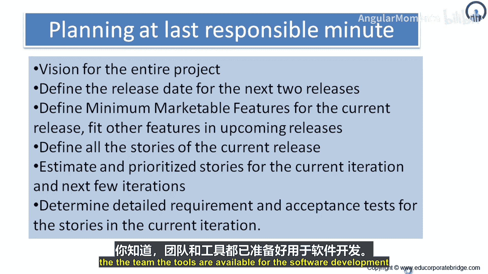
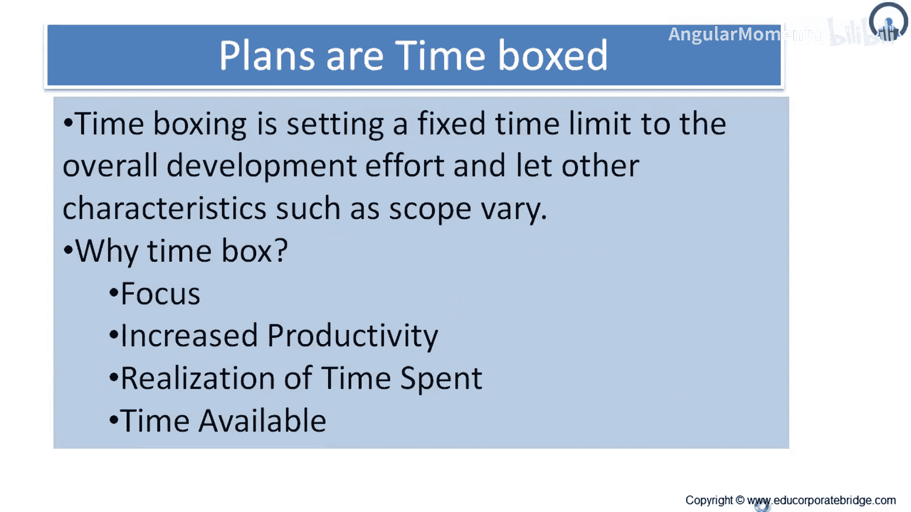

# 【EDUCBA】从思维模式出发的应用、评估与优化 ｜ Agile Practices： Apply, Evaluate & Optimize from Mind p47 04_03_02_最后一刻规划的优势 -BV1TLcTzJEXS_p47-

Now let's understand two approaches。Planning before you start the work。

 planning at last responsible minute when you plan at last responsible minute。

 you get vision of the entire project。the final elements get added， the objectives， the deliverables。

 the intended use， the regulation， the likely testing。

 most of the things come much more visible and clear to the project teams you can define the release date for next two releases as you work on the producing the releases with the definitive intervals and the always the focus is on。

😊，Giving the shippable work or the value or the MMF to the customer。

 it also helps to define minimum marketable features for current release fit other features in upcoming releases So the last minute responsible planning helps to give the value to the customer by the way of giving minimum marketable features and also fit other features if they are not included in recent to releases into the release three and4 it also helps to define all the stories of the current release because you planning at last minute so you get the user stories you further try to add detail into it。

 make notes so that user stories are ready from the perspective of taking it for the development estimation and prioritization of the stories for the current iteration and next iteration is possible。

😊，🎼Because you are doing the last minute left responsible minutes planning did remind detailed requirement and acceptance test for the stories in current iteration so requirements are detailed out with the customer interactions and you also get the inputs for the acceptance testing so that the current iteration current release is comprehensively。

Understood。Plan and resource， you know the。The team。

 the tools are available for the software development。

