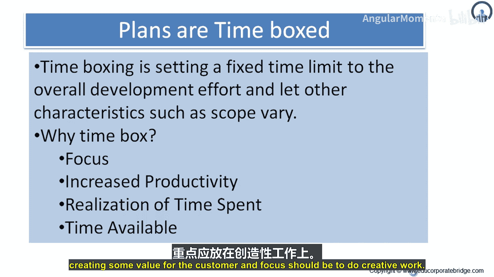
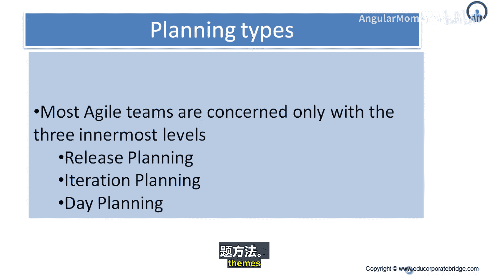

# 【EDUCBA】从思维模式出发的应用、评估与优化 ｜ Agile Practices： Apply, Evaluate & Optimize from Mind p48 04_03_03_时间盒 -BV1TLcTzJEXS_p48-

Pls are time box time boxing is setting fixed time limits to overall development effort and let other characteristics such as scope vary so agile the principle is the time is is a constraint it is a fixed and the optimal features are delivered with respect to time so in traditional projects you get all necessary time to deliver the goods whereas the focus on agile is to keep on delivering the goods with available time so scope is dynamic it can vary best on the team's velocity。

😊，Story points or ideal date by time box because it brings the focus。

 it brings sharper focus Do know that they have limited time。

 limited resources to deliver and we their focus is always to deliver a value minimum marketable feature to the customer it increases productivity because of the peer pressure because of the whole project environment which is directed towards creating value so why to time box to bring the focus to increase the productivity with respect to the limited availability of the time so that there is a peer pressure to deliver the value to the customer it's more from the perspective of realization of time spend time is essence so it's a valuable resources resource for the project team So use deliver it properly try to deliver value to the customer and fourth is。

😊，Time available for creating some innovation， creating some value for the customer and focus should be to do creative work。

 So most of the agile teams are their concern with only three in innermost levels release flying。😊。

Iteration planning and day planning。As we've seen in the initial discussions that there is a focus with respect to planning a release。

What we are releasing immediately， what we are releasing for release one and 2 and the balance features backlog goes to release3 and fourth。

With respect to deliver release1， we do iteration planning and try to take the themes。

