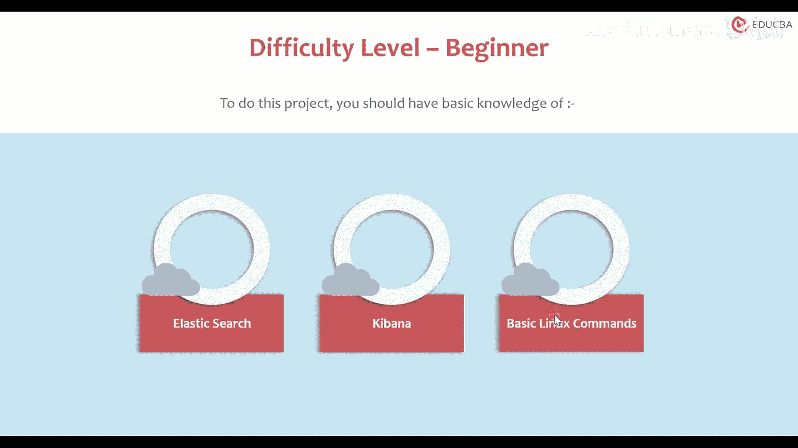
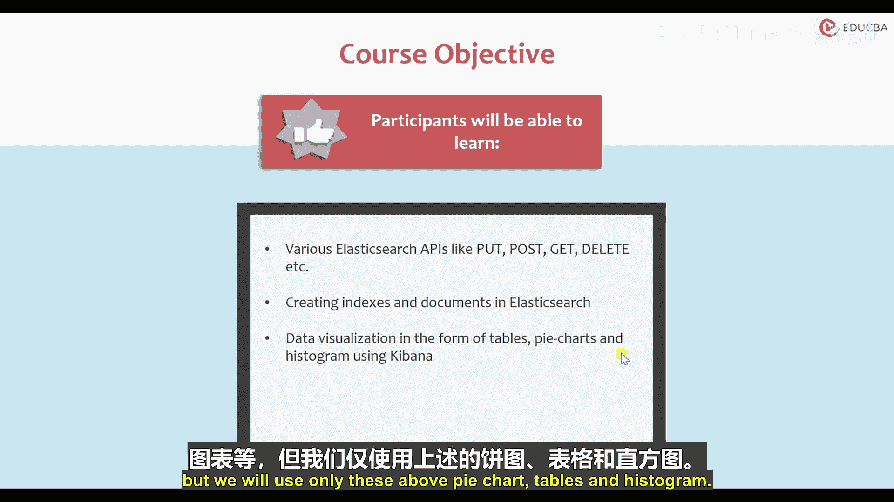
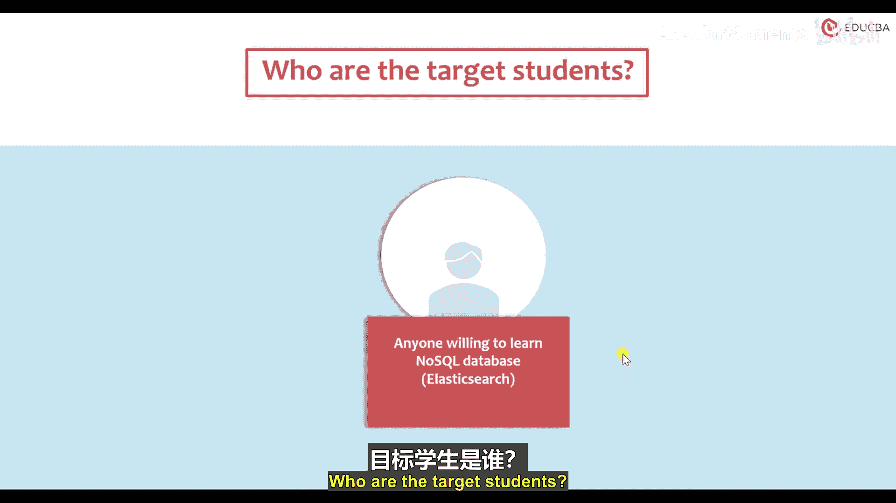
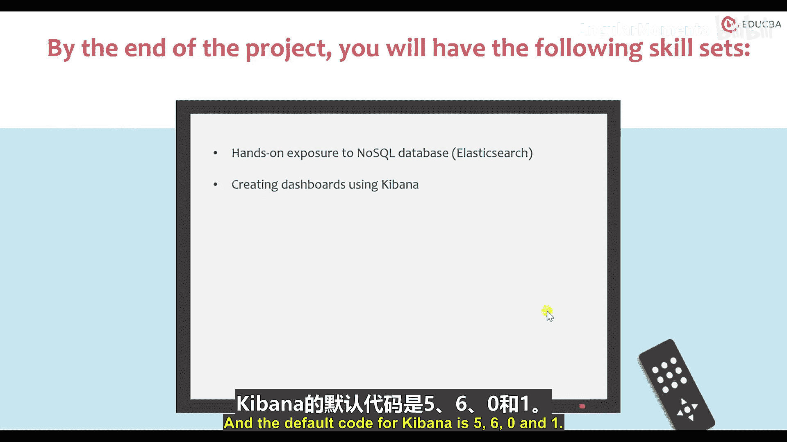
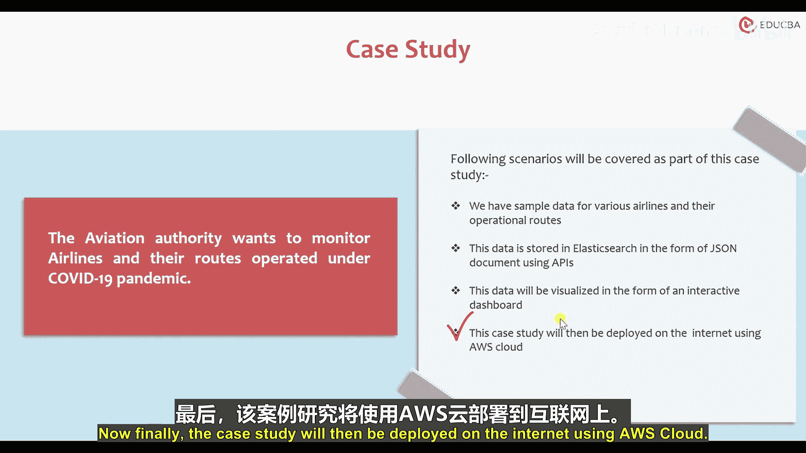

# 【EDUCBA】AWS Elastic Beanstalk与云项目的持续集成⧸持续部署 ｜ AWS Elastic Beanstalk & CI⧸CD for p01 01_01_01_Elasticsearch项目在COVID-19疫情期间的航班监控导论 -BV1zXcKzNENN_p1-

🎼Hi everyone， today we will discuss about case study on flight monitoring during CoviId 19 pandemic。

We know that due to this pandemic， airline is suffering a huge loss and in order to get the information about flights on a particular date。

 flight monitoring is necessary for the aviation industry。

🎼Difficulty levels beginner to do this project you should have basic knowledge of Elastic search。

 Kiana and basic Linux commands。🎼As this case study is implemented in Elasticse。

 which is commonly known as ELK ST。😊，That is Else， log stash and Kiana。🎼For our case study。

 we only require elastic。🎼For NoAQ database and Kiana for visualization。😊。

🎼And basic Linux commands are also required because the installation of Elasticse and Keana is done through Linux commands and also their connectivity is also formed through Linux command So。

🎼Course objective。🎼Participants will be able to learn various elastic search APIs like post， death。

 relief， etc。😊，🎼This stores data through various APIs， which can be implemented in J form。😊。

🎼We will study all these APIs in our no SQL database。😊。

🎼Creating indexes and documents in Elasticse in our case 3 participants will get exposure to no SQL which is a nonrelational database it is easier as compared to SQL database because related data doesn't need to be split between tables elasticasticse also uses component based no SQL database。

😊，It stores daytime， JS。🎼Data visualization in the form of tables。

 pie charts and histogram using Tiana。🎼We will be using Cubabaana for implementation of data stored through various APIs and visualization of data by pie charts。

 tables， histograms， etc there are also other visualizations like graphs， maps。

 charts but we will use only these above pie chart tables and histogram。😊。

🎼Are there any project requirements or prerequisites？

🎼Installation of Elasticse and Kibaana in Linux system。🎼Basic knowledge of GS。

 Linux commands and No eQ concept。😊，🎼Complete guidelines along with Linux commands are given on internet。

 you can follow it step by step in your Linux。🎼I did this part using AWS Cloud Linux instance。😊。

Who are the target students？

🎼Anyone who is willing to learn no SQL database is welcome。🎼By the end of the project。

 you will have the following skill sets。

Hands on exposure to no SQL database。🎼You will be able to work on no SQL database and understand。

🎼Concepts that how to enter the data directly through index and how APIs can be used in JSson form。

 the default power for Elastic search is 9200 creating dashboards using Kiana。

🎼These dashboards contain all the visualization on a single page using B。

 we can access data and the default for foot Kiana is 56，0 and1。😊。

Case study， the Aviation Author wants to monitor airlines and their routes operated under COVID 19 pandemic。

🎼F scenarios will be covered as part of this case study。

 so we'll take each step by step process and we'll do the project in the same manner。😊。

We have sample data for various airlines and their operational routes。🎼Secondly。

 the data which is stored in Elasticse in the form of JSN document using APIs。

🎼Now that particular data will be visualized in the form of an interactive dashboard。

It's using cabana。🎼Now finally， the case study will then be deployed on the internet using AWS Cloud。

