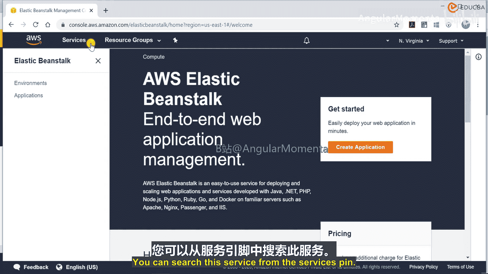
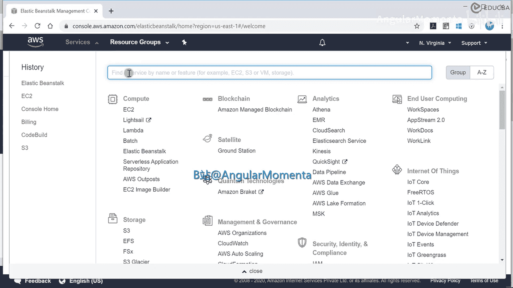
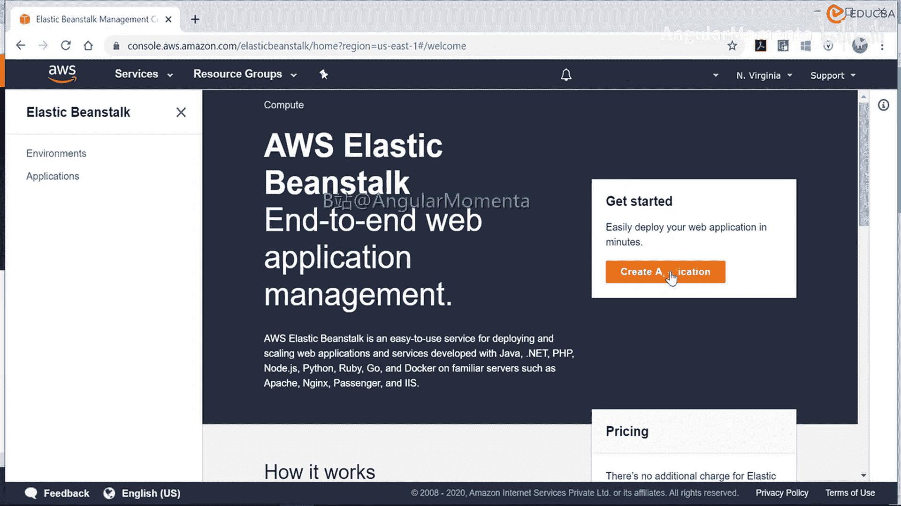
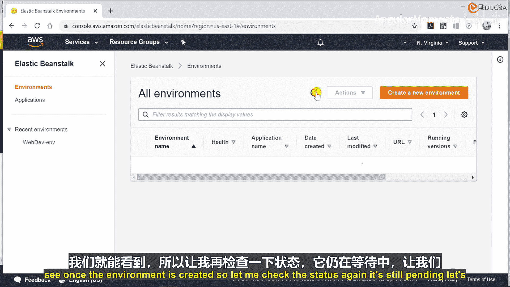
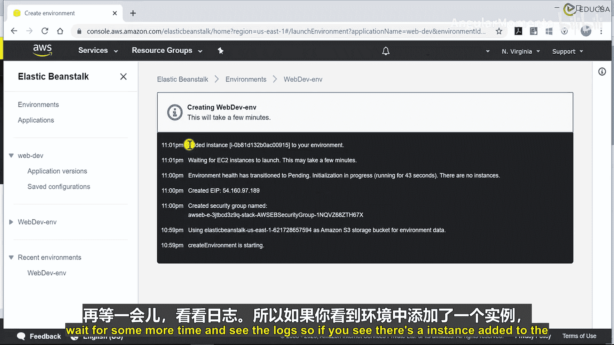
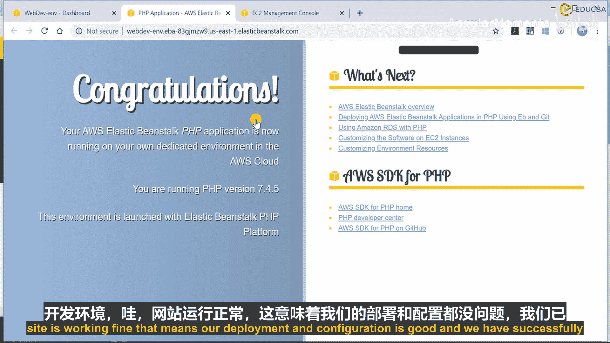
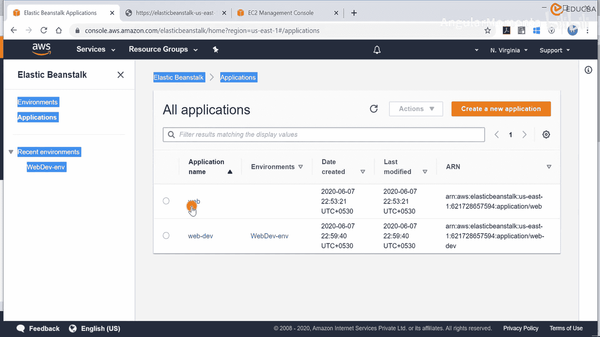

# 【EDUCBA】AWS Elastic Beanstalk与云项目的持续集成⧸持续部署 ｜ AWS Elastic Beanstalk & CI⧸CD for p02 01_01_02_环境配置 -BV1zXcKzNENN_p2-

Hello and welcome again。 So in this video we'll create a infrastructure an elastic be stock for our web development environment。

So basically， we will create a environment。let me go to the environmental screen。

You can search this service from the services bin。

P your log into your El account。 So here it， it is elastic windstock。

So if I go to Ens， so let us move to creating application。

So will creative application and environment will be set up。Accordingly。

 so we'll name this application as web and。If you want to give some key value， you can give it here。

So as to identify your resources。I'm not giving that since it is just a demo。We'll go to platform。

 and。You can set lot of platform here， like dark net， Doer glassfish。Go Java， P， P， Python。

In this case， I will be deploying a PhP web application。S select PhP。 Make sure you are。

Taking the supportive latest version。And any will be populated。My default。So。

I am deploying the sample application， says to no。Whether it's working right or not。

We can deploy code through CSCD pipeline later on this course。

And if you see there are multiple options to configure here， let me open this。Contriion pan。

So if you see， there are some presets， like if you want to have a。

Single instance that is by default selected。You can have a multiple。Sport instances。

 high availability。Ising spot on demand。Or you can do some custom configuration， as well。

So I'll go with the single instance for this demo， and we have already selected PhP 7。4 running on。

A 64 bit Amazon Linux。 So that is fine。Apart from that， you can have like。It was x。

For checking your logs and doing some。Ajust us， then we have like instances if we want to add it。

The kind of instances or something like that。You want to have a pleasant dis or general purpose。

Or the size of the， is it do。He is volume。So you can configure everything here。

But we are not touching that。 We'll just leave it as it。As it is， then the capacity。

 if you want to change the capacity， you can do that here also， you can change the instance time。

 you can change the Mi， and then if you want to use the load balancer you can do that as well rolling deployments as currently it disable。

 but if you want to。Suppose you want to deploy your code on only 50% instances at a time。

 you can do that if you want to deploy fully， so that is only did by default。

 so this will work in case you will have multiple easy two instances underlying in this plastic wind stop。

 so that will work there。Let me show you， at least。So， if you see rolling updates。

Multiple signatures here。Deployment policy， if you check。All it ones， currently。

 since we have only one instance， then that's why we have。All at once selected。Otherwise。

 if we have multiple instances。It will change。 And then。

On the configuration times like its currently disabled rolling update time since we are just having one instance。

So we'll go with the default option。Then， the security part。

It will already create a elastic greenstock service role and to access those instances and performing the operations apart from that like we'll have some virtual machine keep you so if you want to log into the instances you have to configure that and if you want to have your own EC2 keep you instead of letting elastic Gastock to create a one for you。

You can select that as well。 But as always， like， I'll go with the。Default option， then monitoring。

 So you see currently， we have health reporting system in enhanced when enabled。

But log streaming is not enabled right now。Then if you want to have managed updates。

You can just check it here。And。If you want to enable it， you can do it。

 So currently it's set at Monday 11 UTC。Weekly update window。

Instance replacement if will schedule do if no， so you can enable these options if you want to。

 then notifications if you want to have notifications you can give your email address here and this will notify you about。

The activities。On the rust windstorm and since this is by default is not a part of the VPC。

So you can add that as well， and。select。Some subnets， if you want to。And definitely。

 it's a part of default VPC， not any custom VP。 So you can just ignore that。

 And if you want to use some database since we are not using database because we'll be deploying。

Simple static website。 So we don't need avisio。So that's fine and the tax part。

 like if you want to add tags to identify your resources， that will be good。

 but we are not doing this。Like no， I would like to change。

The name of the application to Fb deaf says to identify it as a development environment。Later on。

Will create a problem as also it's better to name it as step。So I'll just everything looks fine。

 I'll click on create application， so it's doing all the configurations and at the same time it's creating the environment by the name web tab。

En envy。And application is webive。 looks good to me。Now let me check the application name。

And let me check the status of the application， so it's creating the environment keep on checking what it is creating。

 So the first thing we see here it's creating the security group then it created Okay it's going too fast。

 not able to。Or highlight things and show to you so this is the storage bucket it created and this is a security group name this is the elastic IP of the website which we are going to access and you will have some DNS name as well that we can see once the environment is created so let me check this status us again it is still pending let's wait for some more time and see the logs so if you see there a instance added to the environment and let's check out that instance okay no environment seems good。

咩。Will check all the resources which has been created。So， we see。

There is an instance that is created here with depth environment。It's running。

 and we check check the status。And initializing。 So let's wait for some more time。And till then。

 we will see other resources as well。You see a freevo， there will be a bucket。Create。Okay。

 so this is the one。Which has been greetd right now。And it has some resources with lu beanss stock。

 some confusion files。So， it's good。And again， if you see the security groups。

 there will be a security group created for this。😔，One illy Iy has been assigned。Yeah。

To rede in a moment。And then。There are some security groups。

So this is a security group which has created， let's check the rules assigned to it， so it's 480。

And bound so we can access this website on code SGtP。Odburn will be default all effect。

So this looks good now let's go and check the environment， so this is the web dev environment wow。

 so the site is working fine， that means our deployment and configuration is good。

And we have successfully created the environment and application， the sample application for now。

Let's go to me。 Now， if we check the environment。All the configuration we have done。You can see that。

 Everything here。You see。The contribution part software。Allow you have open on。How toing here。

10 instances， to。And then， the capacity。Whatever we configured， load balance was not configured。

 so it's same here。😔，Then rolling updates and deployments， this was also not good。

Configured we put everything they。We have not mentioned the email for notification。Updates。

 far monitoringing， everything is the same what we created。Then if we check the logs。

There is option to request logs。Last， Ill just。Request， let's see what's coming。Okay。

 you can download the logs and。Check it。So， if you see the logs。Everything， whatever we did。

 as mentioned here， Soll get to know like what all things。Has been happened。

Which we we were not able to see because we were on the。

The interface Ar then we can check the health overall all health is okay。

Looks good Everything monitoring。 So you can see。What was the CPU utilization。

 maximumim network and Maxim network out monitoringing health CPU utilizationil was around 60%。

 maybe network output was 29 kb， and was 24 kb。😔，So this looks pretty good。Then if we。

 if we have any alarm， we can sit it here。We have not defined any at。Managed updates， events。

 So this will tell what all events that have happen。

So the first thing it is started creating the environment。Second thing。

 it started creating the three bucket and gave it some name。That's a random name generated。

 then security loop was created。Then EIP was added now。

It was waiting for the easy two instances to launch。Then once if the were generated it got some name。

 this is this society， then the application URL was generated and within few minutes we got our en ready and the URL was working fine。

 So this looks good to me。 The o looks good Now we can proceed further in all。😔，Project。

So thank you for listening。

