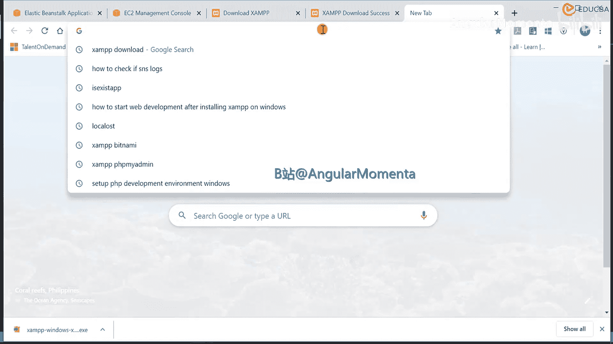
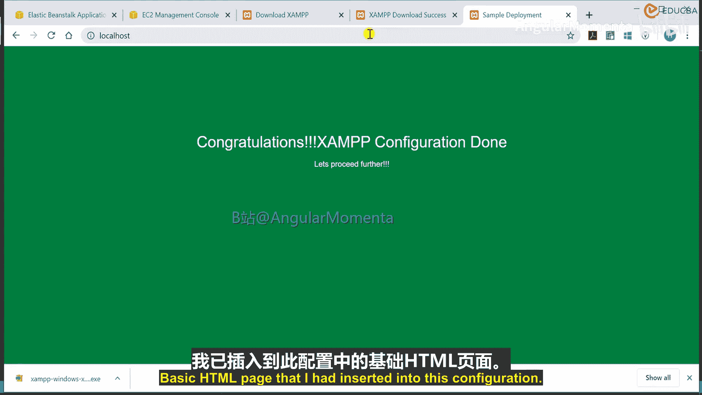
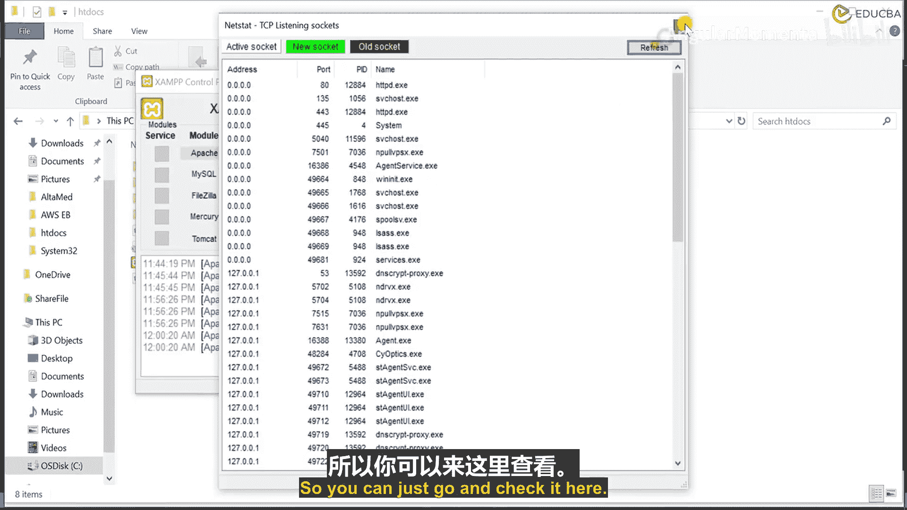
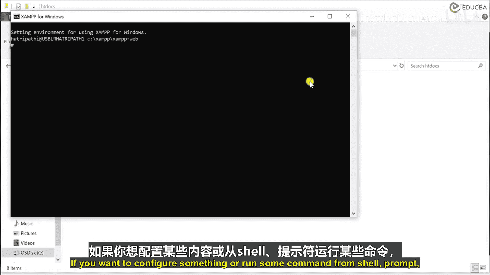
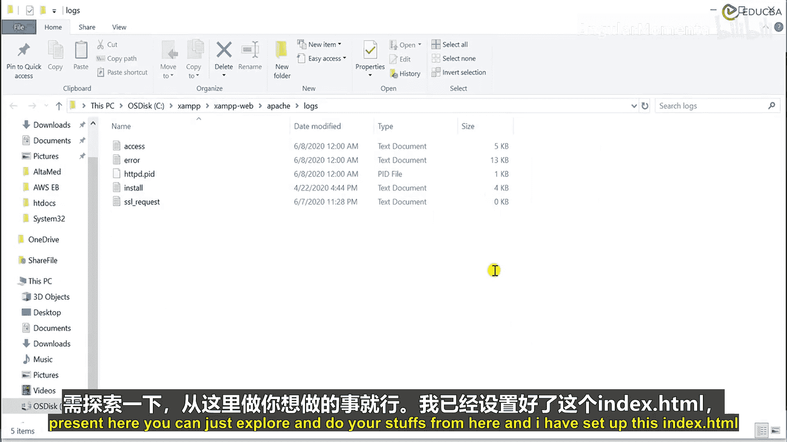
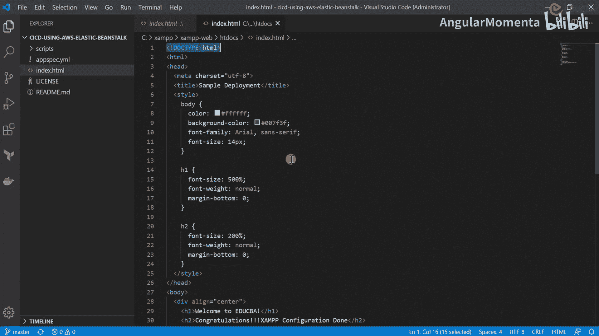
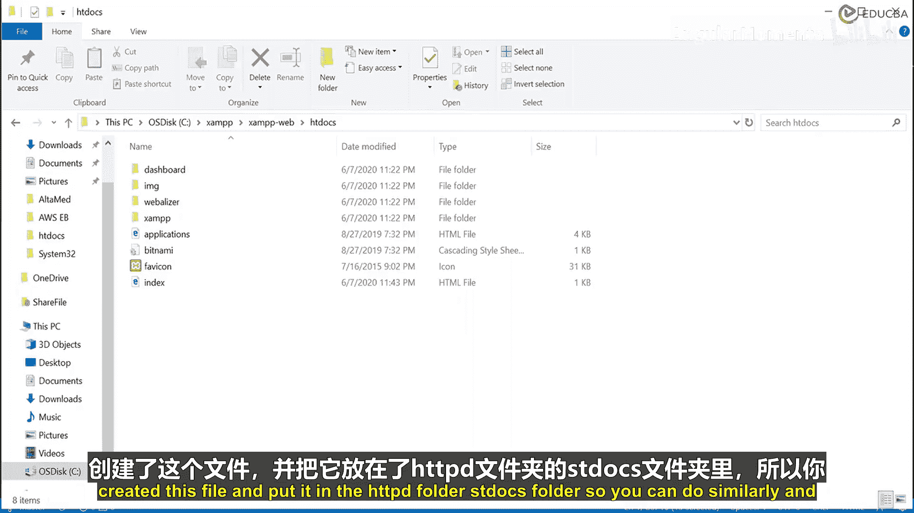
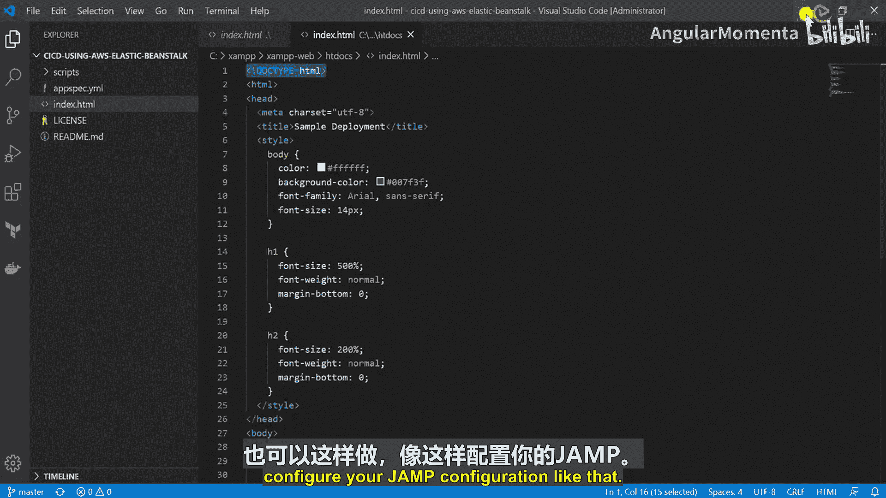
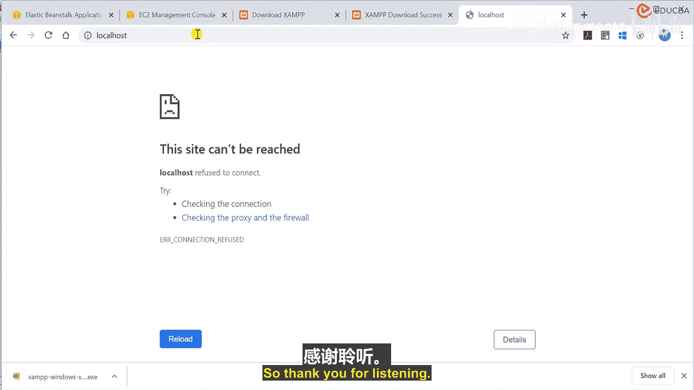

# 【EDUCBA】AWS Elastic Beanstalk与云项目的持续集成⧸持续部署 ｜ AWS Elastic Beanstalk & CI⧸CD for p03 01_01_03_开发环境配置 -BV1zXcKzNENN_p3-

Hello and welcome to this lecture in this video well be discussing the configuration of jamm server for our website。

That will will be going to configure。 So to install the jump server， you need to go to this link。

Or you can search it on Google as well， you'll find this link and you can download it from here。

 So since currently I'm using Windows， so I'll download jam for Windows， Similarlyly。

 if you want to download it for Linux， you can download it from here and。

If you want to download it for Mac， you can do it from here。

 So I already on downloaded this in interest of time。 So it's already here。

 You'll see a file like this。And the installation is pretty simple。

 You can just double click this and follow the instruction， and the installation will be complete。

 So in interest of time， I have skipped the installation part here and you can do it very easily。

 I hope so。 And once the installation is done。 you'll see a screen like this。 So you'll have。Abaji。

 mysl， filela， mercury and Tomnkat。 So all these services will be there。

 But if you want to configure these components。Well installation。

 you can skip few few things like if you just want to install a budget， you can do that as well。

If you just want to but Apache and SQ， if you have a dynamic website。

 you must have Apache and MySQl file you if you want to transfer the some files to this website that will work and that will be mostly useful for Linux websites so these things are should video so if we check about Apache because we need the Apache only for a web static website。

So we will check this configuration of this Apache。😔，So we have multiple files here。

So the first one is SttP dot com。 So this is for。Configuration of our。Our normal SDTP website。

 So we'll open it。And if you see。We have a lot of configurations， like server root， and。The logs。

 the port on which it will listen 80 and multiple things are there。 so you can go through this file。

😔，To have more insights and do。What is there in the StP configuration And you see if you want to access this server。

 you need to go to local hostt80 and similarly like you can follow these instructions and see what all the configuration files are。

 So if we want to access this website。 we need to first start the A over。

 So I'll just click on start。So it will tell me like on what ports we can access this website。

 so since we don't have SSL configure， so we can access this website on port 80。

 so I'll just go and type local host so welcome to。

And a jammed configuration is completed on basic estimate page that I had。

Inser it into this configuration。 So if I take you there。

 So this is our installation folder where I have installed this gem lab server。

And。Our web page is will decide here。And the edged dogs。So this is my web page at C。And。

If you want to have your ownest page， you can just develop it and put it here So this was from the development perspective and the multiple configurations as well like if you want to check the logs。

 you can go here。And access your logs。These are the logs， like。From where you have access the sub。

And all the details like has been done。And then in logs itself， we have error log as well。

So what are the error logs。So。Multiple things are there like a warning process ideas。

Server certificate does not include an ID match， which matches the server itself。

 multiple things are there。 So since this is a very basic website， simple website， static one。

We don't need to configure much on that part。But if we want to do this in production。

 we must take care of the SL part and configure our servers accordingly。 So if you see the path also。

 it's mentioned here。So when we start the Apache service， basically the STTPD service started。

Just to tell you， so if you want to start this service Apache on the next machine。

 you need to start this atPD service。Since we have got a beautiful panel like this to control everything。

 we can do the start and storm operations from you。 Now。

 there is a net stand configuration that we tell like what is the bold and process Id。It other。😔。

Used， so you can check that as well from here。 A new socket， active socket， old socket like its。

The all this beautiful information is present here。

 so you can just go and check it herepart from that。 theres a shell。

 if you want to configure something or run some command from shell。😔。

Prompt you can do it from here。Then， the explored one。I will take you to the。😔。

Fileles and folders and configuration settings directly。Then you have the sizes。

It will take to the services， when。Where you can search for the services。

Like if I want to search for Apache or any other service。😔，It should be somewhere here。

 I'm not finding it right now。But it must be somewhere。 So all these things。

 like if you want to create the panel， you can do it from here。 So all these things are present here。

 You can just explore and。Do your stuffs from here and as of this index rotation testeml。

Create this file and put it in the STTP default ST docs folder so you can do similarly。

And configure your jam configuration like that。 One morning I would like to tell you need this Apache service running for this website to work。

 So since right now it's running so we are able to access this website。

 but what if I stop this So let me stop it you can see the service is now stopped status chain detector stopped and if I try to access this website。

 we can so。

Apache service should be running。For this our website to be ready。So please keep that in mind。

 So thank you for listening。

