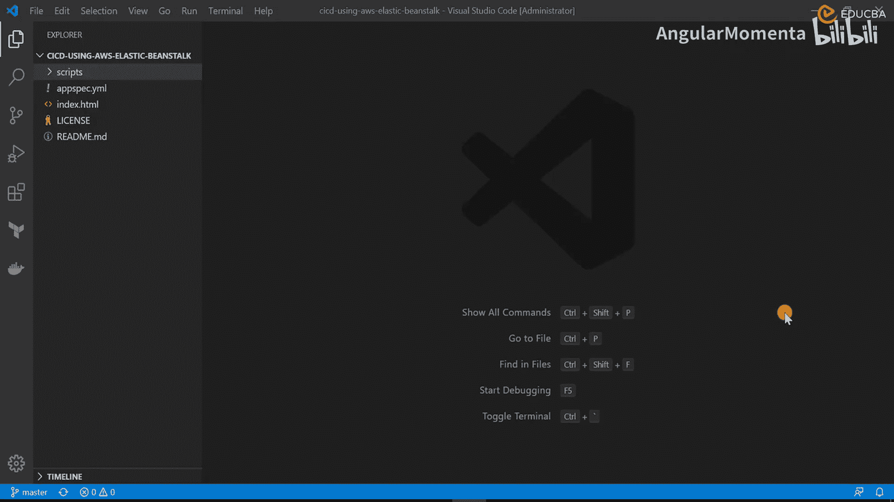
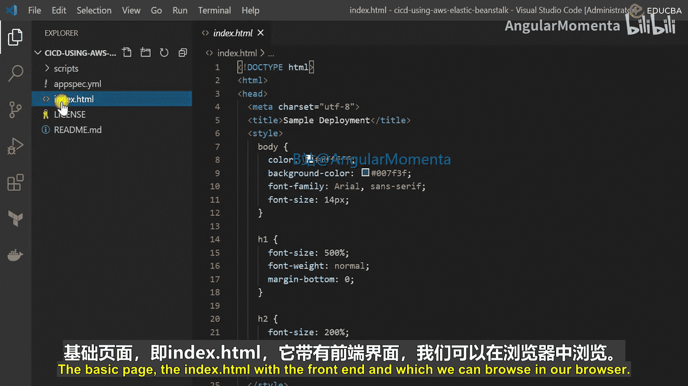
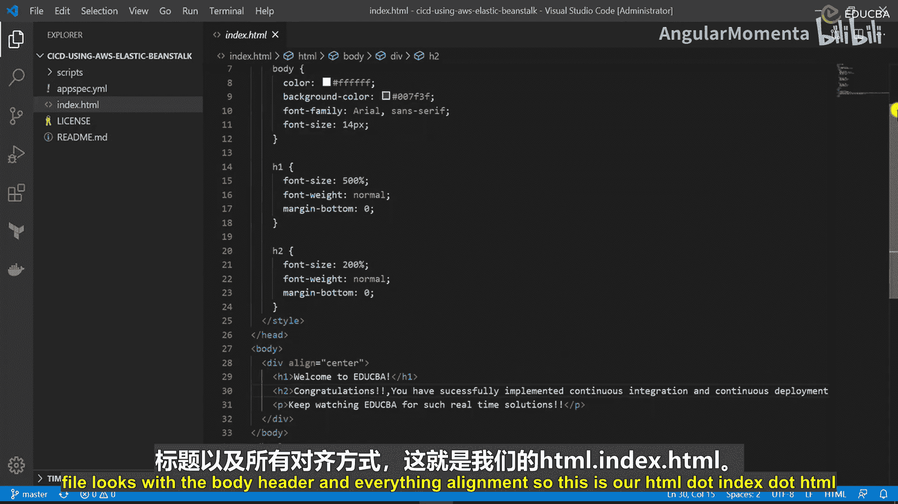
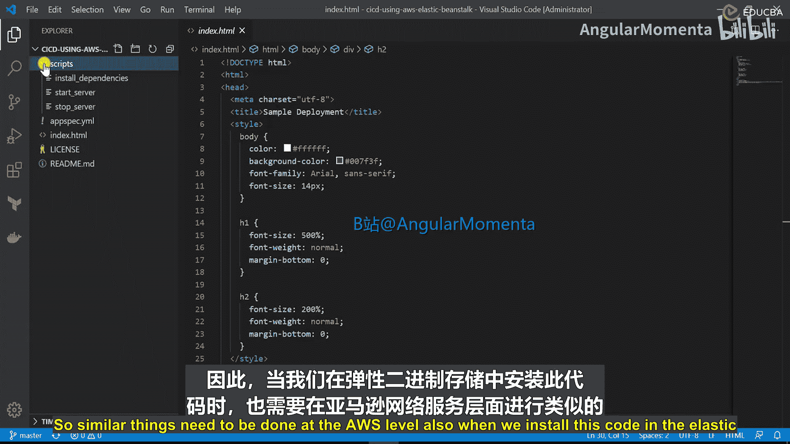
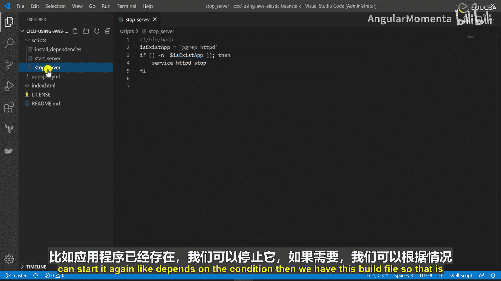
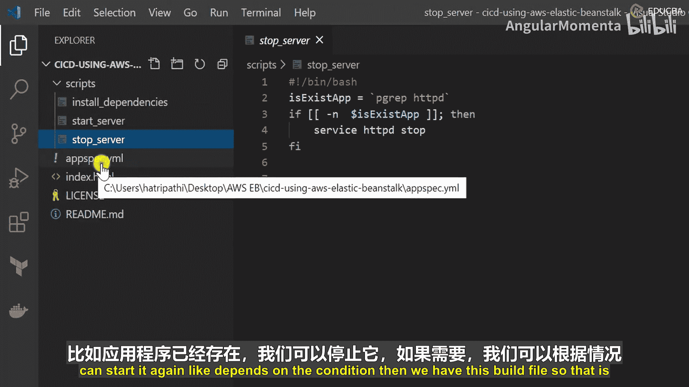
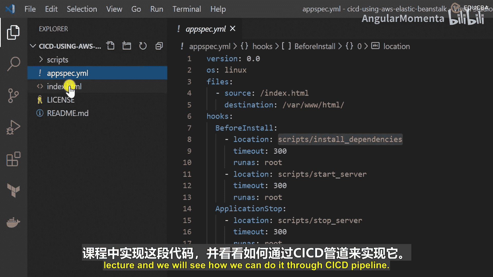
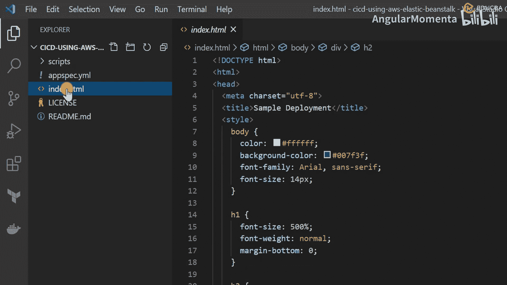

# 【EDUCBA】AWS Elastic Beanstalk与云项目的持续集成⧸持续部署 ｜ AWS Elastic Beanstalk & CI⧸CD for p04 01_01_04_构建与配置文件 -BV1zXcKzNENN_p4-

Hello and welcome to this video in this lecture， we will be discussing the code which will be going to deploy into elastic Be stock using continuous integration continuous deployment。

 the basic page， the index taught estimateim with the front end。

And which we can browse in our browser So that I'll discuss first， and then I'll。

Discuss some of the scripts and the configurationation files。

Which will be used apart from this main indexestimal file。For the deployment in El wind store。

So if you see， this is an index STl file， and we have a。Headed here。And with the name。

 simpleple deployment。And we have used the body， and we have done。

The configuration of the body like color and background color font family font size， everything。😔。

You can replicate similar thing for you as well。Are doing the similar kind of。Coding。

And then we have this header file。With a font size。5，500%。

Fund weight to a normal and margin bottom to be 0。So this is one of the header。

 and then we have second header。With the font size of 200% font weight normal and margin bottom zero。

Again， the body， so。I have like a written or agenda in the body。Like welcome to AUCVA。

 thanks to them for organizing this tutorial。And then， we have the。

Message like congratulations you have successfully implemented CCD and keep watching AUCV for such real time solutions。

So you can edit these things and you can put whatever you want。As per your wish。 But this is how。

Ouresttl file looks。With the body header and。Everything， alignment。

So this is our HTML do index of HTML。Apart from that， like when we。

This file need to be installed on some server。When we do a CAD。

 it will go and it will install on some maybe Linux server。So we need to make sure。

 after this installation。Few command should be run， like we see in the。

Previous video that we installed the jam and we configured a website。 We started the Apache server。

 After that， only we were able to access the website。 So similar things need to be done at the。

AW level also， when we install this code in the plastic windstorm。

 So to make sure that we will install the。

Depenencies。 So as I said earlier， for StTP website。

 you need to have this StTPD service that is another name for Apache should be running。So。

 we will install。This as a dependency。Along with this code。So the command is before you， you install。

Iyon y that is stand for years。 And then S Tbd， that means aba。 Then we have the start server。

So that is again， like when start this SDTPD service and then。We have this stop server。

 If something happens， like if the app is existing， preexisting， we can stop this。And then， we can。

If needed， we can start it again。

Like depends on the condition。 Then we have this build file， So that is F dot VMl。

So this file tells like what things need to be done in what sequence。So if you see the version here。

Version we have mentioned0。0。Os Linux and the files。

 the source file will be indexed at HTML that is directly under this。Aripo repository。

And then it will be put into the destination， this one where www dot。And then， a stable。

So this will be the destination it will copy the file to here and then。We have hooks。

 like before install。The dependency should be running。That A patchache server should be started。

And then。Oh， if。The condition satisfies we need to stop the Aches over as well。

 So this is how our code looks like。And we are going to implement this code。

In the coming lecture and it。See how we can do it through CSCD pipeline。

So thank you for listening。

