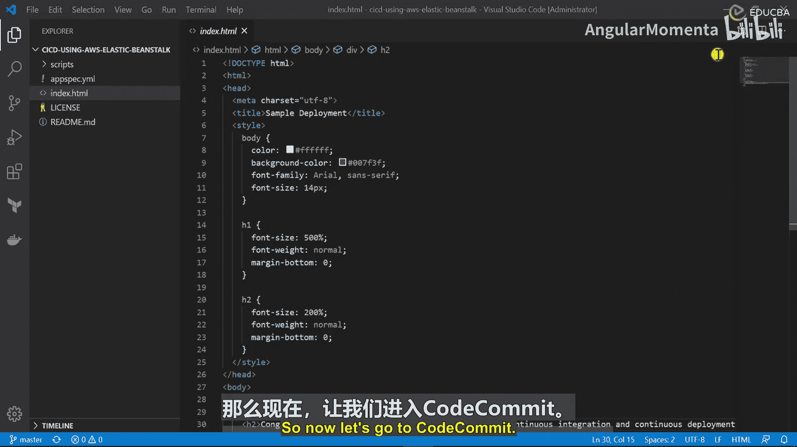
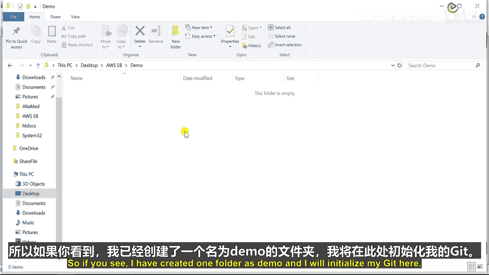

# 【EDUCBA】AWS Elastic Beanstalk与云项目的持续集成⧸持续部署 ｜ AWS Elastic Beanstalk & CI⧸CD for p05 01_02_01_配置Git -BV1zXcKzNENN_p5-

Hello， and welcome to this lecture。In this video。We will be resetting up the first component of the CD pipeline。

 That is AWs code commit。 So we need AWS code commit for source control。

 and AWS code commit is a fully managed source control service that host secure Gipa repositories。

 So now since we are done with the coding。 but we have the code Le， we want to check in this code。

To AWs code commit。 And from there， it will be taken forward to the court pipeline。And finally。

 it will be deployed on plastic binstone。 So to check in this code will be needing A code commit。

 So now let's will go to code commit。

You can search this service from here。And we'll find it。So I've already searched it。

 So it's in my history。And I will create a repository right away。

Some give the name to the repository as。Vb， verable， and。Description as。C AD demo。

 And if you want to add some tags， you can add it to you。

And we don't need this enable Amazon Cloud Gu reviewer for Javava。

 So that is not required it's a PhP project。 So I'll just go and hit the create button。So， finally。

 our code。Repo in court commit。Is。Then now to access this codere， we have multiple options。

We can use STJTPS or SSH or this new feature STJTPS GRC。So we'll stick to SDDbs in this case。

And there are some prerequisites。Which need to install。

 The first one is you must use a git client that supports kit version 1，7，9 or later。

To connect to Is court commit revository。So you can go to this link。And download。The girepo。As perto。

Operating system you are using。So I'm using Windows right now， So I'll just。And download it。

And it will take some time to download。And then， you can install it。As for you。

 So since I already have on gi on my systems， I'll not install it。Download it。

 You can do it for yourself。 It's pretty easy。 Just X file need to be executed。

So once you are done with target configuration， you have one A code commit managed policy attached to your Iam user for the permission。

So if you want to learn it， how to create this。And configure this I am user。 You can just go to this。

And。Read this con part。How to do that。But I can show you right away， like how you can。Do this。

 So I'll just go to I am， and I will go to。Users。So。I have already attached this policy。

 A code commit power user。 But if you want to do it for yourself， you can go to。Add permissions。

Go to attach existing policies， and you can search for code commit。

 since I already attached the power user policy， Its not showing me here。

But you can go for code commitful access to that will also do your job。

 So this is how you can attach the policy to your current user。

 And then we can proceed with the other steps。 So it is already there。 If you see， I have gi past。

So currently it is located here。 she uses so not。I will change it to some parts。But before that。

 I will need some credentials。To connect to this court commit repository。So， I have created the role。

Now， I need to generate this。S to T P get credentials。 So now I will go to。My user role。

 which is already here。And I'll go to security credentials。And。I have one code already here。

But to show you， I can generate credentials one more time。 So this is my credentials。

 I can download it here。And I need to use these credentials to connect to this repo。 So similarly。

 you can also generate and download it and you can use it further。

 So since I have the credentials now。I am good to configure this。

 and Im good to clone this code commit rebel。So I just go to this raport。By the name， Varepo。Yeah。

And I will try to。Cown it。So I have just copied the location。But before cloning， Ill。Just。

Create a new folder for this project。And I will get into that folder and do the gi initialization first。

 So if you see， I have created one folder。As demo。And I will。

Initialize my get here。