# 【EDUCBA】AWS Elastic Beanstalk与云项目的持续集成⧸持续部署 ｜ AWS Elastic Beanstalk & CI⧸CD for p06 01_02_02_AWS CodeCommit 代码仓库 -BV1zXcKzNENN_p6-

I'll go to this location， and I'll。

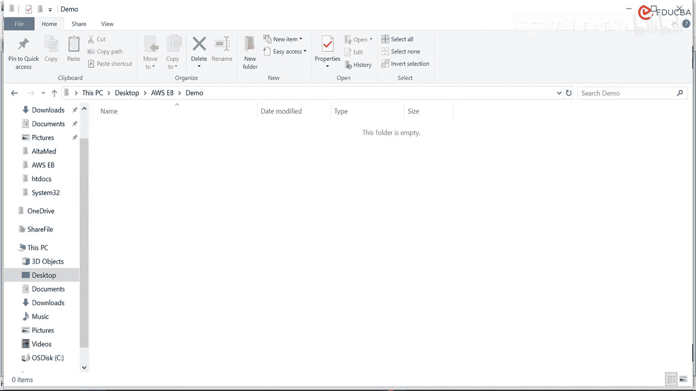

Yeah。Can need to put double coats， because there is a。唔嘅。All seems some issues， too。

So I have created a new folder。And I will go from this location to。Do that follow。

So the folder name is demo SD。I'll just go to this folder， and then I'll do。Get initialization。So。

 firsts of all， I will initialize the。Get depo with。Get in it。 Come on。Yeah。Also， it's done。

 The initialitation is done。Then I need to configure the gi。lebel。With some first name。

 last name and an email address。 so that。It identifies who is checking the code。So， I will configure。

It convey。Global user name。As iduc Cate training。So let me click enter to configure this。

So it's done。 Similarlyly， I will configure the email for unique identification， so。

I will give this as AUCV and。Dot com， so。Email configuration is also done。

Now I clone this code committee reportpo。

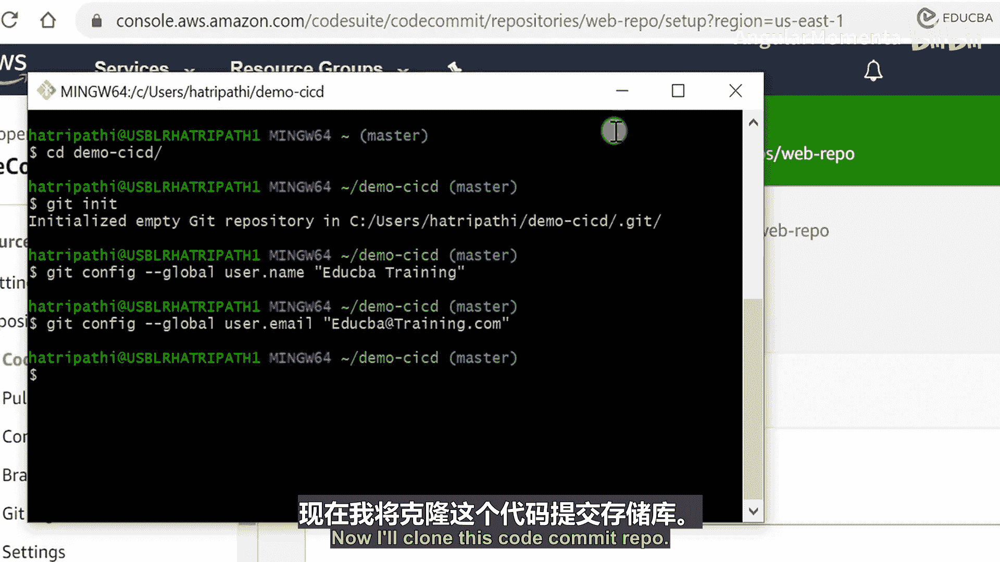

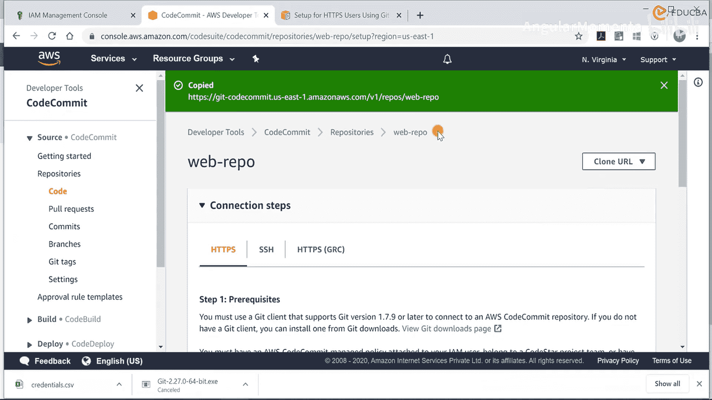

Which I have copied earlier。 Let's see what， what is happening。

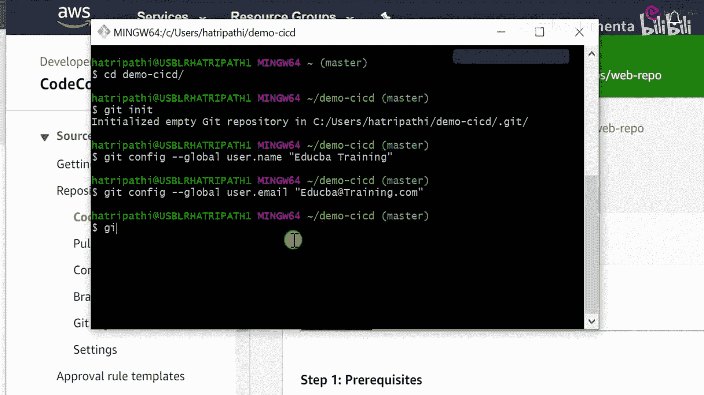

Get clone。I'll paste the URL， see。

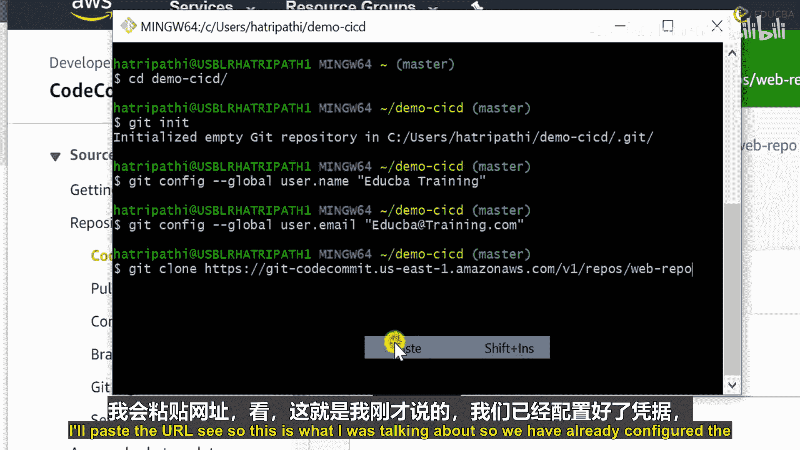

So this is what I was talking about。 So we have already configured the credentials。

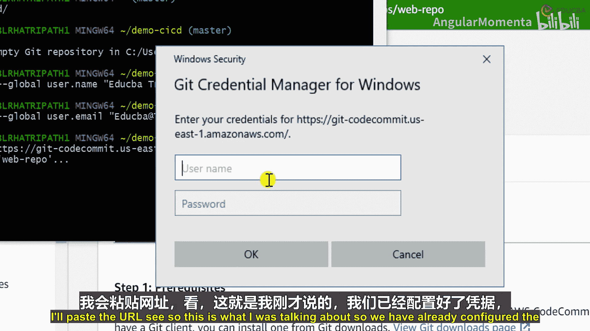

So I'll just enter those credentials here。So that I will be able to clone the repo。 So this is the。

 this will be the password， which shall be entering。Okay。Now， let's see what is happening。

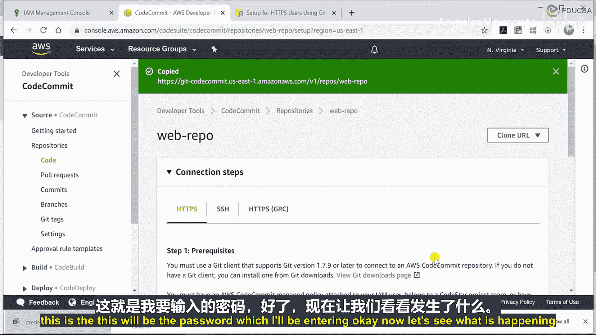

Okay， so finally， we were able to。Cown the repo。And the warning。We have got this。

 you appear to have cloned the empty repository。So thats fine。

 like we have not entered anything into that repository。

So that's fine we were able to authenticate to the rappo。 that's the good news。Now。

 I will check the gi status。So， nothing is still。Right now。

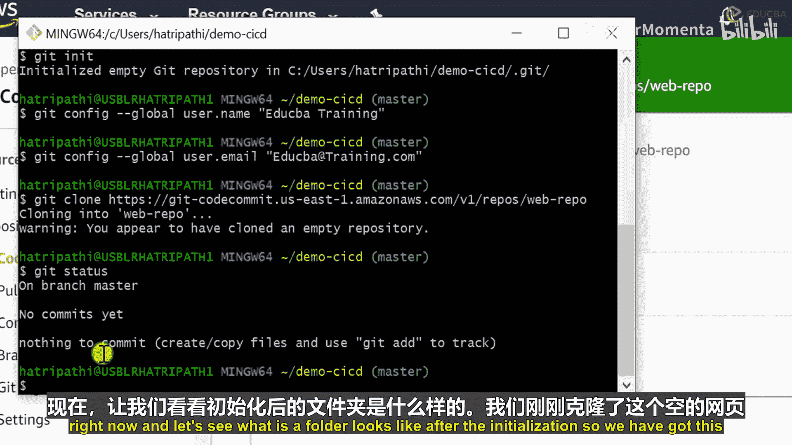

And let's see what is a folder looks like。After the initation。

So we have got this vbrapo empty folder cloned。Just know。And now we will put some code here。

In this level。Soll go to my arm。Courd section。 I will copy everything。And I will enter these courses。

So now I will add this code。To my web repo。 So this is the code we are going to implement through CSCD。

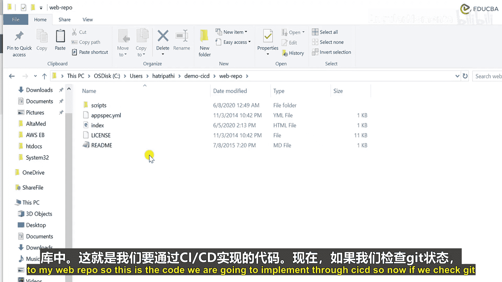

So now， if we check， get status。We'll get the whole depot。To be。对。Compte， so again， we will go to。

Vebbrapo。And from there， well do get status。So these files need to be。Added for。Commit。

 and then they will be pushed to the origin。So。I will do a command gift。And。

And let's see what is happening。Okay， so I need to enter a doort。

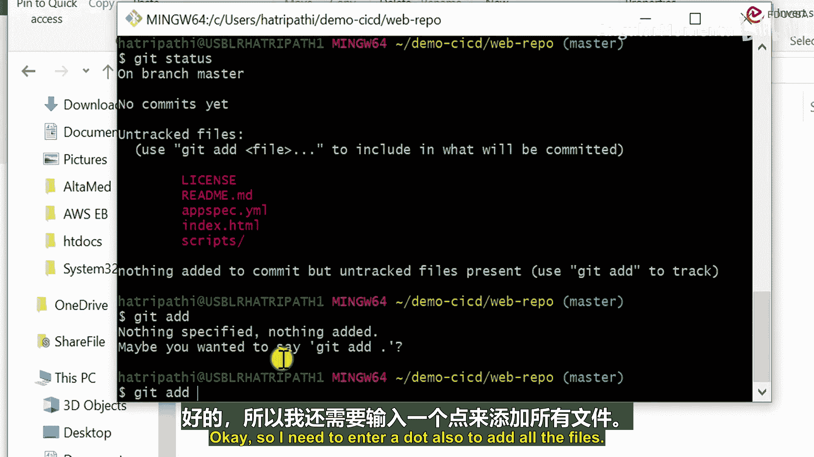

Also， to add all the。Files， so now， if we check get status。I's see。These。Other files。

 these are the changes that need to be。Mid。So， now， I will get。Commit。Everything with message。

Uplaing。Yeah。This。Tice。

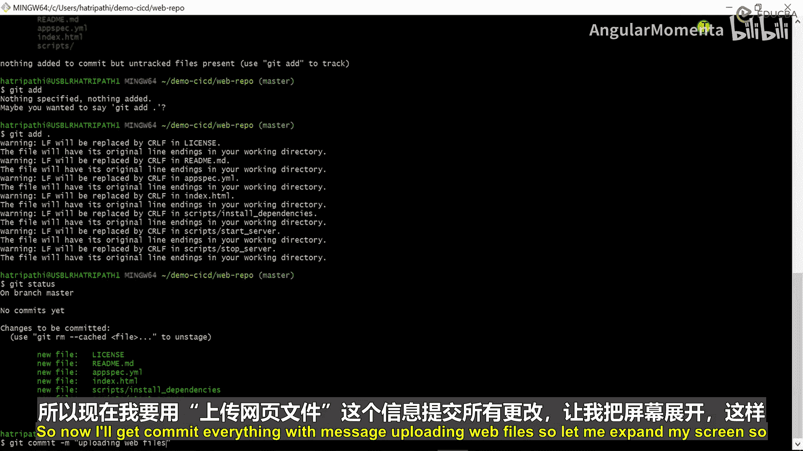

So let me expand my screen so that you guys can find it。

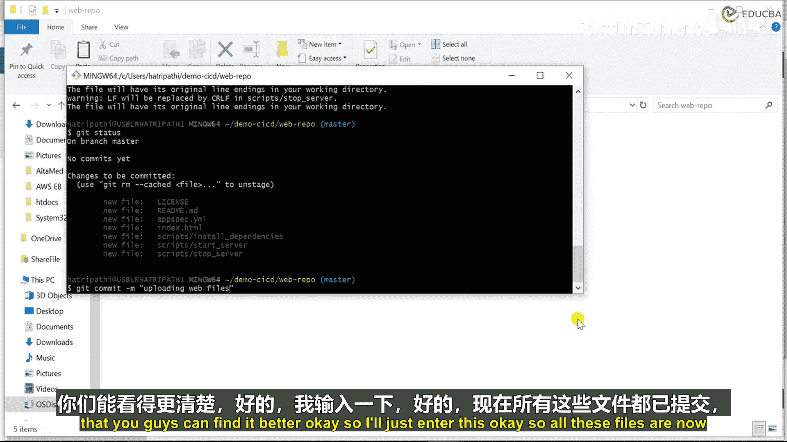

Metter。ok。So， I'll just。En of this。Okay， so all these files are now。Committed， now， as you see。

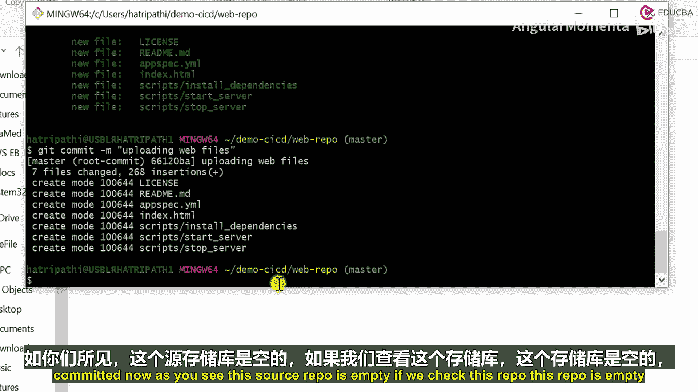

This swordrepo is empty。 If you check this repo， this Rabo is empty。 There is nothing。

 no files are there。

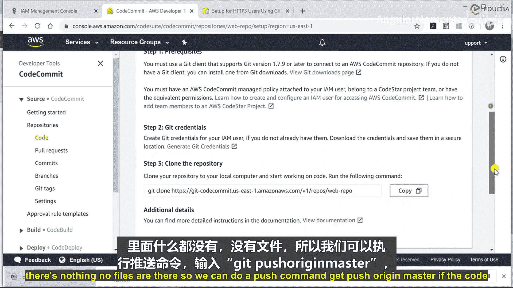

So we can do a push command。唔见。Push origin。Master。If the code is getting pushed to AWS code commit or not。

So we have entered the command and enumerating object Jacktenon。 O。

 I think it has pushed the court to。

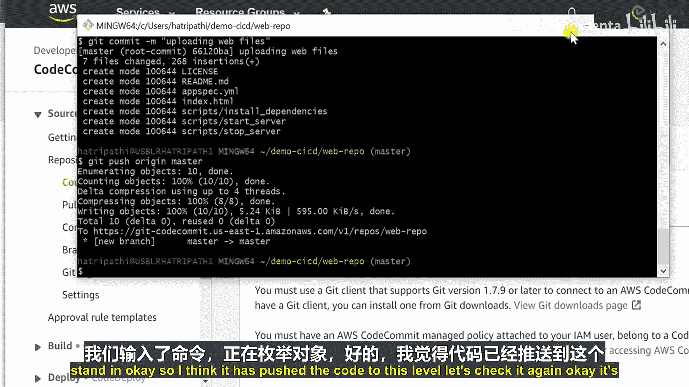

This rebel， let's check it again。Okayk， its turning last modified1 minute from now。

 Let's see if those files are。Preleasent here in the code section。Yeah。

 so all those files are now pushed to。Courode commit。 So a job for。Pulling the rapport。

And pushing it to again， to I court commit is completed here。So I hope you must have enjoyed this。

Part， so thank you for listening。

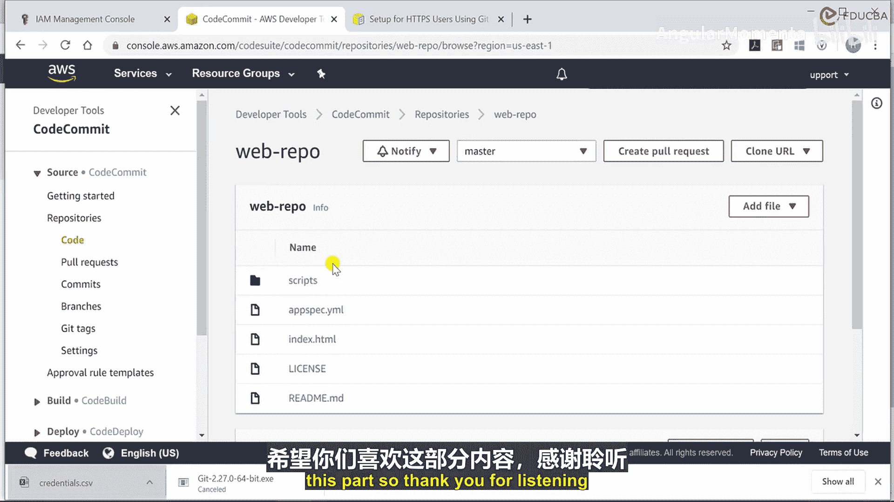