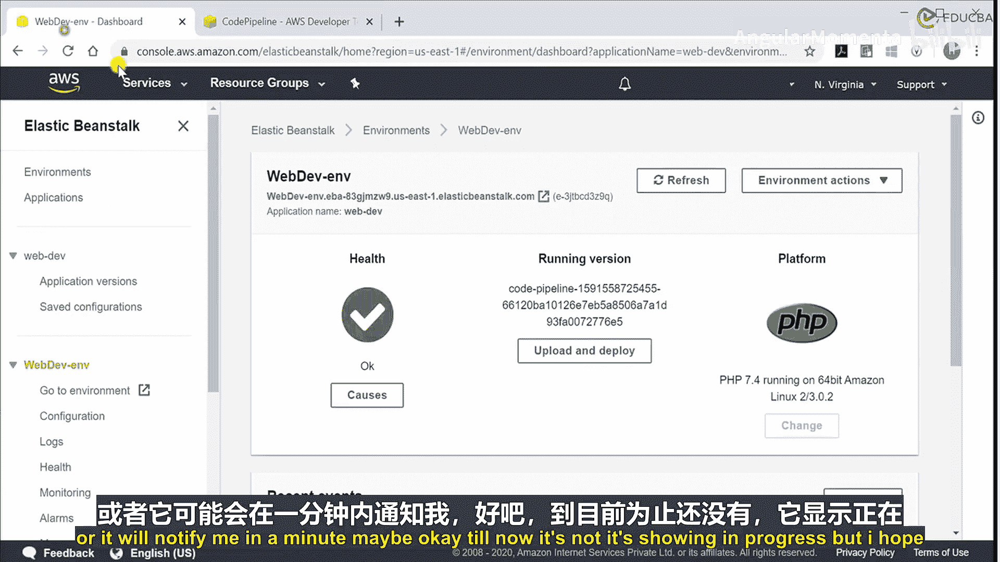
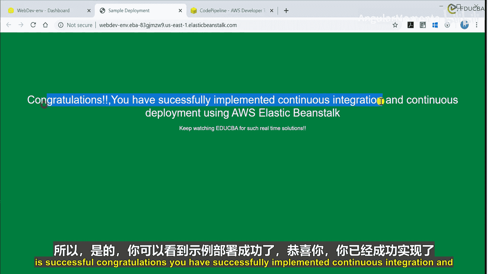
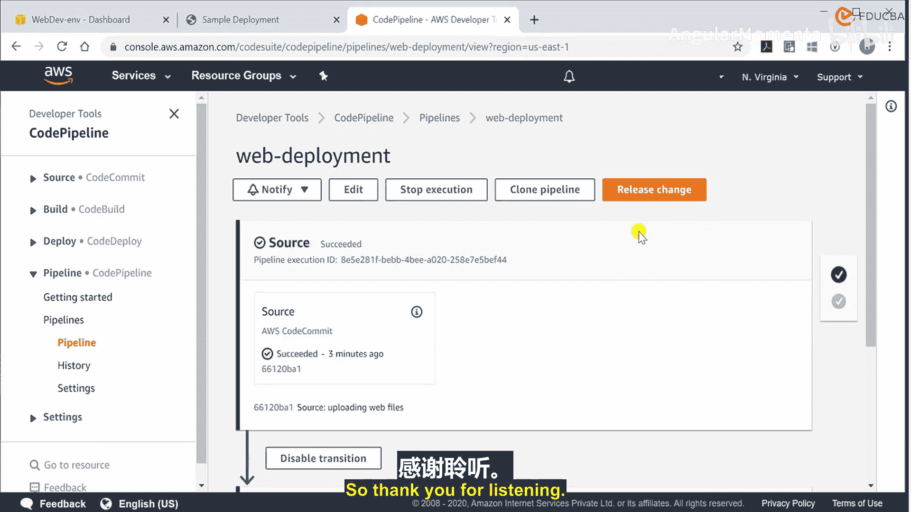

# 【EDUCBA】AWS Elastic Beanstalk与云项目的持续集成⧸持续部署 ｜ AWS Elastic Beanstalk & CI⧸CD for p07 01_02_03_代码流水线配置 -BV1zXcKzNENN_p7-

Hello and welcome to this lecture。In the previous lecture， we have discussed how to configure gi。

And how to commit your code to AWs code commit。 And we have pushed our code to this AWs code commit Repo。

So we have all the files ready。To be built and deployed into one of her environment。So now。

They will create。Pipline to deploy our code。So， I will search for。Good pipeline。And I will create a。

Fble。I'll name it。That。Deployment。For the service role。I will create a new service role。And actually。

 it will be done by Aws itself。You just need to check this box。

 allow its code pipeline to create a service role so that it can be used with this new pipeline and then you can if you want to do some advanced settings。

You can just go ahead and do those。But I will keep it default， it will create a default S3 bucket。

Forral artifacts。And it will use the default E scheme management service for encrypting the data in the arts too So keep these things by default。

And I'll proceed to the next window。So now it's asking for the source word。

 So what will be the source of our code。 So since we have。Deposited or code in Aws code commit。

We will select as code commit as a source， So now it will ask for the details of the reportpo。

So we have only one repo Web repo。We have selected that。

 and we have only one branch that is a master branch。 so we have selected that as well。

And now we have two options， so choose a detection mode automatically start your pipeline when a change occurs in the source code so we can use a CloudWch event to check whether some code changes ads happen。

And we can initiate the pipeline， or we can or the a code pipeline to check periodically for the changes。

 So I will go with this option。 So as soon as we check in the code to。Eedddleless court commit。

The pipeline will automatically detect it， and it will restart the deployment。As soon as possible。

 So now。If we want to build our code， we can。Selectto。

Bill tool so in this case you can select it is code build or Jenkins。

 but since it's a basic static website， we don't need a bill tool here。

 so just skip this so it' is giving me a warning your pipeline will not include a bill strip so we are fine with this we will skip it。

And then for deployment， it will ask like， where do you want to？Deploy your code。

 So since we are using elastic bin stock for deployment， I will select the same。

And the region will be same North Virginia， because I am currently using that only。

And all our resources are in North Virginia region。Now， for this elastic windstorm。

 we need to select the application name as well。So， we have web depth。

As a replication name and web dev E and V as a environment name。 So we'll select those and then。

We can move to the next page。 So this is how the final draft look like。

So you can review the settings and you can see if whatever the details you are mentioned。

Is correct or not。 And then you can confirm the。Pipline station。 So I'll just hit K pipeline。

And it will start creating the pipeline。 So I'm getting a success message that it successfully。

Created。Now， if I see it， it has already detected the code and from code commit。

 and it is successful。 And now it is deploying the code in elastic bint。 So if you remember earlier。

 we had a sample code in elastic binstorm， if I can show you here。😔，And then， we can just。

Identify the changes。 What is happening。So， this was the original。Page that was from Aws。

 which was getting deployed， but。As soon as this deployment is completed。

 if you see the deployment is going on。From this code pipeline on El windstorm。

So as soon as this will be completed。We will see a different web page altogether。 select me okay。

So it's successful， seems。I'll just refresh it， or it will notify me in a minute， maybe。Okay。

 till now， it's not。 It's showing in progress。But I hope since the health is looking good here。

 it should be good。 So yeah， you can see the sample deployment is successful。😔。

Congratulations， we have successfully implemented continuous integration and continuous deployment。

Yep， so now it's also showing the。Deployment is succeeded。So we are good， but to。We are good here。

 So this is the code pipeline。If you want to do some configuration changes or settings。

Or you want to see the history。You can see it here like this is your pipeline details。

 If you go to this pipelines， you'll see your web deployment pipeline。

 Then if you want to check the configuration， you can。

Do it here and then if you want to do a check what is a history like what are things which has been completed and whether they have failed or succeeded。

 you can check it in the history and if you click on those links you can get the details as well。😔。

Like what was the source and where was it deployed。And you can do a visualation as well。

Like how it went。So everything you can just you can see the revisions like home。

 what is the revision number that has been deployed。😔，And then you have settings options。

 what all things you can do and where is your artifact stored。

 so currently the artifact is here in S3。As we discussed earlier well， we were setting it。

 and then this is a service role err， which was created for us， this is pipeline Aaron。

 so everything looks good。So this is notification。 we have not yet set it up and if you want to put some tags。

 you can put it here。 So overall this looks good as of now we have configured the source。

 we have configured deployment。😔，And the pipeline is set up completely。

So thank you for listening in the next upcoming lectures。

I will configure the notification so that we can get a mail as soon as some deployment is happening and it will be very helpful for us to know what is going on in our AWS environment。

So thank you for listening。 Have a great day。

