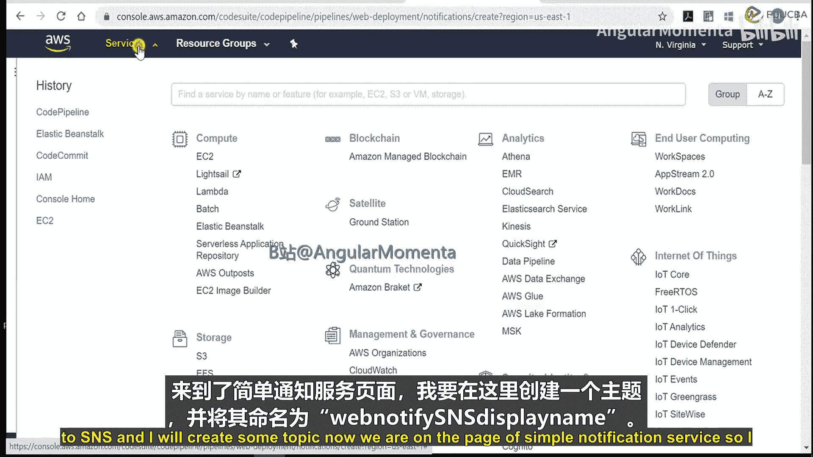
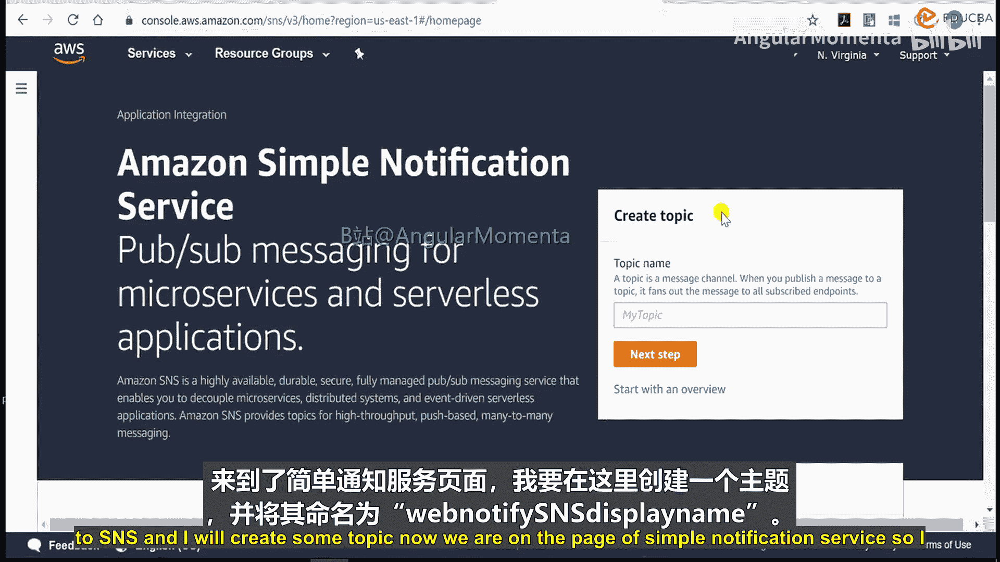
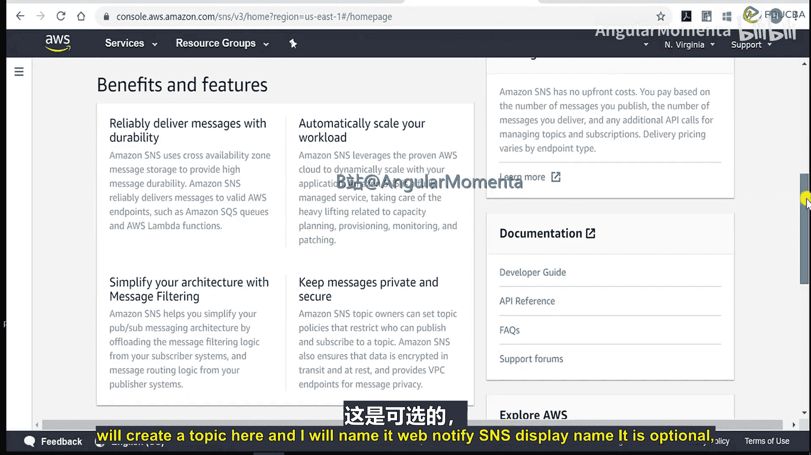
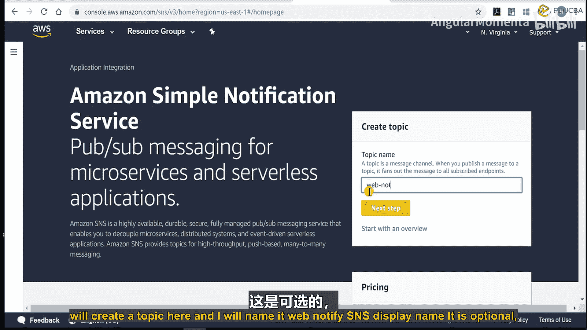
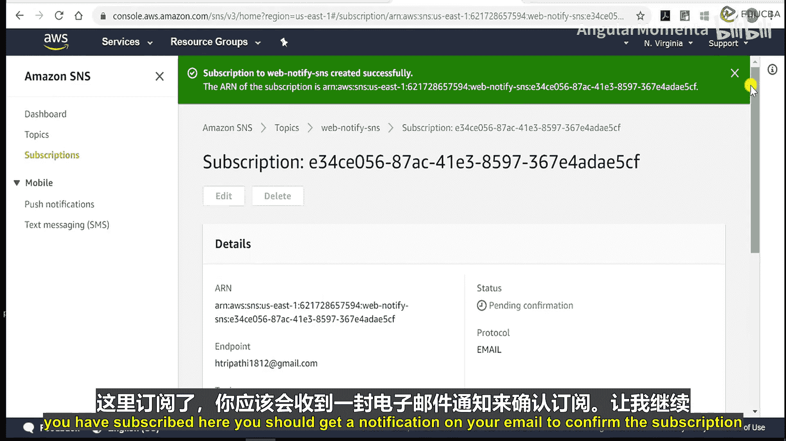
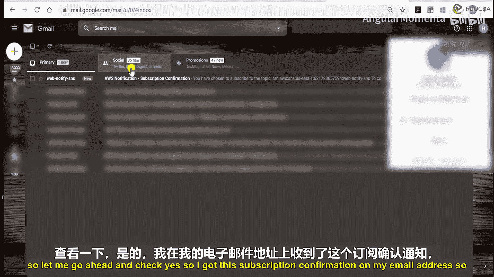
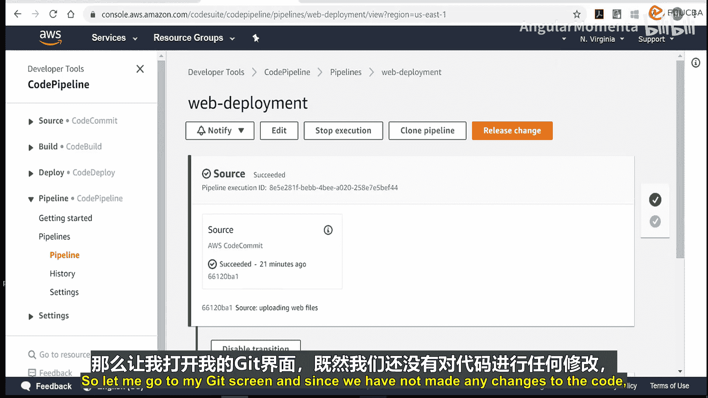
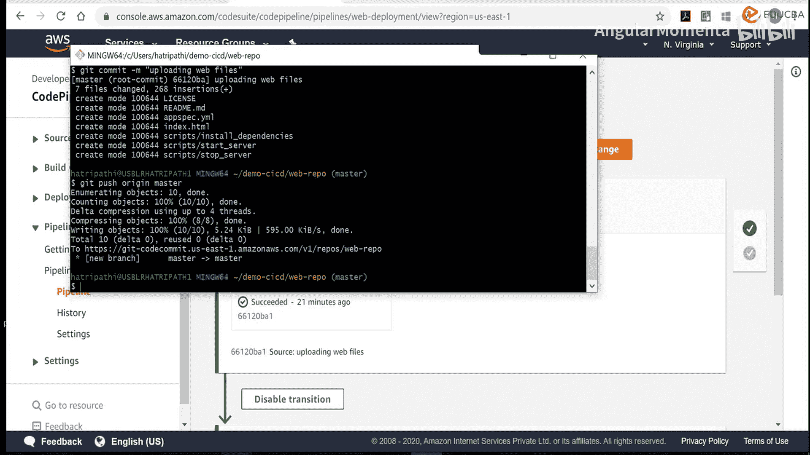
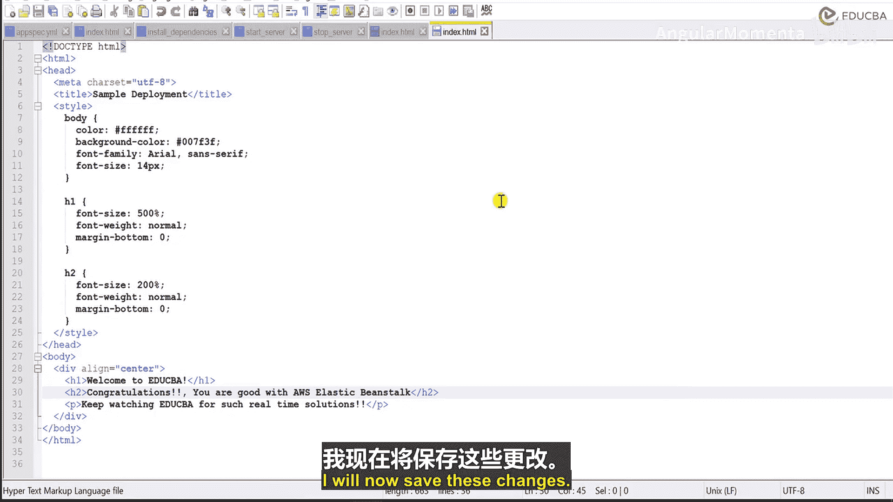

# 【EDUCBA】AWS Elastic Beanstalk与云项目的持续集成⧸持续部署 ｜ AWS Elastic Beanstalk & CI⧸CD for p08 01_02_04_部署通知 -BV1zXcKzNENN_p8-

Thenearn， welcome to this lecture。In this video， well discuss how to create notification for alerts。

Through S N S， so we will configure some notifications。

 which will give us some alerts in the form of mail through notification service。

 like S N S Simple notification service in the previous video we have discussed how to integrate。

Your source code。In source repository like Aws code commit。And apply that in。

Aelless elastic gainsstock。And we have configured this pipeline to do such。And as you see。

 like it was successful， this is a source reppo。It was good commit。 And this is the deployment part。

And deployment was in it ofs elastic beans stock。 So these two things were covered。

And the previous video。No。We want that。When the deployment happens， whether it's successful or not。

 we should get a notification， or if some activities like checking of this code and these things are happening。

And it transitioning to next stage， we should get。notification mail for that so that we are notified what is happening in the AWS infrastructure to do that。

 we will create the notification。So， there is option。And the。Cote pipeline。And。In our pipeline。

 we have created web deployment。 We have an option to create notification rule。

 So we will click on this notification rule will。Name it， give it some name， web notify。

 and we will choose the level of details we want。 So we want full details。Like what is all happening。

 And then some of the notifications， which is already mentioned here。Like actionary execution。

 like succeeded， failed cancelled started and stage execution， like started succeeded。

 resumed called， failed， and similarly the pipeline execution failed cancelled started。

 resumed succeeded or superseded， and similarly the manual approval。So。These。

 this manual approval part we will create later in this course。

 but as of now I'll select everything so that we will be getting notified for whatever the actions we are doing Now we need to create a target for that so we have option create a target to use specifically for this notification tool so as as topics created as target have no subscriber。

 but have all the policies apply to act as a target notification so I will create some SNS topic for this as a target for the notification so currently there is no。

As this topic created。 So I will go andll just duplicate this page。

And I will go to SNS and I will create some topic。 Now we are on the page of simple notification service。

So， I creatorto。

Topic here。 and I will。Nam it them。Notify as。

And display him。It is optional。But I'll give the same name here as well now we have certain features which if we want we can enable so these are like encryption so currently it is not very confidential information so we can just leave it like that but if you are doing this in production environment。

You can consider to enable encryption。 then the excess policy。

 like what is the policy you want to give to everyone。 So if you want， just。

This policy is to be stayed with。The topic corner that will be the ideal condition。

We should not allow everyone to see what we are publishing， so well keep the default settings here。

 and then there is a retry policy like how you want to retry this。

 so number of reres configure to3 with a delay of 20 seconds。And maximum delay should be 22nd。

 So in case our masses is failing。It will re three times after a delay of 20 seconds。 Then again。

 we have delivery status logging。So if we want to log the messages。The status。

 like whether it is getting delivered or not， or is it failing， we can enable this feature。

 But as of now， it is not so important so we can just ignore that。

 And then there is an option to create。 I am rule for S N S to require permission to write logs to Cloud watch。

 so。This will leave it as default and then tax， as you know， like。

 if you want to manage your resources， you can put tags here。 but as of now， like。

 we don't need that。 So we will go ahead and create this topic， so。😔，The as topic is created。

Now I need to create a subscription as well， because we need to mention the email addresses of people who needs to be modified。

😔，Usually。In production environment， their managers or deemed leads are the person who is doing the job。

 they are the people who need to be notified， so I'll select the protocol as email。

And in the endpoint。I'll give my email address。 make sure your email address is correct。

 And then there is a filter policy as well。What do you want to filter。

 So if you have something particular to that， you can just do that。And then。Retri policy， quas。

Dabled。 so in if you are enabling this， the masses will be delivered to dead letter Q。

 So it will be undelivered message。 So if the message is not。A getting delivered to the recipient。

 it will be sent to that queue。 So we are finding with this like。

 we will create the subscription here， and it's created。 So once you have subscribed here。

You should get a notification on your email。

To confirm the subscription， so let me go ahead and check。 Yes。

 so I got this subscription confirmation。😔。

On my email address， so'll just confirm the subscription。So it's good Subscript is confirmed now。

Whatever the changes that will happen。On this pipeline， let me go there。

 And now I can select the target。As a， let me refresh this， when we。I left it open。

 and then created this。So， it's not。Taking the target name， scientist。

Copy the name of this notification tool， and I'll come again。

 I'll again create the notification tool， give it the name The details will be seen as earlier I'll select all。

Notification services。 and on the topic， as soon topic will be there。 and now it's popping up。

So I'll just select this and submit it。So the notification rule has been created。 What I will do。

 I will just。Make some changes to the code。And I will see。Of once the court is checked in。

And getting died。Are we getting the notifications or not， So let me go to the mygate screen。

And since we have not made any changes to the court。Will， first go。

And make some changes to the court。 I was into this Webrepo。

Ill look in this index file。And I'll make some changes。I congratulations。You are good。Vnt。

A ofs elastic windstock。I will not save these changes。

