# 【EDUCBA】AWS Elastic Beanstalk与云项目的持续集成⧸持续部署 ｜ AWS Elastic Beanstalk & CI⧸CD for p09 01_02_05_部署持续通知 -BV1zXcKzNENN_p9-

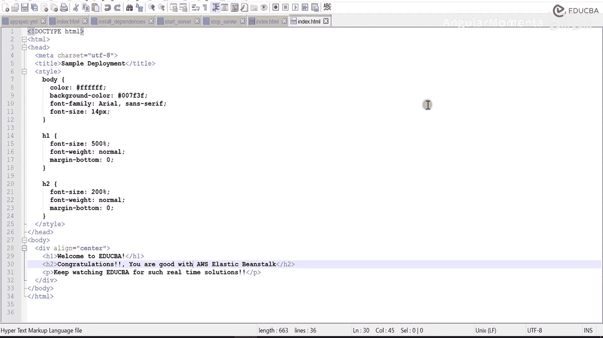

Now， let's see if we are doing now and just go to this did。

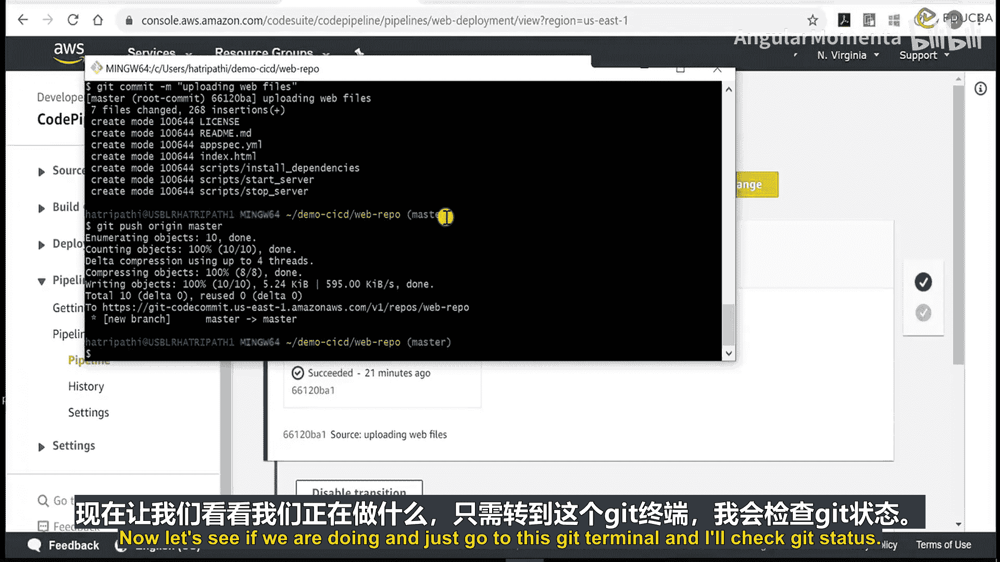

Donnelly。And Ill check its status。So see if it is telling that index rotation is modified。 Now。

 I need to commit this。Good。And then I need to push it to a wless court commit。I'll go again。

 and I'll。Saying it。Comit。I'll give some message， updated index， taught S M。So。

This code is committed now， indexed to test。No。Al。Push this code to。

Master from master to origin theory。 So get push Or master。 Okay， let me check。

What is the problem here， So it seems like we have a just。Given get push， we have just。Committed。

We have not mentioned the five yet， so。We have to mention the file lymph first。

Gt commit it index next S Tl。And then， we can。Oh。Push it。 So I have just updated my command。

 get commit index on S Tl Iphonem update S the index process。 So that is the comment。

So here M stands for a message， so it will not take the commit without message so make sure of that you are adding the message with the commit。

Sn。Since I have committeded it。Now， I will。Do get， push， origin。Mustster。See， so now it's up up。

Notading the code， Aless code coming。 So if you see here。

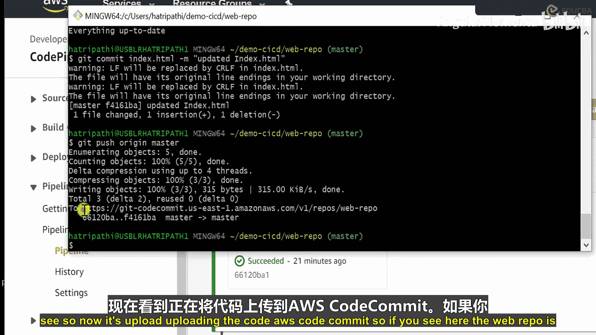

The webrepo is updated。 Now， let's go to the pipeline。

So it's currently till like 21 minutes before we have。Un did up。Check in， but。It should be start。

 It should start the checking right now because we have pushed the code to。😔，He of the court come。

 So now， if you see。The statusus is changed to1 minute from now。That means。

 and we have got the message updated indexed taught Timil。

And the message we have given while committing the code。And now the deploy is in progress。

 So let's wait for a while。Before the deployment is happening。

Let's wait for the deployment to happen。 Okay， so deployment is successful。Let's go here。

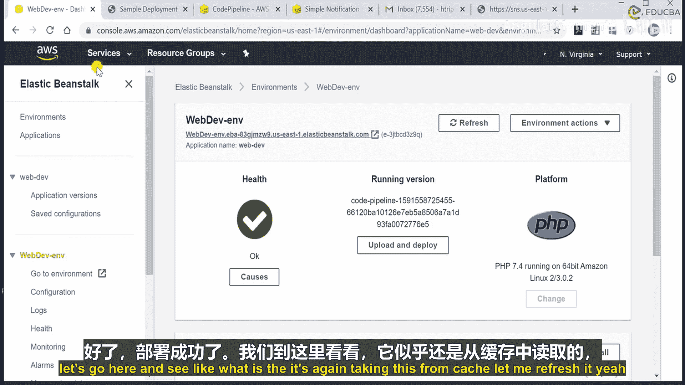

And see。Like， what is the it's again， taking this from cash。 Let me refresh it， yeah。So， now you see。

We have got the updated message， which we have done in the index file。😔。

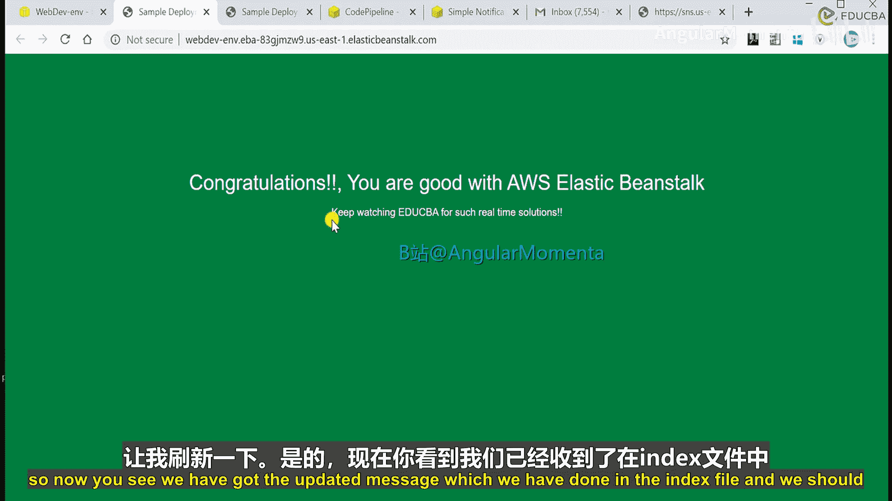

And we should be getting a notification， as well。Okay， let's wait for a moment。 Maybe its。

 it might be in the way。 We will configure the notification。 Let's wait for a moment more。

 So as you can see， what is the issue So the issue is it's unreachable。 So I am just checking。

 So since that notification topic was not reachable， So I created a new topic。😔。

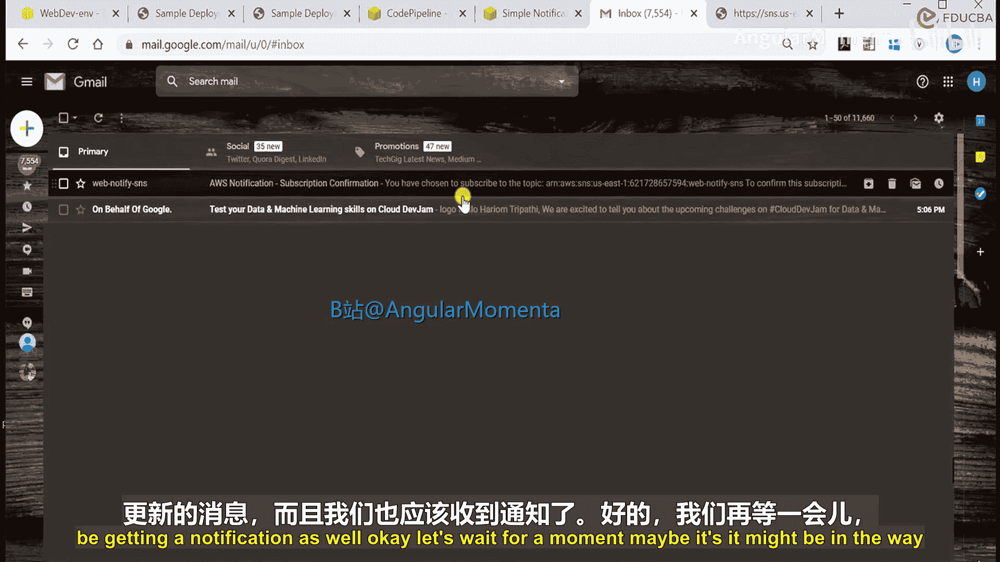

Oh I went。Onto。Managing the notification， said。Manage notification rules。I went on to the door。

And I created a new topic with this name。 And if you can see。It is joint active view。 So previously。

 it was showing。re in unreachable， nor showing active view。

So I just selected this topic and deleted it。And created a new one。 So if you face some issues。

 it might be some backend issues from AWs side。 So I just created a new rule。

And if you see the simple not of here。😔，I createdd this new topics， and。

I have given my same ems and point。And we are good。 We are getting notifications。So this is fine。

 But I'll show you this whole thing。Of。By doing a new deployment。So this is our pipeline。And。

Ill go to it。Before that， I'll make some changes with the code。 So suppose this is congratulations。

 I'll add to。 Congratulations you all。 So save it。😔，And if I go to my git。

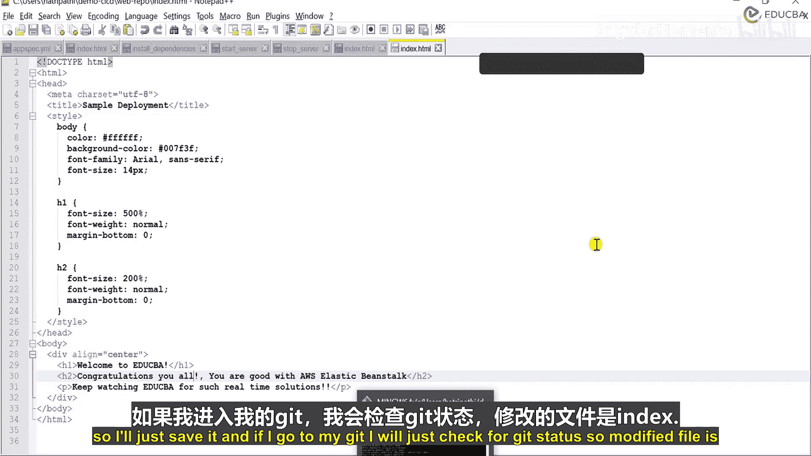

Yeah。I will just。Check for a good status。So modified file is indextro testl。H。

Commit this intestimal file。And then， I will。Push it to。Hutgen。

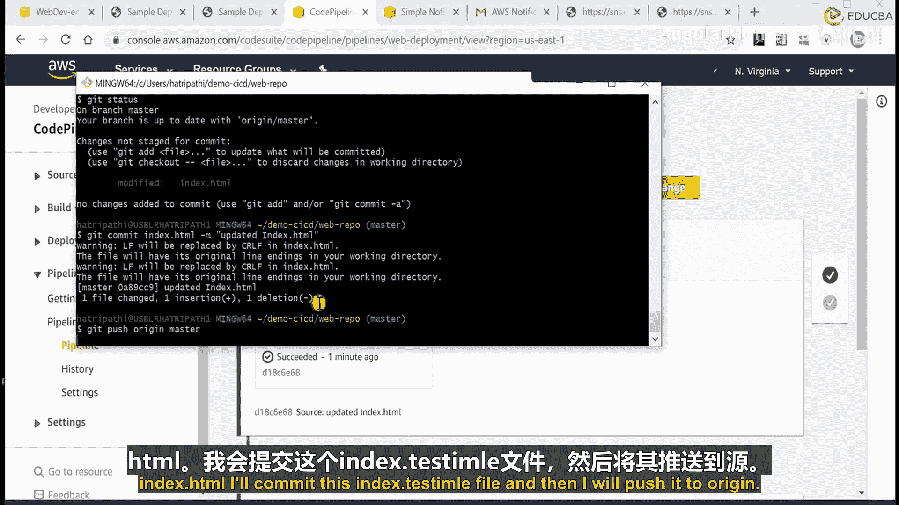

Yeah。So let's check here。😔，I should see。Dove。嗯。Prac here。If I refresh the page。It should not pick。

 pick up the new code and start deploying。Yeah。So let's wait for a minute， maybe。Yeah。

I refresh it again。Yes， so you see it's in progress。And。

Let's check if we are getting any in notifications。😔，So right now， weve got one notification。

And let's see what it is telling。A on this this。By applying with deployment execution。Started。

Everything we are getting like all the notifications we are getting。

 So we got some more full new notifications as well。😔，Sject those， the deployment started。

So now this looks good we are getting notifications for。😔，All of transitions。 And again。

 if we see here。The deploymentship should be completed now。Yes， if succeeded。

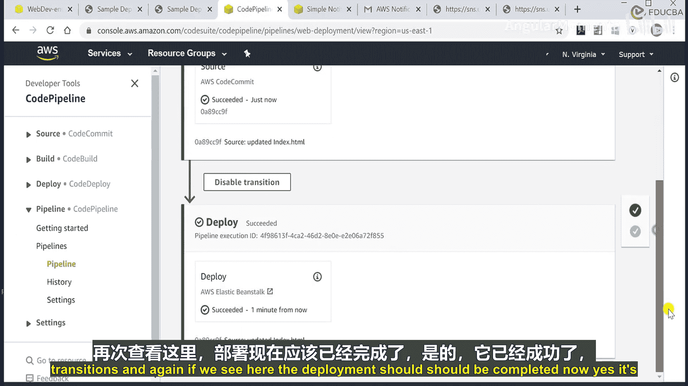

Now we can just open this Si and check。😔，Congratulations， you also are。Cordes of did it。

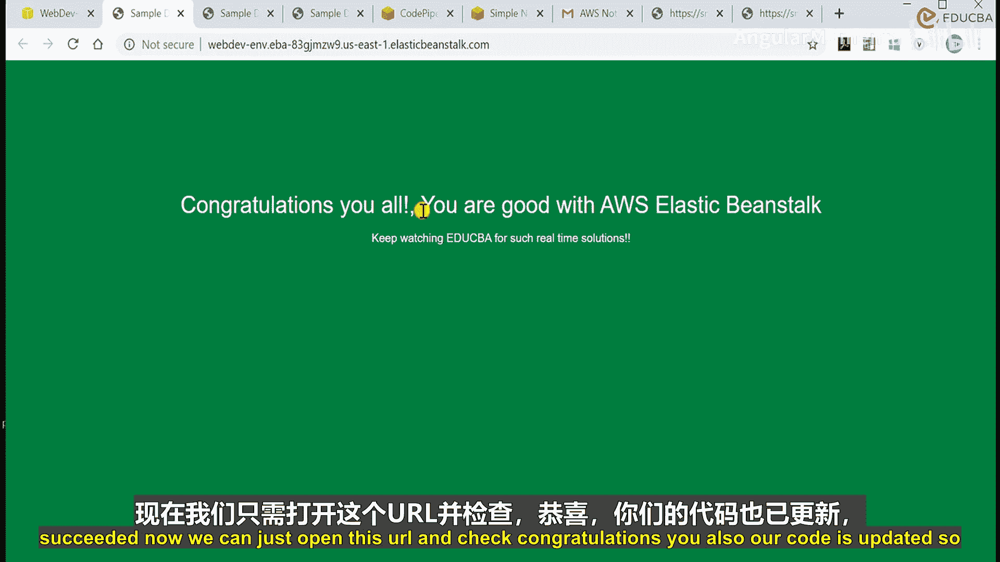

So this is how we configure notifications for all our actions in our CSD pipeline。

It helps us to get a track of what is happening in our a environment without logging to the environment。

And will be updated。So thank you for listening。

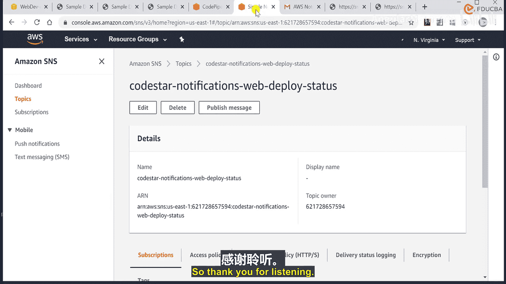