# 【EDUCBA】AWS Elastic Beanstalk与云项目的持续集成⧸持续部署 ｜ AWS Elastic Beanstalk & CI⧸CD for p10 01_02_06_配置审批 -BV1zXcKzNENN_p10-

Hello and welcome to this lecture。In this video。I will add some more stages to this。Depment pipeline。

 like a production stage and some approval stages。So that if。Somebody wants to deploy a code。

It should get for approval。 And then once it is getting approved。

 it will be going for the deployment。So before that， I will create one。

Additional environment for production environment。So， let me go to environment and。

And since the same code need to be replied to。 And just to。

Select the current development environment。And I'll clone it， too。Thought。

So the new environmentment name will be。Theb。Fd。Web dot A And V。

 thrown off web tab A And V that fine。 and the same settings will be there。 So for this URL。

 let me check if it is available。He adds looking available， so。We can start clo this in。

 so it will create a similar。

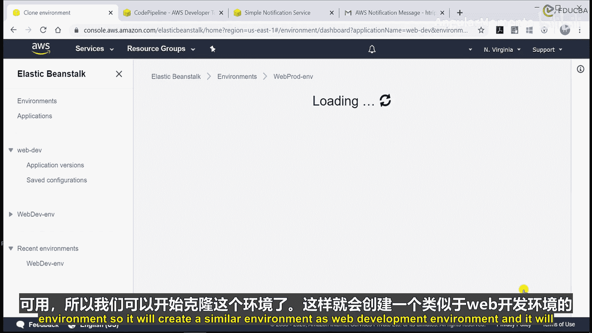

Enviment as。Vev de Lement lament。And it will have the same details。

 So let's wait for this environment to come up， and then we will move to creating our multi stage pipeline。

Such telling the environment is starting。

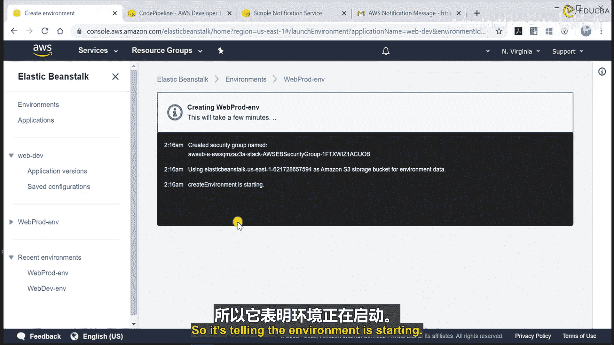

Let's go here and see what is happening。 Okay， so you see， the application is same。

And the same application is present in。And then， as well as thought enment。

So if I opened the plot in women。

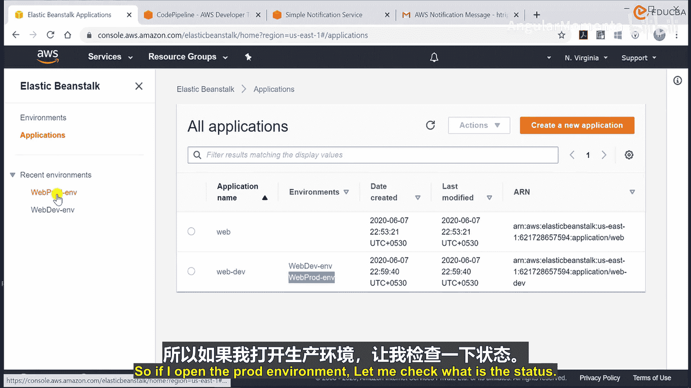

Let me check what is this status。Okay， so stilling security up is done。Enviment is starting。

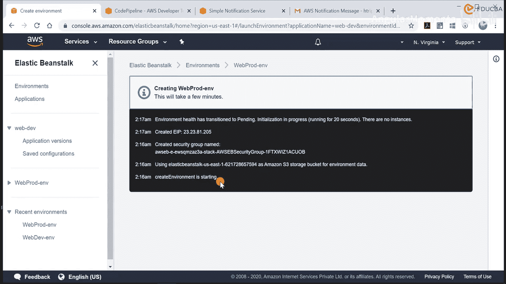

So this looks fine。 O， this the broad environment is pending。We'll wait for some more time。

Till it comes up。I will pause the video for that time。So if you see， it's still pending。

 but we can check other configurations as well by that time。So it it's a web server。

 same platform is there。😔，And same versions youll get once it is。Said the penri。

Amplication name is same。Yeah。So what we'll do， we'll just leave this to。This environment took itto。

 and by that time， well add the stages here。So I want to edit this by plane to adddo。

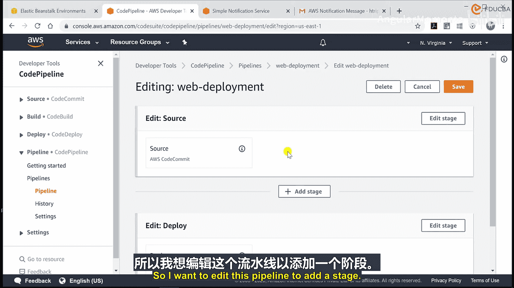

Stage。For deployment。First， I'll add a stage4 approval and add a stage4。

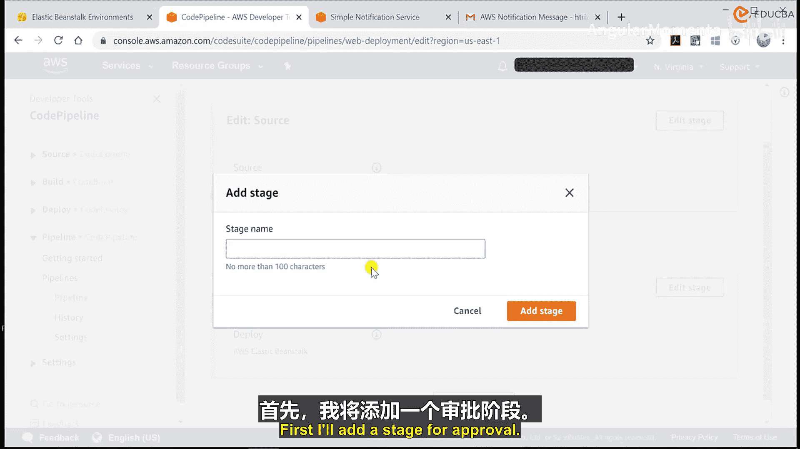

A portfolio。And I'll add some action group。 The action name will be manual。

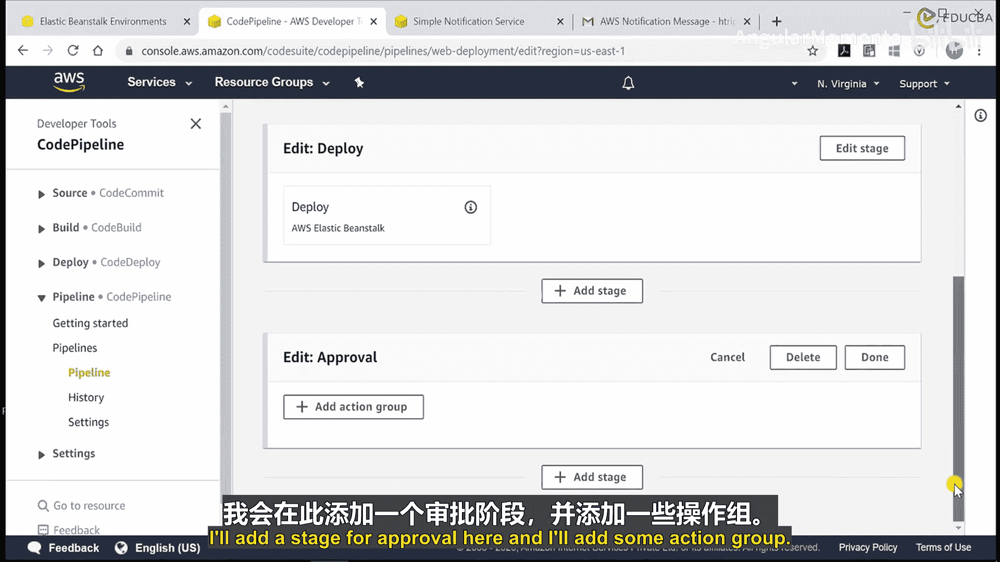

Croval， and then action provided will be a manual approval。Configure the approval request。So。

 I need to mention。The Sns topic。 So I'll use the same Ss topic called turn not fu web de plas。

It was working previously， and other things can be optional。I can put the commanders， please approve。

Or deny。 So this makes sense。 So I will just click on then And this。 Okay。

 so we cannot include a space here。 Maybe I need to put some underscore theco。😔。

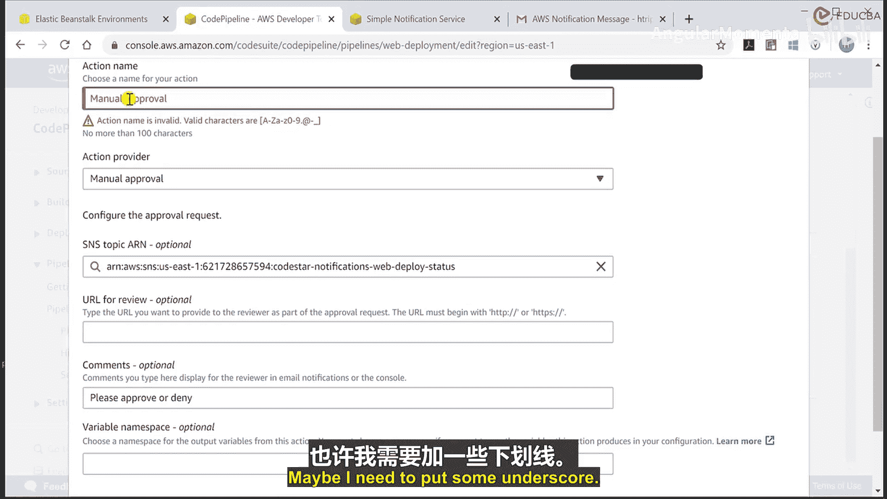

So I have added the approval stage， and now the next stage， I'll check thela environment。

If it's up and running， then I will end that in my moment as well。Sa still Kening。Okay。

So I'll do it for this environment to come up。Then， I'll add it。In the stage。

 So if you want to see like what is happening and why this environment is spending from such a long time。

You can check on these causes。😔，And its telling。Let。Initiation is running for like5 minutes。

 and it is checking like what is。Heappening。So， let me check over on。

Configuration for this environment。 and then locks。Nothing is still health。😔，Okay， so。

A loance Le a long smoke managed to obtain nothing。Evens added。Okay so we see。Dead as though。Added。

You're getting some error here。So。Let me told you this， first。And then we can proceed further。

 So since this environment is not getting ready from a long time。

What we'll do will terminate this environment and will create a new one。

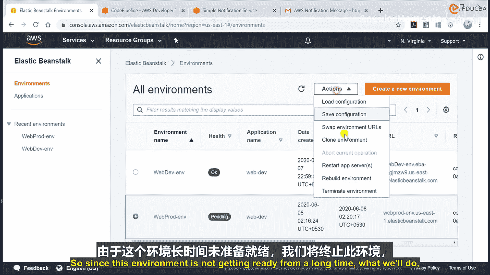

Without cloning， so I'll just give the name of the environment。

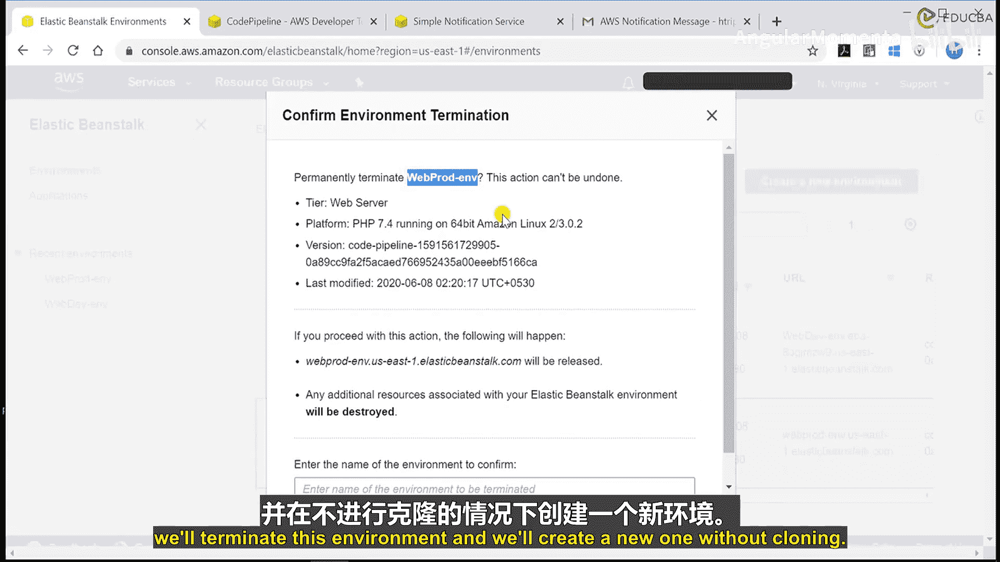

Do it isen moment。And we'll go to environment and。 Well create a new environment。

Sa select of that server en。Amplication name will be web broad。And tags， if you want to give。

 that is optional again。Enviment name where plot。He and Vivi can。A， for instance。

 you'll give iPhone 1 because there's already web fraud。Envy。

And we don't know like whether it's deleted complete or not。

And don't we name like we can leave it blank， as it has mentioned you。Willll get the name。

Here will give the broad。The plumment。And we want to do this on our managed platform， so。

We select page before that。And we'll start with the sample application later on once or code will move to broad environment。

 It will be deployed。 So rest other settings are seem like if you want to configure more options。

 you can again。Checked that。But that is not required since we have not done that in the。

De environment as well。 So we can just go ahead and create this environment。

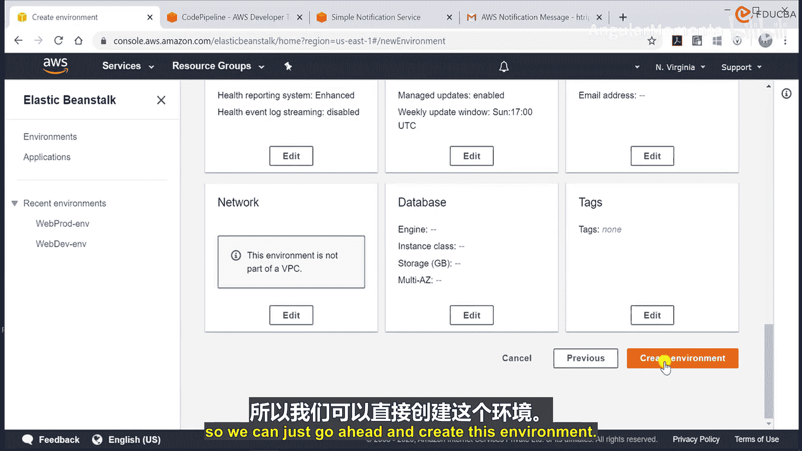

So let's say it for some time and see。How much time does it take for this experimentmentation。

 So we see。As three book， it is done。Greed。Let's wait for a moment。

 And this environment should be ready。So we see that the security group is created。

And there are no instances of knowledge liquid he is created and。No， I think it's time for， though。

Instances， too， rec created。So'll wait for a moment。 Let's see。 once instances are created。

It will not take much time。I'll pause the video for a while till the environment is completed。Now。

 as you can see， the environment is ready。 Now let's open it in our new tab。

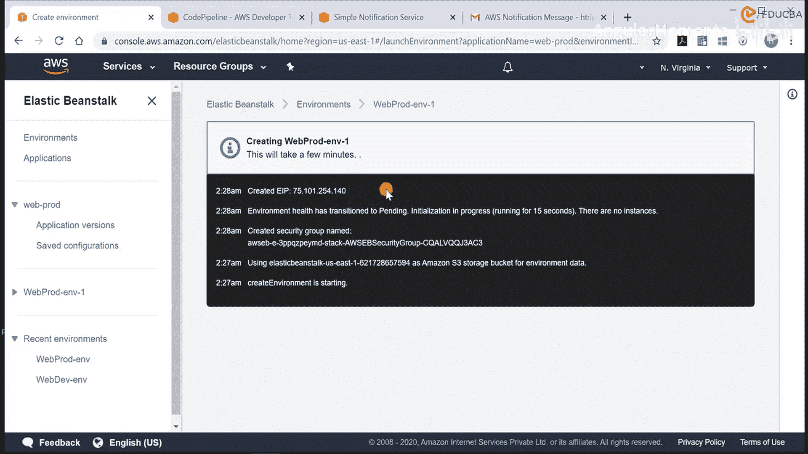

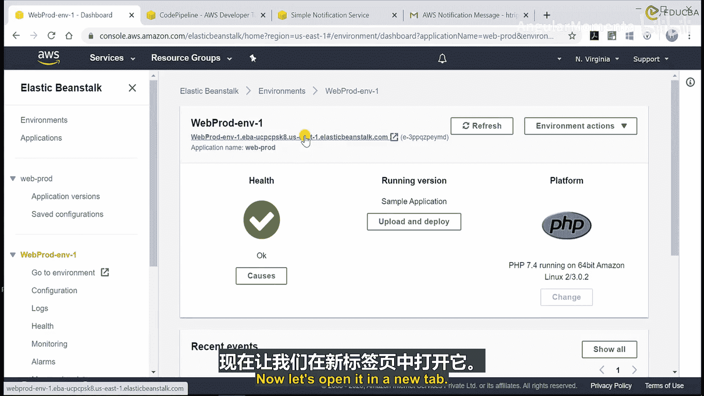

We'll see this standard basic。

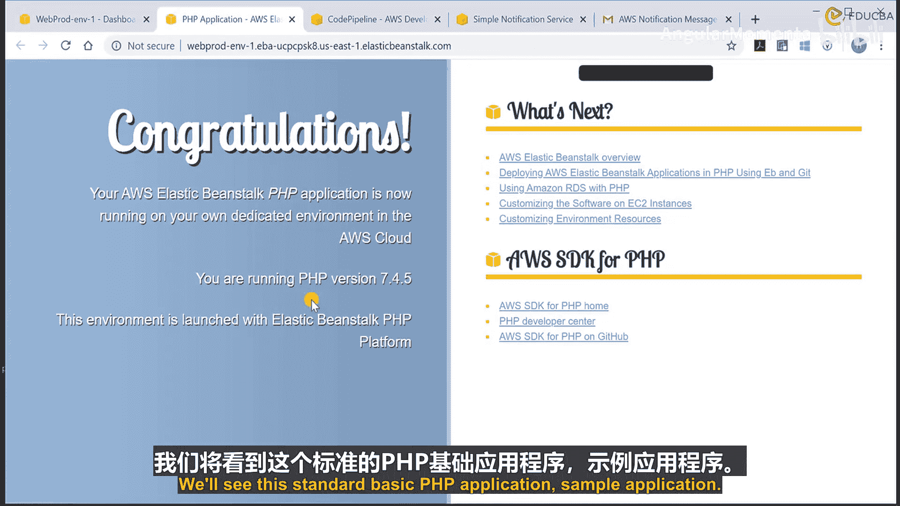

PHP application， sample application。So that means the environment is ready。And now， in the stage。

In the pipeline stage， we can add this production environment as well。そう。

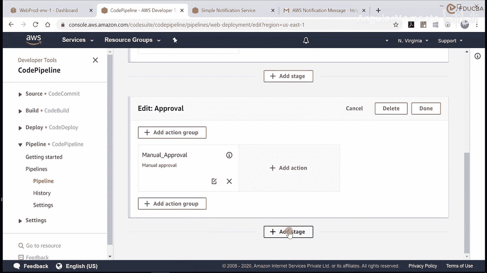

Sometime back， I added this manual approval thing。And now I will add God and employmentment stitch。

Sit add as a stitchitch。Okay， again。Its so。Spaces are not allowed， so I'll just be won go。

And in broad deployment， I'll give some action rope。Again， fled。Deployment。

Itive a name action to what there will be。Under Pment。So， we'll deploy in As。Plastic beans stock。

 Then again， the use region will be North Virginia。Yeah。Input artifacts be source artifact。

 so this will be this is stored in S3 bucket， which was created when the environment was set up。

 then we need to select the application name。So we will select the web broad applicationing and。

Environment will be webed in E N V1。 and if we want to give some variable name space。

 we can give that as well but that is optional so we donate to。

So just verify everything whatever you have mentioned here。😔。

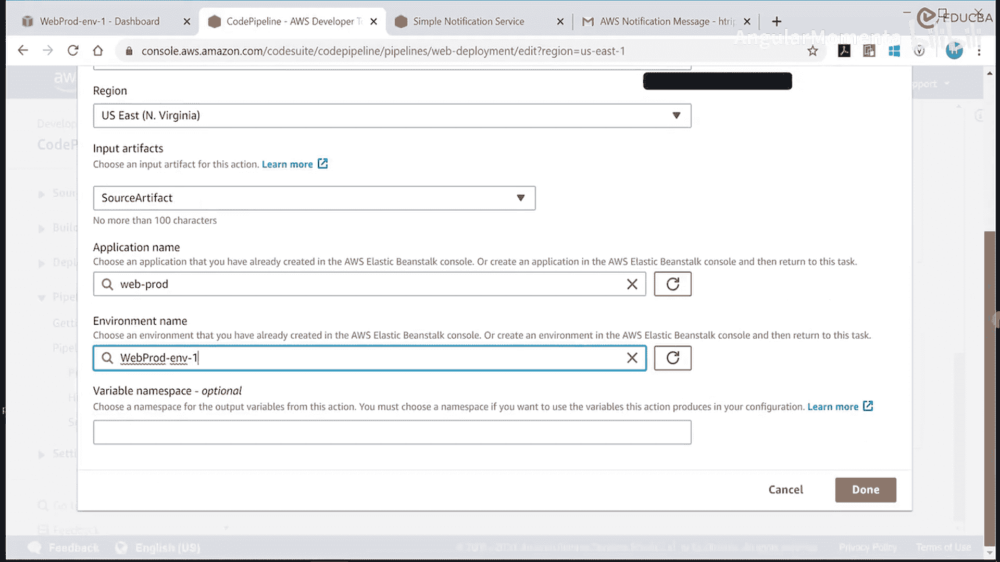

And then， we will just do her。Who done。So now， our pipeline has been expanded。So we have a source。

As though Aless court come。Then， we havea。Deploment in stage environment。And then。We have approval。

 because inf environment。We need to be very cautious before deploying anything to plot environment。

 So there's a stage of approval。That has been。I'll added to you。And once this is。

 this has been approved by your。Our manager or technical head。It will go to them。

Production environment or deployment。

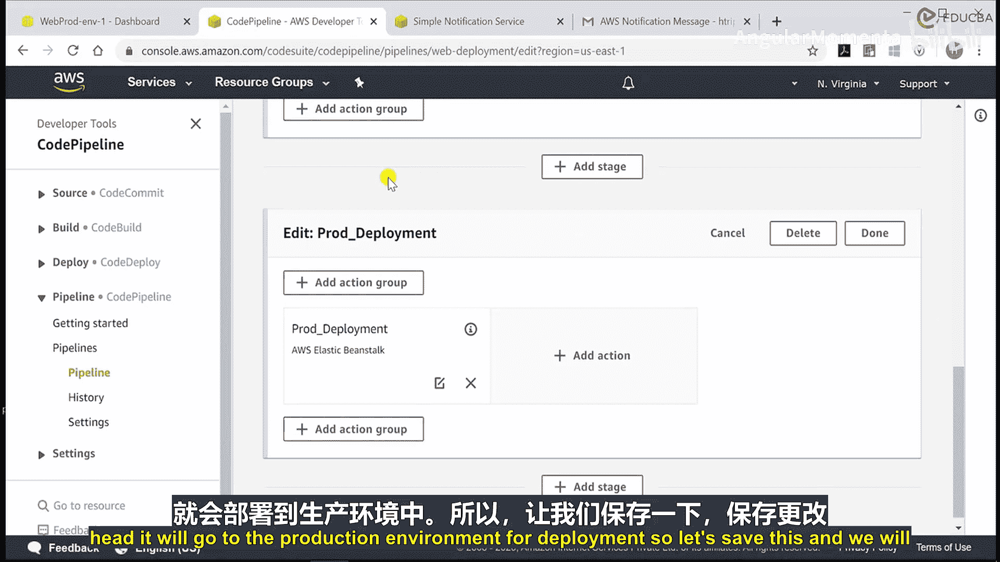

So let's save this。 and we will。Saving your changes cannot be endure done。 Okay， fine。

 We are good to go。

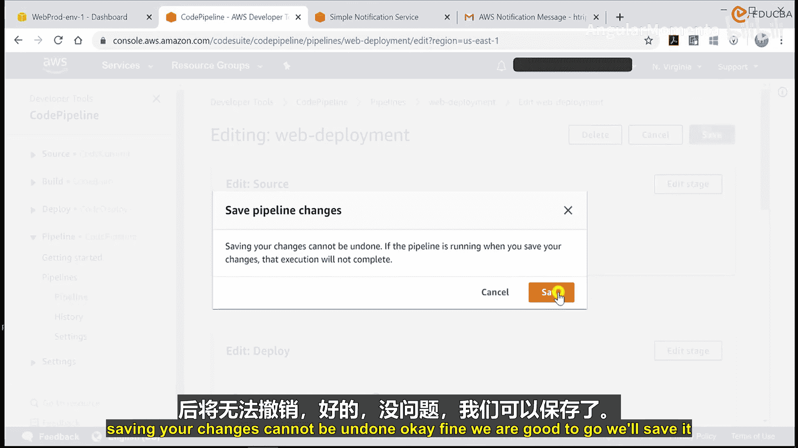

We'll save it。