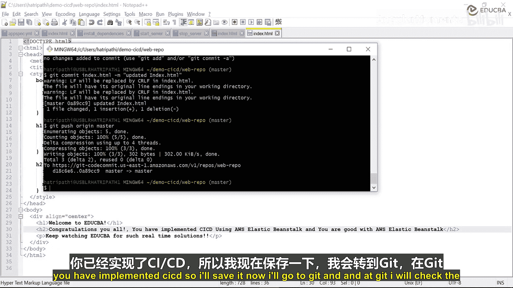
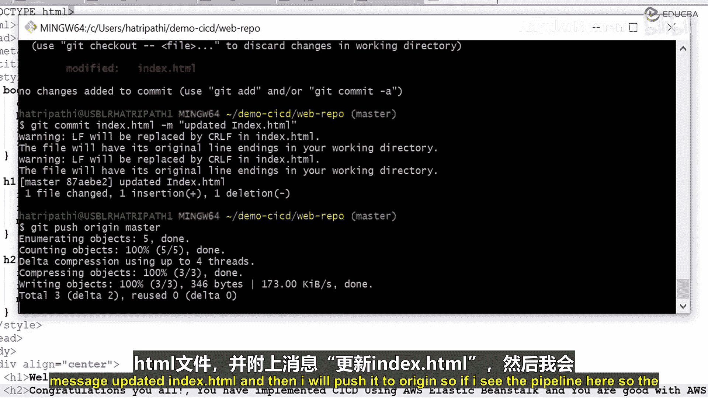
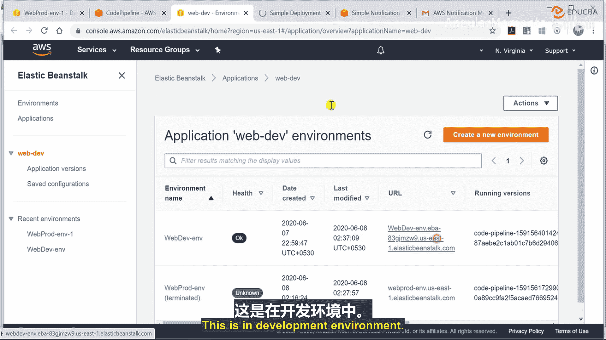
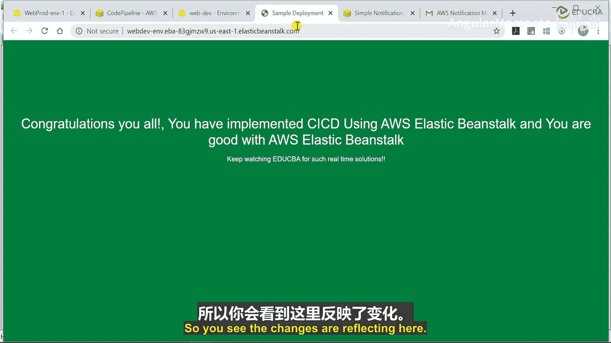
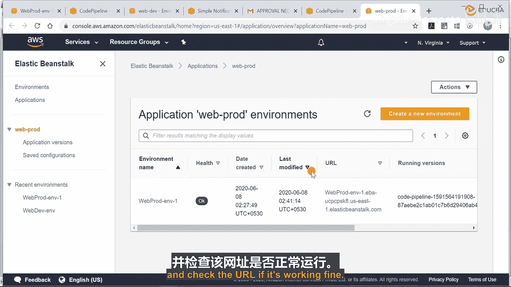
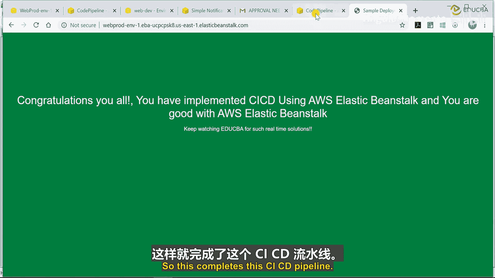
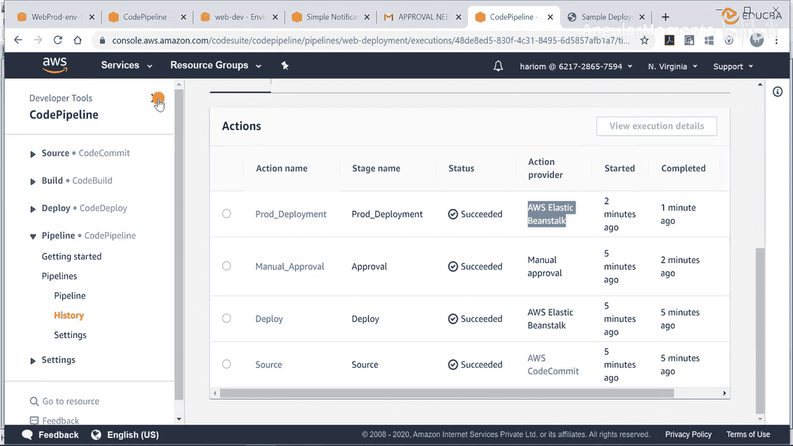

# 【EDUCBA】AWS Elastic Beanstalk与云项目的持续集成⧸持续部署 ｜ AWS Elastic Beanstalk & CI⧸CD for p11 01_02_07_配置审批继续 -BV1zXcKzNENN_p11-

And now。You see， there are four stages。 First one is source code。 That is an ed code commit。

 The second one is。On deployment to stage environment， third one is approval。

 and fourthfulness plot deployment。 So this is the ideal scenario that happens in a。Company。

In a broad deployment。 So now we'll make some changes to the code and will' save it。

 Welcome to Auc CB。 congratulations， you all。You have implemented C I C D。So I'll save it。 Now。

 I'll go to get and， and at kit。 I will。

Check this status。 So it's telling the index dot HTMLt is modified。Now。

 I will commit this index rot testimal file with a message updated index rot testimal。

 and then I will push it to Or。 So if I see the pipeline here。

 so the last deployment was 33 minutes ago。

Now， let's see what is happening before the Dlist clear this screen for。Notification。

 I'll go to pipeline stage。 I'll refresh。The check should be initiated。Ma isison。 Let's wait for it。

Yes， so the check in has been completed。And now， the deployment is happening in。

Development environment。 So let's wait for the deployment。 See we have got a message。

Of whatever is happening。So this is just now I got a message。😔，That。Yeah。

State sub succeeded from court commit。Similar messages will keep on getting so the deployment is also successful an elastic windstock in the stage environment。

 so let me open the stage environment and check this is in stage development environment sorry。

 let me refresh it Yes， so you see the changes are reflecting here Well stage environmentment now let's see what is happening next。

So yes， this is what I wanted to show you guys。 So after it is deployed in stage environment in the development environment。

It's asking for approval。Yeah。For deployment to thought， if he。Will not approve here。

It will not move forward。So， and one more thing， we must have got some message for approval。

So let me check if I got some approval the， yes。So this is the notification I have got for approval。

Hopeper will need it。Yeah。The following approval action is waiting for a response by plain details this this this。

And approve or rejectors additional for please approve ordinance。

 So this is a comment I have given there。So now I'll just click on this and go to them。

By plain page to review it。So I could have done what I wanted to show you like how you can go from the mail section to upload this。

So， ugly con this。And I can approve reject and give some comments as well。 So I'll just tell。

 looks good。To me， and I'll just approve it。谢。So once approval is given。You see。

 the statusus is chained here。And then， it will move to。Next。D plumment。So， that is them。Though。

 in moment。P department says， if you see， it has started deploying in plot， and it's in progress。

 So once that is done， we can just open the broad environment as well， and we can check。

If it has been successfully deployed there as well or not。 So let's wait for a moment。

 It will not take much time。 The broad deployment is successful。A began。Go to this link， and check。

The URLl。If it's working fine。 So yes， this looks good。 So this completes this CD pipeline。

 If we see what we have implemented。

We can just check this pipeline here。We have a source that is a code commit。

It will deploy directly to our development environment。 That is this the first stage of deployment。

And then it will ask for approval。We can either approve from this console， or。

It will send a notification， as we。Configured in the previous video。So it will send a mail to her。

Subscribe， email I。And from derazle can approve。And then once approval is given。

 it will move to them。Production deployment。So this is how it looks。So apart from this， like。

 we have some more options like。We can stop execution。

 so if we we see like even if the approval is given and somehow we got a message from our hard authority that we need to stop the execution right away。

 we don't want the new court to apply so you can do a hard。Stop， as well。So this is also can be done。

 and is like a emergency situation。So this is one thing and。Another thing is like。

You can do some mode changes。To then from the settings menu， and you can check the history。

For success and failure。Of the deployment。 So if you see the method we are using pooling for source changes。

 So this is what we are using， and it will tell you。The statusus of each deployment。Sa see。

 this is a source。 That is Aws court commit。Deployment that is happening in As elastic Gamestock。

And then there is the stage manual approval that once we have given。

 it will go to production deployment。 So this is how it is flowing from source to。Proroached Simon。

So I hope this must have。Argue venue news of knowledge。About how to use the acidd by plane。

 using elastic bins stock。And you must be in a very good position to implement this in our environment。

So thank you for listening， this concludes this project。Andum。Hopefully。

 the deployment will be successful when you will do this as well。

So if you the code I have used in this project。I will upload it。And you can thereforeer those code。

While you you will be doing this deployment， so please use this code or if you want to have your own code you can have it your session。

 but the process will be seen to implement the CSED using AWS Elastic Be store。

So thank you for listening。 Have a great day。

