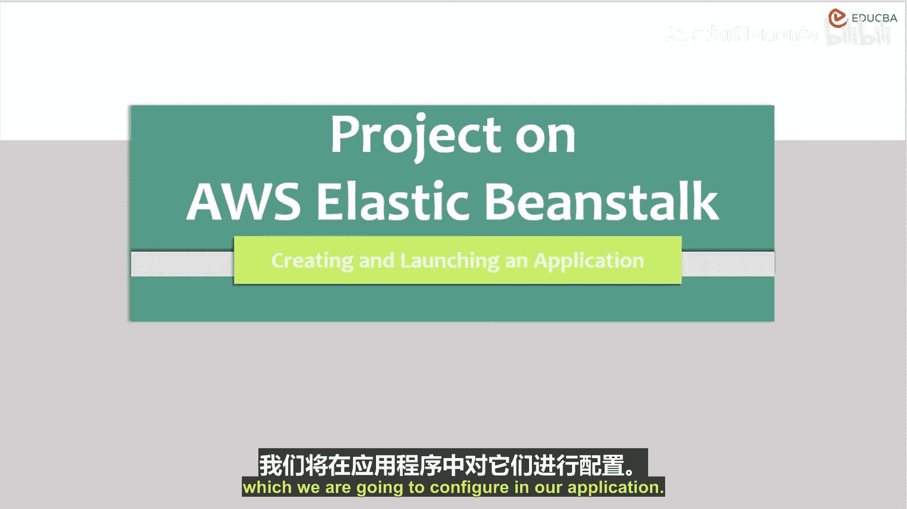
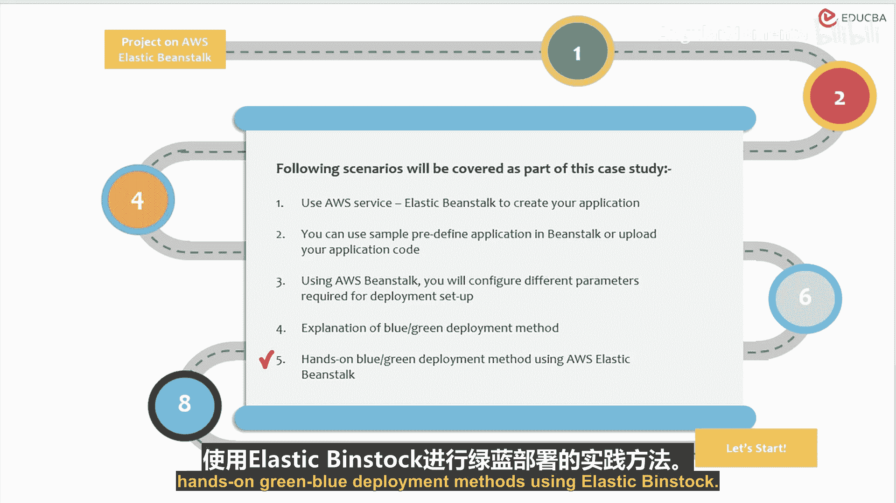

# 【EDUCBA】AWS Elastic Beanstalk与云项目的持续集成⧸持续部署 ｜ AWS Elastic Beanstalk & CI⧸CD for p12 02_01_01_项目弹性豆茎应用创建与启动简介 -BV1zXcKzNENN_p12-

🎼Hi， guys， welcome onboard， But to have you all here today。

 we are going to learn one of the most interesting AW servants which is AW's Elastic Minstr。😊。

🎼This is a project based on Elastic Vistock we will see how we can save a lot of time and infrastructure set up by using AWS Elastic Viinstock for creating and launching your application before we start on hands on training let's see what is the El Vit Eve and go through the PPT。

😊，🎼We will understand what are the objectives of this service and this project。🎼As I told you。

 we are going to use this for creating and launching an application for this project we are going to use the AWS building sample applications present in different languages with their different versions。

😊，🎼As we move ahead， it is important to know the difficulty level of this project so this project would be an intermediatemittent level and since this is an intermediatemittent level it is expected from you that you know some basic AWS services such as S3 is to instance which we are going to configure in our application to do this project you must have AWS account you can also use AWS free tire account。

😊。

🎼You want to deploy your own code for creating an application， keep your code handy。

🎼Further discussing about project objectives， Part will be able to create applications using。😊。

🎼Some services with different languages such as Java。net， PhP， noda jazz， Python， Ruby， and Bo。

🎼Isn't it exciting to use all these languages with their different versions in a single platform？😊。

🎼Also participants can upload different versions of their applications， launch your environment。

 you can also monitor your environment。😊，🎼Let's discuss what you will learn from this project。

🎼You'll learn the architecture and different components of El Bestop。

 their applications using these services。😊，🎼You can also create and launch your own application in this service Are there any project requirements and prerequisites。

😊，Yes。🎼You must have an AWS pret account so you don't have to pay for any services and that's it you are good to go to learn AWS Elastic Bistorm。

😊，🎼そう。🎼We can discuss this AWs El windstock can be used by the developers finding a way easy to deploy their application。

 As I mentioned， this will save a lot of time of your infrastructure setup。😊。

🎼Application will be helpful for the developers and also will be working on hands on experience so students who wants to pass AWS solution Arch associate this will be helpful by the end of this project you'll have in following skill sets deployy your sample applications knowledge on many pret AWS services which I'll be telling you when we are going to do the hands on on elastic Pst。

🎼You can also monitor the application， there are different services which we can use for monitoring this application。

🎼Maintaining different versions of your deployed application using this service project contents will be the architecture of El windstock。

 and we are going to perform the hands on experience。😊，🎼For this。

🎼So let us now discuss the case study which will be following for this session your customer wants to focus more on development and innovative ideas。

😊，🎼You suggest your customer to use AWs elastic brainstock for the application deployment and maintaining different deployment budgets you will demonstrate your customer to see you can save a lot of time and efforts to set up an deployment and infrastructure environment create an application using AW sample application。

😊，🎼As well as you can also create application by uploading your own tool。

🎼The following mentioned scenarios will be covered as a part of this case study。🎼Use AWS service。

 El Venstock to create your application。🎼You can use sample predefined application in WinSt or upload your application port。

🎼Using elastic wind you can configure different parameters required for the deployment setups。

🎼Explanation of green and blue deployment methods hands on green blue deployment methods using elastic windstock。

