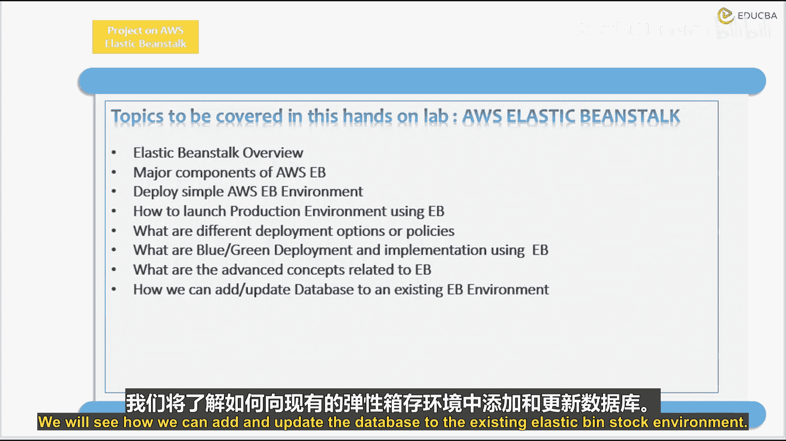
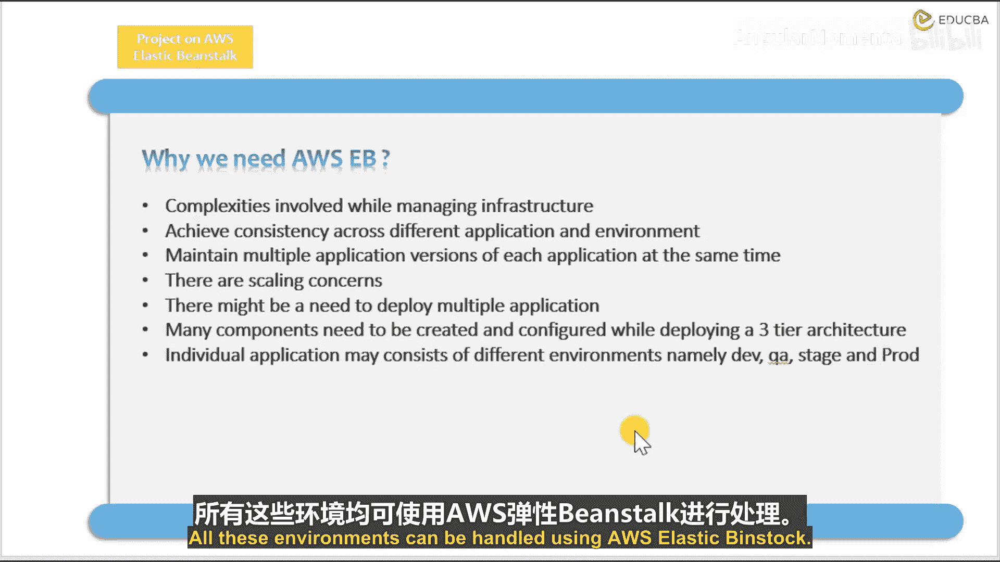
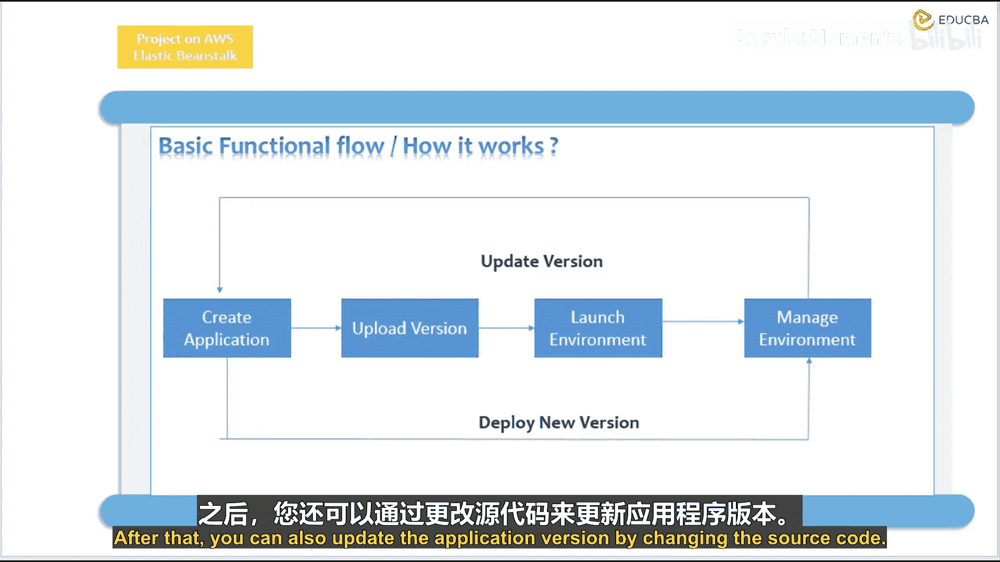

# 【EDUCBA】AWS Elastic Beanstalk与云项目的持续集成⧸持续部署 ｜ AWS Elastic Beanstalk & CI⧸CD for p13 02_01_02_为何我们需要AWS弹性Beanstalk -BV1zXcKzNENN_p13-

Hello friends， Today well see the topics to be covered in this lab of Elastic binstock。😊。

We will see what is the purpose of elastic binstock and why we use it in AWS。😊。

Well discuss the major components of elastic binstock， which consists of three categories。

 application， application vouger and environment。😊。

We will deploy the first environment using elastic binstock rather than going for the complex one we first deploy the easy one we will see how to make use of elastic binstock to deploy a simple nos Js application。

 then we will just launch an advanced environment or any production environment。

 it would be an advanced production level environment where we will be using the high availability configuration presets。

😊，We will use high availability options such as load balances and auto scalings。

 which will be included as a part of our environment。😊。

Then they will discuss the deployment options and the policies。

 We will see the blue green deployment methods。 Hell make use of two different environments。

 which we have created earlier。 You can split the traffic into half using the route 53 settings。

 We can see the advanced concepts related to elastic windstock。😊。

We will see how we can add and update the database to the existing elastic binstock environment。

 Then we'll discuss why we need elastic Minstr。 There are complexity involved while managing infrastructure。

 a lot of infrastructure and time is consumed to neglect those。 The best option is elastic binstock。

 We can use elastic Minstr to achieve the consistency across different applications and environment。

 We can use this to maintain multiple application versions for each application at the same time。

As we know， there are a lot of scaling concerns which can be neglected using AW's elasticastic Minstr。

😊，There might be a need to deploy multiple applications so we can use elastic wind for the same。😊。

Many components needs to be created and configured while deploying the three ti applications architecture  individual application may consist of different environment。

 namely we can use as a dev， Q A， stage and pro。Individual applications may consist of different environments such as dev。

 QA stage and trod， all these environments can be handled using AWS El windstock。

Now， let's see how it actually works。 Let's imagine you want to create an application and deploy an application。

😊，You can upload our application version， and then it will launch an environment Enment is nothing but a collection of eight resources that you need to run an application version。

You can also manage your involvement。 So this means whenever you create an application and when you deploy an environment。

 you have deployed a new application version。 After that。

 you can also update the application version by changing the source code。

