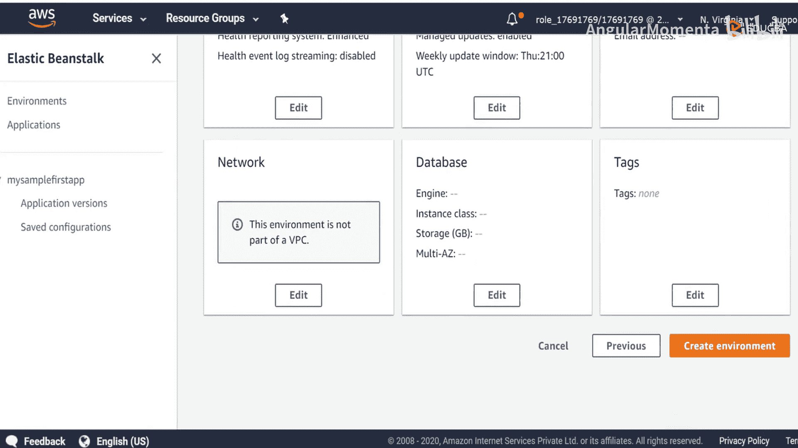
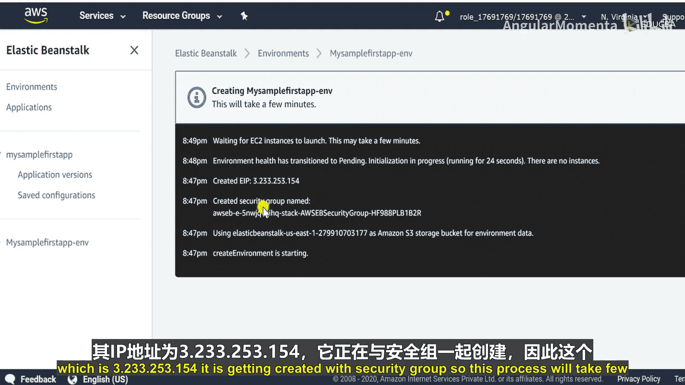
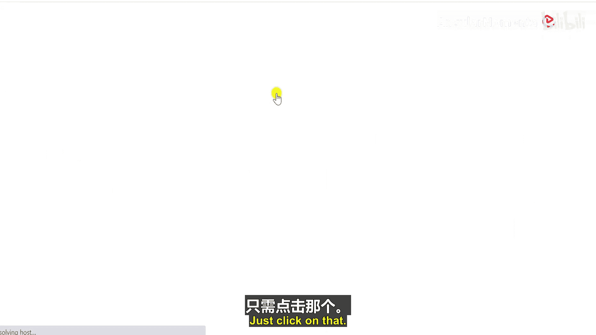
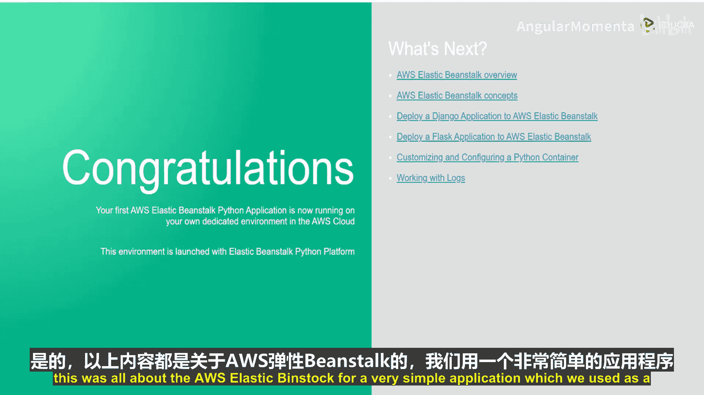
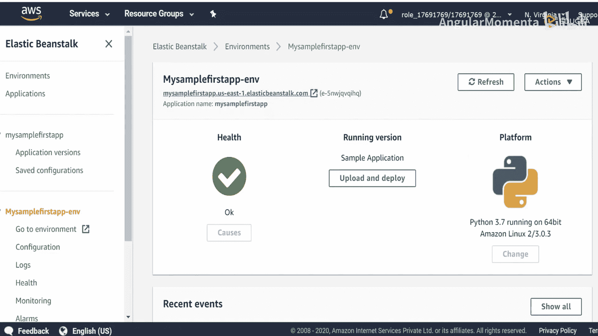

# 【EDUCBA】AWS Elastic Beanstalk与云项目的持续集成⧸持续部署 ｜ AWS Elastic Beanstalk & CI⧸CD for p14 02_01_03_基本功能流程 -BV1zXcKzNENN_p14-

Now， let's discuss about the pricing strategy。 how you will be charged for using AW's El binstock service。

 So there is no additional charge for using elastic binstock。

 You don't have to pay anything for its uses。 However。

 you only pay for underlying AWs resources that you use or that your application consumes。

 For example， you might deploy easy two instances。 El load balances or any other resources。

 You have to pay for those resources。 However， you don't have to pay for elastic binstock as a service。

 So that was the overview for elastic binstock。 Now we jump to deploy a first application using elastic binstock。

 So what elastic binstock is Elastic binstock is a developer centric view of deploying an application on Aws。

 You can quickly deploy and manage your applications on this。

 there is no need to learn about infrastructure that runs those applications。

 It helps to reduce the management complexity without。choice or control。

 You can simply upload your application and deploy it Elastic binstock helps the capacity provisioning load balancing。

 scaling and application， health monitoring。 Let's see some of the basic components of elastic binstock。

 So basically we have three major categories that is application application version and environment。

 So let's start with application。 What is application application is a logical collection of elastic binstock components。

 which includes environments， versions and environment configurations。

 Second one is application version。 an application source bundle or a deployable code。 For example。

 a Java dot wire file， and application version is a part of application。

 It is just a source of bundle。 application can have many versions and each application version is the unique one。

 Now， the last one is environment。 What is environment。

 It's a collection of Aws resources running an application version。

 Each environment runs only one application version。At a time。

 you can run the same application version or different application version in many environments simultaneously。

 when you create an environment， El binstock provisions is the resources needed to run the application version you specified So these were the three major categories around El binstock。

 So let's get started with the handsson lab for elastic binstock for this go to the AWs first front page under compute will find elastic binstock。

 click on it。 First will create an application。😊，Click on create new application。

You'll see this createate application page fill the required details。

We will see my sample first application。 You can leave the description entities， or if you want。

 you can give it tags are also optional。And will create heat。

So once you are here you'll see you have created an application。

 but that application needs an environment， So what we'll do we'll just click on create one now you'll get two options first its web server environment second is worker environment so as we are here to deploy an web application will go with web server application and if we you want to run an worker application that process longrunning worker loads on demands or progress tags on the schedule you can go for worker environment but by now for this requirement to deploy an web application will' select web server application will' select that fill the required details Now our application name as we have given my sample first app。

Application name then environment name will resist this。 Now we have to select the domain。

 So what we'll do we'll just try to write our domain name and we'll check whether it is available or not。

 Now we'll check the availability。 Yes， it is available。

 So well go further Now here is your choice Like what platform you want to。Deploy your code。

 So my first。Platform will be you can select anyone from this dotnet Docker go Java nor dojs PhP Python Ruby Tomkat。

 so what Ill select Ill select Python now here you have one more advantage you can select the platform branch and the platform version whichever you are comfortable with or what you want to deploy。

By now I will take the recommended one that is3 or old or3。

 Here is the third option that is application code。😊，As on the earlier stage I said。

 you can deploy your own code also， or you can just go with the existing version。

 or as this is the very fresh application will go with this we can also go with the sample application So as this is a demo purpose Ill go with the sample application and we just check what this configure more option means so you can edit whatever configuration default configurations mentioned over there as this is our simple application I'm not going to edit anything we'll check this configurations in our broad environment deployment。

😊，So by now I am saying everything looks good and well just create the environment so as it is saying that it is creating the environment and application。

 so it may take a while what is actually happening in the background， whatever resources。

 AWs resources such as S3 EC2 VPC， everything is getting created。

 everything is getting deployed for your application。😊。

So I'll just pause the video and we'll see further。 So as you can see。

 AWS resources are getting generated such as EC to。😊。

Which is 3 dot233 do 25 s3 dot154 it is getting created with security group。

 so this process will take few minutes so as you can see。

Our application is getting generated。And the status is healthy the running version is this and our platform as we selected is the Python 3 do 7 here you can see the events watch place while you know creating the application successfully launch environment that is my sample first application the application is available on this path。

 the instance which is added for this environment easy to instance So this is the way you can see。😊。

And you can create your environment， your application。

 you can also refresh to check the updates if any。 Currently。

 our application is in environment is in a healthy place。 Now。

 to see whether our application is actually created or not just you'll you'll get this URL what we have selected for our domain name。

 So this is our domain name just click on that Yes。

 so you can see our application is successfully deployed。 and you can see this output。 So yeah。

 this was all about the AWs elastic binstock for a very simple application。

 which we used as a sample application available in the easy to instance。

