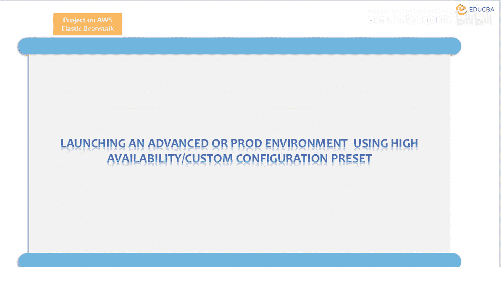
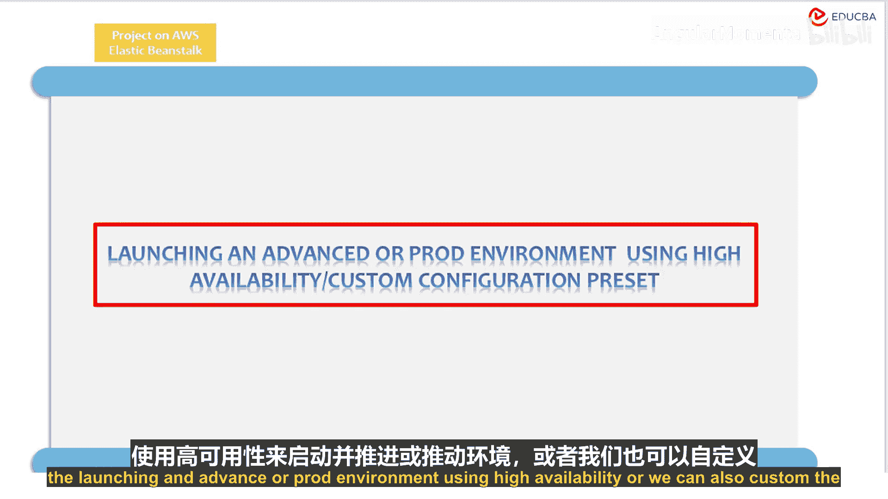
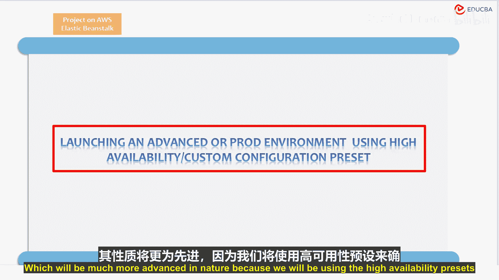
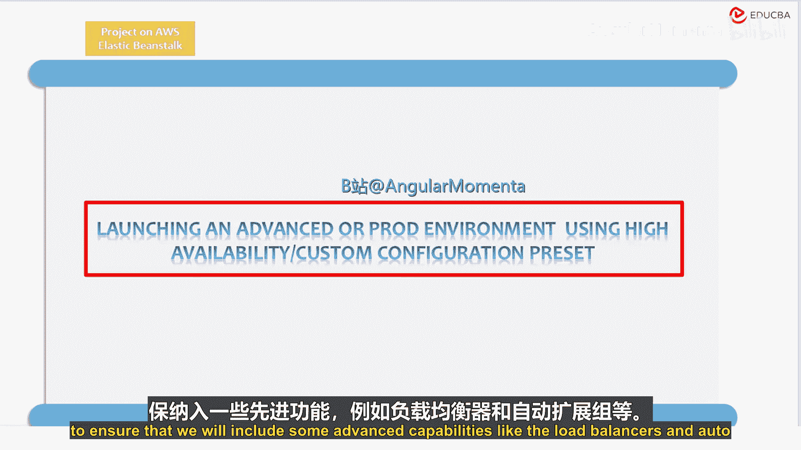
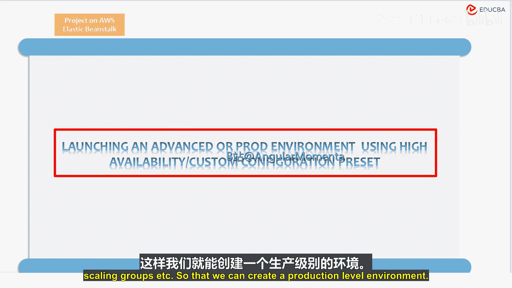
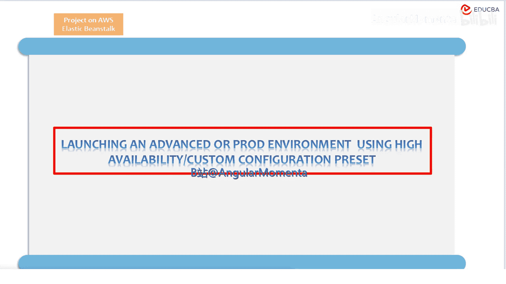
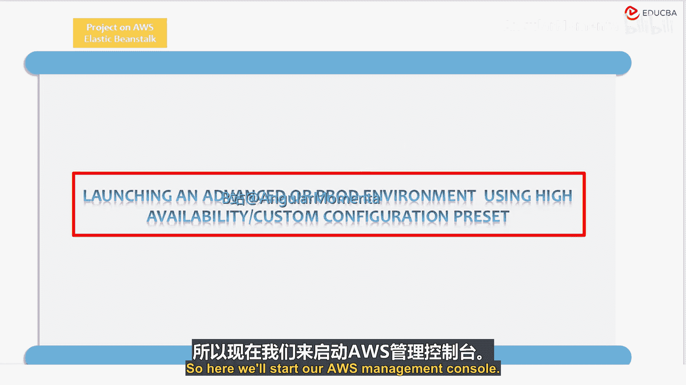

# 【EDUCBA】AWS Elastic Beanstalk与云项目的持续集成⧸持续部署 ｜ AWS Elastic Beanstalk & CI⧸CD for p15 02_01_04_自定义配置预设 -BV1zXcKzNENN_p15-

The launching an advanced or broad environment using high availability。

 or we can also custom the configuration presets， which will be much more advanced in nature because we will be using the high availability presets to ensure that we will include some advanced capabilities like the load balancers and auto scaling groups。

 etc。😊。

So that we can create a production level environment。

 so let's get started and let's start with the entire process。😊。

So here well start our AWS management console。

