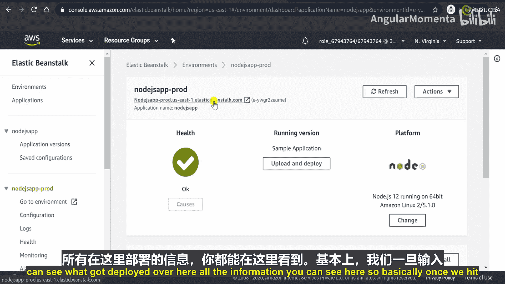
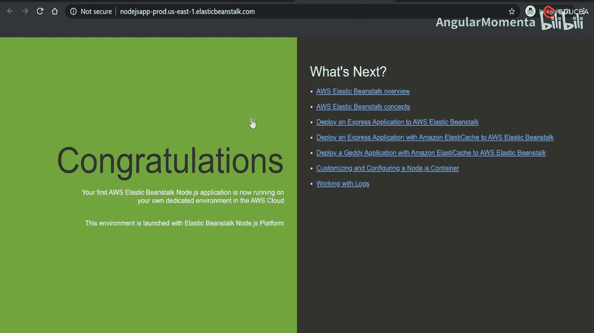
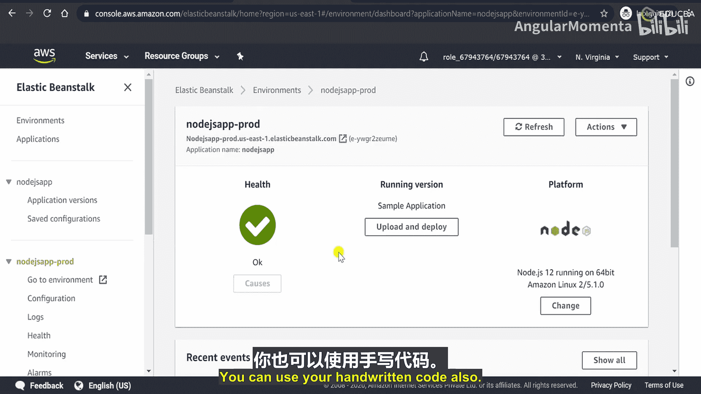

# 【EDUCBA】AWS Elastic Beanstalk与云项目的持续集成⧸持续部署 ｜ AWS Elastic Beanstalk & CI⧸CD for p16 02_02_01_创建新应用程序 -BV1zXcKzNENN_p16-

So this is our AWS console management will go inside the compute。😊，Select elastic windstock。So yeah。

 what we'll do well just create an application over here。😊，As we are going to use no dos。

Will name the application， you can give the description it's optional。

 you can also give the key N values。 It is also optional。😊。

So yeah so our application nodeal GS is created now this application needs an environment。

 so as we are going to generate and launch a production environment first we need a test environment for this application first we create a test environment for that just hit create a new environment。

😊，So here its as we have the application web application will go with the web server environment as we earlier discussed we can also use worker environment for you know the worker application that process long running load workload on demand or for any particular task on schedules but by now we'll go with the web server environment as we want to launch our web application so just select that。

Here来子。Some mandatory fields here。 you have to give your domain name。

 So we'll just give our domain as not just app and will check the availability。 Yes。

 so it's available。 We can go for it。😊，You can give some description。

This is here well be choosing the platform as node Dodges out of the series or mentioned over here。

We will take the recommended one that is 5 do1。0。Here the application will be like the sample application code。

Just hit the environment。So now it's creating the environment for our application。😊，This is。

The dashboard where you can see what AW resources are getting created and what is happening actually in background。

 it will take few minutes， so lets utilize this time to create one more environment for this application。

That will be our production environment。嗯。Yeah。So this is our application。 Just click on that。

This is our application， this is our test environment， which is in a pending state。😊。

Now you can see the action button over here， we will select create environment to create another environment that is broad environment for this application。

 you can create n number of environments for one application， so let's create it。

Here there are two options web server environment and worker environment。

 So what I suggest for whenever you are you want to deploy any web application。

 just go with web server environment as worker environment we need when the worker application that processes long running workload or demand or perform task on schedule So by now we want to deploy our web application so just go with the web server environment select that。

Again， here you'll see our environment name will changed as fraud environment。No， the jail。Ap broad。

And well just check the availability Yes， it's available so yeah that will be our domain name。

Description you can give or you can avoid。 Here will again， go with the note Dodges。

And the recommended one a platform version that is5 do1。0。

 Now here it comes as we have to launch advanced thing So what will do we just check what is actually in this configure more options。

So you can see here are some presets configured for us named as single instance。

 but is free tire available。Single instance using the spot instances， high availability。

 high availability with the spot and on demand instances and the custom configuration。

 So these each set consists of the configurations which we can use as we want high availability configurations So we'll just select this if you want to configure you can do on you have to you know customize your thing your configurations such as EC2 instance type and lower balancer type all you can do with the custom configuration by now I'm selecting high availability So let's check out what actually are the configurationd parameters so you can see the softers you can see what are the instance type what are the storage type what are the auto scaling group mentioned or here what is the。

You know， instance type T T2 micro， this is the default one actually what image they are using。

There are different types of deployment here they are using all at once we will see all these in the coming sessions。

Lad balancer type， which is application which is the recommended word you can also use the network load balancer or the classic one you can check all the security parameters over here the monitoring pattern what actually they are using。

You can just go inside check what configured actually and save your changes by now I'm not changing anything I'm just going with the configured prefix values and I'll just create the environment so now by hitting the environment what actually will happen it will create my core fraud environment which is the advanced level then the test environment so basically by this time I my application that is no do J application is having two environment one is test and another is fraud。

So， let's check。Just let wait for a while as it will take few minutes here see you can see all the parameters getting recreating target group failure like you know what are the things available over here and its getting created the state is in pending so as you can see our production environment has been deployed successfully for our application the health check is okay。

😊，And yeah， so。All the parameters， what you can see what got deployed over here。

 all the information you can see here。So basically， once we hit。

The domain name， yes， so us production environment is successfully deployed over here。

So now， for my application， we have。So this is my node application。

 So for this I have a bunch of production environment test environment。

 So as I said for a single application you have multiple environment so this is my draw environment So yeah in this way you can deploy multiple environments。

Regardless of what。Confirations you want。 you can use the pres。 You can use different code。

 As in this， we have used the sample application。 You can use your。Handwritten code， also。

