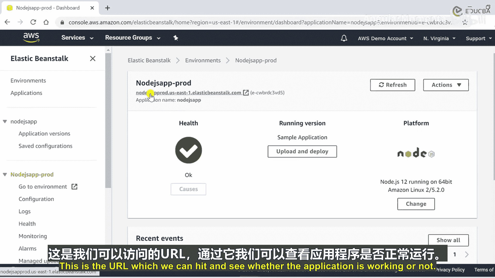
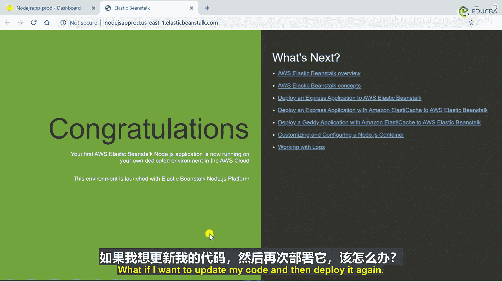
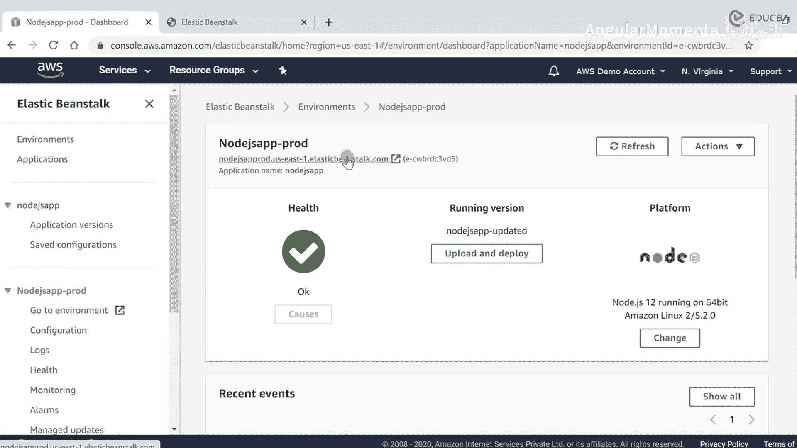
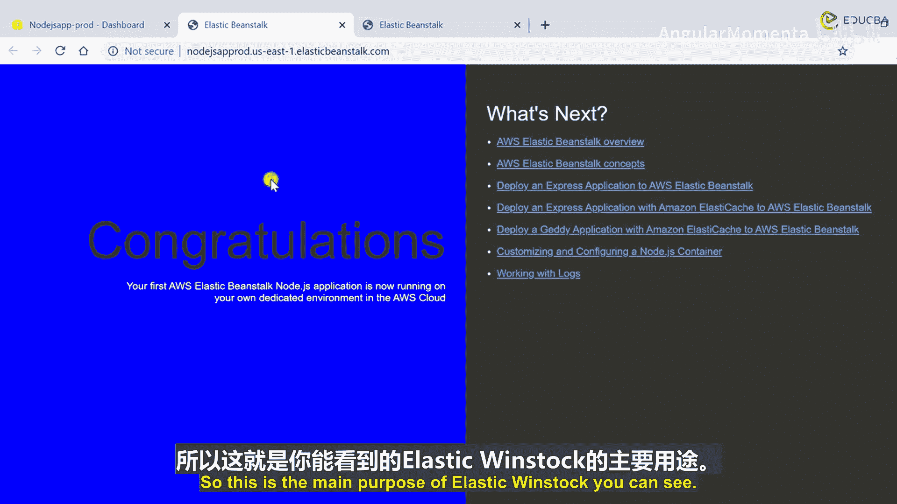
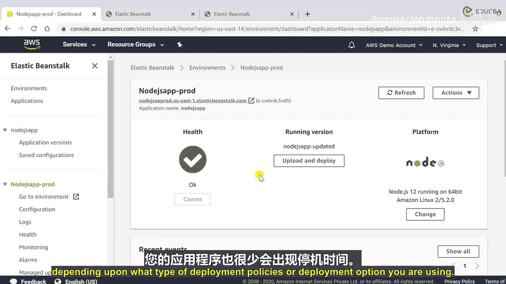
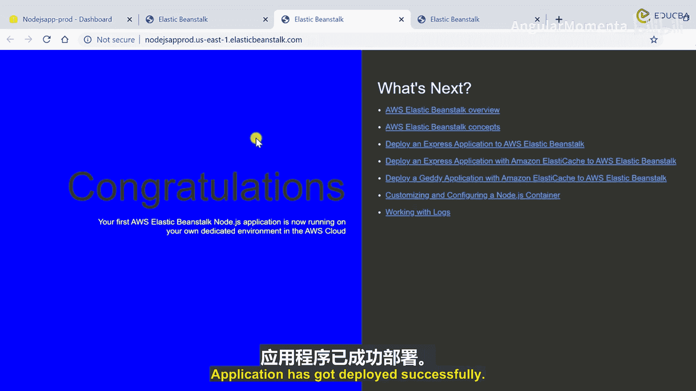
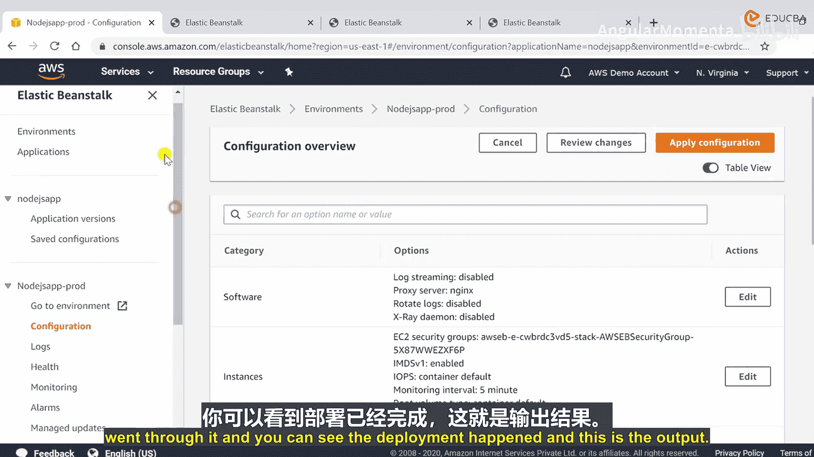
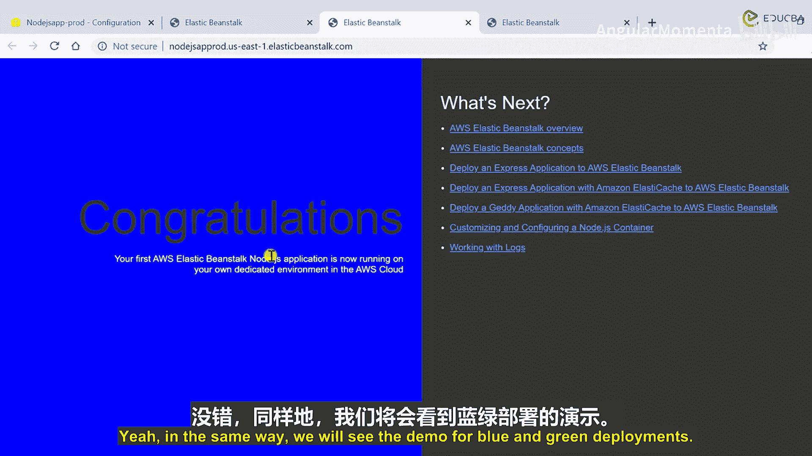

# 【EDUCBA】AWS Elastic Beanstalk与云项目的持续集成⧸持续部署 ｜ AWS Elastic Beanstalk & CI⧸CD for p17 02_02_02_部署策略 -BV1zXcKzNENN_p17-

We will discuss the deployment options and policies available in AWs El binstock。

 There are four different options of policies such as all at once rolling rolling with additional patches and emit so let's have a brief overview of these different options and see how we can use them in elastic bint so let's start with the first that is all at once。

😊，All at once is the fastest deployment option amongst all。😊。

When we use this all at once deployment option， application has downtime。😊。

This is the great option for quick iteration in deployment environment。😊，However。

 there is no additional cost for this。😊，This is the default option for deployment in AW's elastic binstock。

 The second one is rolling rolling upgrades the few instances at the time and then move on to the next batch once the first batch is healthy。

😊，You can set the batch size if you want the application to run both the versions simultaneously here there is no additional cost involved。

There is a long deployment because once you go with the upgrade policy or you want to upgrade your application。

 you have to go with batches conserved。 So you go batch by batch。

 So which leads to the longer deployment process。 Then we have rolling with additional batches。 Now。

 this is an advanced version of the rolling what we saw in a previous slide。

 The features are for this rolling with additional batches。 The application is running at capacity。

 You can also set the batch size。 application is running both version simultaneously。

 There is a small additional cause because we will be executing。😡，Or， you know。

 when you will be initializing the new batches， the initial stage of initial batch is moved at the end of the deployment because we don't need that。

 after all， the units test cases are being upgraded， which leads to a longer deployment。 Last。

 but not the least， we have immutable in this concept of deployment strategy。😊，In this。

 we make use of auto scaling group。 Lets see the feature。

 which is now it having a zero down time when we deploy an application。

New code is deployed to new instances on temporary auto scaling group this has high cost because you go double the instances which will lead to a high cost。

This has long as deployment， but the benefit to get from this deployment policy is that you get a quick roll back in case of failures。

 just in case if the new application is not working for you， if it is not working properly。

 then you can just term that new outer scaling group and then you can just retain your existing one。

 this is great for production environment deployment。

 our next topic to discuss is blue green deployment。😊。

Blue green deployment is a technique for releasing applications by shifting traffic between two identical environments。

 running different versions of the application。 Bluega deployment can mitigate common risk associated with deploying software such as downtime and rollback capability。

 Let's see the example。 You have the users and the send the web traffic which is generated as StTP or StTP as web traffic。

😊，This wet traffic will hit route 53 DNA servers and that of the traffic is sent to the blue environment because the blue environment will consist of the version of your environment and rest 10% is being sent to the latest version that is the version 2 of your application as known as green deployment so you have just split your environment in two different categories blue environment and green environment。

😊，You can use weighted routing policies in routeute 53 and you can split the traffic in such a way that 90% of the traffic is sent to the blue environment which consists of version one of your software and 10% of the traffic is being sent to the version 2 of your application which is included in your green environment。

 now the thing is that once your green environment passes a health check。

 then you can use the concept of swap URL。And then you can send the entire traffic to your green environment。

😊，After this， you can terminate your blue environment。😊，So how it works for you。

By using blue green deployment， it increases the availability and reduces the risk。😊。

Blue environment is a production environment that normally helps the life traffic。

Green wind vomit is created with the upgraded version。

So this was all about the bluegra deployment Hello friends in this demo video we will see how we can make use of different deployment options and how we can update our code and deploy it this the main purpose of elastic windstore to deploy our updated code。

😊，So， as you can see， I am having an application no or Js and it is having two environments currently。

 one is testing and another is broad。😊，So， for this。I will just go to the broad environment。

 I'll check the status。 It is healthy， and it's on。😊，Notor J 12。

This is the URL which we can hit and see。😊。

Whether the application is working or not， here you can see the output。

What if I want to update my code and then deploy it again。😡。

So what I'll do， I'll just hit on this upload and deploy。😡，It will give me two options。

 One is like you can deploy the previous version of this application。

 and the second is I can upload my new code。😡，So we can go either ways let's go the second way that is upload the application。

😡，This is the simple mechanism of uploading your document， whatever you have。

 I have the zip file with all my updated code。😊，I'll just name this as。No dodges。U a big one。So。

 current number of instances is one。This is the pattern。

 the zip file is uploaded and will hit the deploy button。So what is happening in background。

We are getting deployed with the new current new code， whatever we uploaded。😡。

We can just see the events what is happening， so see。These are all getting updated。

 The environment is getting again updated with the new code。Oh yeah。

 here I can see my deployment is completed and the updated code is now ready with the health check。

 Okay， so this is our。😊，URl， if we again， hit this URL。

So you can see we have updated the code with the blue color of background and this is deployed successfully so we just clicked and we just uploaded our code and just clicked few buttons and our deployment happen without any infrastructure headache without any。

😊，Add on additional。Work we need to do anything。We just neglected all the headache of infrastructure set up for deployment。

 So this is the main purpose of elastic wind stock you can see。

This was very simple。This in the same way you can in you can now upload any core piece of code for your application。

 anything which you want。Do。Upload also， there are few times a downtime for your application。

 depending upon what type of deployment policies or deployment option you are using。

 application is got deployed successfully here I have use rolling back with the update。

 So how you can configure your。

Deployment policies， you just need to click on。Configurations under this section。

You can see all the configurations you have in your application， so here you can see。

Rolling updates and deployment。 So if you want to go with the。Other options。Yeah。有跟你。

Deployment policies but defaults one at one， all at once。The configuration updates are dis。

 so I didn't change anything here and I just like you know。

 went through it and you can see the deployment happen and this is the output。

Yeah in the same way， we will see the demo for blue and green deployments。😊。

