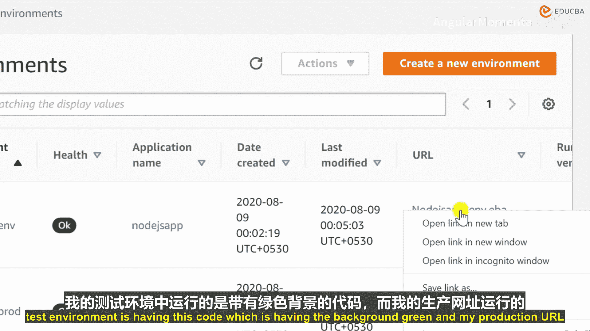
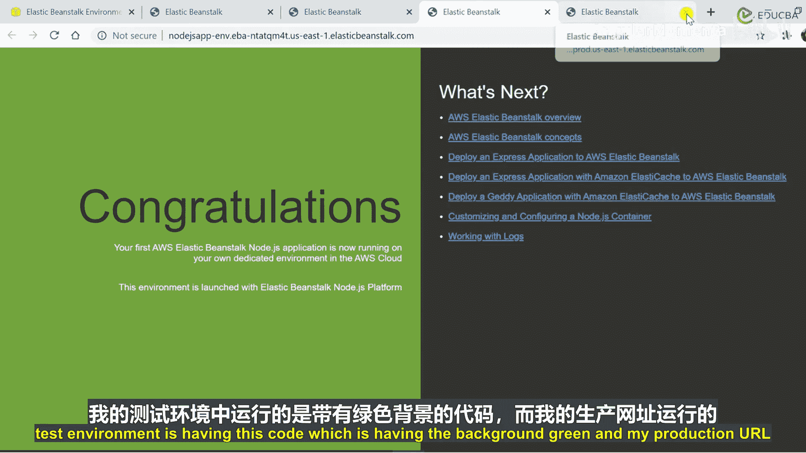
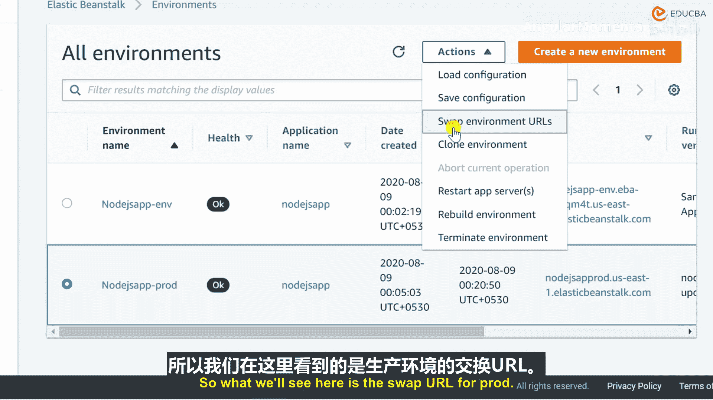

# 【EDUCBA】AWS Elastic Beanstalk与云项目的持续集成⧸持续部署 ｜ AWS Elastic Beanstalk & CI⧸CD for p18 02_02_03_演示背景 -BV1zXcKzNENN_p18-

We'll see how to make use of bluegr deployment method to ensure that when we deploy new application version。

 then you can use an option which is swap URL or you can swap the links and ensure that the domain traffic is been sent to the instant or to the environment with the new application version so let's see the entire process how it happens。

So for my application， these are my2 environment as we have discussed already in a previous stage what we did we deployed our new code。

😊，To the broad environment。 So currently， my test environment is having。

This code， which is。

Having the background green and my production URL is having this。 So what。Is up happening here。

 F of the production traffic is moving to broad environment。What we can do。

 we can swap the URLs with the option。 What you can get is here select the environment and click on actions。

 you can see these options load configuration save configuration swap environment URL clone environment。

 So these are like by reading the name itself you can come to know their functionalities。

 So what well see here is the swap URL for Pro。

