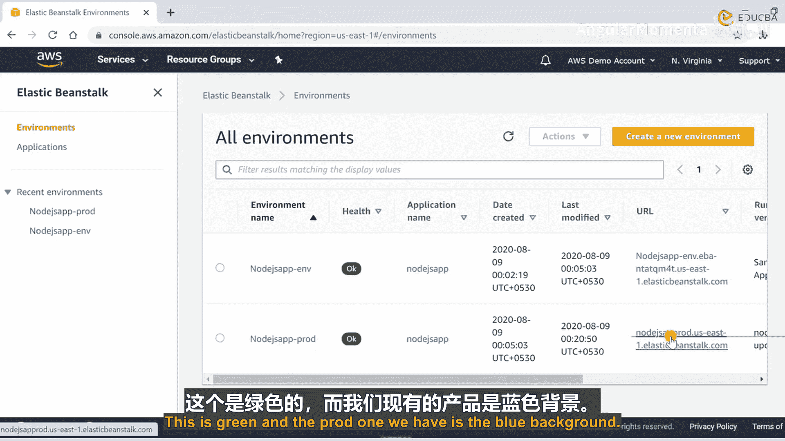
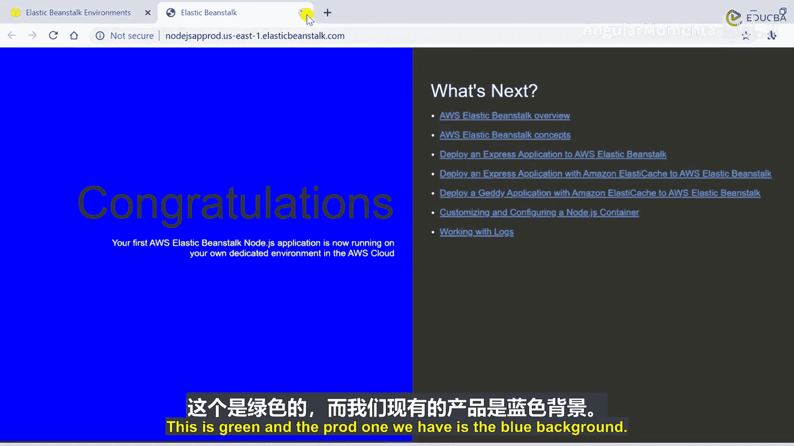
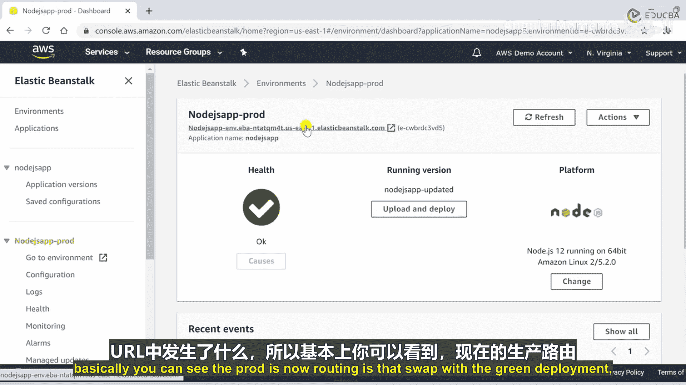
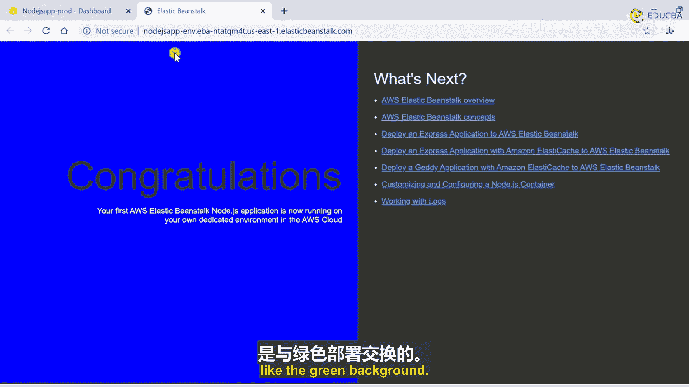
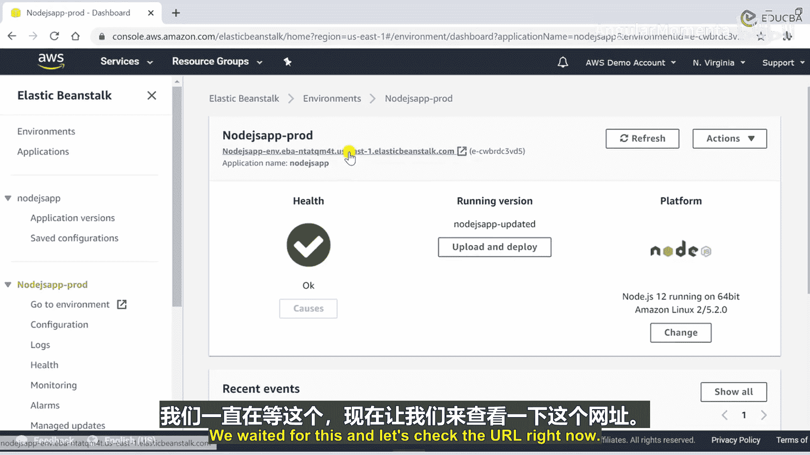
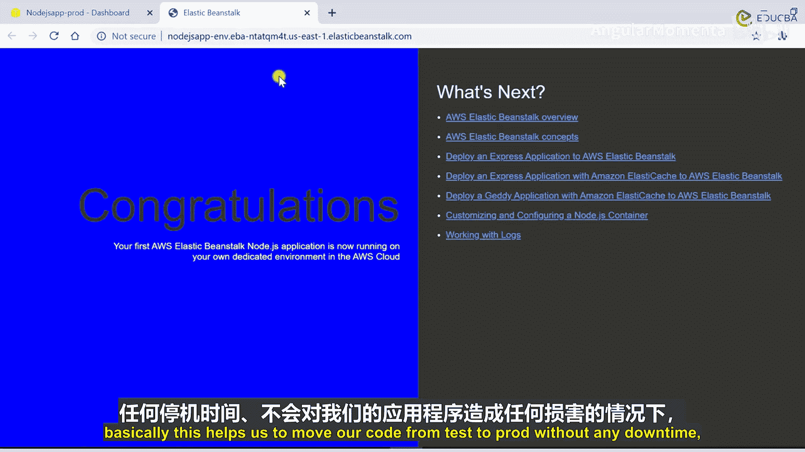
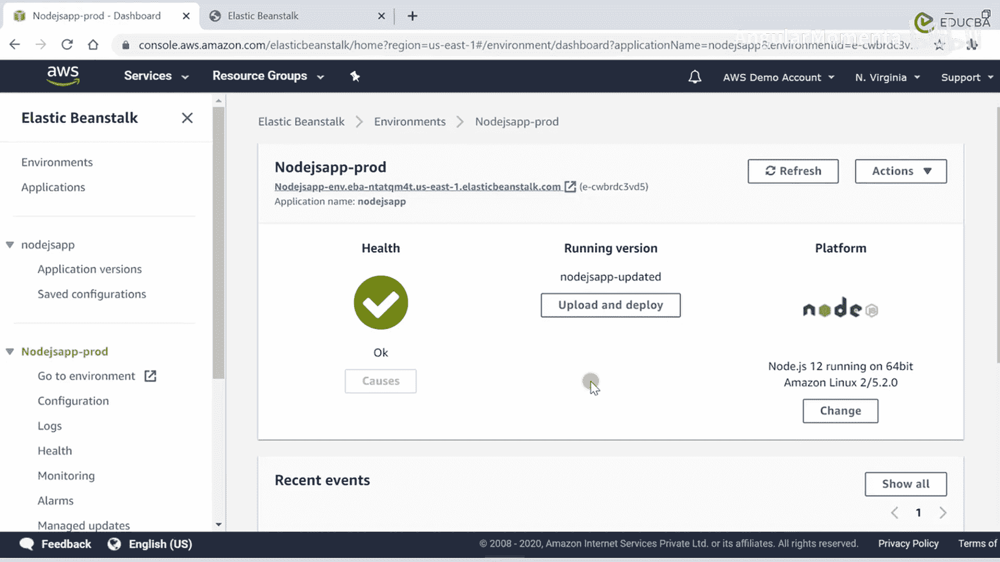

# 【EDUCBA】AWS Elastic Beanstalk与云项目的持续集成⧸持续部署 ｜ AWS Elastic Beanstalk & CI⧸CD for p19 02_02_04_演示背景延续 -BV1zXcKzNENN_p19-

So， as we mentioned， we need to route our traffic to the required domain link for that well be using the Amazon service known as Route 53 search routeute 53 in your search tab you will get this window。

You have one hosted zone here mentioned， you can have multiple hosted zones。Like this。

 this is my host what we need to do is here we need to create a record。

 so just click on create record。As like， you know， it's the basic thing to know about the routing policies。

 if anybody wants detailing like which how many types of route routing policies are there。

 So you can just read these description given here。It will clear your idea for this demo purpose。

 I'll be using weighted one。 So just click on next。

Here we need to configure few parameters which will give our record configurations so this is you can give any name over here。

Now you have to you know select the record type， so I will be going with the default one。

 which is the type aim。Which will route traffic to the IP 14 address IPV4 address。

And I'll keep the P at time to live as 300 seconds。 Yeah， now we need to define the weighted records。

 Now what will do will'll click on that。 It will say these are the things you have selected as a record name and record type。

 Now you want to select the endpoint where we want to。Drought of a thing。

Here you can see there are different types of options in the dropdown。

 which you can see which will give us an advantage like Cloud 53 is interconnected with these other AW services such as gateway API。

 cloudfront distribution， elastic windstock， the app the load balancers。

 etc as we are working with the elastic windstock environment。You can just select the region。

 We are working with the US East Virginia， and then。The URL， that is our broad one。

You can also see the test one。 But now currently， we are working with this。

 This is the configuration。You have to enter this I D also。 Okay。

 you can just give sample domain testing。And define the weighted valve record。Yes。

 so this is created。😊，Now we'll just create this record。 This record is getting created。

 So in what we actually did， we just routed 10% of our domain traffic to the pro link。😊，Now。

 we'll create one more record。Yeah。To route 90% of my traffic to the test environment。 So again。

 I will choose my routing policy as weighted。Click， next。The same process will go。

Will define our weighted policy here again， the name will be this route type record type Ill select a and here under the endpoint section will go with the elastic windstock environment region will be US east1。

And this time， we will select this one。The weight now this time I'll give 90。No help checks。

And this will be the record I D as。We have defined it。And now， we will。Create。So。

 now we have defined our。Domain， like we have routed your entire traffic in two domain links，1。

10% to the fraud and 90% to the test。 So let's go back。 I think route 53。

 we have configured everything， and let's。You can see here how it it got created。 Yeah， this one。

 So weighted policies。Now， we can go back to elastic windstock。And see how it works。Yeah。

 these are our environment test environment。 And this is the pro en environment。 As you can see。

 this is my test。 will again， just open to see the output test。

 This is green and the pro one we have is。😊。

The blue background。

What we can do now， once we have configured everything。

 the route 53 weighted record sets and all will just select this broad。Envi ro。

Go to the actions as we already discuss these different types of functions are there。

 the most important function in this blueprint deployment is swap environment URLs。Just click on it。

This will do what it will actually do。 It will swap your pro URL with the test one。😡，In the dropdown。

 you can see the environment which is our test one。 Okay what actually it will do。

 it will just change the URL from pro to the test again。

 it gives you a warning swapping the URL will modify route 53 DNS configuration which might take few minutes your application will continue to run while the changes are propagating。

 So there is no downtime。 You can see your your your application will up and running。

There is no downtime。 This is the most important feature。

Of this service basically so now what actually will happen。

 our probe link will get converted to the test link like all the DNS policies will get changed hit the swap button In background the process is going on。

 you can see。😊，And。The deployment is like in a healthy state。

Let's check what's happening in this URL。 So basically。

 you can see the pro is now routing is the swap with the。

Green diploma， like the green background。

Okay， still， it's coming like blue。 We check， as they mentioned。It will take few minutes。

 Keep on refreshing the page。And we'll see。 Yeah， it's been 2 to three minutes。 We waited for this。

 And let's check the URL right now。 We'll just open this。

And Yo有gu。What actually happened here， you。See， step1， what we did。

 we routed our traffic of 90% to the test environment， which was test environment。

 Miss you take imagine like the green background and 10% to the blue color。 Okay， the second step。

 what we did。 We swap the URL。 We selected the pro environment went to the action selected swap environment URL in that。

 we swapped our pro URL with the testing one。😊，Basically。

 our production environment is now ideally will get 90% of the traffic。 What we did。

 we refreshed the page。😊，And here we' get the output。 The URL is like when you see the URL。

 it's for the testing one， but it's having it's routing all the traffic to the updated pro code。

 This one， Basically， this helps us to move our code from test to pro without any downtime。

 without any。😡。

A harm to our application。 This was the simple example。

 You can use the same terminologies and same method to modify your complex code by just uploading your new code。

 you down deploy it with the different options we have by swapping the URLs from test to port and there are multiple options you can go through and play with this application service。

 This AW service is free of cost as I've already mentioned and only you have to pay for the services which are your application is gonna use。

😊，So， yeah， this was all all about the blue green deployment and the deployment options。

