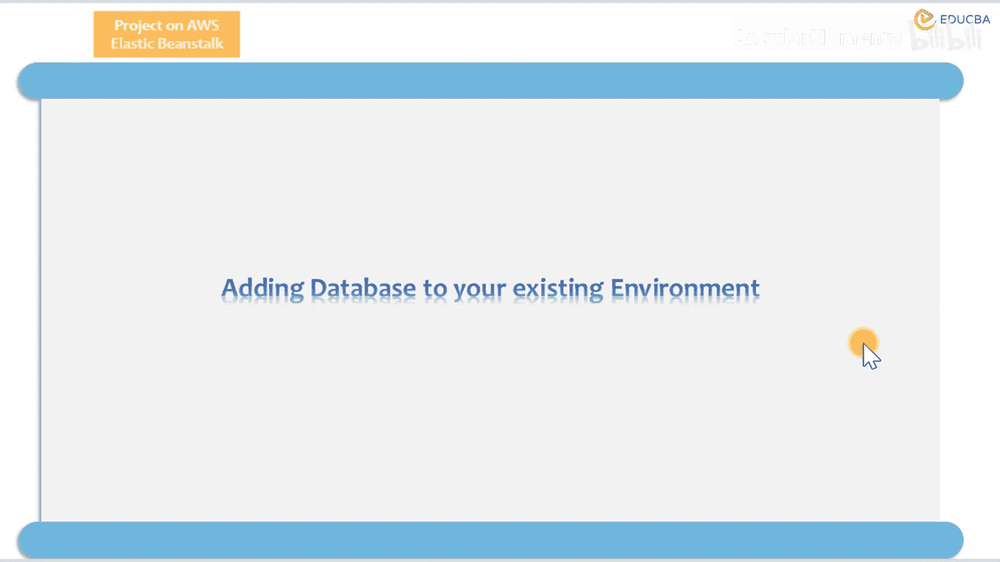
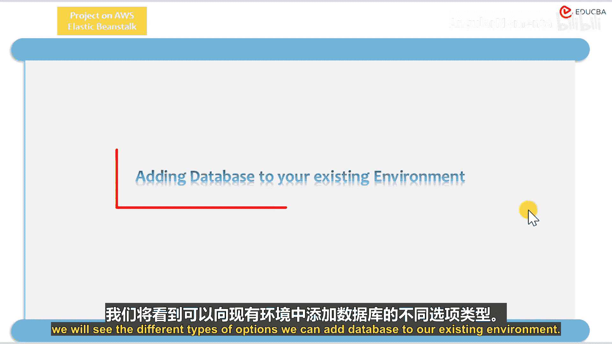
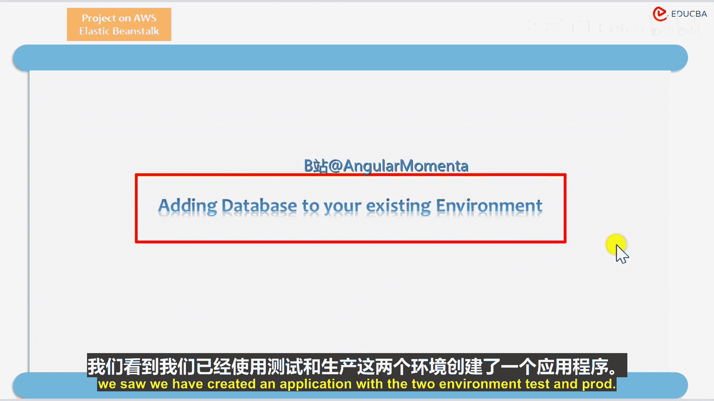
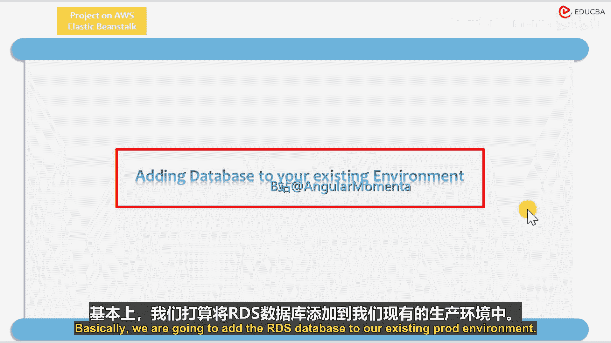
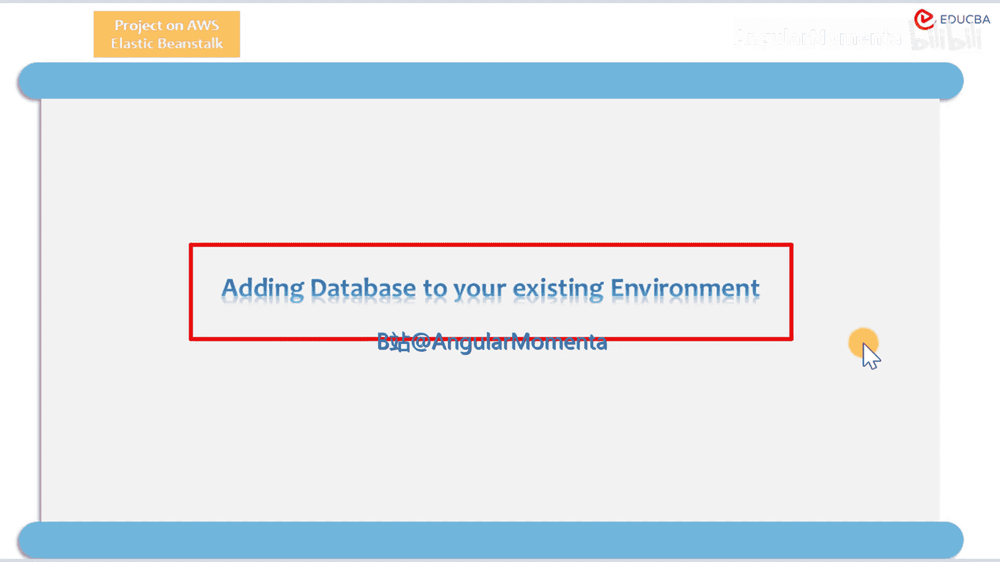

# 【EDUCBA】AWS Elastic Beanstalk与云项目的持续集成⧸持续部署 ｜ AWS Elastic Beanstalk & CI⧸CD for p21 03_01_02_数据库导论 -BV1zXcKzNENN_p21-

So in this video we will see the different types of options we can add database to our existing environment。

 So in the previous slides we saw we have created an application with the two environment test and pro We will see how we can add the database Basically we are going to add the R database to the to our existing fraud environment so let's get started。

😊。

