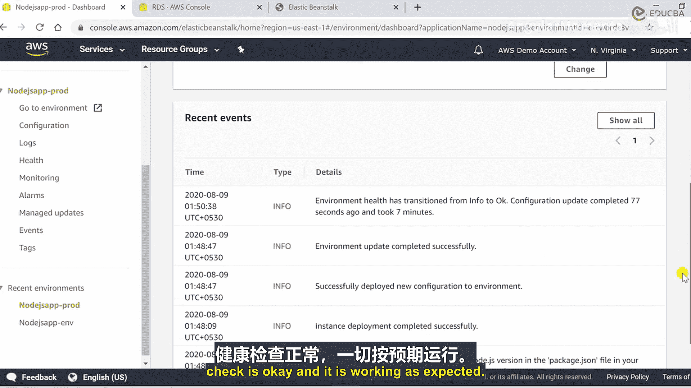
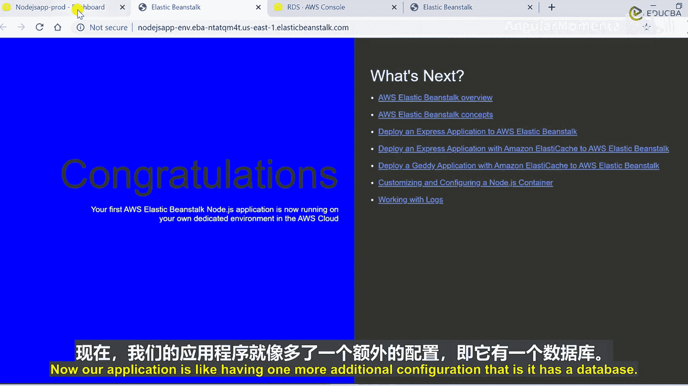
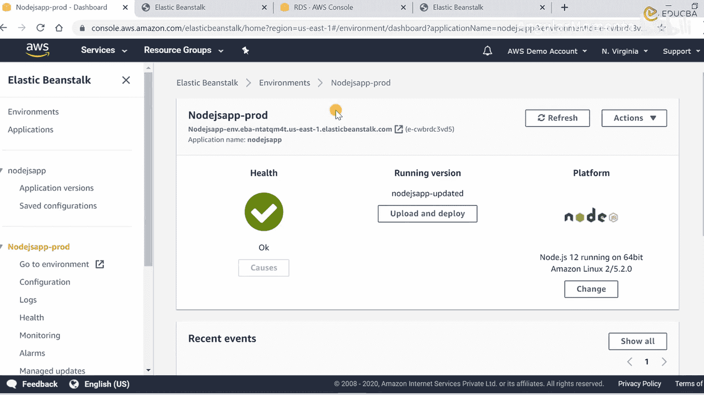

# 【EDUCBA】AWS Elastic Beanstalk与云项目的持续集成⧸持续部署 ｜ AWS Elastic Beanstalk & CI⧸CD for p22 03_01_03_演示数据库 -BV1zXcKzNENN_p22-

So， this is our elastic Minstock dashboard where you can see the two environments will go inside the broad environment。

Currently， it's in a healthy state。So now what we have to do。

We have to add the Rdius database to this。 So what actually Rdius is。

It will currently be this application is not having any database added。

 so what you can see where the configurations are added or edited is this。😊，Configuration column。So。

 once you hit this， you will get all the configurations which are present over here and you can have an option of edit。

😊，To edit those。But the last one is database。 we don't have any anything over here。 What will do。😡。

We will just click on edit。It will first fetch the configuration RIS configurations for us so basically for modifying the database so what it will do it will add anardIS SQ database to your infrastructure to your environment for development and testing purpose AWs elastic bin stock what provides the connection information to your instances by setting the environment properties for the database host name。

 username， password， table name and the port when you add a database to your environment its lifecycle is tied to your environments。

For production environment， you can configure your instances to connect the database。😊。

So now here it is having few parameters which are saying like ideas will create snapshots。

 So what it is saying restore and。😊，Snapshot。 So this option is asking us whether to restore an existing snapshot in your account or you need to create a database。

 so。If you know。We have an option in AWs。 we can restore the database from the snapshots。

 So basically this option is just saying that。 but here we'll be going with creating the new one。

 So we'll say none if you have anything， then it will come inside this drawer inside this dropdown。

 So currently we don't have anything it's just coming none。 Now once we select it。

 we need to create a database this are the following things So by default。

 its saying my Sql engine but we have number of database。

Options or here that is oracle post SQ server web and the rest of the things。 So for this purpose。

 we'll be going with the default one， which is engine Myq engine version is like 8 dot dot 17 and the instance type instance class is course to like the T2 micro。

 which is like default free comes with this。 What is actually is asking we have an option of choosing 5 gb to 1 or 24 gb storage。

 So we are taking the minimum minimum is like the5 as this is a demo purpose。

 Now we will give the user and a password。 Now this is very important to configure the user name correctly and the password。

 this will actually help you to go inside the ideas。 So if we give here testing。Db。

 and I'll just give the same testing D the next one is that retention when you terminate your environment。

 your database instance is also terminated。 chooseose create snapshot will save your snapshot of that database prior to the termination and that same snapshot。

So basically you can connect this with the first option so why it was saying one any in previous if anyone is like restore any snapshot so we can just restore that database from that。

 So by here I'm just telling that I don't want anything I just want to delete。

And here if your application is not going to be a multi multitenant or like high availability so you can just go with the one environment zone or you want to like like use the high availability then you can just go with the multi isn but right now I'm just going with the one availability zone。

😊，Make sure you have entered everything correctly and then just apply。😊，It's validating。

 and it's saving all the configurations。 It's asking me to save。

Good not to save any configuration on your desktop related to the database。 Yeah。

 so basically now it's taking。It's just deploying again。

With all the as we have changed some configuration。

 it will update my environment with the Rds with the database what we just configured so it will take a few minutes。

 I will pause the video and we can also check once the deployment is done the database in updates on this events so as we can see its getting like you know creating the Rds with the name。

This it saying it will take few minutes， but we can monitor if you want all the activities happening in this event section under this。

And you can observe like at what time what steps are happening if you are a beginner for this elastic brainstorm。

 it is very interesting to know what。Is actually happening in the background while the deployment is happening。

 As you can see， I'm not refreshing anything， but by default。

 it is getting refresh refreshing because at  one，1 step。

 any update in the application it's getting refresh。 the page is getting refresh。

 So now you can see the event that。😊，RDius database is created with this name。What we can do。

 we can just cross check this right in your consoleard and you can check。

What are the configurations that we selected there are exactly created like that or not in this idea section you can see databases and yes。

 see same is created you can see over here。Just click on that。

These are all the security and the connectivity parameters。

 These are all the submit created for this particular Rds。

 This is the security group we are going to use which is an active state you can also give you can also check the replications so currently we have one you can explore more on this by you just click on this as we have not selected any snapshot for this so you don't get anything in this snapshot section you can also modify by hitting the modify modify button in this the same thing what we just configured our Rds is created but our environment is still getting updated with the。

Few things。 and as it already mentioned that it will take few minutes， we have to wait。😊。

It's been like。2 to 3 minutes more。 And we got this message。 Enment health is like， okay， and。

I took around like 7 minutes in all。 so we can just check our production。 Yes。

 the health check is Ok， and it is working。

As expected now， our application is like having one more additional configuration。 That is。

 It has a database。 So， yeah， this is all about how you can add the Rds to your existing environment。

 Also， I want to explore this to you guys。 Like how you can。😊。

Check the logs related to your environment。 You can configure different logs in this。

 You can just ask check last hundred lines or all you want full logs for that。

 you have to configure first your instance。 and then in in instance。

 you have to make sure you configure the logs currently， we don't have。

 so you can't see here you can hit on the health where you can see the oral health or you can just see the specific instance what we created right now that monitoring。

 we haven't。Done with the enhanced monitoring。 whatever you can see in this is the basic monitoring available in the free tire zone。

 This is it。 The CPU uses is 0。6。 The network is like maximum network in is 69 k and the maximum network out as like 38 you can always change the range of this。

 you can as our instance is just created like few like few minutes back so we don't have much difference in this。

 you can always check the hell。 you can check the CPU utilization as you can see the pick here because we just launched our ideas on that。

 So that's why you can see the p So in this way you can always monitor your application。

 you can always monitor what activities happen So you can also you can also like configure this with the cloud watchch which will give you alarm So basically this all。

services are can be interlinked with each other to perform to you know。

 to get the best performance to monitor application。 Also you can set alarms， as I just said。

 you can also do it from here or you can use cloud watcht for this Why I know this topic we are more focused on elastic windstock but Im talking about other elastic like other AWs services also because those are all interlinked with elastic windstock somehow elastic Vistock is basically an environment basically a service where we can basically a platform where we can launch all the other AW services together to get a broad environment。

 So yeah this is all about the AWs elastic binstock from my side。

 please go through it take an AWs account configure these applications these services。

 explore more Exp more I must say。

