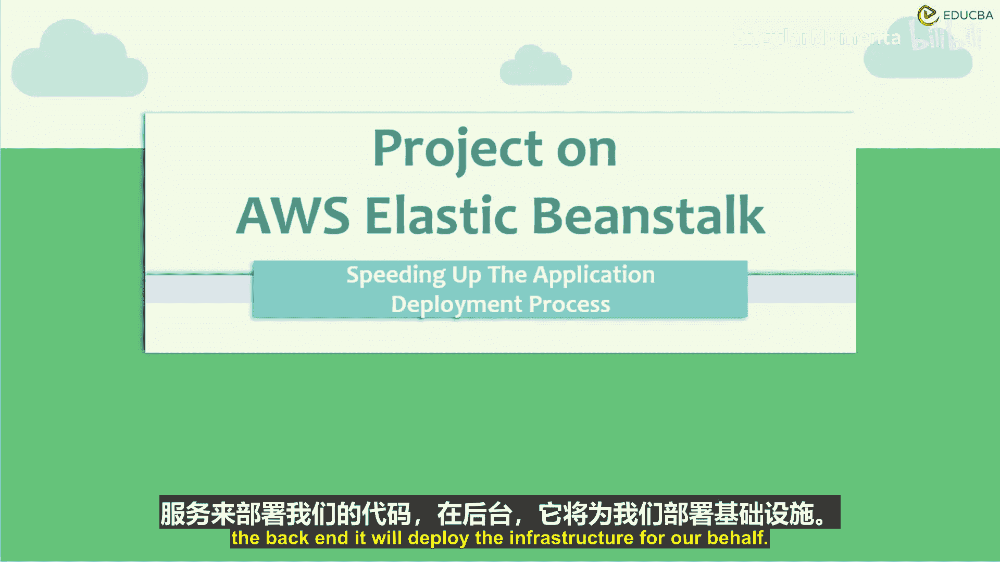
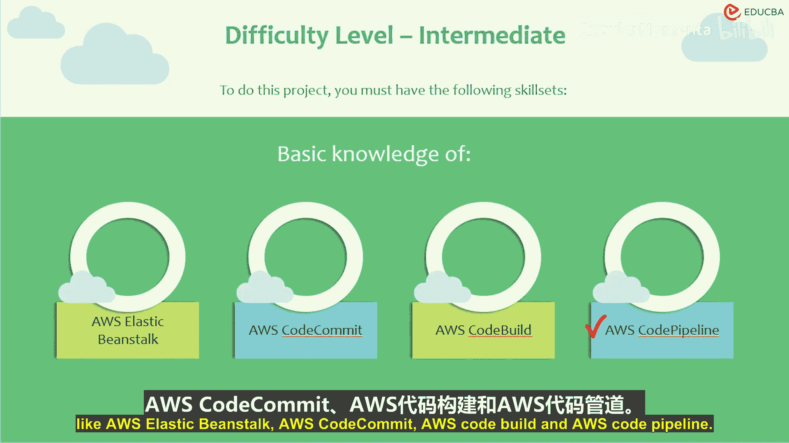
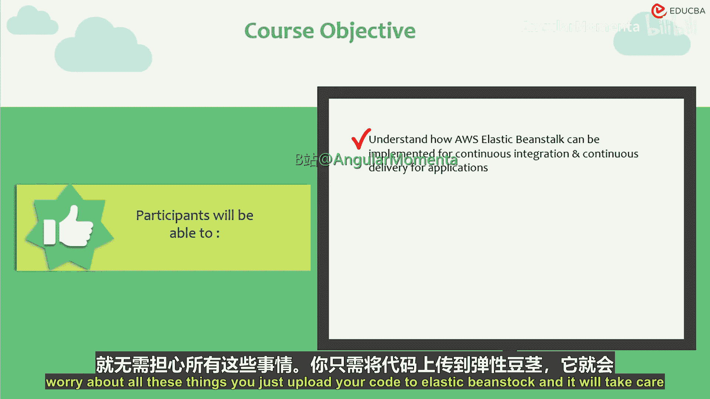
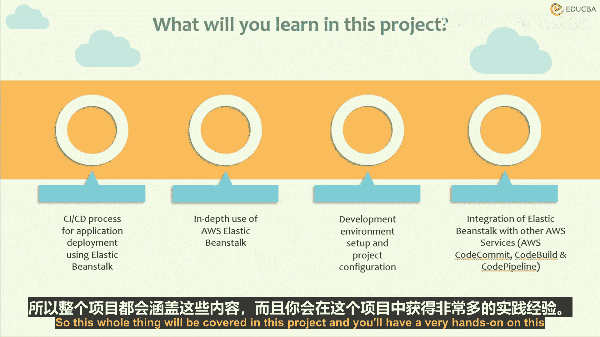
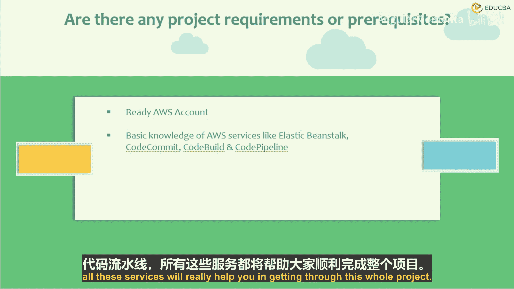
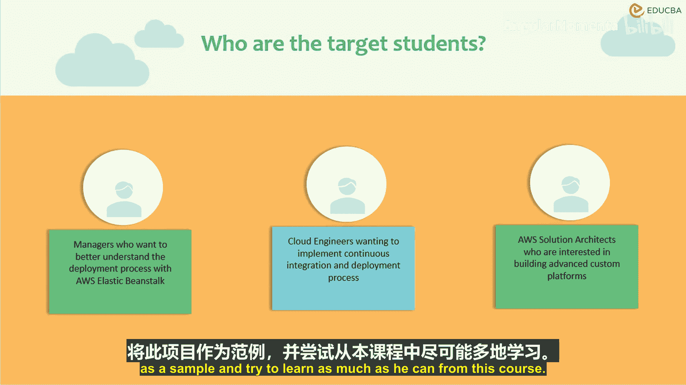
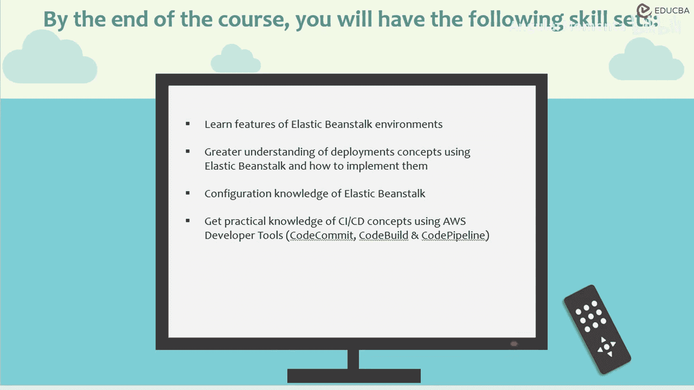
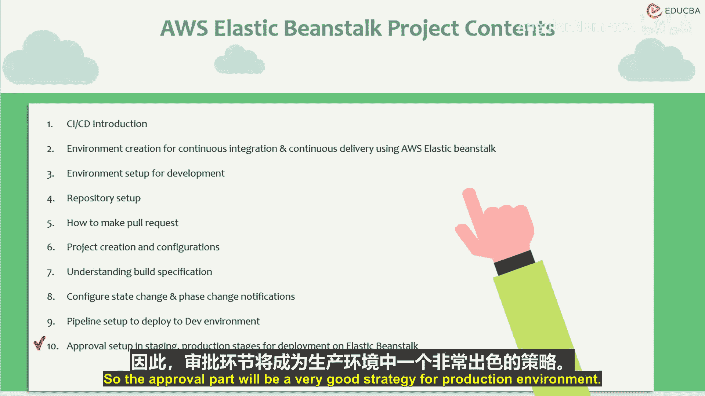
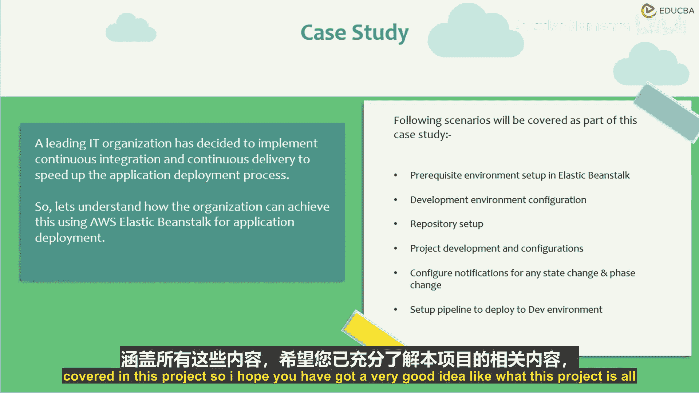

# 【EDUCBA】AWS Elastic Beanstalk与云项目的持续集成⧸持续部署 ｜ AWS Elastic Beanstalk & CI⧸CD for p23 03_02_01_AWS Elastic Beanstalk 案例研究应用部署导论 -BV1zXcKzNENN_p23-

🎼Hello and welcome to this project on AWs Eling Betop。

 So this project is basically speeding up the application deployment process。

 So that is in other words， you can say continuous integration and continuous deployment。

🎼So as we know。🎼Dvos is fast becoming a standard right now。

 and CD is the term often associated with development and release of a software in the Devvos process in simple terms。

🎼Continuous integration is a process that allows developers to integrate their code into the main shared repository multiple times a day and providing them with instant feedback about possible broken functionalities or tests instead of building and integrating software work products from different teams or people at the end of the development cycle。

🎼With continuous integration， you can build it at regular intervals。

🎼This helps developers to meet the code quality standards。

 resolve bugs early and reduces integration costs so continuous delivery is a extension of continuous integration that helps you focus on automating the delivery process of the software。

🎼Development。🎼Wwhich helps in deploying staging and production at any time so continuous development and deployment is a process which automatically builds。

 deploys the code onto the server the process can be fully automated which will be built test deploy in multiple environments and it will automatically handle any will failures and divert back to the previous good state so when we talk about deploying application using CICD。

🎼There are several tools in the market which can help you build a CSCD pipeline capable enough to answer all your agile and continuous build deploy and delivery requirements。

Like we have Jenkins， we have Travis CI， we have Gitlab， bamboo。

 and some of the names which come to my mind immediately when someone says CSZD。🎼But in this project。

🎼We will be going to deploy CSCD using AWS tools like we will use AWS code pipeline。

 well use code deploy well use El Be stock as a infrastructure as a platform service to deploy our code and in the back end it will deploy the infrastructure for our behalf So when we talk about the difficulty of this project So it's a intermediate level project and you need to have some information on these AWS services like AWs El Bet AWS code commit AWS code build and AWS code pipeline the objective of the course is to understand like how elastic bin stock can be implemented for continuous integration and continuous delivery for applications So when we talk about elastic bin stock it's a highly managed。

🎼T for deployment of your code， So in usual cases you need a server and you need to configure your。

🎼Cold on that server and build some databases as well， take care of security， everything。

🎼Once you are doing all this things， then it might be that your code will run on this infrastructure。

🎼But when we use elastic Be stock， we don't have to worry about all these things。

 you just upload your code to elastic Be stock and it will take care of all the infrastructure needed。

🎼So now when coming to what you will learn in this project， we have like。

🎼A CSCD process application for deployment using elastic bin stock in depth use of elastic bin stock you'll learn。

🎼And setting up the environment。🎼For elastic beans stock and setting up the environment for like code pipeline code deploy and like how you can automate the whole cycle from checking of the code till the deployment process in El Besstock so this whole thing will be covered in this project and you'll have a very hands on on this project so when we learn about this project I would advise you to create a free AWS account and be familiar with some of this AWS services which I mentioned here like El Beta Code commit codeBuild code pipeline all this services will really help you and getting through this whole project。

🎼ho are the students like what are the target people which this project can help them so we can we anyone can run this project especially any technical engineer who is trying to implement CCD in his environment or any cloud engineer or any solution architect or any developer or any manager trying to implement CCD and want to work with DevOs kind of thing can use this project as a sample and。

🎼Try to learn as much as he can。

🎼In from this course so once you'll complete this course。

 you'll learn some features about elastic green stock environments。

🎼You'll have great understanding of deployments using elastic bin stock and how to implement them configuration knowledge of elastic bin stock and very good practical。

🎼Example of CCD concepts using AWS tools， and you will be able to completely。

🎼Build the whole pipeline。🎼With yourself by following discourse。

🎼So if coming to the contents of this project， we have these many topics to be covered first introduction then。

🎼Environment creation for CSD using。🎼Elastic main then En set for development so this project will be going to use PhP。

🎼So I'll set up environment for PhD in the upcoming lecture。

🎼And then we will learn how to set up our deposititory and how to make a pull request and push our code to code commit then the project creation and configurations like what other things we are configuring so that our code can run easily in plastic bin stock and then we'll understand the build specifications like what things we need to consider when we are checking our code and how to prepare our code so that well get very less issues。

🎼In the deployment。🎼And then， we'll。🎼Set up some notifications as well。

 which will let you know like when our code is getting deployed， getting built， whatever。

 so you'll be able to know and track what is happening on your environment。

🎼And then we'll deploy it to dev environment and then to Pro。

🎼So in between we'll set up some approval steps as well so that you can approve manually like whether the code need to be deployed to dev environment and or fraud environment so the approval part will be a very good strategy for production environment。

🎼So I'm taking the example of a leading organization which is trying to speed up the application deployment forces using CICD and it will cover all these scenarios which is mentioned here like pre K environment setup and then development environment Conation。

 repository setup， project development and Conation。

🎼And notification changes and setting up approvals and pipeline for deployment to Dave and fraud environment so all these things will be covered in this project so I hope you have got a very good idea like what this project is all about so thank you for listening。

