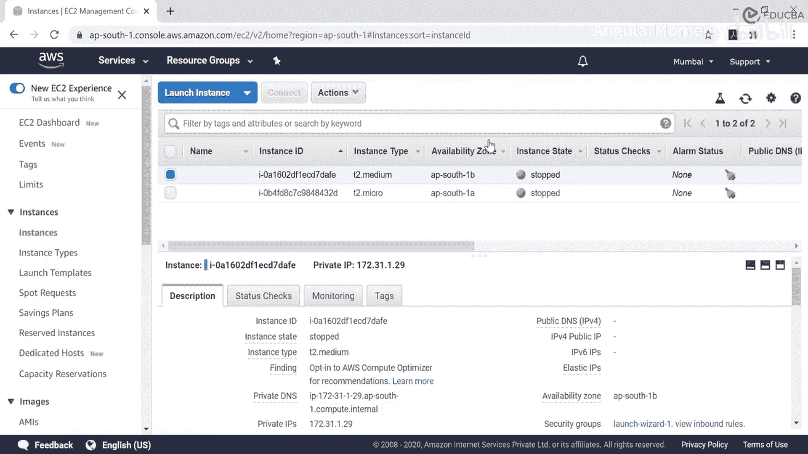
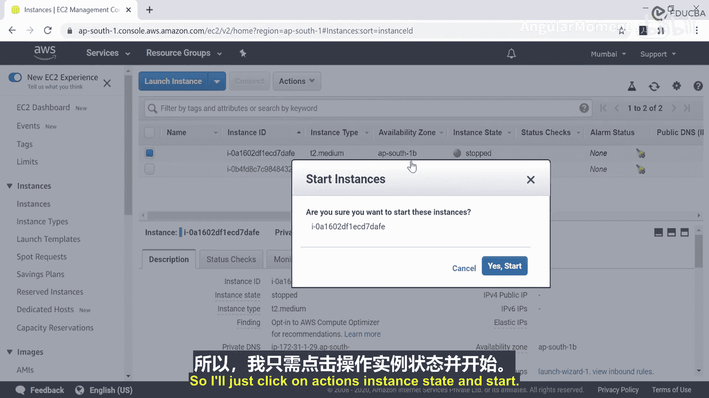
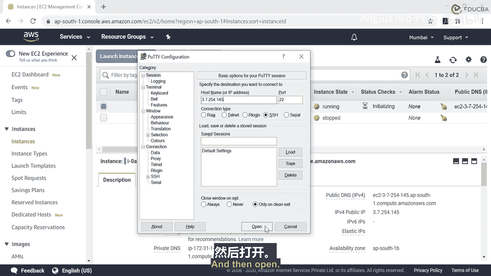
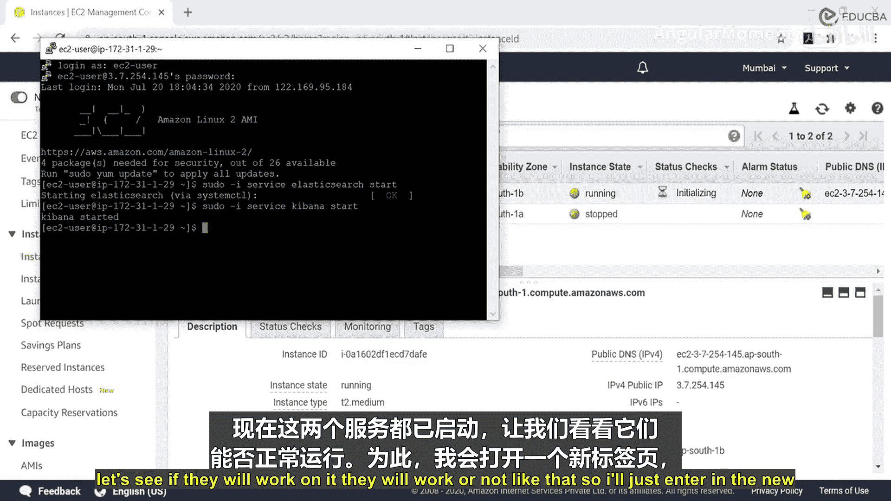
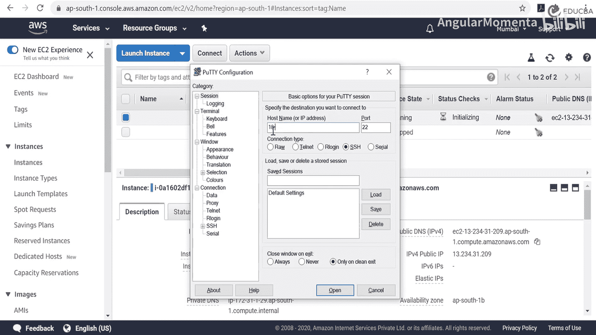
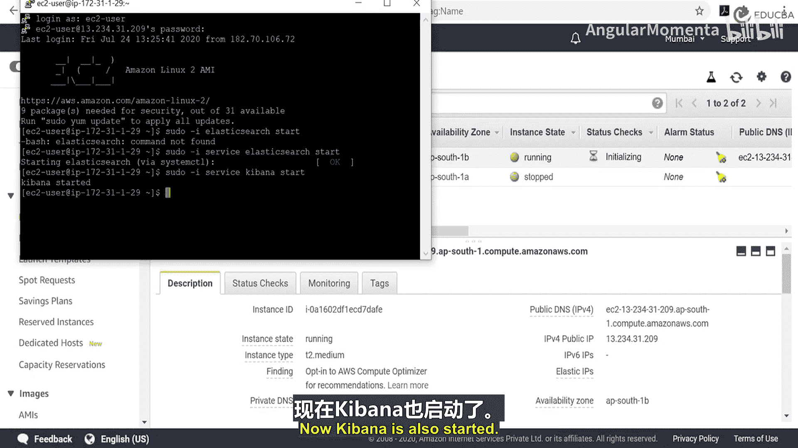
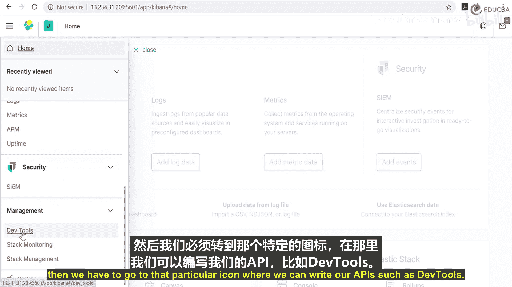

# 【EDUCBA】AWS Elastic Beanstalk与云项目的持续集成⧸持续部署 ｜ AWS Elastic Beanstalk & CI⧸CD for p24 03_02_02_理解AWS控制台 -BV1zXcKzNENN_p24-

Let's start with our project on flight monitoring during Cod 19 pandemic it is basically used in aviation industry The softwares are Elasticse and Kibanana for this you required the basic knowledge of Linux and also the installation of Elasticse and Kiana should be there in your system。

Problem statement， understanding AWS console and its working。

 I all the APIs to store and access data from no SQL database third。

 creating pie chart table and histogram in Kiana using data from no SQL database created earlier。

And finally creating a dashboard with all the data visualizations and work on filters to fetch data。

Now， in this particular video Ill only cover the first problem statement that is understanding AWS console and its working Ive already used AWS console and created a shareable IP address through instance。

So what is AWS console Now， EWS console is a web based user interface which gives access to the cloud through the E to instance service。

 Consider a scenario in which you are residing in a small house。

Where you don't have all the facilities， but you do have knowledge to work on that facilities。

 and you want to work on that。Now， there is another house that is a big house。

 which has all the facilities on which you want to work on and the basic internet connection。

 And if you want to work on that particular place， you have to provide some fees to that house。 Now。

 to travel from small house to big house， you need a particular bicycle。

 That should be with you when you want to enter the big house。Now， in this whole scenario。

 the small house is a local host。The big house is AW S console。

 That is which allows you to share your I address to anyone present anywhere in the world having Internet connection。

And that particular bicycle is put， which is the mediator to enter easy to instance。Now。

 lets start with the service that is how we we have to enter the AWS and how to reach the elastic search。

Now， this is the E to dashboard。 Ive already made my instance on which， on which。

The elastic search and Kiana are already installed。 Click on running instances。

 So this is the instance on which I have already installed the El search in Kibaana。

 and this will only allow me to enter the particular IP address。As you can see。

 the instance state here is top。 Now， what I will do is I have to start this instance。

 So I'll just click on actions。

Inst stay and start a start。

Meanwhile， will go to the putie， which acts as a mediator and will take me too easy to instance。

In this host name， Ill give the public IP address， which this instance will provide。

When it will start。Every time when I will start the service it will already it will change the public IP and the private IP address and we can add that particular IP address only in the put configuration So this is the public IP address enter this particular IP address3 point。

7。254。Dont玩我。And then， open。

This is just the warning and will say yes。 I've already made that username。Initially。

And the password， also。Now， we have reacheded that particular part。 that is。

 we have entered the EC two instance in this particular item。 Now。

 the next part is we have to start the service of Elasticse in Kibaana。 So for both of them。

 there is a command That is first， we'll start the service of Else。By Sudo。I， I eye service。

Elastic search。And start， and then enter。Now it is starting elasticsePrevious I have already installed a elastic search in it。

 so I just start the service of it。When we start both the services。

 well see how it will work and how we can enter it in our computer and how we will work on it。

So the last service is already started now lets start the service of Tiana。So do I service。😔，Gana。

Stop。If you want to stop the service， you can write their pseudoai service Kiana stop and similarly with El search。

 Now， both the service has been started。 Now， let's see if they will work on it。

 They will work or not like that。

So， I'll just。Enter the new tab。And I'll just write this public IP address along with the default port of Elastic search or Kiana as we are working on Kiana。

 let's start with the Kiana， the basic default port of Kiana is 5601 so 3。t7。254。145 Col。3 dot 7 dot。

😔，2，5，4。Dt 1，4，5， column 5，6，0，1。 This is the default port for Kibaana。

 Let's see if it is starting or not。Disloading it。We can also start the service of Elasticse。

 so Else the APIs are only written in Kiana， there is a one part in Kiana which is which allows us to enter the APIs。

So elasticasticse is just to show that it is working or not。

 So let's see that elasticasticsearch works on it or kiana or not。Yes。

We are we have successfully into the Kiana home and similarly into the elastic search also。

 so in this particular video I have already shown you how we have entered into the Kiana now in the next video we work on the Kiana service。

We are going to discuss about our next problem statement that is implementing all the APIs to store and access data from no SQl database。

Everybody should be aware about what is no SQL database。

 no SQL database has no tables and works on the concept of document now again starting our instance like we did in the previous video this is our instance action。

Stand state and。Meanwhile， let's start puty。 Now， we'll add the host name。

 which this instance will provide to us。 So it's still in pending state。 Now。

 we know that in this video， we are going to discuss about the four of our APIpis。Put post。

 get and delete。 Now， we have got the public I P here。Will enter in the host name。

And then， open。We have already created our user。😔，Okay， now we'll start the service。

First Cl start their elastic search service。I starting your last search now。嗯。嗯。

When we start both the service， then we'll go to the clone。Now， starting the service of Hibana。Yes。

Theme command， this。Change in the name。 Now Kibaana has also started， but work here is done。

Now， well enter first the public IP， which we have got from that instance。13 dot2，3，4 dot31。t209。

209 and our default port for Ti is5601 this is loading elastic search。

Then we have to go to that particular icon where we can write our APIs such dev tools。

