# 【EDUCBA】AWS Elastic Beanstalk与云项目的持续集成⧸持续部署 ｜ AWS Elastic Beanstalk & CI⧸CD for p26 03_02_04_可视化饼图 -BV1zXcKzNENN_p26-

We will see the data through API and see how we can make pie chart table and histogram out of it。

So if we run this API。We see the data。We have entered six documents。

With different Is now we will implement it into pie chart table and histogram for that firstly will create the index。

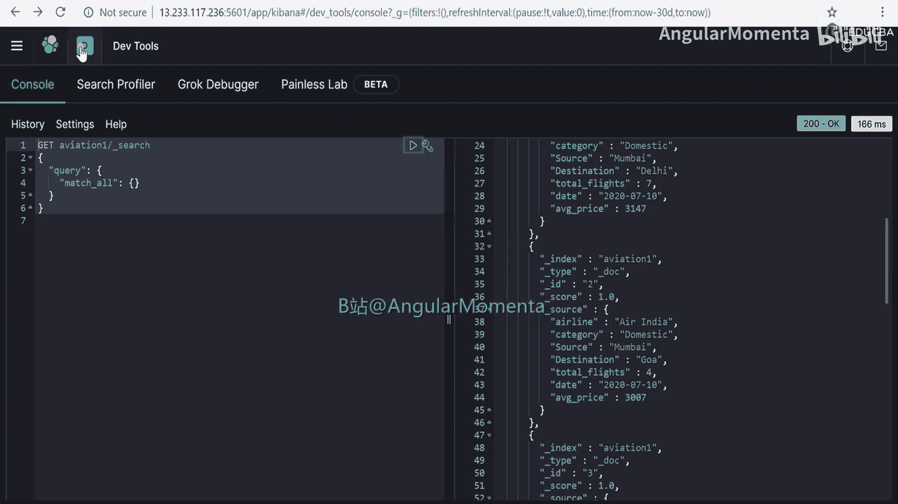

We go to depth tools， manage spaces。Index pattern。And create index pattern。So， we'll create。Aviation。

1 star。S says your in next。And I don't want to use。That time filter。

There are certain fields which we have used。 We have source， destination， airline。

Aish price category。Date， total flights。

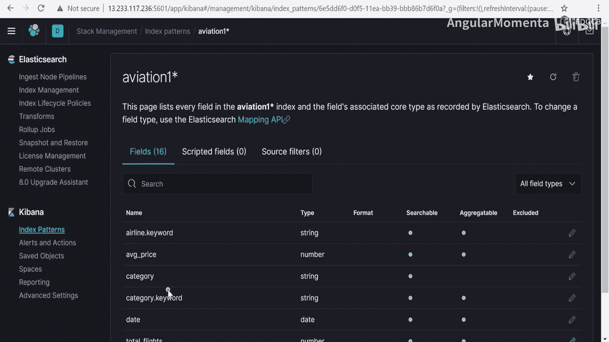

Okay， our index pattern has already been created。Now， going to。

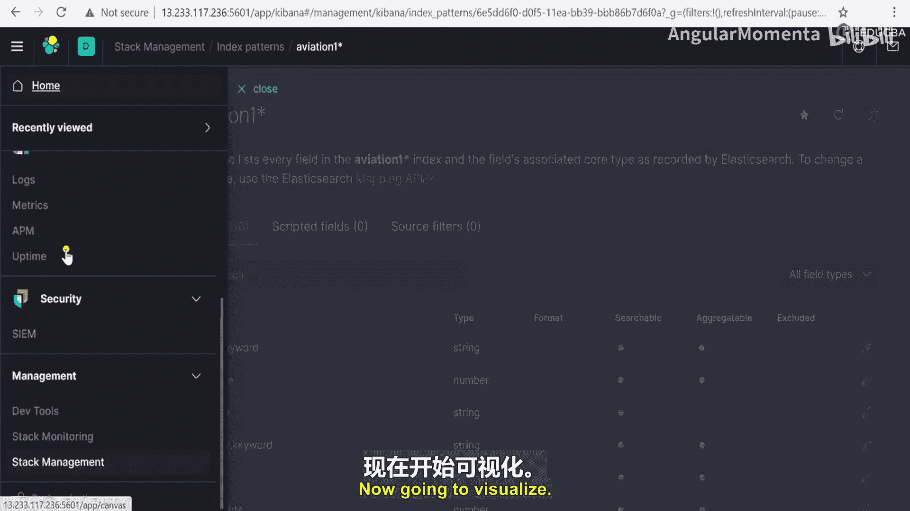

Visualize， let's create our new visualization and first we'll create the pie chart。

 create new visualization。

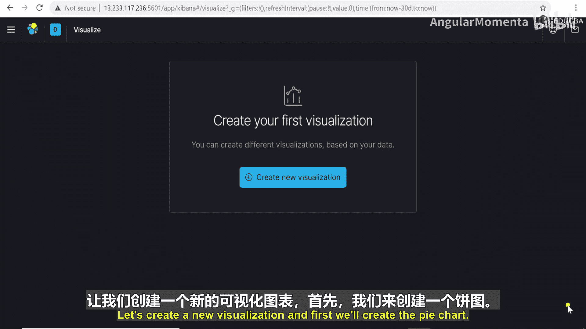

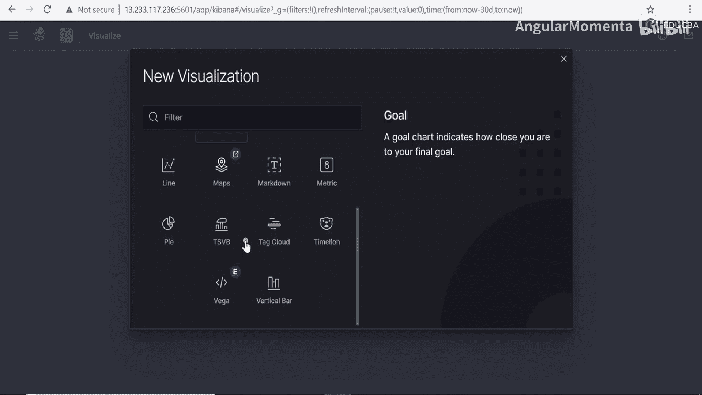

Byy chart。Under index aviation，1 star。And add bucket。Let slices。

We select the aggregation under terms。 This terms will help us to give the freedom to create a field。

So we can select any field of our choice on which we want to create a pie chart。In this case。

 we want to create a pie chart for airlines that is different types of airlines should be shown in the pie chart。

So we'll select from this airline dot key。And will customize the label， too。Airlines。An update。

Now we can see it different。Airlines present in here with different slices。

Now we don't want this into donut， so we'll just unselect it。And this is our final pie chart。

 We can these are the different types of settings which you can use accordingly and work on it。

 So now our pie chart has been created。

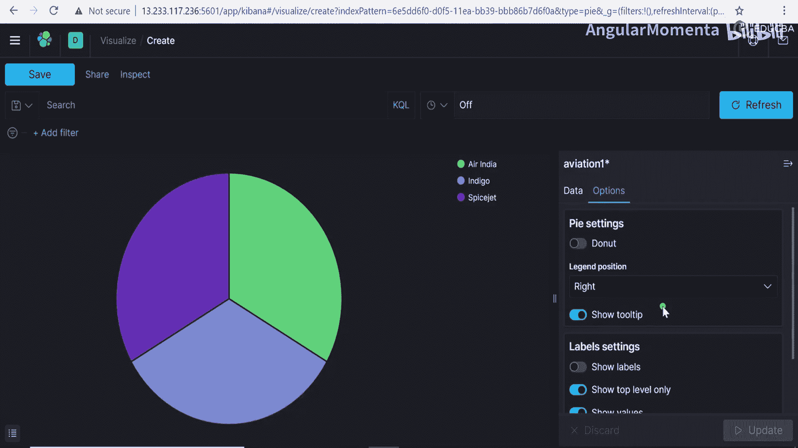

Now， we'll save it。With the name。Aviation。Bter。Aviation 1 by chart as our table name is aviation 1。

Im just going by it。

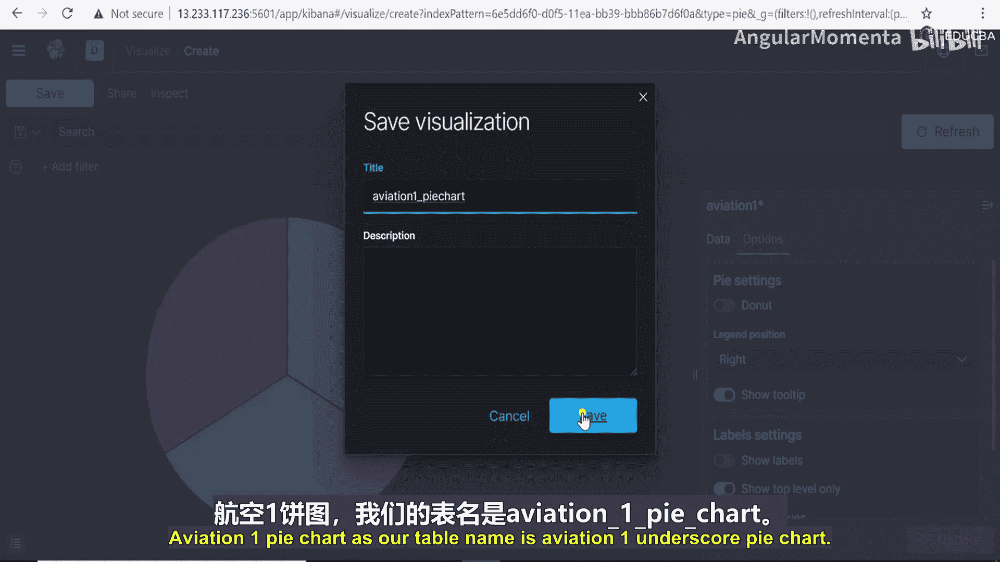

Okay， now our pie chart has been completed now next is his program。

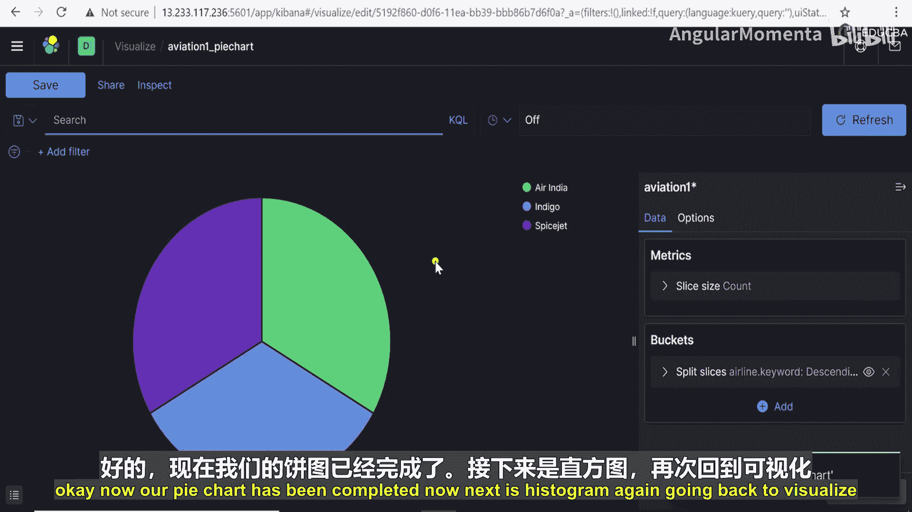

Again， going back to visualize。

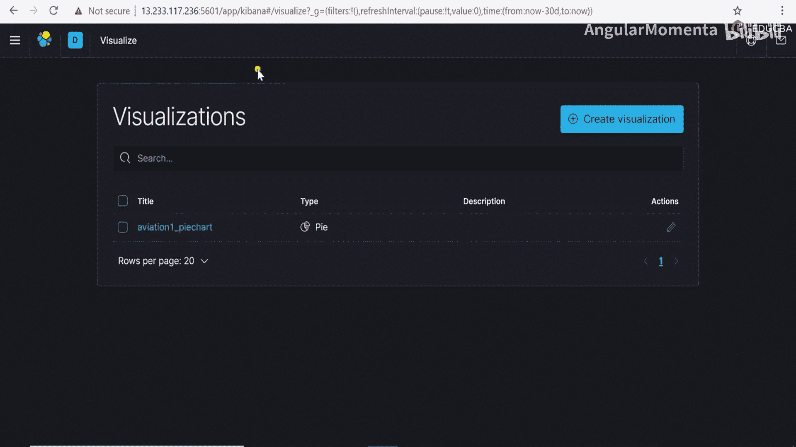

Create visualization。And horizontal path。

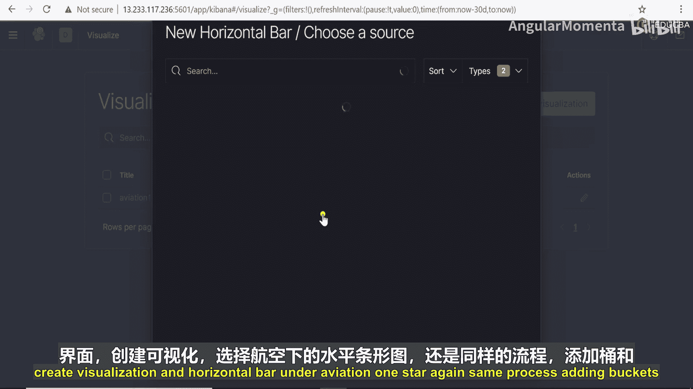

Under aviation one star again。Same process， adding buckets。And split series。Selecting the terms。 Now。

 in this case， I want the category of different。I want this in the different category column。

Like if it is domestic or international， it can show it on histogram that these are the domestic rights and these are international flights。

 so well select the column as category dot keyword。And customize the label as。Aviation。

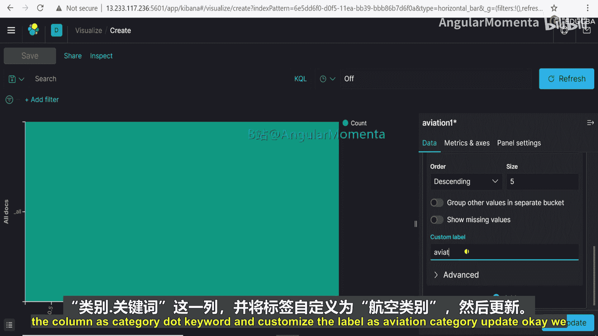

Geting。Update， okay， we can do certain changes also。We'll have to find out the changes。Pel suitings。

Legend position， bottom。

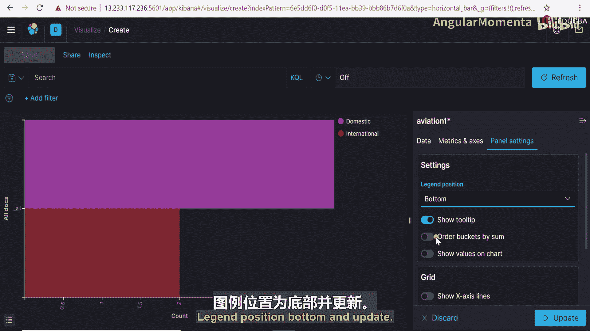

And update。Here we are on the histogram visualized creation。

Now well create a new visualization of histogram。And lets see how it works again with the same process like we have done in the pie chart。

Buckets， add bucket in x axis。Here， select the aggregation on the basis of terms。

Which gives me the freedom to select the field。 And in this case。

 I want the histogram in the form of category that is domestic or international。 What kind of。

Airlines， are we supporting。So， we are selecting category。And label this custom label it is。Category。

And update。So now we can see that the histogram is going on the y axis。

 I want this histogram to be on the x axis， so I won Ill do certain changes on that in metrics and axis。

X X positions to the bottom。

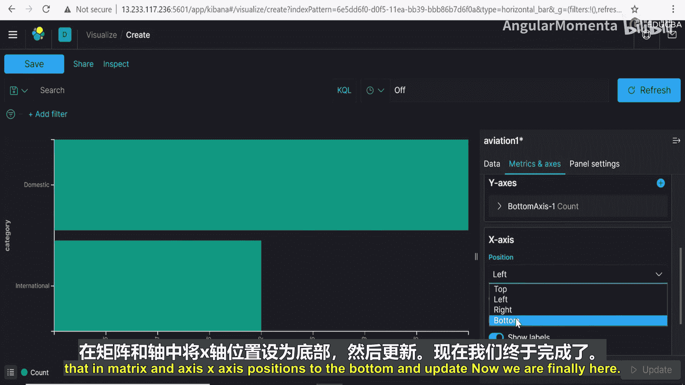

An update。Now we are finally here there are lots of settings where you can perform different different things and different different changes on your histogram。

 you can use as many settings as possible and do the changes hidden in trial methods and see what happens。

Now we'll save this histroogram。

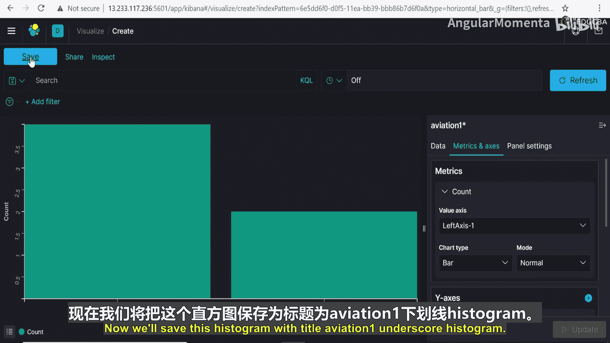

With title。Aviation1， underscore。

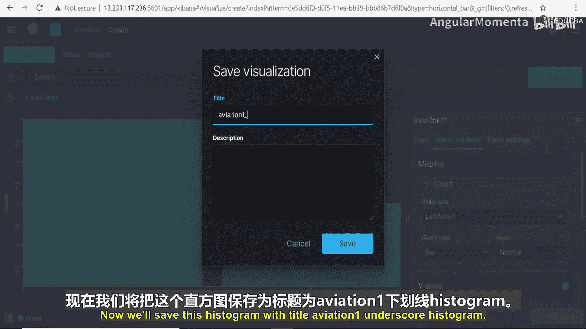

Histogram。Now we have already created P chart and histogram and now will finally create the table。

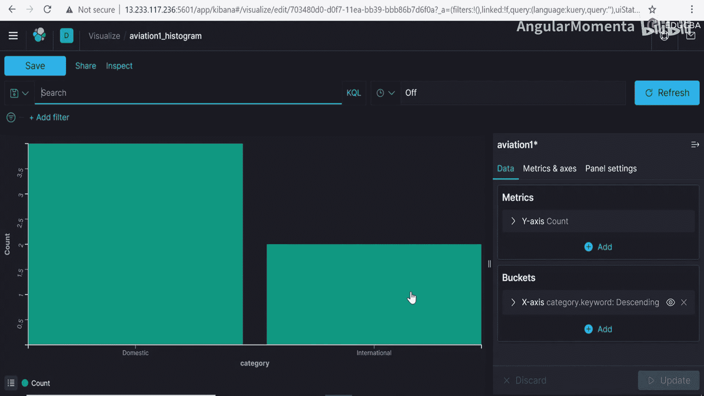

Going back to visualization。Create new visualization and then data table。Under aviation one star。

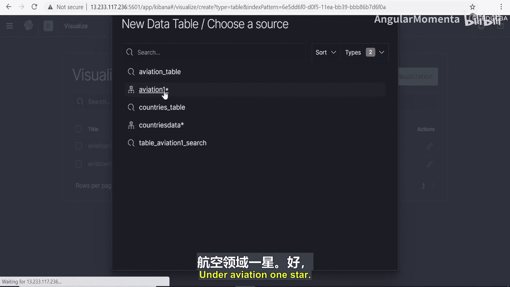

Okay， going to the bucket again。Split rules。Aggregation on the basis of terms。Fend。

Now we want all the fields to present here one by one。

 so we have to write it in ascending or descending order according to your choice like any field you select first will come on the left and so on。

So， I wont。To select airline first， so I have selected the field as airline。And label data， airline。

Update。Okay， we have an airline。Now， I'll add another column。Split rules。

Aggregation on the basis of terms。And selecting the field。 Now， next， I want category。

With the name of。梗得嘅你。We can proceed like this。So let's just go again to this。

Selecting the digregation。Third field， I want is those。The name of sources。Adding。

We are just doing it fast first because we just have to repeat the process。Dons。Selection of field。

Destination。Update。As soon as we are updating it， it is performing the changes on the left。Okay。

 previously， we haven't changed the name。Customom label it into destination。Dong。And。

Category airline， category source destination， all are。有。Total flights。Out did。Okay。

 we again did the same thing， let's just change it into total lights only。Now， fine column is。

Average price。Theybel it is average price。Okay， we do have one column left that is date。

It's the add date also with the same manner， row split aggregation， adding terms。

Selecting the Fless date。And naming it is date。Yes， we have it。Now。

 we have created the complete table。

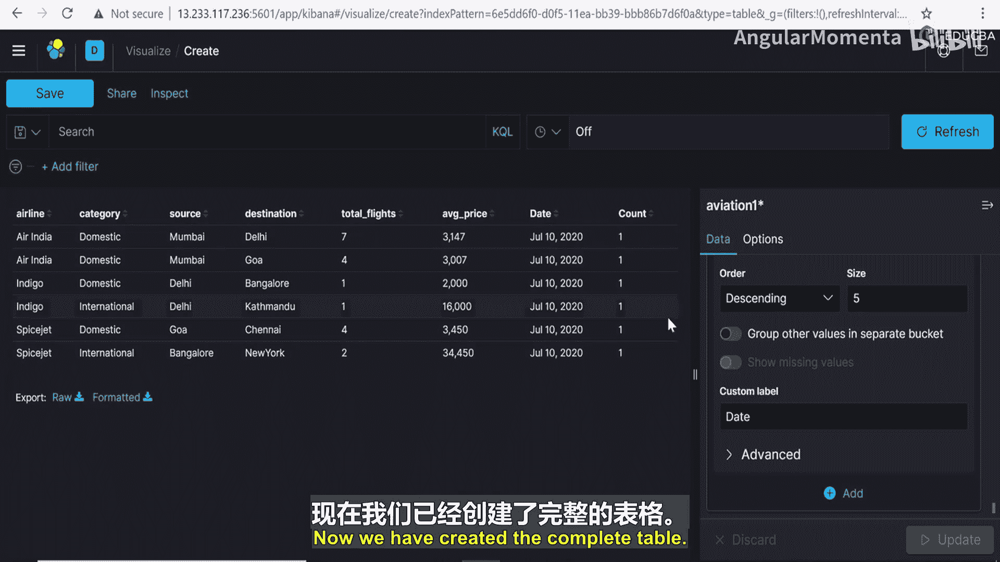

Necessate。Aviation underscore。Weishing one underscore。They大。Any。

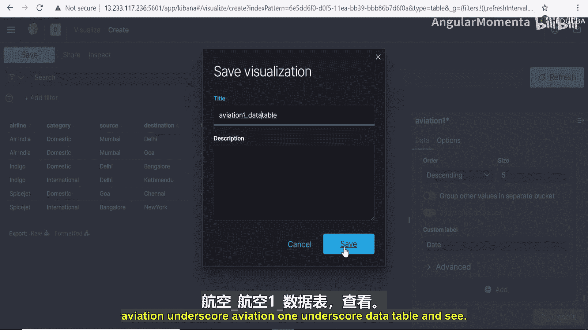