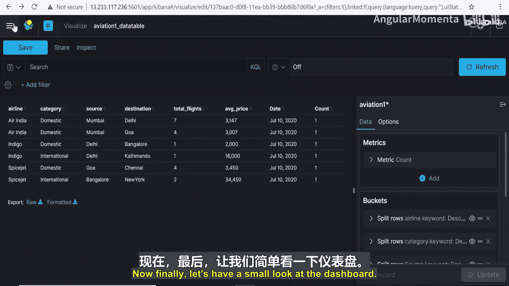
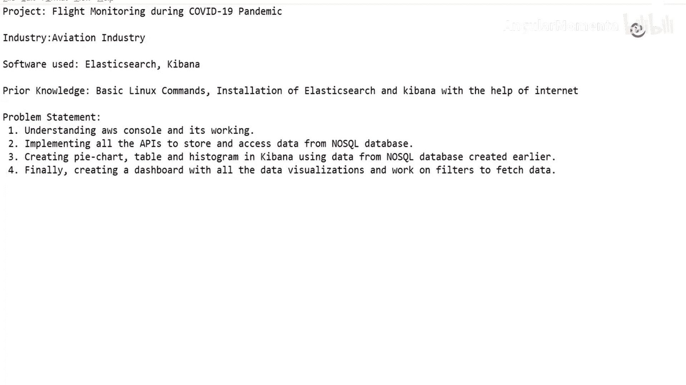
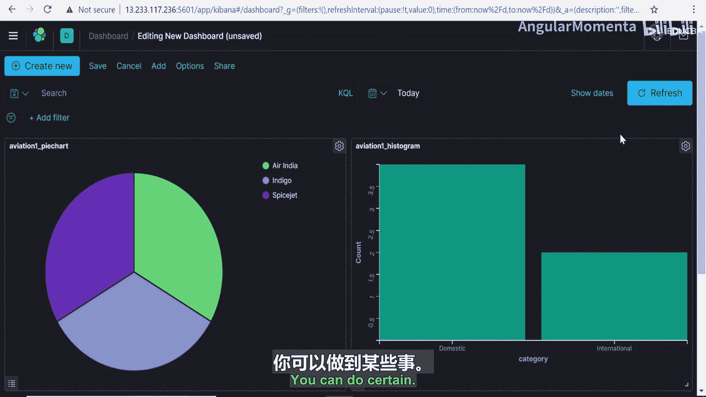

# 【EDUCBA】AWS Elastic Beanstalk与云项目的持续集成⧸持续部署 ｜ AWS Elastic Beanstalk & CI⧸CD for p27 03_02_05_使用筛选器 -BV1zXcKzNENN_p27-

Now， here you can see that at the rate time is also given。

 this is the time at in which I have created this particular field。Now。

 I'll change something in the setting。So for that， we have。

To go to stack management in stack management， there is advanced settings。In advanced settings。

 you can see date format here in date format， you can change the date format according to your choice and there are various date format also provided。

Now， I don't want time along with the date。 So I have removed the time column。

There are also other daytime formats。You can change the date time format according to your requirement。

I'll save the changes。This one is a default date time format which it was given in that particular table if I have changed it now we can see the changes。

In the table。Going back to that。Now you can see that time is removed。And we have left with the date。

 which we require。No for any。

Let's have one look at the dashboard。Now finally we are on a final video and our final problem statement that is creating a dashboard with all the data visualizations and working on filters to F data as in our previous video we have already created pie chart table and histogram now we want to store all the three visualization on a single dashboard。

So we'll go back to that elastic search page， not previously we were on this page with where we have created the table in the last now going back to the options。

And will select dashboard。We'll create our new dashboard。And we will add。

The different visualizations which we have created and saved in our panel page。

And we will create the we will add the panels one by one as we want it on our dashboard。Firstly。

 if I want aviation pie chart firstly， so I will add aviation 1 pie chart first after that aviation 1 histogram。

And finally， the aviation one data table。Now you can see that all the three visualizations are present on a single dashboard。

So we' will just stretch the data table。According to our requirement。Okay， it's just。

Getting little hipy。Now we are here on this particular dashboard。

We can add filters and find the data according to a requirement。 For example。

 if I want the domestic clients of air India， so I just select domestic。

So I can see that Air India has domestic rights。2 domestic flight。Which has the data here。

So now it is showing me all the domestic flights only because I have selected the domestic first and if now if I want only the air India flights。

So， you can see。The domestic clients for air India。Firstly。

 from Mumbai to Delhi and then Mumbai to Goa。But these are the keys。Now， if you remove filter。

 then it will perform the changes。Now this date provide me the last 30 days how how much dashboards we have created in the last 30 days。

 so I just selected it randomly as last 30 days， you can select it for today as well。Yes， for today。

So， you can change the day accordingly and if you want different dashboards and C you can change the dates and find them。

Now， if you want to go to indigo。You can also change the color。Now。

 if I have want the data of only the indigo flights， so Ill just select indigo。

And you can see there are two data for indigo flight。So。

 this gives me the clarity and all the filters can be arranged according to your choice and you can get the data accordingly。

So this will end the video。With all the dashboard information and along with the filters and how you can use the filters。

 you can also add filters like this here。Collect a field first in which you want to add the filter。

Yeah。Operator。It's showing that if that particular airline exists or not， so yes， they exist。

But they are just putting it and making it the normal。

You can add filter accordingly and you can change the date and you can perform as many changes as possible。

And you can see the settings also according to your choice。

 you can do certain hidden trials for that。

