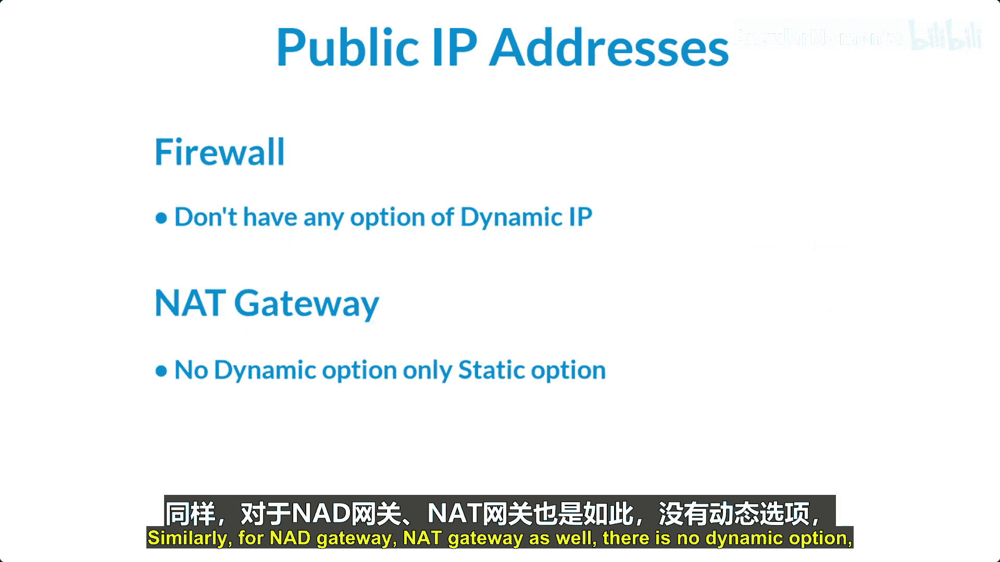
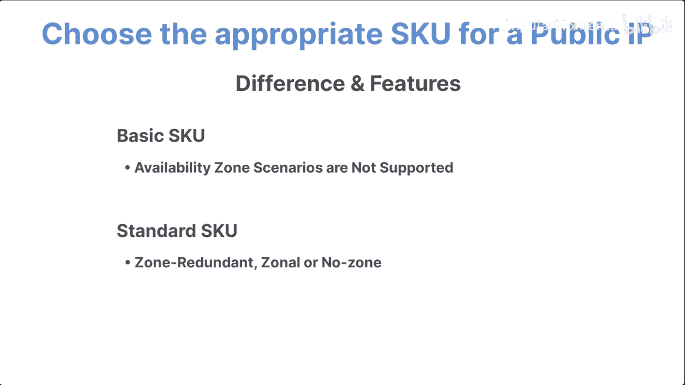
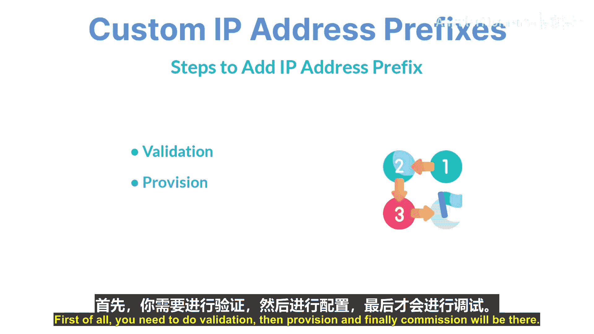
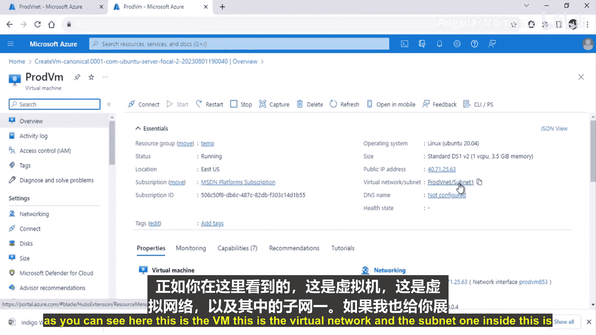
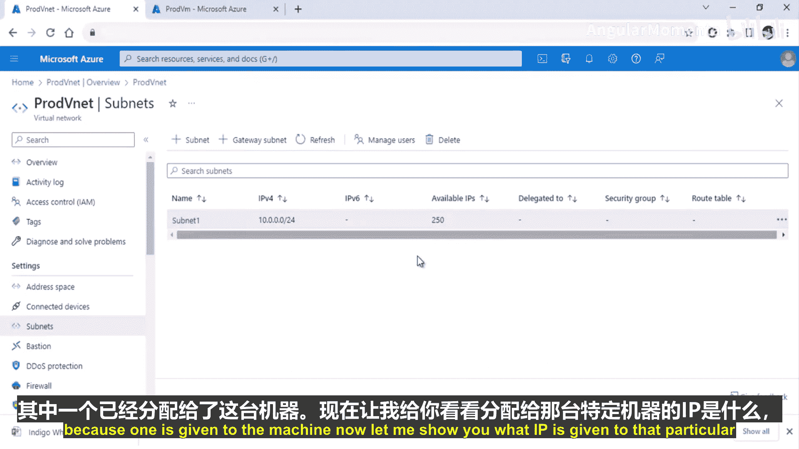
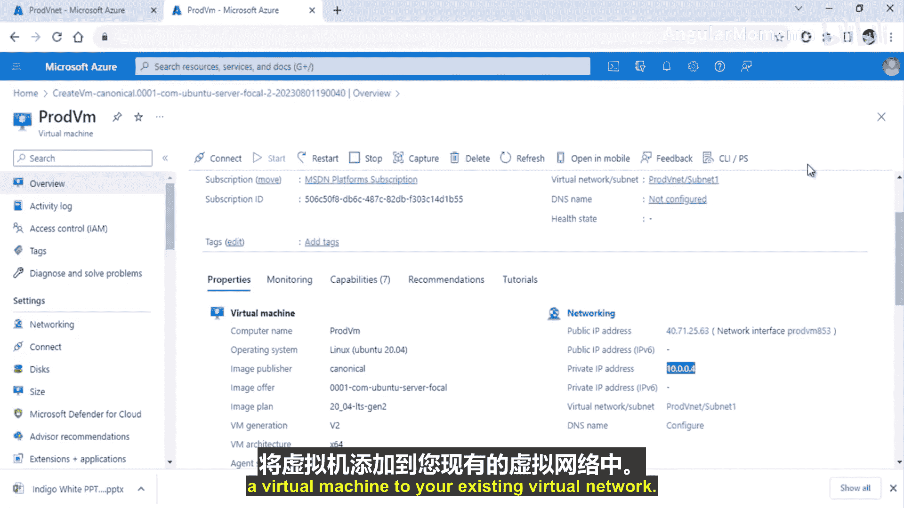

# 【EDUCBA】Azure网络基础 ｜ Azure Networking Fundamentals p01 01_02_01_公共IP地址 -BV1twFSzNE5z_p1-

Hello learners will be discussing about public IP addresses。In our virtual network。

 we would be having resources and those resources， you can have public IP addresses to those if you want your resource to be accessed publicly for that。

 you will require public IP addresses。 That's why we are discussing about public IP addresses as well。

Now if you see about the public IP addresses and inside your network you can have multiple resources。

 Basically you have two type of IP addresses， dynamic and static so first of all we should understand what is dynamic address and what is static public IP address。

If resource with which your public I is assign， if it changes over the lifespan of the aszure resource。

 that means that is the dynamic I you might have seen in your VMs as well。When you restart your VM。

 that I may change。 So that is the default setting of your public Is， that is the dynamic one。

 But if you want that your resource IP should not change over the lifepan of here as your resource。

 even if you restart your machine or something like that you are doing。

 even if the same IP should be assigned to your machine。 that is static I。

 So both the options we have in public IP addresses。 for example， in load balancer。

 we have dynamic as well virtual machine for application gateways as well。

 we have for VPN gateways as well as your firewall。

 we don't have any option of dynamic I is only static option is there Similarlyly for N gateway at gateway as well。

 there is no dynamic option。 only static option is there Thank you very much。

Hello， learners will be discussing about。SkuU for public copies。So in our virtual network。

 we'll be having virtual machines。😊，And those virtual machines will be having public IPs now what type of public IPs you can have。

 what are the different different types of SUs available for the public Is that is what we are about to see here。

😊，So first of all we have basic SkuU and standard SkuU。

 let's see whats the difference between them what are the features which are provided by basic SQU and what are the features which are provided by standard SKU。

😊，So first of all in basic SQ we have static allocation as well as dynamic allocationation in our last video we discussed about static or dynamic allocationlocation its the same thing so static as well as dynamic both are supporting。

😊，But in standard SkuU， you can use only static IEP that will not change even if you restart your machine。

 only static allocation is there。Second option is， by default。

In basic S open network okay there won't be any firewalls at all it suggested that you should have firewalls at all there should not be open incoming traffic but by default it is not there by default it's open itself but in case of standard SkuU incoming traffic is closed and its necessary if you want to accept particular traffic from the outside all the incoming traffic should be allowed inside your network using NS3s network security。

Now next thing is if you want to assign the basic your public IP you can assign to network interfaces VPN gateways。

 public load balancers or application gateway and in standard SkuU you can assign to network interfaces standard and public load balancers or application gateways Now last thing availability zone scenarios are not supported in basic SQ but in standard SkuU you can have zone redundant Zonal or no zone IP thank you very much。

Hello， learners will be discussing about custom IP address prefixes。Now， if you want to add your。

On Ipss， which is owned by external parties and all to Asia。 that also you can do。

You can bring your own Ipiece to Azure as well That is also possible to keep up a good reputation and to continue getting through the loud list。

 you can retain your Ipiece whatever you have right that is also possible。😊。

And you can use those Is in the same way as Azure on public IPs so addresses from a custom IP address prefixes can be used within your network if you want to reach external destination outbound from the Azure wide area network that is also possible。

And if you want to interact with us your resources using private Is， all this you can do using Azure。

 And if you want to add IP risk prefix to uszure using three step process。

 there are three steps for doing that。 First of all， you need to do validation。

 then provisionvis and finally， commission will be there。 Thank you very much。😊。

I'm going show you how to add a VM to your existing virtual network In our previous demo。

 I have shown you how to create a virtual network。 So this is the virtual network we have created in our previous video。

10 dot 0 dot 0 dot 0 slash 16 range。 And inside that network， we have created one sub network。

Sub network， we have created 10 dot0 dot0， slash 24。like I told you before as well。

2 total of 256 I should be there according to this。

 but as your reserve5 I addresses from every subnet， as you can see available Ia to51 here。

 Now lets add a Vm inside that network。Here， go to virtual machine。 So this is the virtual machine。

 I'm selecting。 Now let's create a one and add this to our virtual network。

 While the creation of virtual machine only you can add it to the subnet of your choice。 Now。

 this is the subscription I have， which as I'm selecting。

 I'm using the same resource group in which I have my virtual network。 So let's select this one。

 give it a name。 virtual machine name， Let's make it fraud via。😊。

Select the region as East to us and if you want to use the availability options。

 availability zone and all， that's what I'm not selecting。 let's say no intra redundancy required。

Keep it default。 You can take whatever image you want。 Let me take it that U to one only and size。

 let it be this one only。 And I want to use the password option for authentication。

 Let's give it a username。 Let's call it Nehi。And some password you can write。Again。

 confirm the password。You can have any passport。Should be uppercase and all certain provisions are there for the password。

 but you can use any of this。 If you want to allow certain ports and all。

 although we'll be discussing about NCs， what are the bomb ports and all will be discussing。

 But as of now， I'm selecting just S。Pto test。I'm using the default one premium message only I'm using here I'm using the default。

 We want to add additional tests and all。 you can do that。We do networking。So here。

 this is the place I want to show you exactly。 So here in which virtual network you want to add your machine to from here。

 you can select this option。 So I'm selecting my virtual network， which is pro Vnet。

 And this is the submit I'm having， I'm using this one。

 And here if you want to use the public I or you want to add later on as well。

 like we discussed about the public Is， different different Ss we have。

 but I'm using the default option default。😊，T themic IP will be assigned to that machine。

 That's what I'm using， the default one。So the basic one I am using and what are the inbound ports you want to use so inbound ports you can select。

 you can add additional as well or later on as well you can add that what you can do。

And if you go to management， I'm keeping it default， monitoring also， I'm keeping it default。

 advanced setting everything I'm putting default。 Let's just create this machine。😊。

It will do validation， as always。 It's showing you the price as well， how much it will be estimated。

 Now， let's create this machine。It might take a while， but yet squing。giveive it a moment。

It's creating might take a while。As you can see， deployment is in progress， it shows you。

It shows you notification as well whenever your process your deployment will be precedeed or it will be succeeded。

 it will give you the notification here as you can see here。

 the status it's okay it's created or its being created whatever is happening it will show you here。

C as you can see here。creating。I'll also show you what IP will be given to this machine because we have taken the default setting。

It's done。 deploymentloyment has succeeded。 If you got a resource。As you can see here。

 this is the PM。 This is the virtual network and the subnet one inside this is if I show you my sub network as well。

 if I refresh this。😊。

Now， you can see available I is at 250 because one is given to the machine。 Now。

 let me show you what I is given to that particular machine。 if you see here。😊。

So we have taken 10 dot 0 do0 slash 24 range。 And like I told you。

5 IP addresses will be reserved by as your。 So 0，1，2，3 is reserved and the last one as well。

 The next a I is fourth one。 So that is assigned to the machine。 That is the default setting。

 If you want to give I of your choice， which should be unresserved， that also you can do。

 But by default， this is the setting。 So that's how you can add virtual machine to your existing virtual network。

 Thank you very much。😊。

