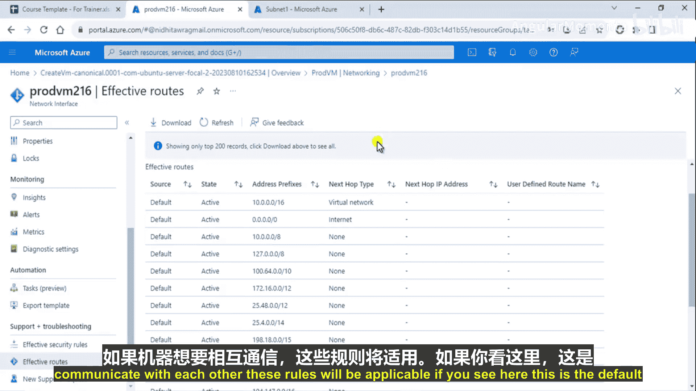
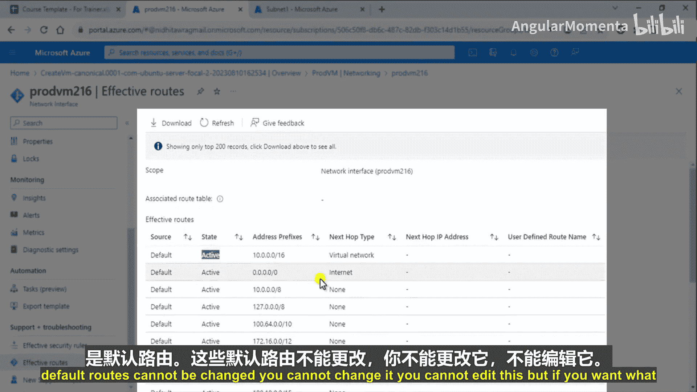
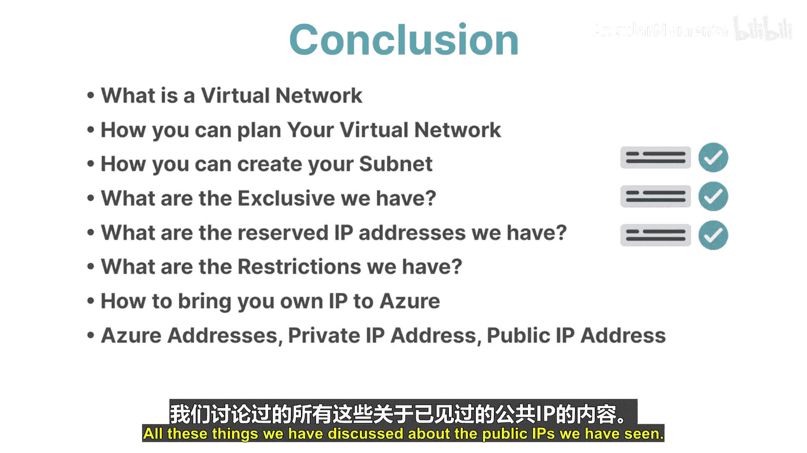

# 【EDUCBA】Azure网络基础 ｜ Azure Networking Fundamentals p02 01_03_01_Azure 路由配置 -BV1twFSzNE5z_p2-

Hello， learners will be discussing about routing how we can perform routing in as are。 So basically。

 there are two types of routes， system routes， as well as custom routes。

 So what are system routes by default， what happens when you create a virtual network and inside that。

 let's say you have virtual machines。 So by default。

 a default route table gets attached to your machine。 So these are the system routes。

 You cannot update those system routes。 you cannot change those system routes。

 But you can simply overrite those routes。That's what the system routes。 Now。

 if you want to create your on route table， if you want to have your own user defined route。

 then you can use your on route table as well。 Then you can use custom routes。

 So I'll show you what are the system routes and what are custom routes。Using an example。

 I'll show you how they are。 but as of now， understand。

 system routes are the default routes which are created by Azure itself。

 Microsoft itself and custom routes are the one which you will create。Now， let's take one example。

 When do you actually require custom routes， Let me give you an example。The mu paint again。Let's say。

 you have this。Subject within a virtual network， let's call this as front end subject， front end。

Snet。And let's say I have this backend submit。Let's call it。Backened。心力。

And let's say I have inside the same network。 Let's say I have one。😊，Virual appliance。 Let's call it。

Virtual appliance。And on that virtual appliance， let's say farewell has been installed。 Now。

 by default， what happens using the system routes， if any machine is in there。

 let's say1 VM is here and one Vm is here by default， what will happen。😊。

This machine wants to communicate with this machine using the default system routes machine should be able to communicate with each other。

 that's the default setting， but now because let's say on this particular machine on this particular appliance you have farwell installed and you want every communication whether it's from front end sub to the back end submit。

😊，It should go via these appliance if you want that particular thing， because firewall is there。

Then you can use your own custom routes。If this traffic is going from Fnet front end subnet to backend submitnet。

 it should go via this applianceplans if you want this setting。

 then you will definitely require your custom routes。Thank you。Hello， learners。

 we are about to show you how to create our own custom route。 So， first of all。

 let's create virtual machine in a virtual network。 So let's do that first。

 Then I'll show you how to add your own。Routes in that also I'll show you the default routes。

 So here let's create one resource group first first， let's call it1。Give it a VM name。Frad V。

 for example。Let it be default and here let's say no infrar redendency require。

 let it be one to only keep all the things same， let's call it password authentication。😊。

Scall it this username and some random password I'm putting。He as well do the same thing。

The port let it be only a message。 Now， let's go to disks。

Let it be default go to networking here Ill create one virtual network with the name for example。

 let it be broad vard only and this this and lets just rename this let it be。😊，Subnet one。

 this is the subnet I'm creating with this default setting。

10 do0 do 0 do0 slash 16 and inside that this is the range I'm having。So let's click on okay。

And all other things， let it be default。Go to management。Monitoring。

 let it be default and let's just create this。So my virtual network as well as virtual machine will be created。

😊，Might take a while to do so。So first of all， it does validation。

 validation past and let's just create it might take one or two minutes。Let it complete。

So the deployment is in progress。Pnet has been created。Switzland progress， still in progress。

Let it be it's about to be done， I think it's just about to happen。

I think my virtual network might be ready as of now if I show you， let's check it out。

Go to watch your network。See， the network has been created。If I go to its subnet。

So here this is the subnet one。If you see here by default let me show you the default setting first as you can see its route table there is no route table associated with that as of now because we haven't created any custom route。

😊，That's the kiss。And now。If I show you if I go to resource， my VM is ready。啊，你帅哥嘟。Here if I go。

To networking。And if you see network interface。And here go do。Effective route。So first of all。

 let me show you the default routes。Let it open So if you see here， these are the default routes。😊。

System routes I was telling you about these are the default routes we have。

 So as of now I haven't added any route table by default from one subnet or within a network if machines wants to communicate with each other these rules will be applicable。

 If you see here， this is the default route and this is an active state。

 If you see this particular route。 this is the address prefi 10 do 0 0 do 0 slash 16 next stop type is virtual network that means within a virtual network machines can communicate with each other this is for internet and these are the default routes。

😊。

These default routes cannot be changed。 You cannot change it。 You cannot edit this。

 but if you want what you can do， you can override these particular routes by adding a custom route table and by adding custom routes。

 So by default， what happens， first of all。

How the tracking will happen。 First of all， it will check whether any custom route is there or not。

 if any custom route will be there， then that will be applicable first。 After that。

 the default routes will be there。 If there is no custom route， then only default will be applicable。

So in the next video， we'll see how to add our on routes。 Thank you。Hello， learners。

Let's continue our discussion from here。😊，Like I told you， as of now。

 there is no route table associated with that。 And I want to add my custom route。😊。

To that particular subnet where virtual machine is。 so as you can see。

 there is no associated route table here。😊，So I want within a network。

 all my traffic should go via one virtual airplanes。 That's what I want to do。 As of now。

 this is the default setting and what I want， this is the address of my virtual network。

 So 10 do0 do 0 dot 0 slash 16， I want every traffic within this network should go via 1 virtual airplanes。

 That's what I want to achieve。 So first of all， I need to add one route table。 So if I go here。😊。

孤嘟老。Table。Before that， let me show you again， see if yet if I go to this my network。

 this is my sub network inside that if you check it out。😊。

There is no route table associated with that。 None it written。 Now， let's create one route table。

 We go to route tables。And let's create one row table。So select the resource group11 region。

 let it be east to us， and let's call it。A road。不。Let this is the name of my round table。

 You can take any name。 I'm just stick out to。And here let it be default and lets just create this route table。

😊，So it's happening。It will take a while and then route tape will be created。😊，So as you can see。

 it's in Pro。So it's succeeded。So this is my， if I go to resource， this is my route table。

So as of now， as you can see， it is not associated with any of the sub network。

 neither it has any route， so nothing is in here。😊，After creating a route table。

 you can simply add routes here or what you can do you can associate with the sub network first so let's go to my virtual network。

😊，And here， if I go here。Go to my sub network because my machine is there in that particular sub network if I go to subnet  one。

Here， as you can see， no row table is associated with that， but I want to associate route to do that。

😊，Say this。So its saved now if you go and check here。

 as of now there is no associated route table if I refresh this。😊，So。

 as you can see its all the blood it is loading as you can see here route2 is associated with that but you won't see any changes in next type and in this because I haven't added any route here now let's add a route here。

 go here， go to your route table。😊，So what I want to achieve， like I told you。

If I go to my routes what I want to achieve here， I want to overr this particular route。

 So to this address prefix， every traffic should go via one virtual appliance。

 So I am not actually creating any virtual appliance。

 Let's assume there is one virtual appliance with some IP it should be there because here I just want to show you routing and al right that it's actually happening just want to focus on that part here。

 So let's do that give it a name let's call it route one and destination type let's select IP address and destination IP address cider ranges or whatever you want So I want to overr this particular address prefix。

 let's add this only。😊，Let's call it 10 do0 do0 dot0 slash 16。

 If this is the destination where I want to route my traffic to let's select to a virtual appliance。

 you can select virtual network gateway in virtual network internet or anything I'm selecting virtual appliance and let's say let's assume because I don't have any virtual appliance here but let's add 10 dot0 dot 0 dot8 for example。

 so let's say I have one virtual appliance with this IP address and。

Whatever my destination is in any of this， It should go via this。 This is what I want。

 So let's add this。走。So， it is added if I refresh this again。

 it might take a while to show the actual changes， but it will eventually show up。😊，Let it load。😮。

Still， it's active。Like I told you， it takes a while。 let me refresh this again。😊。

In order to propagate the changes it takes a while。Let me refresh this again。

So it might happen to you as well because it takes time to show the changes。Again。

 let me just refresh this again。As you can see here now it is showing me as you can see here that was the address prefix and the default route is invalid here and what is valid for this particular address prefix as you can see this is an active state this is my user defined route and this is an active state and that will be the next hope and that is route one。

😊，So that's how you can add custom route。 So what basically happens， how it will be the flow。

 First of all， it will check if destination is this one。 First of all， it will check。

1 custom route table is there。 and if your traffic is going to that particular destination。

 whether that route is there in that route table or not， will check it out if a destination is this。

😊，Yes， that particular route is valid because this is the user defined route。

 If it doesn't find any route in user defined route table， then it will take the default route。

 That's what it happens。 Thank you。😊，Let's summarize whatever we have discussed as of now in this particular module。

So whenever your organization moves to Azure， it's better we should design a virtual networking environment which is secure enough and which provides connectivity to both your virtual as well as on premises resources so users should be able to access the resources from wherever they need either from on premises to Azure or within Azure they are accessing the resources。

 they should be smooth and secure enough It's better we should do that and in this module based on that。

 we have seen what is a virtual network， how you can plan your virtual network。

 how you can create your subnet。😊，And what are the exclusions we have。

 What are the reserved Ip addresses we have， What are the restrictions we have。

 We also saw that if you want to bring your own Ip to us here， that also you can do。 We also saw。

As your addresses， what are the addresses you can use， private IP address ranges。

 we can use all these things we have discussed about the public Is we have seen。

Thank you very much。