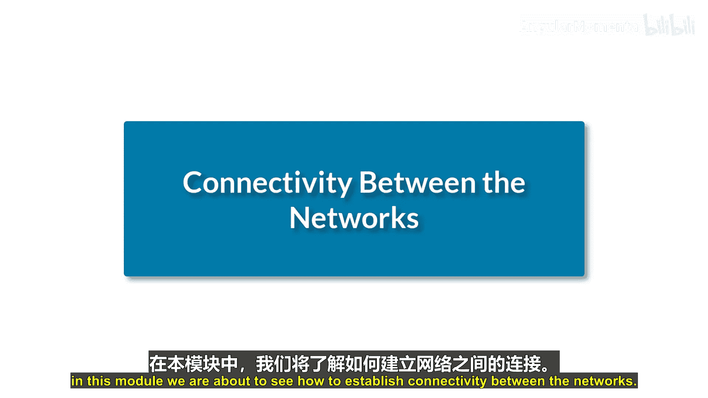
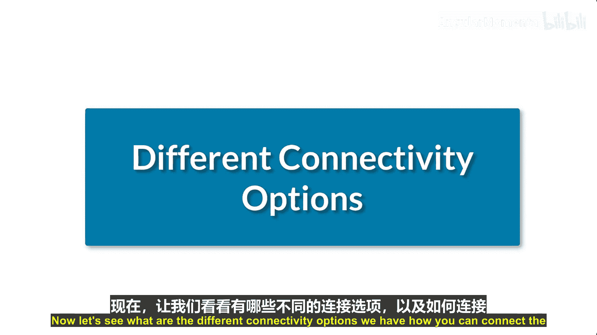
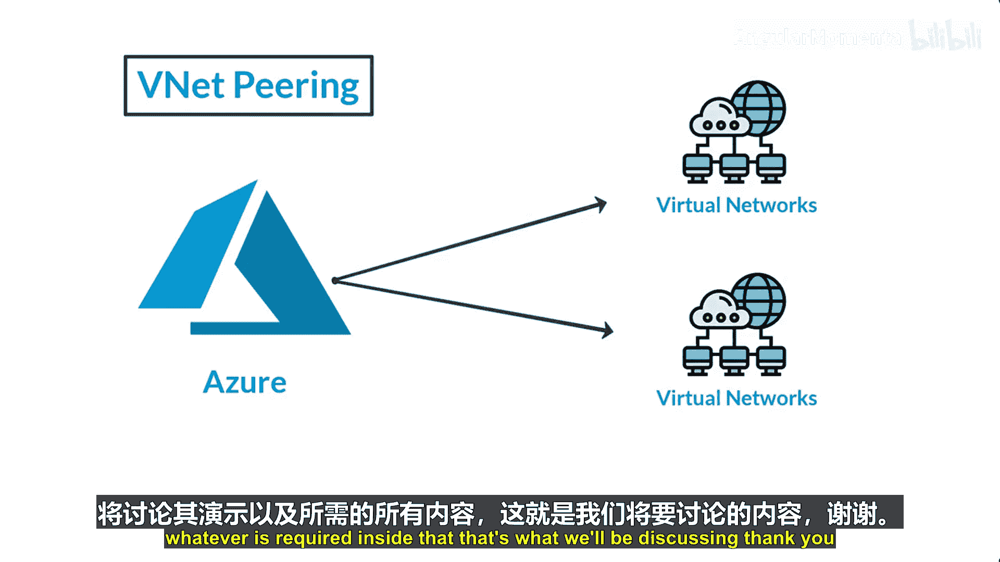

# 【EDUCBA】Azure网络基础 ｜ Azure Networking Fundamentals p03 02_01_01_Azure虚拟网络连接简介 -BV1twFSzNE5z_p3-

Hello， learners， in this module， we are about to see how to establish connectivity between the networks。

 It can be the connectivity between your on premises network to Azure。

 as well as connectivity within the A between two virtual networks。 That's what we are about to see。

 And why do we require that connectivity。 Let's say you are network engineer。

 It can be for a company。 and you are deciding to。😊。

Migrate to as your。 And you want to implement a global transit network architecture， as well。

To connect the expanded number of dispersed offices， you would use this network for that。

 you may require the connectivity。 And here with this way。

 you can manage your cloud centric conditions connectivity， and basically， you can。😊。

Use your worldwide enterprise IT footprint and you can deal with the work from home ambitions。

 all these things you can do with that。And with this。

 we also require because some of our things are on the cloud。😊，You should be able to。

Connect with the resources with the cloud resources， it can be your file storage。

 it can be your databases and maybe the applications that are located both on your own premises and the Azure。

As a network engineer， you should know all these things。 That's what is required。

 We'll see what are the different options to do that。

That's what we are about to see in this particular module。 Thank you。Hello， learners。 Now。

 let's see what are the different connectivity options we have， How you can connect the networks。

First of all， you can use VPN。 VPN is nothing。 You might be aware if you want to。Connect。

 do the connections。 if your traffic is flowing through。

Tunnel through a secured tunnel on an unsecured channel。 for example， Internet。

 then this is a VP in connection。In Azure， if you want to connect using VPN。

 that's also possible here in this module we'll be discussing about site to site VPN connections that means from your on premisemisss data center to Azure if you are connecting that is site to site VPN connection and another one we are about to see is point to site VPN connection if you are doing the connections from your individual system to Azure that is point to site VPN connection and the last option will be discussing is Vnet peering So generally we do Vnet peering within Azure within Azure if you want to connect two different virtual networks then you do Vnet peering also will be discussing its demos and all whatever is required inside that that's what well be discussing。

Thank you。😊。