# 【EDUCBA】Azure网络基础 ｜ Azure Networking Fundamentals p04 02_02_01_站点间VPN连接简介 -BV1twFSzNE5z_p4-

。Hello， learners。In this module we' will be discussing about site to site VPN first of all let us understand what is VPN I think you might be aware what happens in the VPN VPN is basically used to send traffic through a secured tunnel that is what VPN does。

😊，Before introducing you to site to site VPN， let's first discuss about VPN gateways。

What is VPN gateway VPN gateway is a service that uses a specific type of virtual network gateway to send encrypted traffic between an Azure virtual network and on premises locations over the public internet like I told you it uses a secured tunnel Also you can use VPN gateway to send encrypted traffic between Azure virtual network over the Microsoft network as well that is also possible Also multiple connections can be created to the same VPN gateway So when you create multiple connections。

 all VPN tunnels share the available gateway bandwidth。😊，Show you with the help of an example。

Let's say our diagram you can see， let's say this is my vnet that is on a your site。😊。

This is my V net。And let's take an example， let's say this is my on premises。😊，That is my on Pri。

Data center。And here there will be on， let's say， here。That is my v on us your side。

 there will be this VTN gateway。😊，And。😊，Here， if you see， there will be one tunnel。

 let's call it secure tunnel over there。 your traffic will flow。 so that's one example。

And one more thing here。That if you are using your on premises data center。

 one VPN device is required on your on premises network。 so what can be the VPN devices。

 Let me show you this as well。So these are the VPN devices you can use， you can use Cisco 1， Ctrix。

 F5，4net， all these options you can use so these are the VPN devices you can use if you want to connect with Azure。

So thats what is I'll share with you this link as well。😊。

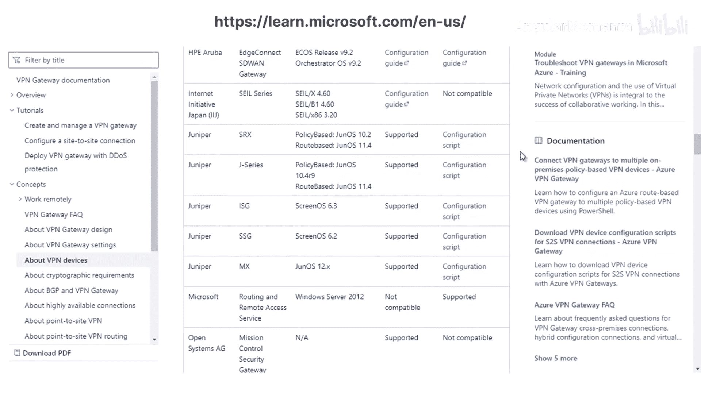

And basically， when you are planning a VPN gateway， we have three types of architectures。

 site to site connections， Vnet to Vnet connections and point to site connections。

 When you are doing connections from on premises to Azure。

 that is specific to site to site connection and the diagram also have shown you off site to site connection。

 Second is Vnet to Vnet connection if within Azure or if you want to connect a virtual networks through VPN。

😊，That is Vnet to Vnet connections and the last one is point to site connection point to site is when individual client system you want to connect with as your that is point to site connection here will be focusing on site to site connection only。

And now let's see about VPN gateways SkuU as well， what are the different SkuUs and bandwidth and all what you can select。

 let me show you that as well。😊。

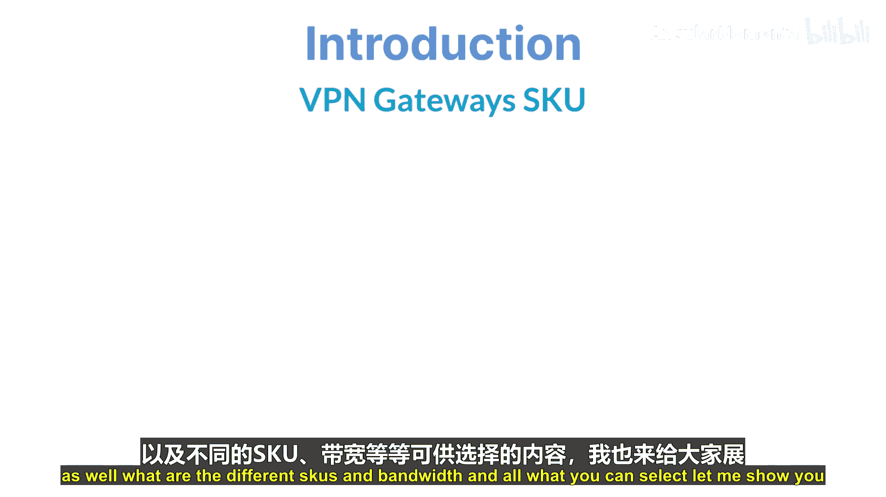

Don't worry I'll share this link with you So if you see here these are the options available we have this is the official site you see here for site to site or Vnet2 Vnet tunnels for generation one basic SkuU if you select maximum 10 connections you can create for。

 to site maximum 128 connections you can have so you can see the list for VP and GW1 maximum 31。84。

2 site cap complete list you have and if you see the through quote as well for generation 1 it is 100 MVps for GW2 we have 1 gBps so this is what we have。

😊。

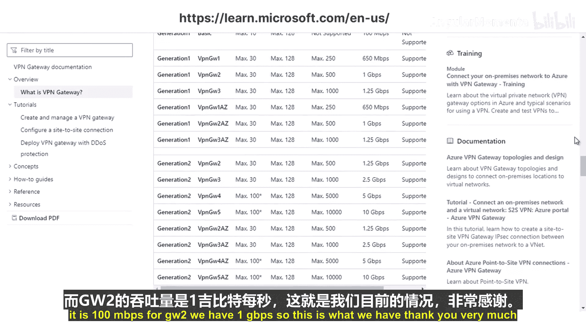

Thank you very much。😊。

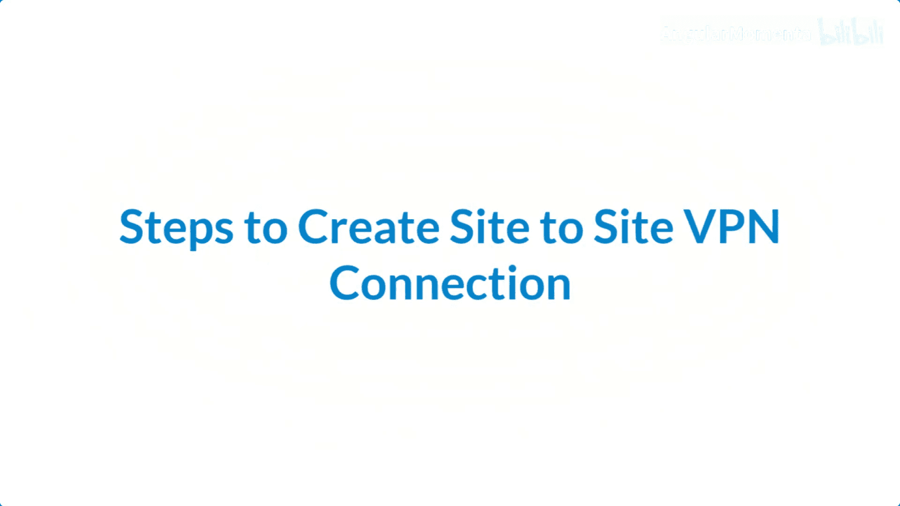

Hello， learners， in this lesson， we are about to see how to create a site to side VPN connection in Azure button。

 what you need to do。 First of all， let's see the prerequisites for the same。 First of all。

 you need to have as your account that is mandatory。 Secondly。

 like I told you in the previous video on your own premises data center。

 You should have compatible VPN devices， because that's what you need to configure it。

 you can have this。 And finally， you should have a public I for address as well for your VPN devices that will also be required。

 Now， what are the steps to。😊。

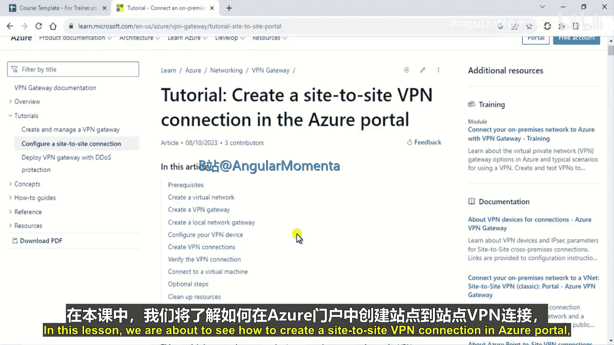

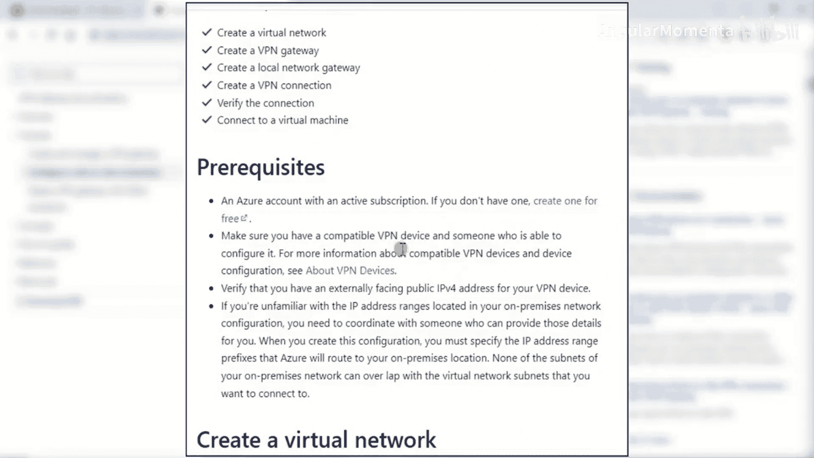

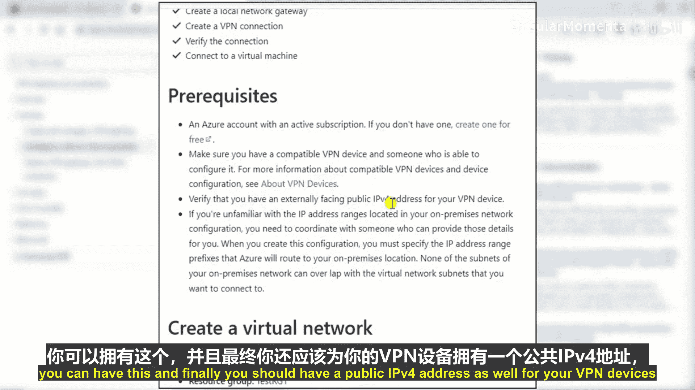

Connect your on premises devices to Azure using site to site VPN connection。 What you need to do。

 First of all， you should have a virtual network。 You will first create a virtual network。

 Then you will create a VPN gateway。 Also， you will create a local network gateway。

 Then you will create a VPN connection。 Finally， you will verify the connection。

 and then you can connect to a virtual machine。 Let's see how you can do that。 First of all。

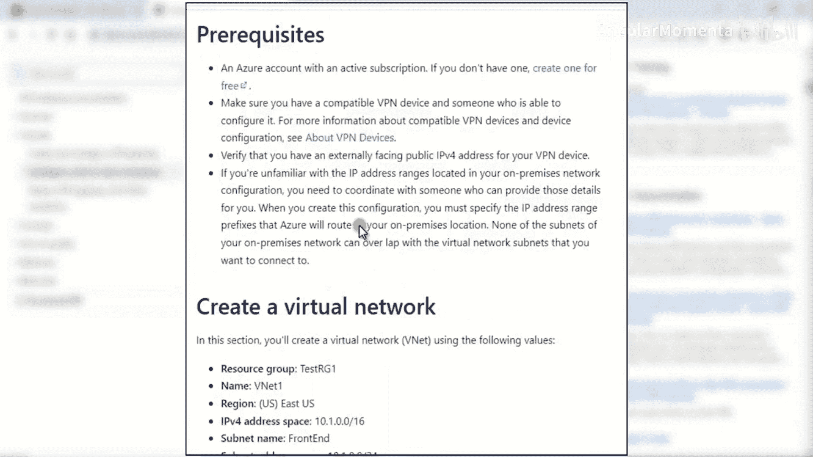

You need to create a virtual network in our previous videos how to create the virtual network。

 you can simply do that。

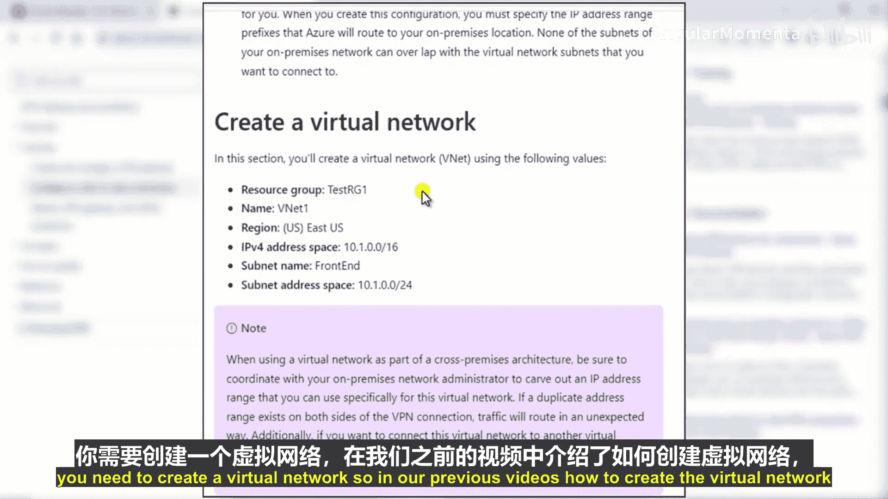

Second thing， what you need to do。After that， you need to create a VP in gateway that is required。

 whichs better its best if you specify slash 27 or larger for your gateway submit because。😊。

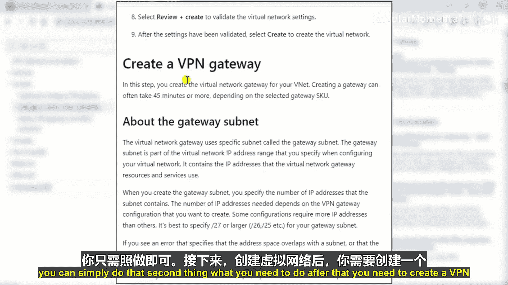

In the gateway submit， only the required resources should be there not much。 Finally。

 you need to create the gateway So these are the settings you can use or you can take your own things as well。

Here they have taken slash 27。And then you are creating a virtual network gateway。😊，After that。

 you need to view the public I address here on the overview page after creating your data。

 you can check it out here。 So it is showing the some I P。 So we will also have that。

Then you need to create a local network gateway。😊，There you will have all the settings related to your local network。

 I P and all everything you will be there。😊，After that， what you need to do。

 you need to configure your VPN devices that will be your own premises。😊，You can do that。 And the。

Its better if you use the shared key for site to site gradient connections， they are also using the。

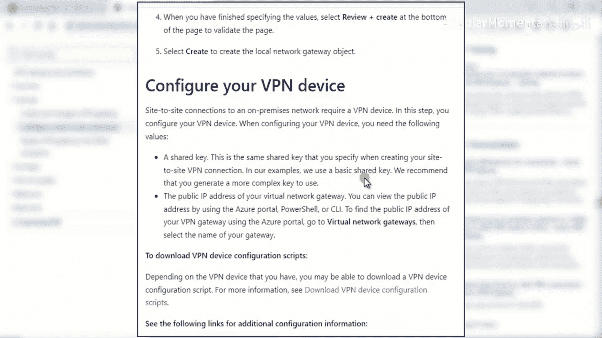

Shar key only。 So you can do that as well。And finally， you create your VPN connection。Here。

 you need to click on create the subscription connection type。

 you can select site to site if it is site to site settings and all， you can select。

 and here this is the settings you can use。And you need to add shared key as well。Here。

 you need to add the share key。

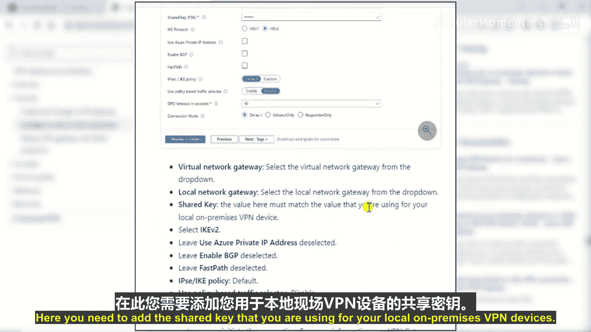

That you are using for your local loan premises between devices that should key you need to add。

Additional settings also， you can correct。 And finally。

 you verify your DPN connection and you need to connect to your virtual machines。

 So these are the steps to do that。 Thank you。😊。

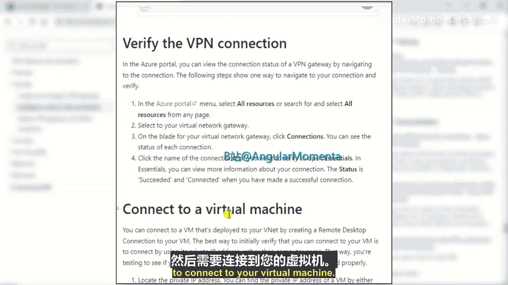