# 【EDUCBA】Azure网络基础 ｜ Azure Networking Fundamentals p05 02_03_01_站点VPN连接介绍要点 -BV1twFSzNE5z_p5-

Hello， learners， in this module， in this lesson， we are about to see。

Point to site VPN connection so what is point to site VPN connection a point to site VPN gateway connection。

 it lets you create a secure connection to your virtual network from an individual client computer。

A point to site collection is established by starting it from the client computer。

 So this solution is useful basically for telecommunicators who want to connect to Azure virtual networks from a remote location。

 maybe from home or a conference。😊，And this point to site PPN is also useful。

To use when you only have few clients， if you are comparing site to site or point to site。

 if you want to compare， so if you have only fewer clients then go for point to side right to do complete site to side connection。

 so that's what you can use it for。Now there are certain protocols that you should understand what are the protocols used for point2 site。

Correction， so first of all， we have open VP and protocol。😊。

So this is a SSL or TlS based VPN protocol。😊，Tl SVPN solution basically can penetrate firewalls since most of the firewalls uses obtain PCP44 for3 outbound it uses。

That's what TlS uses and this open VPN can be used for Android iOS Windows Linux Mac devices for all you can use it。

 Second protocol you can use SSTP secure socket tunneling protocol we call it so that is also what TlS based VPN protocol and it can also penetrate your firewalls and it also uses443 for outbound but only thing is SSTP is only supported on Windows devices so as your supports all the version of Windows that have SSTP and support TlS specifically 1。

2 so Windows 8。1 and later you can use third one is IKE V2 VPN。

That is a standard based I Z VPN solution， and it can be used to connect from your Mac devices basically So versions like 10。

1 when and above versions you can。Now let's see how a point to site BPPN clients are authenticated What are the authentication methods we have so first of all we have certificate based authentication as your certificate authentication so when using the native as your certificate authentication a client certificate that is present on the device is used for authentication for collecting the user basically so client certificates are generated from a trusted route certificate and then installed on each client computer so you need to install it on each client computer。

So you can use root certificate that was generated using an enterprise solution or you can generate a self sign certificate as as well。

 This particular validation of the client certificate is performed by VPN gate for that。

 you can use as your certificate authentication。 Second option we have is native active directory authentication for as your authentication you can use to connect as you are using active directory credentials。

 So as your active directory credentials， if you have， you can use that for authentication。

 So native as your active directory authentication is only supported for your open VPN protocol。

 The first one， which we have seen in a last slide。And it also requires the use of azure VPN tank。

The supported client operating systems can be Windows10 and MacOS， all those can be there。

Now the last one we have is Azure active directory domain server。

 so aszure active directory domain authentication allows users to connect to as youre using their organization's domain credentials and basically it requires one specific server we call it radius server。

😊，That Radius server will integrate with A server and organization can also use their existing radius deployment as well for the authentication。

😊，You can use that as well and that radio server could be deployed on your own premises or in your Azure VNe so during the authentication as your VPN gateway acts as a pass through and forwards authentication messages back and forth between the radio server and the connecting devices so that radio server will be used Thank you very much。

Hello， learners， here we'll see how to create a point to site P P connection。😊。

I'll share you this link as well， that is also of Microsoft linknk。 First of all。

 you need to create a resource group。

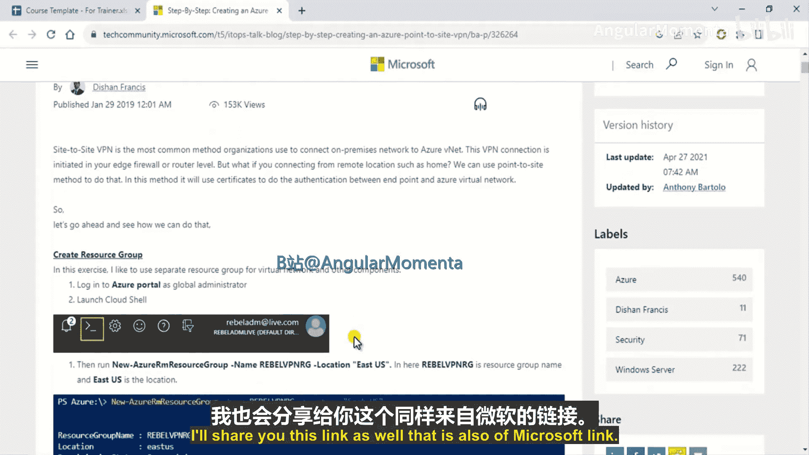

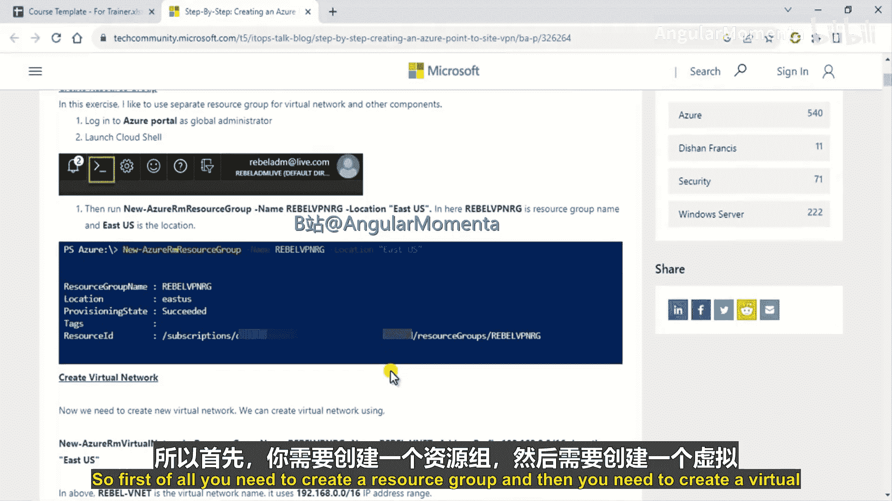

And then you need to create a virtual network。 So these steps you know already here you need to create the subnet。

 We have already seen a detailed thing how to create the subnet and and virtual network you need to do after that what you need to do you need to create a gateway subnet here when you open your subnet。

 you will see that option add gateway subnet Then you will add one gateway subnet。

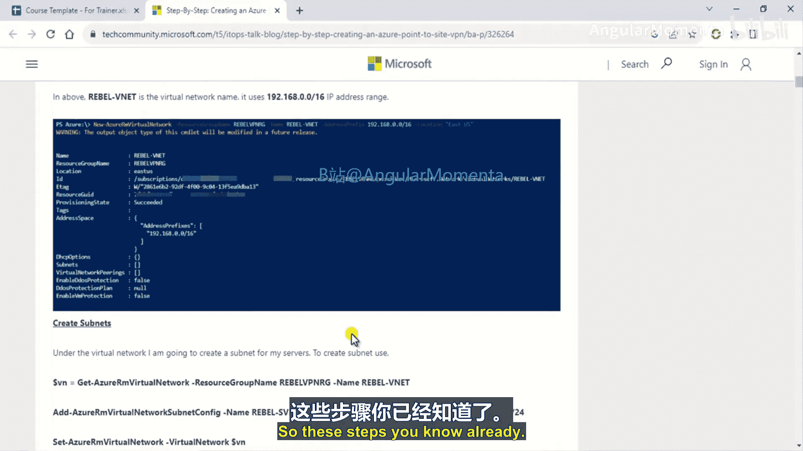

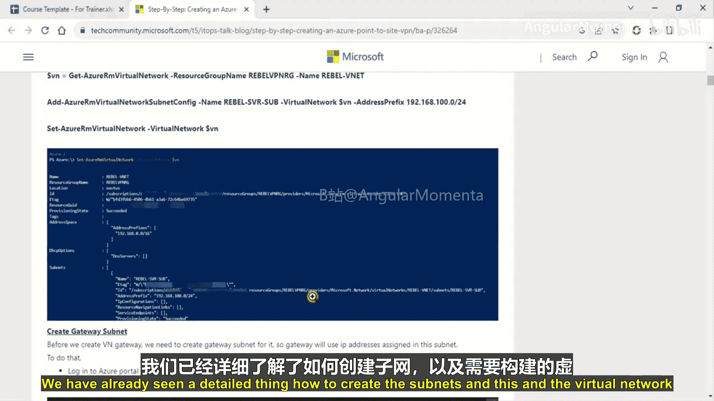

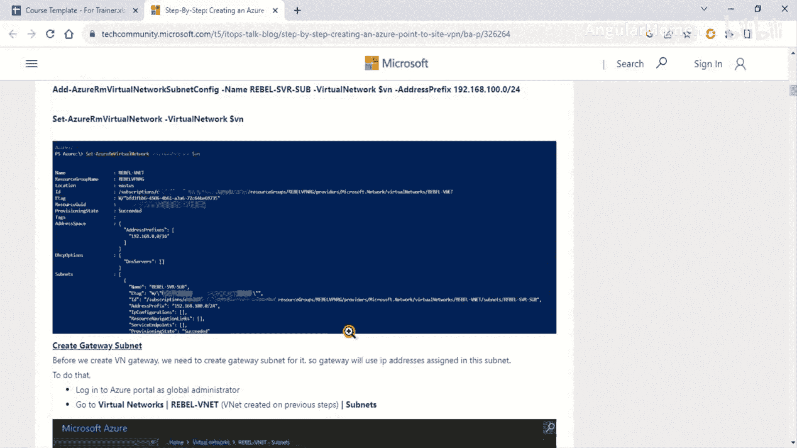

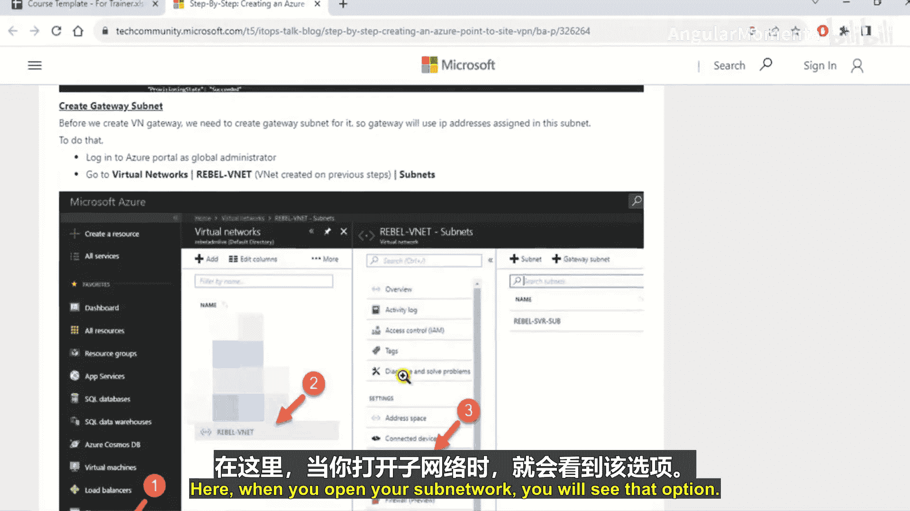

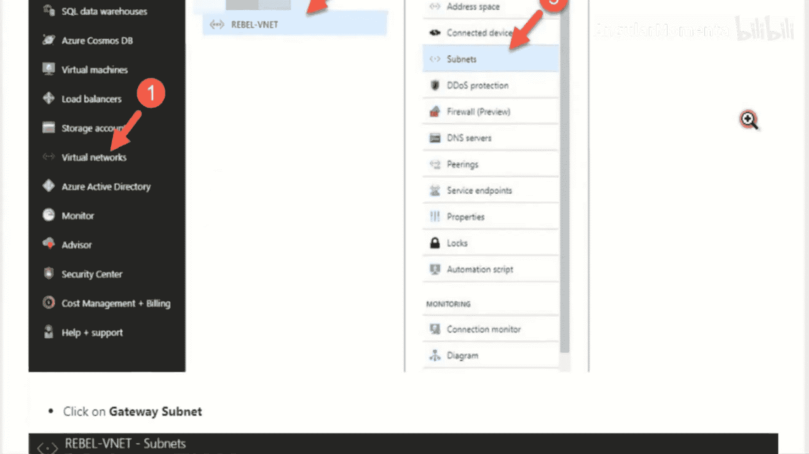

So they are adding exactly way。This is the cider they using。

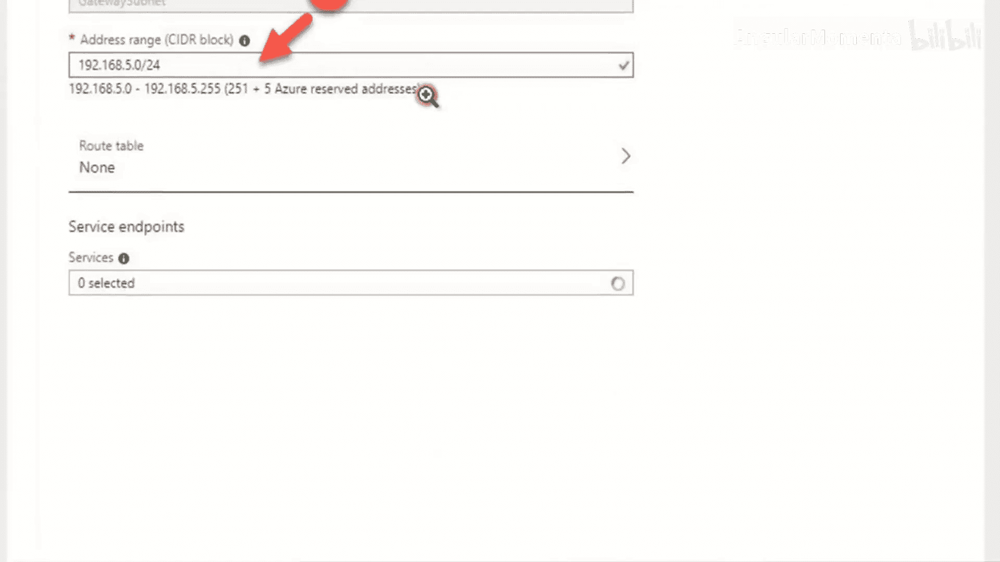

After that， what you need to do you need to create virtual network gateway。

 you simply search virtualual Network gateway and you will get the option virtualual network gateway。

 then you need to click on createre and add the settings， whatever name you want to add。

 whatever gateway type you want， what SK you want to select all these options you will have。

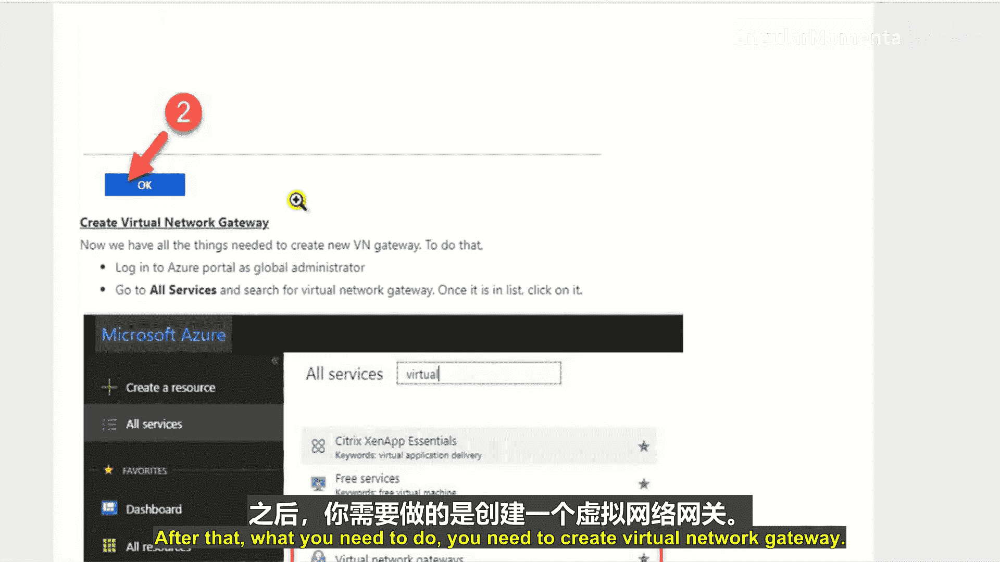

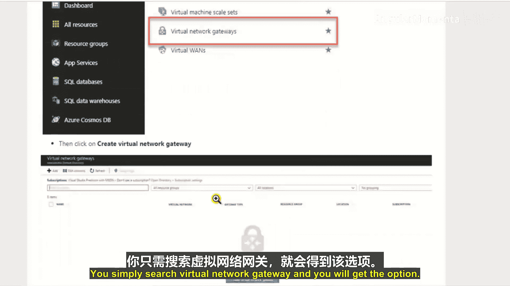

After that， you will create a certificate like I have told you we have different different options for authentication here they are using client certificates here they are creating self sign route client certificate they are creating。

 That's what you can do。 This is the command they are using for that so you can do that after doing that what you need to do。

😊，After creating your certificate and all。Next what you need to do。

 you need to configure your point to side connection so there you will simply search for point to side configuration and you need to add this then configure adding all the things。

 adding the address pool， whatever tunnel type you want。

 whatever authentication type you want certificate or radius because we use certificate so we'll use aszure certificate is authentication and then you need to add this。

 Finally you will test your VPN connection。How to do that， log into a resort portal。

 go to your VPN gatewaycon page and click on point to site configuration。

 download your VPN client and thats what you need to do。These are the steps to those。 Thank you。

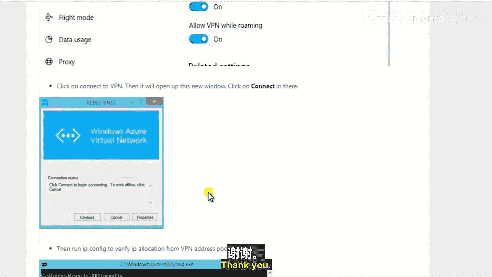