# 【EDUCBA】Azure网络基础 ｜ Azure Networking Fundamentals p06 02_04_01_虚拟网络到虚拟网络对等连接简介 -BV1twFSzNE5z_p6-

Hello， learners。In the previous module， we have seen what is a virtual network？

And what are the sub networks and how we can create the virtual network。

 All those things we have seen。 Now， let's get started with module 2。

In module2 well be discussing about VNe peering， so generally organizations with large scale operations need to create connections between different virtual networks。

😊，そ。Virtual network peering enables you to do the same to connect separate virtual network so we'll be looking about Vnet peering。

 we'll be looking about gateway transit and connectivity we'll be seeing about service chain and at the end of the module we'll be seeing all the things in action we'll be seeing actual demo。

 how we can actually do the peering how we can actually connect different virtual network Thank you very much。

😊，Hello， learners。Let's get started with the very first topic of module2 that is about virtual network peering。

😊，Now let's see what is virtual network theorying and why do we use it？😊，Now。

 if you want to connect to virtual network that you can do using V net pairing。So generally。

 what happens if there are organizations which operate on large scale。

 they often need to connect to virtual networks。Virtual network peering enables you to seamlessly connect separate Vagech with optimal network performance。

😊，That's what it does。 Now， if you might be aware。In the virtual network。

 we have seen that in the virtual network， if I have two sub networks and even if only one sublet is there。

 and there are。Machines， so if there are virtual network and there are two machines inside that network by default。

 they can communicate with each other using private I This is my one virtual network。

 Let's call it V network。And inside Vnet， let's say I have two sublet。Let's call it Subnet one。And。

 let's call it。Subject to。And inside the sub network， let's say I have two virtual machines。

 Let's say I have this one， and I have this one， or let's say I have this one as well and this one as well。

 Let's call it VM 1，2，3，4。 Let's say it's VM1。😊，Vm 2， let's call it。Vm3， and let's call it。BM 4。

So this is one virtual network， for example， and I have private I。Of those machines。

Within the network， even if they spend to multiple sub networks。

 those machines can communicate with each other using private IP by default， that's the case。 Now。

 if you have this another virtual network。😊，And let's call it V net2。😊，And this is my V neck。1。

And inside this phenotypeet as well， let's say I have two sublet。😊，Let's call it subnet。3。

Now let's call it submitnet4。And let's say I have one one machines inside those sublets as well。

Let's call it。VM5， and let's call it。Vm。6。Now， by default。

 if let's say VM4 wants to communicate with VM5 that cannot do using private IP。

 it will have to go via public channel。😊，It will have to use private public I for the same。

 That's the default settings。 Now， if you want that machines inside to virtual network。

 they should be able to communicate with each other using as yours backbone and they should behave as if they are in the same network for that case。

 you can use Vnet peering。That's what you can do。No。

Peed networks utilize the Aures backbone for isolation， as well as privacy。 Also。

 peering is possible between tenants and subscription。 So inter peering， inter subscription peering。

 that also you can do。 The last point here， it is peering over a V net。 It's not transitive。

 What does that mean Let me show you。Let's say we have this v net one and we have this v net2 as well。

 let's say I have another v net here， let's call it。😊，We let 3。V neck。这里。Now， let's see if。

Let me just erase this part。So let's say if V net 1 is paired with V net 2。

 v net 2 is paired with V net 3， that doesn't mean that V net 1 and 3 will be peered。

 so transitivity by default doesn not follow up。😊，That's the case。 That's the default setting。

 Thank you very much。Hello， learners。In this video， we are about to see the types of vette pairing。

Basically， there are two types of internet peering。 One is regional。 Second is global。

 Let's see with the help of an example， what is regional peering and what is global peering。

 Let's say I have this virtual network。 Let's call。 This is in any region。 Let's say。Resion1。

 I'm calling it。 This is my region 1。 And inside the region 1。Let's say I have two virtual networks。

 let's call it VNe1 and VNe 2。Let me name it。Let's call it vet one。And let's call it we it2。

If you are doing peering within the same region and inside that region， if vs are present。

 then this sort of peering we call it as regional peering So within the same region if peering is there we call it regional peering Now if you have another region lets call it region2。

😊，And in that region， let's say I have another vt， let's call it v net3。😊，And if you are。

Attaining peering with V net 2 to V net 3， which is in which is in different region we call it as global peering。

 So within the same region， it's regional peering and with。

The Phoenixs are present in two different regions。 We call it as global peering。 Thank you very much。

😊，Hello， learners。Today's topic is Gateway transit。We are about to see what is gateateway transit。

Gateway Transit is a VNet peering property which we saw in our last video。

 so that is one property of VNet peering which uses the VPN gateway in the periodO virtual network for cross premises or VNe to VNet connectivity。

Let's say you have two virtual network， let's say this is these are two virtual network。

Let's call it v one。And let's call it ween it。😊，度。Let's say these two virtual networks are peered。

They have been it peering， for example。Now we have this is， let's say my on data center。

 let's call it on premises data center。😊，This is data center and inside that I have resources as well。

 let's say some VM is there inside that also I have1 VM and here also1 PM I have。😊。

If in a peered virtual network， resources wants to communicate outside the peering， for example。

 with this resource， this machine， if resources want to communicate， in that case。

 you will have to use gateway transit。So that's the meaning of gateway transit。

Gateway Trans is a peering property that enables cross premises。

 or if it's V net to v net communication between two peering virtual networks。

 it allows one virtual network to use its VPN gateway。😊。

Virtual networks are peered you configure a VPN gateway in the peered virtual network as a transit point in this case。

 a peered virtual network uses the remote gateway to gain access to other resources。😊。

A virtual network can have only one gateway， so gateway transit is supported for both Vnet peering as well as global Vnet peering When you allow gateway transit。

 the virtual network can communicate to resources outside the peering as well。

Gateway transit basically allows peer virtual network to share the gateway and get access to the resources。

 That means you do not need to deploy。VPN gateway in the pure virtual network。Thank you very much。

Hello， learners， today's topic is service training。 Let's just start with service training。

 Let's see， first of all， what is service training。😊。

Service training enables you to direct traffic from one virtual network to a virtual appliance to a virtual network gateway in a peered virtual network through your user defined routes。

You can utilize user defined routes and service training。You can perform custom routing。

You can use hub then spoke technology in order to do that。

Let me give you an example where you can use this service training。 Let's say you have this。How。

You have this hop。And in this hub， you can have your virtual appliance。😊。

Im taking an example of virtual appliance。 Then you have spoke。In this book。

 you can have multiple virtual networks。Let's call it。V it one。V net2。And。V it。这里。

So you have hub where you can have virtual appliance。

 you can have spoke where you have multiple virtual networks。

You can also spoke virtual networks can then pair with the hub virtual network and。

Traffic flows through the network virtual appliance。

 so it can be your VPN gateways in the hub virtual network。 you can use custom routing。

 you can use your own routes and all That's what you can use。

When you are doing virtual network peering， this pairing enables the next hope in a user defined routes to be the IP address of the virtual machine in the peered virtual network or it can be your VPAN gateways using this user defined routes service chain enables you to send traffic from one virtual network to a virtual appliance or virtual network gateway in a peered virtual network through your custom routing and user defined from。

Thank you very much。Hello， learners will be discussing about virtual network peering demo。

 First of all， let me show you in this video， part one of virtual network demo。😊。

I'll be showing you what I'm about to create。So what I'm about to create。

 I'll be creating two virtual network。 Let me just show you what I'm about to do。

 This is virtual network 1， and this is Vnet 2。 Let me name it。😊，V net1。And， let's make it。V呢。Do。

And maybe I forgot to tell you， but remember。Those virtual networks， whom you want to be peered。

 if you want to connect with the help of peering to virtual networks。

 they should not have overlapping IP address ranges。 If they have overlapping IP address ranges。

 you cannot perform peering on that。 That's why I' am taking the address ranges。

 which are not overlap。For this network， let's take 10 dot 0 dot 0 dot 0 slash 16。 And for V net 2。

 let's take。1，9，2 dot 168 dot 0 dot 0 slash 16 and inside those v， let's say I have one submit。

S1 subnet in v net 1 and one subnet in v net 2。 So let's make it。Subnet。1。And let's make it。

Sublet to。And its's address range， which I'm about to take is。

10 dot 0 dot 0 dot 0 slash 24 and for this sublet Im taking ranges1，9。

2 dot 168 dot 0 dot0 slash 24 and inside those sublets I'll be having two virtual machines。

This is one virtual machine。 This is another virtual machine。 and let's call it。😊，V fun。

And let's call it。B业。Do。And after that I'll be performing peering on those two networks VNe one will be peered with VNe 2 and you will see that with the help of private Is those two machines will be able to connect with each other。

 That's the benefit of peering。😊，Like machines will behave as if they are in the same network。

 We do not need public I to do that， even if they are on two different networks。

 So let's see that in action in the part  two of this particular video。

Will continue remaining part of the topic in the next video。 Thank you。Hello， learners。

 in previous video， we have seen what we are about to create this 1 I want to create。 Let's create。😊。

Vatchual network and PMM first then we'll perform on networking on that。Pearing on that。

So let's go to virtual machine。So while you create the virtual machine at that time as well。

 you can create virtual network， Im doing the same lets create。😊，As your watching machine。Here。

 let's select the subscription， create a new resource group。 Let's make it1。Hey， give it a name。

 virtual machine name like we discussed， let's call it VM1。Reicionness is use， for example。

And I want to select no infrar redundancy required。Let's keep everything else default。

 Let's select one， two， only。And authentication type， let's make it password， username。

 let's make it niy and some random password I'm selecting。Here as well， let's confirm the password。😊。

And here inbound Po， lets select SSH as well as SGTP。Now， let's go to this。Let's skip a default。

 Go to networking。Here， create a new virtual network。Let's call it。Vnet 1。

The address ranges like we have selected。 Let's take it this one。 only 10 dot 0 dot 0 dot 0。

 slash 16 and。With a subnet name， let's make it submit one and with the same address range。

 which we have selected 10 dot0 do0 do0 slash 24。Sick on， okayk。

So this is the one I want to create and one submitnet I'll be having rest all the things。

 let's skip it default， go to management。😊，Monitoring advance， everything。 Let's keep it default。

 and let's click on create。So first of all， it's doing the validation。And let's create beamM。

With this VM， as well as your virtual life， will be created。😊，Now。

 let's create another virtual machine in a different virtual network。 Let's do that parallelly。

 So go to virtual machines。😊，Click on create。Is your virtual machine you select。Resource group。

 Let's select the same resource group， M 1。And give it a VM name。

 let's make it VM2 this time region I'm selecting the same。

 although you can do pairing if the machines or the virtual networks are in different different region as well。

 like I told you regional as well as global both are selected in this demo I'm showing you regional only。

😊，And let's make it no intra redundency required。😊，And let's take the same machine。This one， only。

And let's select the password， let's make it username as niy only and let's make the password as。😊。

And let's confirm the password。And let's select SS as well as StP go to this。Keep it default。

 go to networking now create another virtual network with a range which doesnt overlap with the previous one like we selected I'll be taking this range only 192 one。

So give it a name as we need2。And let's delete this default one and let's make it 1，9，2 dot 1，6。

8 dot 0 dot0 slash 16。And here lets make it as submit to and address range is 192 dot 168 dot0 do0 slash 24。

😊，Pick on okay。And trust all the things。 Keep a default。Monitoring advance and all。

 let's just create this。And let's create since when it is creating。

 let's do one more thing because one of my machine is ready。 let's go to that machine。 As of now。

 I haven't done any peering。 So you can see one virtual machine is there。😊。

Let's connect with that virtual machine。So if you want to connect with that， let's check it out。

 I'll be doing using SSH because I have used U21 right So how you can do this is the public IP。😊。

Of the machine。So， here， go to。Cloud shellll。 I can open it and。New session as well。

 Let's open it here。

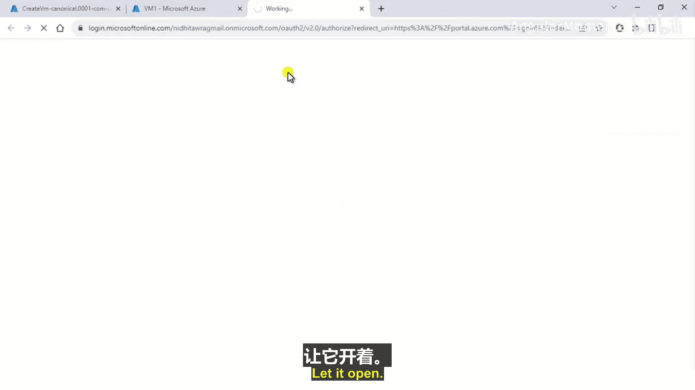

Let it open in。It's connecting。 just read a while。So， let's do SS S H。Naty。

 that's what I have copied。Let's space this。nidi， this is the username Aate public IP。

 That's how you connect with U1tu machines。 So as you can see here as well， Nidi Acurate this IP 1，7。

2 dot 1，90 dot。😊。

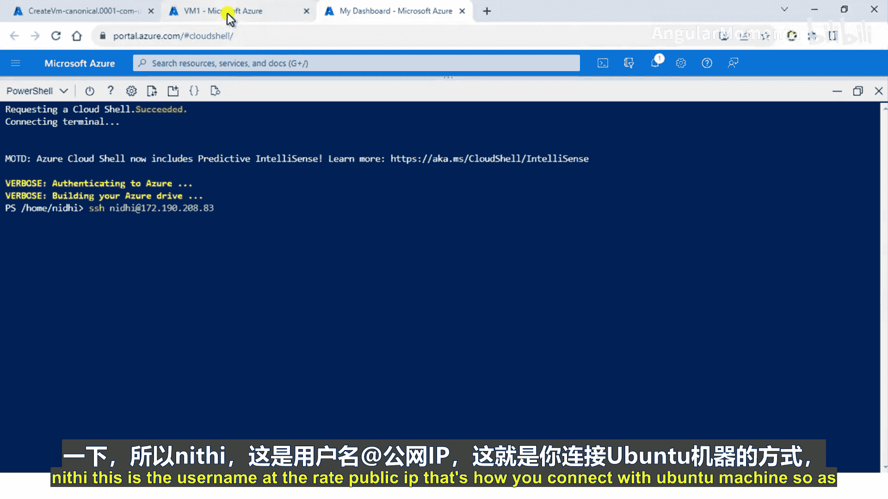

2，0，8。 This is the private key path。Will continue remaining part of the topic in the next video。

 Thank you。

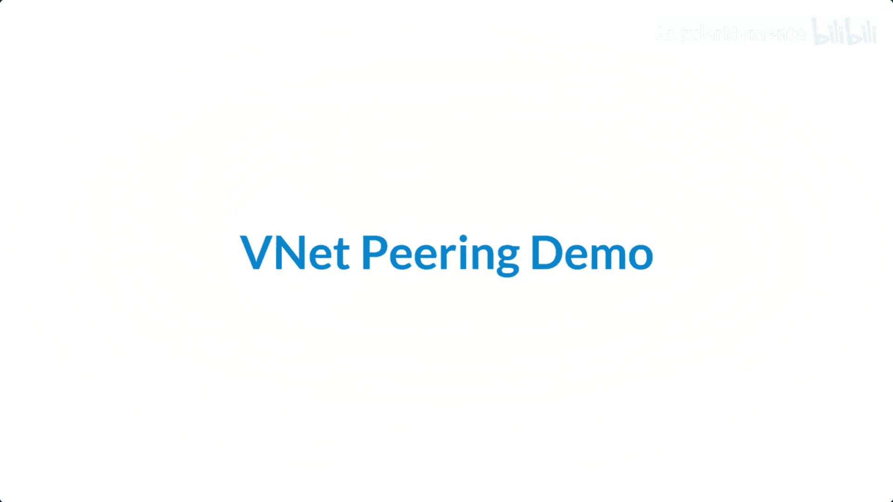

Now let's explore the next topic in our discussion， let's connect。Yes， I want to connect。

I need to add password because for authentication I have used passwords。

 I need to enter that password。😊，So Im inside this machine VM1。 So from this machine。

 if I want to connect with the second machine using private IP。

 I should not be able to do that because as of now I have not enabled peering， let me show you。😊。

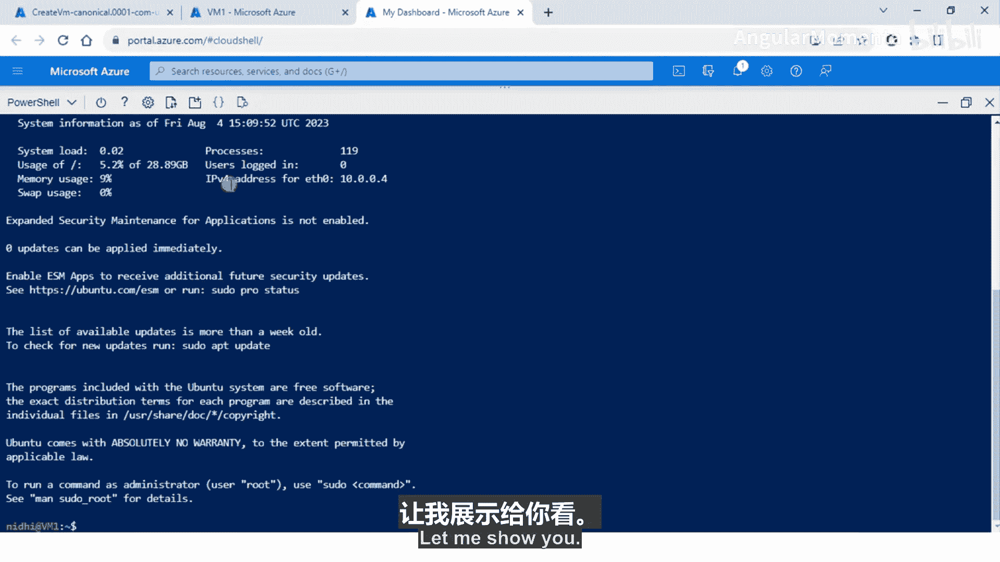

So I think VM2 should also be ready， let's go to that resource。Now。

 if you see the private IP of this machine， this is the private IP 192 do 168 dot0 dot4。😊。

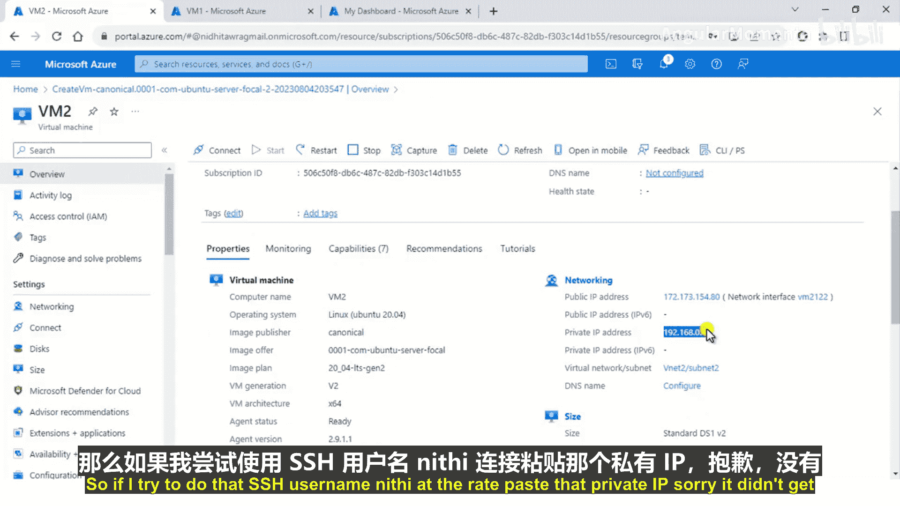

So if I try to do that。SSH username， Nhi， Ad it。Pa is that private IP。犀。

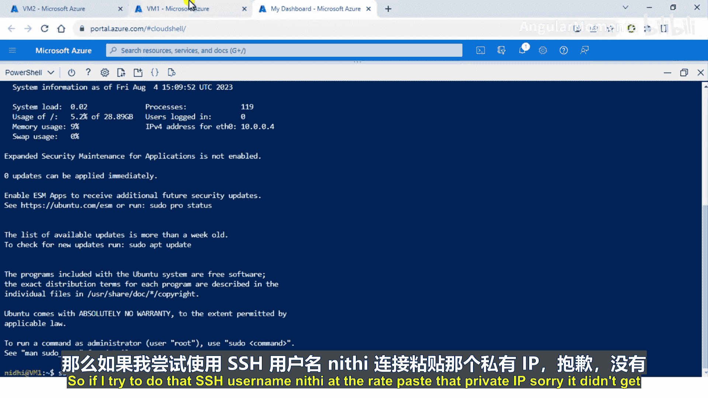

They didn't get copied。So this is the one I need to copy。

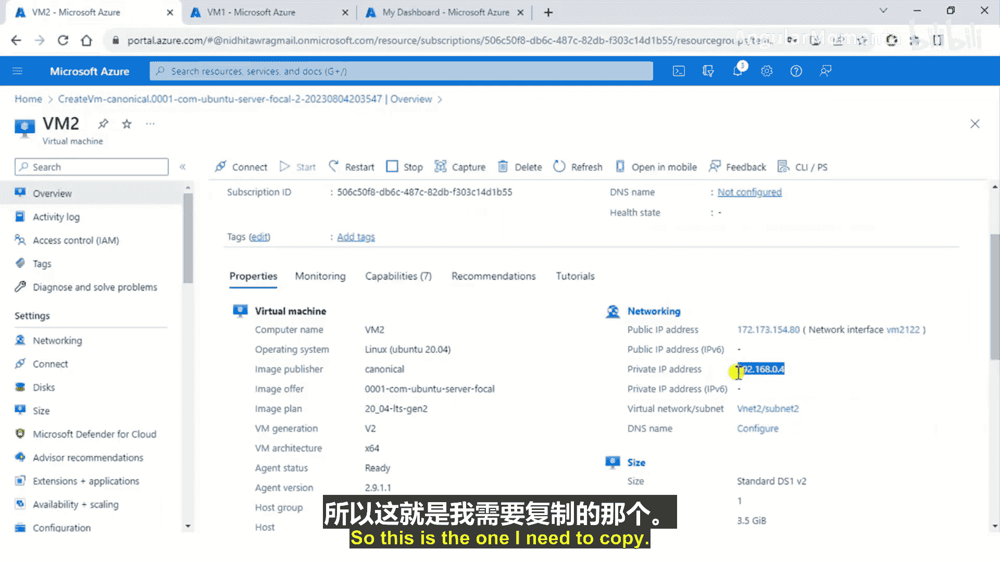

Let's go here again。Let he at。Sps this？And let's try to do that。

I should not be able to do that right now because those virtual networks are not peered so as you can see you are not getting anything after that it will show you failed at all。

It won't show you anything。It won't happen， because it's not allowed。Now， let's perform peering。

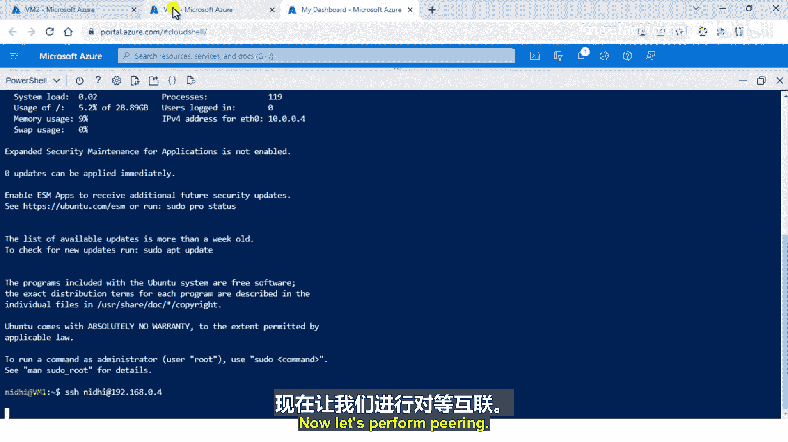

If I go to virtual machines， let's go to virtual network。So as you can see。

 I have two virtual networks， V net1 and V net 2， these are in two different locations。

 Lets go to V net 1。😊，Let it open。Okay， it's opening。 Now it's open。 And from here， go to peings。

Previously， what used to happen。You had to， if you are doing peering， if you are enablinging peering。

 So from B net 1 to 2， if you are doing from 1 to 2 as well as2 to1。

 you had to do separately Now here， if you add the peering。

 you can do both sided settings from either of the network。 you'll have to do。

 But from either of the network you can do Now， let's add a peering here。Give it a name。

 Let's say we let 1，2， v let 2。Here traffic to remote virtual network in that case， V net 2。

 because I'm doing from V net 1。 So V net 2 will be your remote virtual network。

 whether you want to allow or block the traffic。 And if you want a forwarded traffic from the remote virtual network。

 you want to allow or you want to deny a block。 That's what you want to do。😊。

And this is the remote virtual network In that case， it will be V net 2。 So let's make it V net 2，2。

 V net 1。😊，And from here， you need to select the subscription。

 So this is the1 I have and select the virtual network because Im from B net 1 I'm doing I need to select B net 2。

From here， you need to do all the settings from the remote virtual network。

 You want to allow our block forwarded traffic。 You want to allow our block。

 And that's what you can do。 Now， let's add this。So as you can see， from 1 to 2 as well as 2 to1。

 both are simultaneously added。 you don't need to do。 So if you see from green net 1。

 green net 1 to2， you can see this status as connected。 and if you。See， it' is connected。

 and if you go to V net2 as well。😊，And if you go to peering yeah I am inside peering only。

 let's refresh this and you can see 2 to1 also connected。

 So you can do it from Vet2 as well or from Vet 1 as well。

 it's bi directionional law for both the ones you can do at the same time。

 And like we discussed about gateway transit as well。 if you want to enable it that also you can do。

 I'm not doing this in this demo。 But yeah， that's what you can do。 As you can see now， it's done。😊。

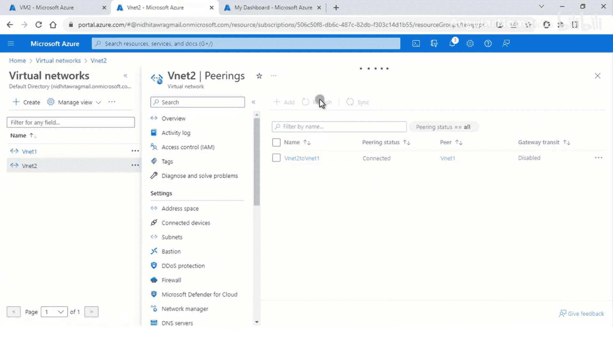

Pearing is done。 Now， if I try to connect， see here I used this same command from VN1。

 that connection timeout happened。😊。

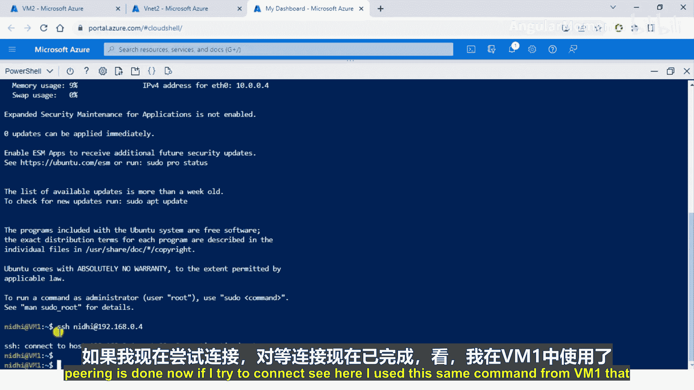

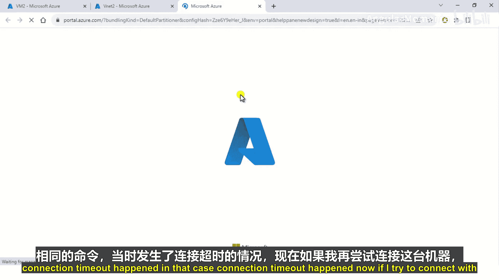

In that case， connection timeout happened。 Now， if I try to connect with the machine again。

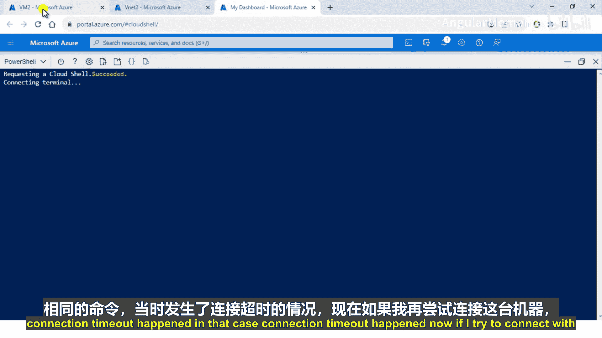

Reload this。Let's go to VM1 again。This time you should be able to do that。

 lets go to virtual machines。😊，안 고르 위엠 번。And from here， if you。肯呢。😊，Gotpy this again。

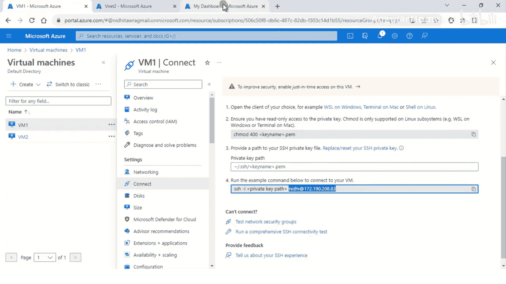

And go here again and try to connect SSH and paste the same command。😊，And try to connect。

I need to enter the password。Let's do that。Okay， now from the VM1 to the VM2。

 if you want to connect using the private IP because I have enabled peering。

 I should be able to do that。 Let's do that S H Nhi。😊，At the rate。

 what was the private IP of the machine，1，9，2 dot1，6，8 dot。😊，0 dot。

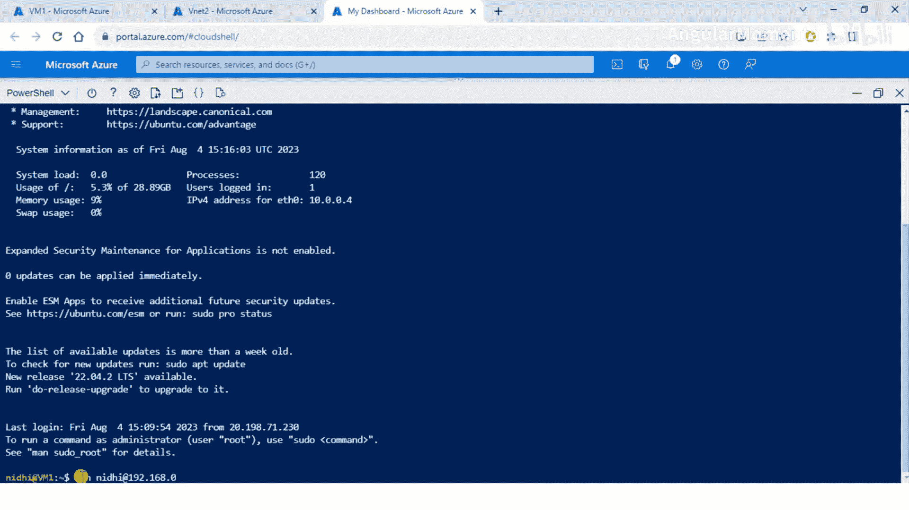

4， that was the I。 I show you again，4 do。BM2。And that's the private IP of your machine。

As you can see。This is the private IP，1，9，2 dot 1，6，8 do0 dot4。

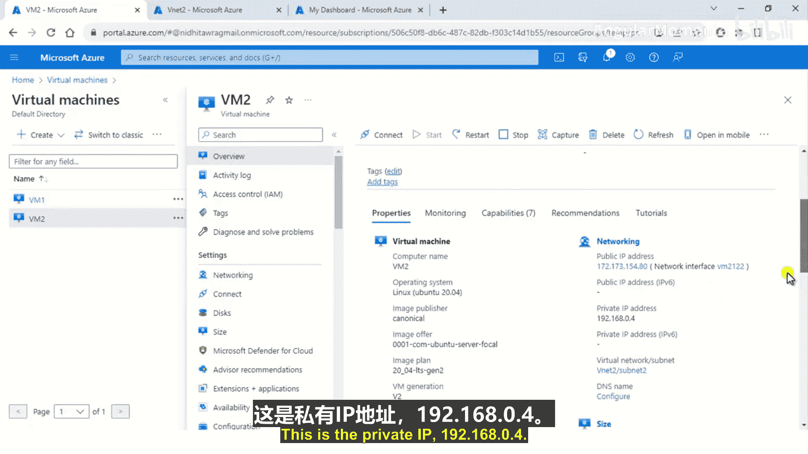

So if I go here， try to connect。Yes， I want to connect see it immediately happened this time I need to enter the password。

😊，So I entered the password。Now， you can see I'll be able to connect with VM2 from PM1。😊。

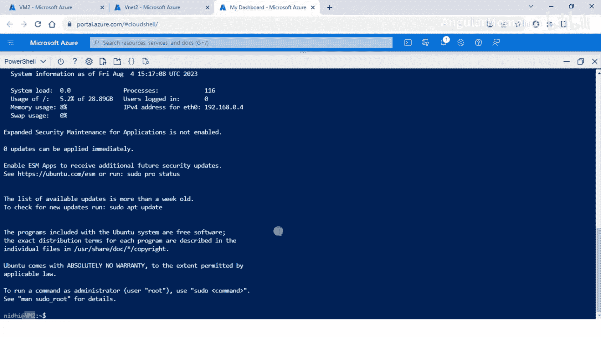

That's the benefit of bearinging。 Thank you。Hello， learners。

 let's conclude what we have seen as of now in this particular module。

 We started with how to establish connectivity between the network。 First of all。

 we started with site to site VPN connections。When you want to connect your on premises device to Azure on premises data center to Azure view use site to S VPn connection。

 and then we saw about point to S VPn。 we saw how we can connect to individual devices towards Azure After that。

 we saw about Vnet appearings within Azure if you want to connect to virtual networks。

 then you can use Vnet peerings there we saw about gateway transit service training and we saw the demos as well。

 we saw the steps to connect site to site VPn point to site VPn All these things we have discussed in this particular module。

 Thank you。

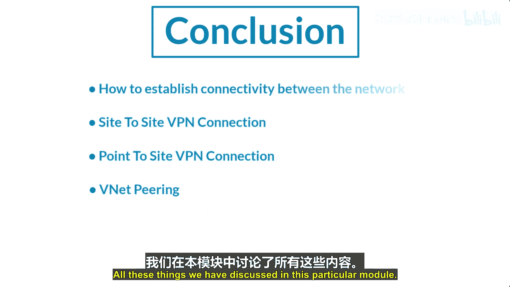