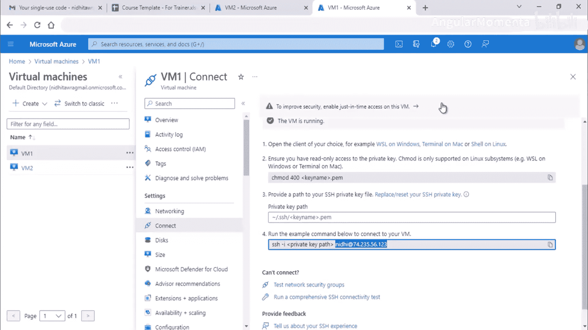
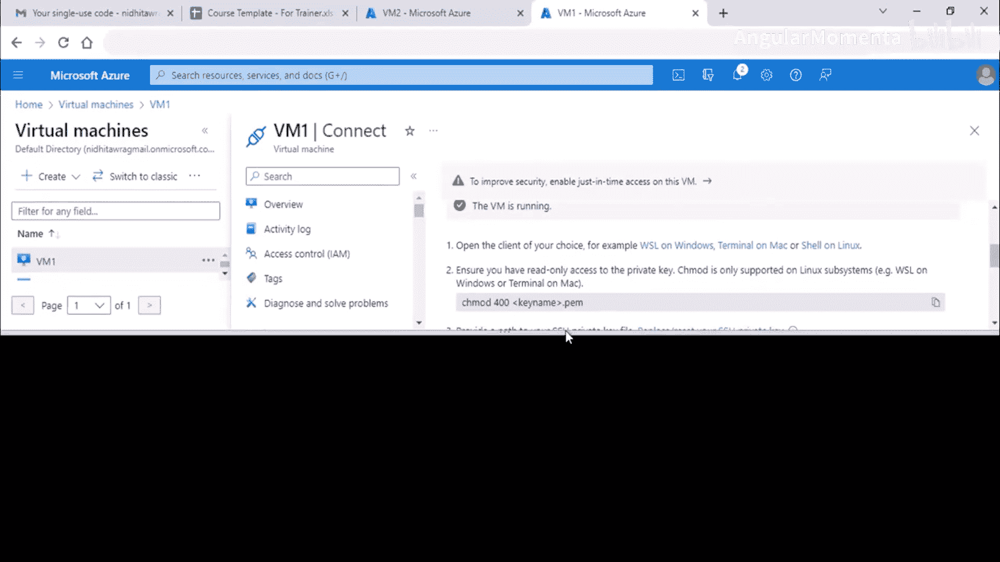
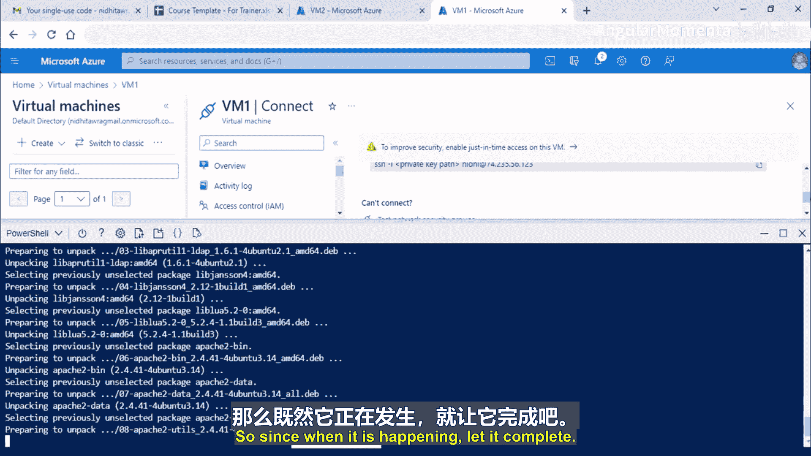
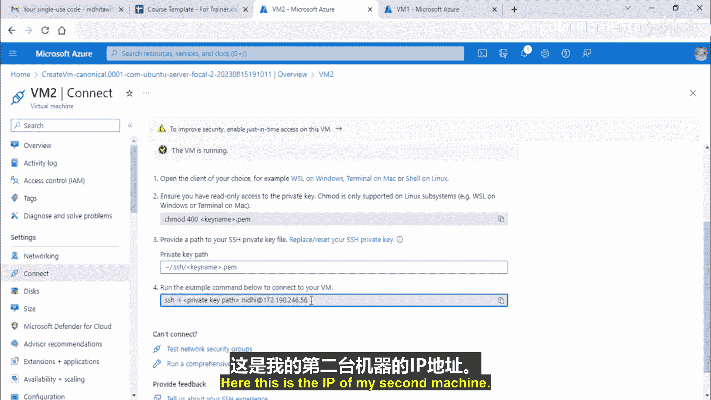
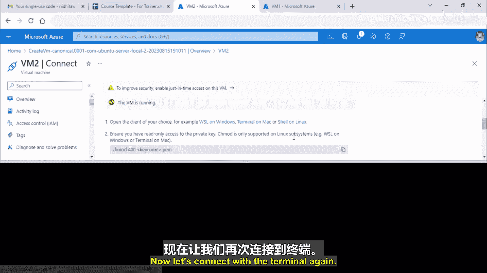
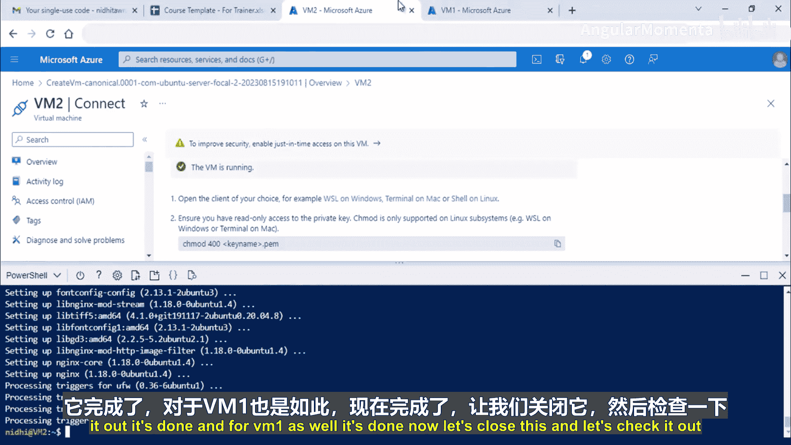
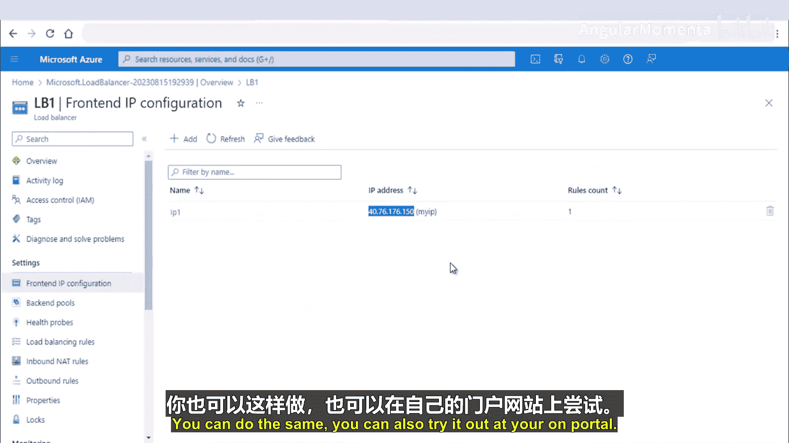

# 【EDUCBA】Azure网络基础 ｜ Azure Networking Fundamentals p07 03_01_01_Azure负载均衡入门 -BV1twFSzNE5z_p7-

Hello， learners， in this module， we are about to discuss about the load balances。

We will see different options offer a load balancers。 so as your are load balancers。

 you can scale your applications， you can create highly available services。😊。

And load balances support both inbound， as well as outbound scenarios。

 So all these things we are about to see in there。There are other load balancing options also available in Azure。

 so we are about to see in this particular module。😊，These topics。So well see about your firewall。

Well see about as your load balancer， we see about as your application gateway。

 we see about as your traffic manager and as your front door well see all those topics in detail。

Thank you very much。Hello， everyone。In this module， we are about to see what is low balance in。😊，So。

 let's start。Load balancing what it does， it basically distributes your workloads across multiple virtual machines if I show you with the help of an example。

😊，Let's say you have these two virtual machines， I'm taking an example。These two Bms are there。

 Let's call it。BM1。And the。D。And let's say one of your application is running on those Vms。

 So in order to provide high availability， because it does the distribution。

 multiple2 minimum 2 Vms should be there。So let's say one application is running on those two Vms and it is。

You can hit it。 And the diesis， let's say， W， W，w dot ABC。Dot co， if it's there。

 let's say one person from any location， let's say this is one person。

 it is hitting ww dot AVc dot com。 Now here， it wont directly hit the application on the VM will first go via this load balancer and on this load balancer。

 you have set multiple rules and all based on the code protocol。

 whatever you want to allow how it should be distributed， those rules and all you set in there。

After that， your load will be balanced， It will be forwarded to the Vs。

 Whatever will be suitable based on the rules it will be forwarded to that。

 It will also check whether that particular machine is healthy or not。

 that's what all the role offered load balancer， the traffic distribution based on the rules。

 whatever we have。 it improves availability by sharing the workloads， it optimized resource use。

 it maximized the outputput。 So that's what the load balancing is。 Now。

 let's see what are the categorizations of load balancers。

 So basically we categorized it on two basis first as global regional。 second it S TP and node STP。

 So if I talk about the global load balancing option。😊，Here you can distribute your workload。😮。

Basically， those machines， those virtual machines， those backend machines can be on different。

 different region， or it can be one on on premises。 and Another one is on on your， as your side。

 That's what it can be。 And then you distribute your traffic。

So it can be hybrid on premises services， or it can be across regional。Backends or the clouds。

 That's what it can be。So basically， this service route your end user traffic to the closest backend。

 closest available backend， whatever it will be。😊，That's what it will be。 So that is global option。

 Second is regional option in regional option。 your traffic will be distributed within the virtual network across virtual machine。

 So one network is there and inside that network a virtual machine will be there。

 but that will be in the same region。 It can be zonal or availability zone option can be there。

 but it will be within the same region。 Second categorization is StTP and nonhtTP。😊。

if you know about OSI layer 7， so based on OSI layer 7。

 it distribute your traffic it accept your traffic。😊，Only SGTP1。

 So whatever it will be the SGTP or SGTP traffic is， it will accept that only。Basically。

 this STTP categorization is intended for web applications or maybe other STTP endpoint。

 then we use SGTP as。😊，And another option， we have non issue Tps。

 It can handle non H Tps traffic and are recommended for non web workers。 So These are the different。

 different options， different different categorizations we have。 Thank you very much。😊，Hello。

 learners。In this lesson， we are about to see different load balancing options we have。

So let's get started so these are the different load balancing options we have each of these options will see in detail lets start with as your load balancer first I'm just giving you an overview here as your load balancer this is a high performance ultra low latency OSI layers forward load balancing service。

And。It is used for inbound traffic of all UDP and TCP protocols。So that's what it is used for。 Also。

 as your load balancer can handle millions of requests per second and also ensures that the solution will be highly available。

 Second option we have is as your traffic manager。 That is a DNS based traffic load balancer。

 It enables you to distribute traffic optimally to service across global as your reasons。

 It also provides high availability。😊，Now， the next option is as your application gateway as your application gateway。

😊，Provides application delivery control。And it offers Oi layer 7 load balancing capabilities。

 You can also use it to optimize the performance Okay， and thats what as your application gateways。

 Now the last one is as your front door。 This is also an application delivery network that provides global load balancing for global load balancing to use as your front door。

😊，And it provides site acceleration services for web application。 It also uses OSI layer 7。

 Thank you very much。Hello， learners， in this lesson。

 we are about to see the first load balancing option that is azure load balance。😊。

So what is Az your load balancer。Just see that first before coming to this particular slide。

 let me explain with the help of an example。Let' say。This is my as your Lord balancer。 Let's call it。

Hows your。Ld。balanceance。I have my back end pool。 Let's call it。2 Vms are in there。 And this is my。

把根管。Coll it。白件。Let's say traffic is coming from here， so we have multiple users。

And my application is running on those two Vs。 Let's say that。 Let's call it V1。

And let's call it V M 2。What does your load balancer does。Distributes your traffic。

 So let's say someone is hitting。 let's say when application is running ABC dot com。

 something like that is there and traffic is coming。 Now it will go to as your load balancer first。

 Let's say it has one public I。It will hit that。 not necessary that your VM has public IP。

 but generally we expose the public IP of the load balancer to the user。

What basically will happen here， the traffic will hit this as your node balancer and as your node balancer has some node balancing rules。

 So based on port and IP， it will forward your traffic。

 It will distribute your traffic to the machines How many machines will be there。

 It will be under this back and pool in the back and pool settings will add the Vms。😊。

So that's what it does。 It load balances your traffic as the name suggests on the basis of rules and it can handle millions of requests per second That's the specialtyity of that and it works on Oi layer4 as your load balancer operates at Oi layer 4 and it distributes inbound traffic to back in pool instances So back in pool consists of the Vms Also it uses health drop So it will keep on checking the help of the machine if the machine is healthy。

 then it will distribute the traffic to that。😊，Also， the rules will be applicable。

Now let's see what are the different types of load balancers we have。 Basically。

 we have three types of load balancers， public load balancer。

 internal load balancer and gateway load balancer Now， let's understand what is public load balancer。

 Public load balancer is nothing， but it can provide outbound connections for your virtual machines inside your virtual network。

 like in the previous example I have shown you you have your load balancer。

 which will be having a public IP。 So traffic will hit the load balancer first and that public IP。

 is exposed to the public。😊，And then it will do the load balancing based on the rules and all。

 That is public load balancingr。 Second option we have is internal load balancer。

Internal load balancer is used where private Is are needed at the front end only。😊，Within a network。

 if you want to distribute your traffic and you don't want that IP to be exposed to the public。

 then you can use internal load balancer like if I show you with the help of an example。

Let's say this is your residual load balancer， and this is your complete virtual network。And。

Let's call it。Vner。This is your be neck。And this is your VM。 And let's say this VM。

 this application wants to exist the database， for example。 So let's call it。 We have the instances。

 and we have this databases instances。 Let's say database instance this database instance this。😊。

Let's say these VMs need to access the database， and。You want to apply load balancing here as well。

 Internal load balancer。 Also， you can use。 Let's say this is your internal load balancer。

 Let's call it。Internal load balance。What will happen here。

 The traffic distribution will happen from this Vm。 It will go to this internal load balancer first。

 then based on the rules and all， it will distribute your traffic。

 So you do not need to expose the I to the public and all based on the private I only it will happen。

 will continue remaining part of the topic in the next video。 Thank you。Hello， learners。

Now let's explore the next topic in our discussion。We have third type of option。

 That is your gateway load balancer。😊，So what is gateateway load balancer。

That is basically used for high performance and high availability scenarios。

 If you want to have a third partyy network virtual application。

 So if you have NVs thirdpart network virtual appliances with the capabilities of gateway load balancer。

 you can easily deploy scale and manage your NVs。 So if you want to manage your Ns and you want high availability load balancers。

 then gateway load balancer is the best option for you。

 So you can insert appliances transparently for different kind of services。 for example。

 for firewalls for packet analytics for detection and prevention systems。

 all these things you can use。😊，So these are the three types of load balances we have。Now。

 like I told you， we have load balancer rules based on those rules only your traffic will be distributed。

 So what it does it maps your friend and I and port combination to the back in pool and port combination that's what load balancer rules does。

 Also we have one more thing called session persistence Now by default what happens if let's say one client is requesting。

Let's say I is hit or or you have hit ww dot ABC dot co whatever the website you want to hit which is running on theM。

 Now what will happen by default based on the load balancing rules。

 any machine can give you the response that is the none option。

 if you want that particular request particular client's request if any successive request is coming from the same client。

And that should be handled by the particular machine only。 Let's say in the back and pool。

 you have 3，4，5 machines。 And if you want that particular machine should handle that request。

 then you can enable this session persistence option as well。 Let's say this is my V M。

 And this is my client。 This is my client。 Let's name it。😊，This X client。

 if it is hitting the www dot ABC dot com。 if that particular client is hitting that。

 So first of all， it will go to load balance。 It will check whether the machine is healthy or not。

 And let's say the request is served by this VM one only。😊，If this particular client again request。

 so if you want that should be handled by this machine only so you can enable this option session persistent option this is what session persistent option is for。

😊，Based on the client type also， you can do that。 Like if request is coming from the same client type that should be handled by the particular machine。

 that option we have also based on client type as well as protocol， that option also we have。

 Thank you very much in the next video we'll see about the demo。 Okay。

 how we can actually do all these things in action。 Thank you very much。😊，In this part。

 we'll see the comparison of different SkuU provided by A balancer。 This is the official webage。

 I'll show you the link as well。 Now， let's see the comparison here。😊。

We have three Skus basic standard and the gateway1。

 if I show you the comparison of standard and basic and each load balancer Sku is equipped for different different scenarios to see standard load balancer its required it's a lower balancing network layer traffic when high performance ultra low latency is needed that's when it is used we have basic load balancer that is equipped called small scale applications that do not need high availability or redundant。

And back in life for standard one， we have I based and N IC based Nick based。

 basic load balance are only neck based。 if you see the protocols， both PCP and UB we are supported。

Back and pull endpoint， if you see any virtual machine or virtual machine skill sets is supported。

 but here in basic one in basic word balancer， virtual machines in a single availability sets or virtual machine skill sets only are supported not all。

Help Rob here。 T C P， S U T P and S T P S is supported here。 only T CP and S U T P is supported。

 We have different comparisons here。 You can check out this official website What is supported and what not。

 you all have told you。 I'll share you willing link。 Thank you very much。Hello， learners。

In this lesson， we'll see what we are about to create for A no balancer demo。 First of all。

 what I'm about to do。I'll create one virtual network。 Let's call it V。And also。

 I'll be creating subnets inside that。I'll be creating two submitnet here。Subnet one and submit。嗯。

Also， I'll be creating two virtual machines。 So let's say this and this。We creatingating。BM1。And PM2。

Also， I'll be creating load balancer with standard SkuU。😊。

Standard S load balancer I'll be creating here。Let's call it。As your load balancer with standard Sku。

 and that will be your public load balancer。And after that。

 I'll hit the application on this Vm Allin Apache to on Vm2 Allin Engine。😊，Based on the traffic。

Your load balancer， the rules I be setting。 your traffic will be distribute。

 You will see the response from both the Williams。 That's what we are about to。

Will continue remaining part of the topic in the next video。

Now let's explore the next topic in our discussion。Now， let's see。The diagram。

 which we have discussed in the last module in the last part， in action。

In order to create a load balancer first of all， I need to create a Vnet as well as subnet and the virtual machine inside that sub network in our previous modules in the vnet virtual networking module。

 we have already seen how to create a virtual network and how to create a subnet and inside that how to create a virtual machine in that。

 That part， I have already covered。 I have two virtual machines inside one network。 Now。

 what I need to do， first of all， I need to install Apache to on one virtual machine and engine Xon。

 another virtual machine。 When one machine will be with， we can see like which one is responding。

 Let's first connect with that machine。😊，Or start with being1。Ny， at the rate。 This is the I。

So， let's open Cloudhell。

Let it connect to the terminal。Might take a while。看脑 done。Now， let's start with that。

 Let's connect with the VM first SH， and let's just paste whatever we have copied username A public I。

 That's how we connect with the event to。So I want to continue， and I need to enter the password。

 which I have added by creating the Vm。So I have entered the password。As you can see。

 I'm inside E M1 here I need to install Apache to cost， Lets update it cost。Suro E update。

 That is the command。 I use for Linux。 If you're not familiar with that。 Don't worry。

 you can go through the Linux commands How to install engine。 So  first of all， I'm updating it。

It might take a while。 Now， let's install Apache to on the Soro。 I get install。U by tree。

 that's the command view。Yes， I want you can do。So since when it is happening， let it complete。

 let's connect with my second virtual machine as well。 So I have manually open another tab。

 Let's go to connect here。 This is the Vm2。

And let's check it out。Here， this is the I of my second machine。 Letaggurate this。 Now。

 let's connect with the terminal again。

Soentating。Connect with that first is。 and let's peace。Enter。😊，Yes。

 I want to continue and need to enter the password again。I'm inside this VM2。Now。

 let's update it to do it yet。Uplift。Here on this machine， I'm going install angels over。

Let it complete。Sudo and kit installed。Aning。It's happening。Since when it is happening。

 let's check it out。 It's done。 And for VM1 as well， it's done。 Now， let's close this。

And， let's check it out。Whether it actually happened or not， I go to VM2。And this is my V one。

 If I go here as well。Let's hit the public IP of Vm1 post。

You can see one Apache to homeage it showing。 If I check out the IP of PM2， let's copy IP here。

 I should see Engine。So I'm able to see engineer。 So as you can see。

 if I hit the public I P of both the Vs， I can see those two servers。 I can have the response。😊。

If you want to use the load balancers， what load balancer says。

 if you are using standard SkuU load balancer， the machines inside your backend pool either should have public I with standard SkuU or if they don't have IP at all。

 because we are about to use a public load balancer。

 So your traffic will hit the public IP of the load balancer and that load balancer will divide where which server will give you the response for that machines do not require the public IP can be happen internally with the private IP as well。

 not necessary that Vm has the public IP。 What I need to do because I'm about to use public load balancer without standard SkuU I need to remove those public IP I just wanted to show you that it's giving the response。

 Now， let's remove that public IP。Here， go to networking。Here I go to network interface。Those VM1。

Here， go to I P configurations。And here， go to I config1。Here， as you can see。

 this is the IP associated IP address is there。I need to remove this。Associated public I P is there。

 and I need to remove this。 Similarly， I need to do the same with Vm to S。

 So we'll see the remaining part in the next video。 Thank you very much。Hello， learners。

Like we were discussing in our previous video， we need to remove the public IP address of both opinions。

 Let's do that。Here， go to network interface。I'm doing for VM1。And here go to IP configurations。

And from here， you go here， go to I P Con 1。And from here。

Just remove this associated public IP address。 I don't want any public IP address associated with that。

 Let's save this。Since when it is happening， go to VM2。Go to networking here。Go to network interface。

And here， go to I P configurations。From here， go to IP P Config1 again。And from here as well。

 just remove this。 I don't want any associated public。 I be addressed with that as well。

So this is also updating。 to check here， I think that might have been done。

 updatedated network interface。 to go to virtual machines again。 you go to V1 again。

And if you refresh this， you do not see any public I be address。If I check what V2， as well。

It's done。 If you check it out， go to B M2。And go to overview。And if I refresh this。

 there is no associated public IP。Now， let's go to as your load balancer。 Now。

 let's create a load balancer here。What do load balances。So if you check this diagram。

 I have created a Vnet。 I have created two sub。 I have created a VM。

 I have installed apache to an enter X on that。 What I'm about to do now。

 I'll be creating load balancer now。😊，Let's create load balancer。Premier。

Let's select the resource through。Andim。😊，And give it a name。 Maybe L B1。 Let。

 That's the name I'm giving。 feature shall let it be east you。SKU。

 I'm about to use the standard SkuU load balancer， and I want to use the public load balance。

And because my machines are in the same region because I this time for this example。

 I am using the same region， regional is fine for me。😊，Now go to front end IP configuration。

I need to add a front end I configuration when people will。

 when the traffic will come to the load balancer will hit what I。 That's what we need to select。

 So give it a name， let's say。I P1， let's call it。 And I want I V for IP address。 I want。

 I'm using standard load balancer。 I P address should be of standard S K U。 Let's create a new one。

And， let's create。My I P， give it a name， and I want standard regional and static 1 I want。

And here you can select no zone or zone attendant as well。 So let it be no zone。

 no availability zone， or you can select like one as well。 Z returnant as well。

 Let's select one only。And let's add。 And here you can select if you want to add gateway lower balancer or not。

 Let's add this。 Now， go to back end pose here。 I need to add the Gms where I want to distribute the trust。

SAT a black and pool。And give it a name。 Let's say， my school。Now。

 I need to select the virtual network Dnet1， because this is the regional one。 I can only select one。

 And here you can select what you want， Nick or IP address。

 whatever you want and I configurations if you want to I。These things you can add from here。

 you can select light name or neck you can select here， add typep configurations。

These are the Vms if you want to add， as you can see。

 IP configuration associated to the virtual machines and virtual skill sets must be in the same location as the load balancer and be in the same virtual level。

 because I have used the regional option。 If I have selected global one。

 Then you can select multiple region as well。 It's not necessary。 You have to be in both location。

 Let's select add this。😊，As you can see， I have added both the。 So this is my backend。

Lets say this from here add the inbound rules， you need to add the lower balancing rule based on that your traffic will be distributed。

Here， give it a name。 Let's say rule 1， an IPV4 I have an IP1 that will be created。

 Let's select this one an existing backend poll。 Let's select the Mypo where I have added the PM。

 and I want to do the protocol as TCP。 We have option of TCP as well as UTP。 Let's say port 80。

 I want to work on4 80 because my requests are a TP。 Let's select back and quote as well。

4 80 health probe。 There is no existing health probe here。

 I need to create new one So give it a name。 My health probe。 Let's say this name， TCP。

 I want on port 80 and。😊，intervalters per second。 If within an interval of 5 seconds。

 if machine is not responding， that means it's unhealthy。 That's how it will check。

 That's the rule I。 So you can change that number as well。 Let's save it。 Keep it to the default。

The let's say all other options。 default ideal time out is4 minutes。 That's why it is。

 If you want to change it， you can do that as well。 And session consistence， if you want。

 you can do non client I and protocol， whatever you want， Let it be defaulted。 Let's save this。😊。

And I don't want to add any inbound net rule。 I don't want to add any outbound rule。

 And let's just create this。When it will be created， remaining part will see in the next part。

 Thank you very much。😊，Hello， learners。Now， in our previous video， we have created load balancer。

 Now it's ready at that time it was under creation。 Now it's ready， it has already created。

 if I go here， if I check it out， this is my front end IP configuration and IP of its standard S has been created。

 and as you can see， we have backing pool later on as well。

 you can change the configuration and here I have the VM1 and Vm22 Vms are there。

 and they don't have any public IP。 only the private IP you can see。😊。

You can see health drops that setting also if you want， you can change it。

 No balancing rules is there later on as well。 if you want to add something， you can do it as well。

 Now， let's try to hit the public I， let's see with server will give the response this time。

 So if I hit this I。 Let's check it out。 I should be able to get the response either so I am able to see engine X space。

 definitely Bm2 is giving the response。 So if I refresh this or if I try after sometimes can get the response from B1 as well。

 That means it's load balancing based on the rules I have。😊，You can do the same。

 You can also write out at your own portal。 Thank you very much。😊。

