# 【EDUCBA】Azure网络基础 ｜ Azure Networking Fundamentals p08 03_02_01_Azure 应用程序网关 -BV1twFSzNE5z_p8-

Hello， learners， in this lesson， we see about us your application gateway。

What is as your application gateway lets see that first as your application gateway is a web traffic load balancer it enables you to manage traffic to your web applications and it works on OSI layer 7 I show you with the help of a diagram it works similar to your normal as your load balancer but there are certain other features which it also supports。

😊，Let's say this is your browser。 Let's call it browser。And from that browser， you have your。

Ass your application gateway？It will be having a front end IP。 Let's call it。 That will be your IP。

And from here。You can have your listeners， it can be your HGTP or HGTP as listeners。After that。

 there will be rules， again， like in our normal load balancer。 So there will be rules。

And some HTTP settings， if you have。 And finally， there will be。😊，Back and food。So here。

 let's say this is your pack pool。So first of all， let's say someone is hitting your application and if we go to first your aszure application gateway front N IPP。

 then there will be StTP and StTPS listener and based on the rules your traffic will be distributed to the backend pool unlike your as your low balancer backend pool may support your let's call it PMs。

And it may also support virtual machine skill sets， and it may also support your own premises。

Serers as well。 So all are support vector。Let's see what are the different routing options we have in application gateateway unlike your as your load balancer。

 so it also supports along with normal distribution of traffic。

 pathways routing and multiple site routing。Let me also explain with the help of an example。

 Let's first discuss us about path based routing。 Let's say this is your。把间뿔。

Let's say two backend pull is there and here we have virtual machines。

I'm just explaining path based routing first。Let's say we have a traffic。

 People are accessing your website。 This is happening。 It is contoso dot com or ABC dot com。

 something like that is there。 So Let's call it ABC dot com a。😊，ABC dot com， if you are heading。

First of all， if someone is setting ABC dot com， it will go to first year as your application gateway。

 Let's call it application。Getway。What path based routing does， you have these two backend pools。

 One is your image server pool， and another one is your video server pool。

 Let's call it image server pool。Image so。Ool， and this one is your。Video搜注。

What will happen if you are hitting ABC dot contoso dot com slash images， for example。

 let's say slash。Images， for example。So it will go to this image server pool。

And if you are hitting ABc dot com slash videos slash something whatever video you want to select if you are hitting that it will go to that video server pool that is path based routing to the individual paths if you go and that sort of routing also supports Also there is one more thing we call it it has a feature although it's optional but it has that call it web application for one so if you have any web based threats like SQl injection and all it also protects you from that if you enable that particular option that is also supported in there so this is your。

八。this酒景。As your also support this application gateway also supports multiple site routing。

 What is that multiple site routing again， if you have this is your traffic is coming people are accessing your traffic。

 So first of all， it will hit your。Application gateway。 So let's call it again， application gateway。

Here also， there will be path， if you want to enable。And it also works on Oi layer ribbon。

 you can call it layer 7 as well。 Now， if you want to do multiple site routing and you have two website。

 this one， as well as this one。😊，ABC dot com， as well as X， Y， Z dot com。 So let's call it ABC。X y Z。

If you are hitting ABC dot com and you want to route it to a particular pool。

 you can do that as well。 So if you are hitting。Let me just show that also with the help of a diagram。

 let's see this and this。 So if you are hitting ABC dot com。

 it will go to that particular pool if you are hitting x。

Yz dot co it will hit that particular pool so that is your multiple site routing。😊，Multiple site。漏定。

It also supports that as well。 Let's see the application gateway SkuU Basically there are two SkuU version one and version 2。

 So what is version one application gateway standard version one。

 It is basically offered in three sizes， small medium and large。

Small sizes are used for development and testing scenarios。 and also we have medium size as well。

 small consists of 6 Kbs，7。5 MBP sort of things that supports and medium。

 it consists of 13 MBP and 100 MBP。 that's what it is。

 And if you also have application gateway standard version2 as well。

 that can be configured for auto scaling。 And if you want to have a fixed size deployment。😊。

Then you can go for version tools， so you can use any of the version of the SkuU based on your requirements。

 Thank you very much。

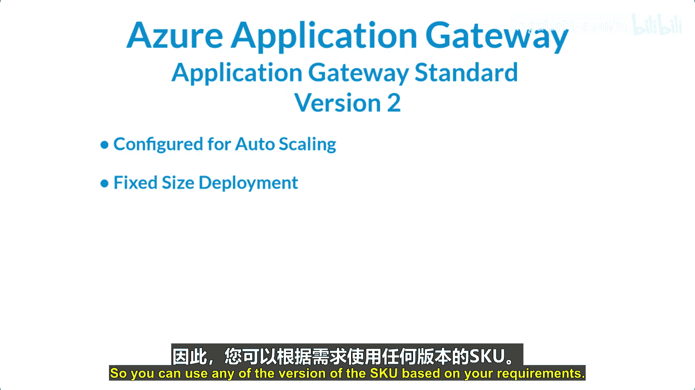

In this part， I'm about to show you more about。S can use of application gateway。

 So if you see this is the official website， I just wanted to walk you through to that。

 like we discussed， we have two versions。 So if I talk about a version two specifically。

Vashten 2 SkuU pricing has two components。 has a fixed price and capacity unit price as well。

 And if you see the feature comparison between V1 and V2。In version  to auto scaling is supported。

 Z red is supported。 Stactic VIP is supported。 Kubernetes is also is supported。Here。

 URL based multiple site hosting both are supported in both the version。

 So you can check it out this list。 I'll share this link with you。 Please go through that。

 Thank you very much。😊。

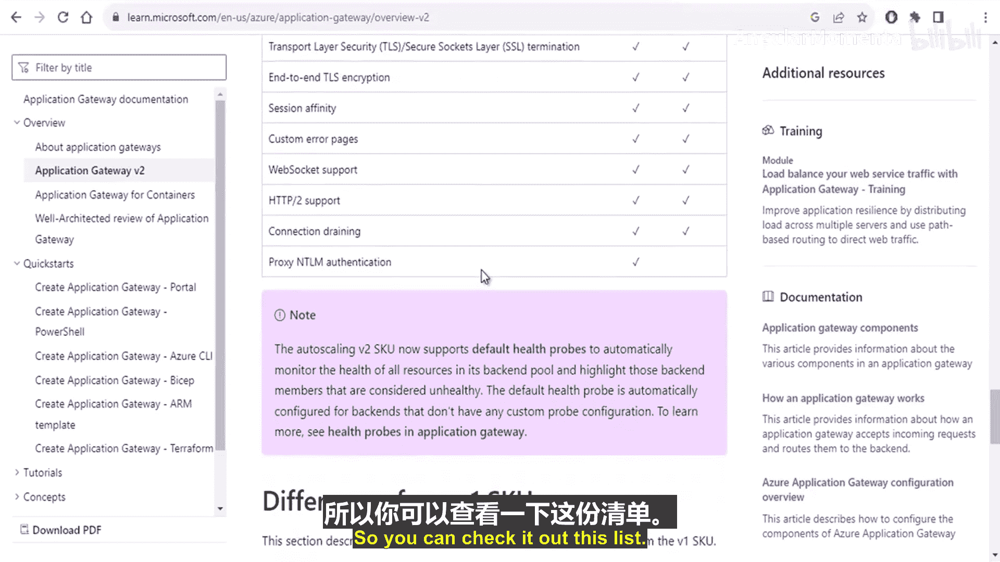

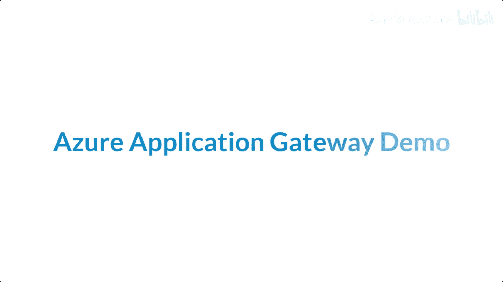

Hello， learners。In this part， well see what Im about to show you off as your application gateway demo。

What I'll be doing。I'll be creating one virtual network。

 let's call it Vnet of the same range in dot 0 dot 0 do 0 slash 16 Also inside that I'll be creating two sub networks。

And let's call it Sub 1。And let's call it sumnet。2。And in submit1。

 I'll be creating a your application gateway。😊，That will be my aszure application kit。And in the。

 let's call it front end subnet， you call it。 And in subnet 2， I'll be having my back end pull here。

 I'll be deploying two virtual machines。 Let's call it VM 1 and Vm2。And on Bm1。

 I'll be stalling Aache 2 on Vm 2， I'll be installing Engine X。

And then I'll show you whether the load balancing is happening or not。 Thank you very much。😊。

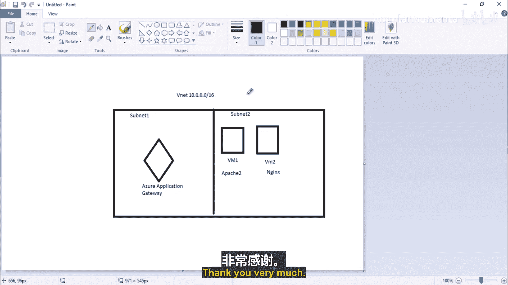

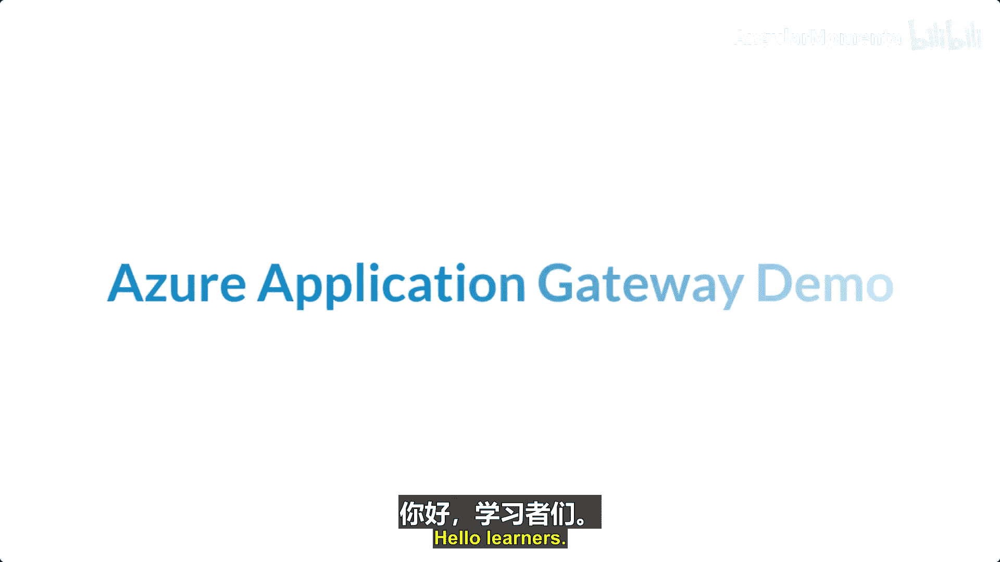

Hello， learners。Now， let's see whatever we have discussed in the last video in action。

 This is what I'm about to create what I have done already because in so many videos。

 I have shown you how to create the V subnet as well。 What I have done already。

 I have created virtual network already。 I have created subnets as well Also I have created my Vms Vm1 and Vm2。

 And on that I have already installed Apache 2 and Nx because that part we have already。😊。

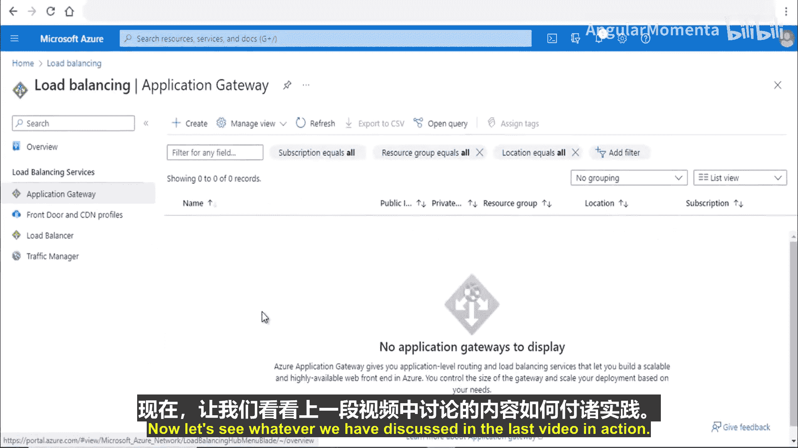

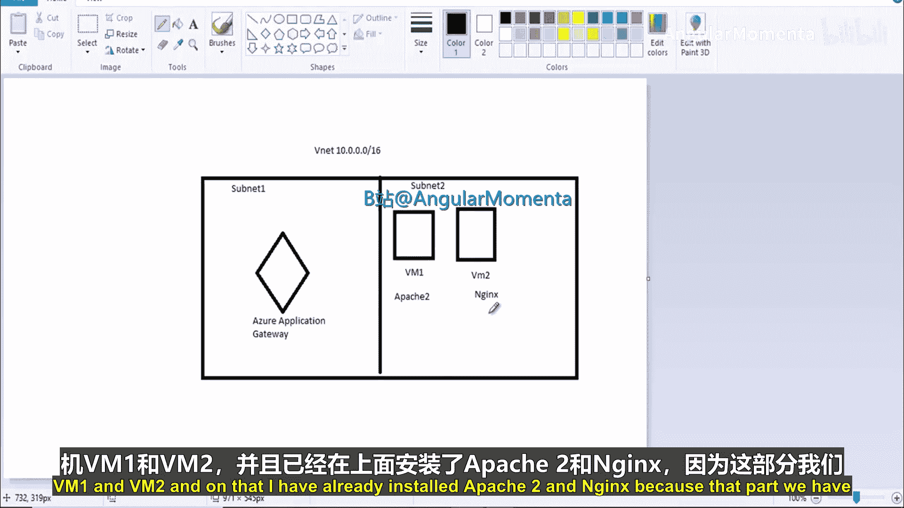

If I show you this thing。I go to my virtual network。

 So if you see here I have already created the screenet。😊，And this Vnet consists of two sub networks。

Subnet 1 and subnet 2， as you can see there there are all the Is available here here 249 because two virtual machines have already installed in that particular subnet。

So two VMs are in this。 If I show you virtual machine as well。Have to过去。Now， directly。

 let's go to application gateway。Let's click on create application gateateway。Here。

 I need to select the resource group， so let's select them。And give it a name。

 Let's say my application gateway， any name you can add。Region you need to select。

 And here you can select the tier version 1， version 2。

 if you want to add by the application firewall， that also you can add， you can select。

 And because standard version2。Enables support auto scaling。 You can add that as well。

 You want to say yes， you can say otherwise， you can click on no as well。 Let's click on yes。

 let it be default。 And from here， you need to select your virtual network。 So let's be next one。

I want to add this application gateway in sublet 1 like I have shown you in this example。

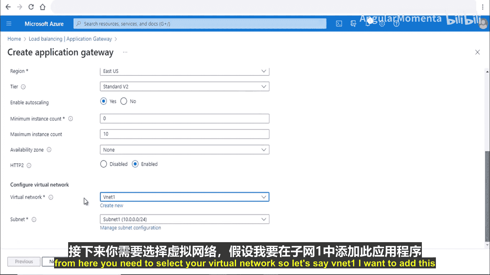

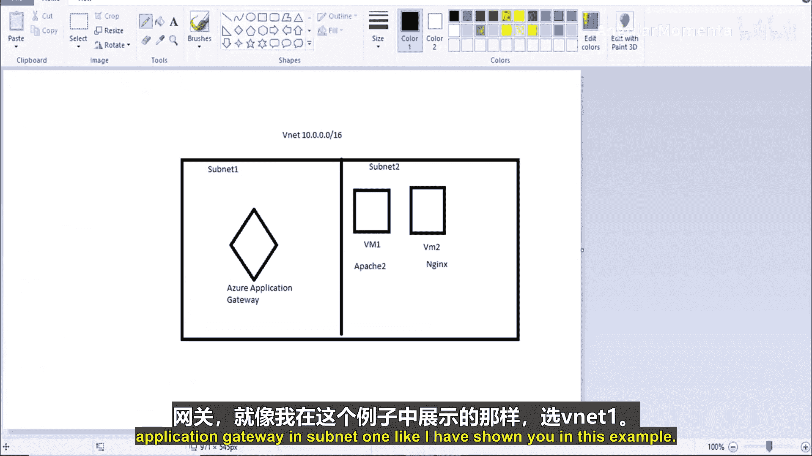

That's what I'm doing。 Now， let's go to front end。So from here， you can select public IP P address。

 I want to add new public I， or you can add。Anyone as well， let's add a new one。

 Let's call it my IP standard IP。 I'm taking standard SU。 Let's click on okay。Now。

 go to backend here。 I need to add a backend pool。 Sa the backend pool。 Give it a name。 my pool。

 for example。 if you want to add a backend pool without target。

 you can click on yes or no whatever you want。 and here select the target type because I just want to do the load balancing on VM。

 I just select VM。 But here you can see we you can do load balancing on virtual machine scale sets as well。

 app services as well。 So I just want to select virtual machine Ta will be。 let's select my VM1。

 And here also virtual machine and let's select my VM2。😊，Let's add this。

Now let's go to configurations here you need to add a frontend IP that will be added。

 Now let's add routing rules here， let's click on add a routing rule， give it a name。

 let's call it rule one here you can select the priority whatever priority you want for a change。

 let's want I'm just saying0 priority let's the rule I want to add。You can have a listener， as well。

Give it a name。 Let's say， my listener。You can have multiple listener as well Public I I want to had。

 you can select the protocol S your StPS， whatever you want here we have that option。

 you want basic or multi site routing。 So whatever you want you can select I'm just selecting。

Qu 80 only here we have bad gateway。 Ferreer pages is coming。

 You can add HTMLl file URL as well But as of now， I'm keeping it default。 let's add this。

 And here I need to add backend targets as well。 So let's select this one here。

 you can select backend pull or redirection as well here。

 let's select my pool because the pool I have already added。😊，Here， let's add a backend target。

 There is no target available。 Let's add new one from here。

 you can select cookie affinity if you want settings name you can add。

 let's say AVC say HTp or HF port number 8 if you want to enable cookiebase or connection training。

 cookiebased does nothing if you want to application gateway can use cookies to keep a user session on the server site。

 If you want you can do that as well connection training is also connection rating helps gracefully remove your backend pool members during a plan service update if you want。

 you can do that as well。Time out， how much you want。 This is in seconds。 This is the default one。

 So let's add this now with the default settings。It's all done。 That waste routing。

 If you want to enable， you can add that as well。 If I'm not adding this now， Keep it default。

And I have front end， I have routing rules， I have back and pull。

 now let's click on tags and let's review in。😊，Sing the final validation。And now， let's create this。

 It will take some time to create。 Let's meet in the next video。 Thank you very much。😊，Hello。

 learners。Now， in the previous video， we have seen that the application gateway was under deployment。

 Now it has been deployed。 Now， let's check it out， test it out。This is my front end IP。I copy this。

And if I hit this on my browser， I can see Angel next page。 So if I refresh this。

 maybe after some time， I can see Apache as well。 That means it's load balancing fine。😊。

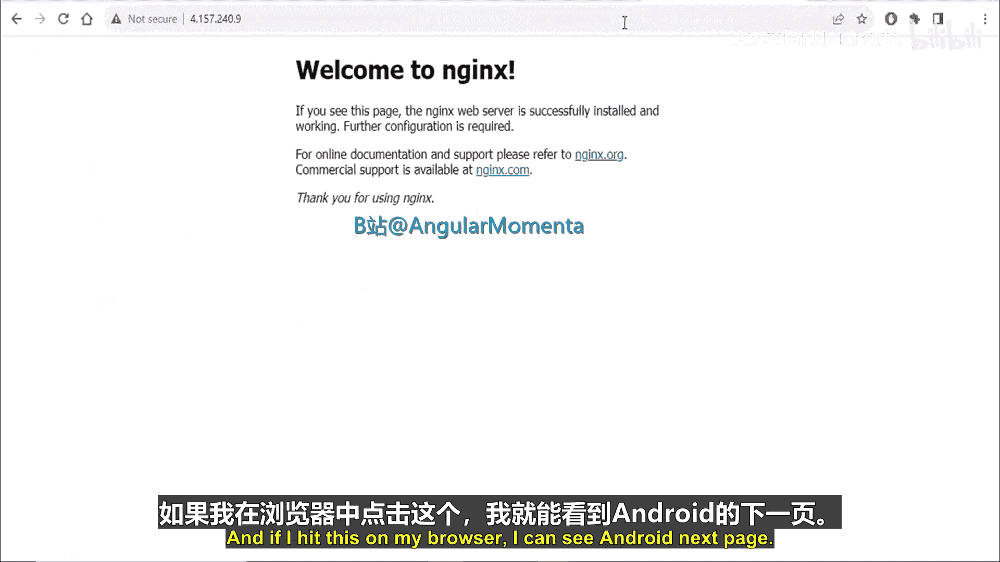

That's how you can do load balancing using as your application gateway。 It has multiple features。

 If I compare it with as your load balancer， we saw all those features as well。 Thank you very much。

😊。

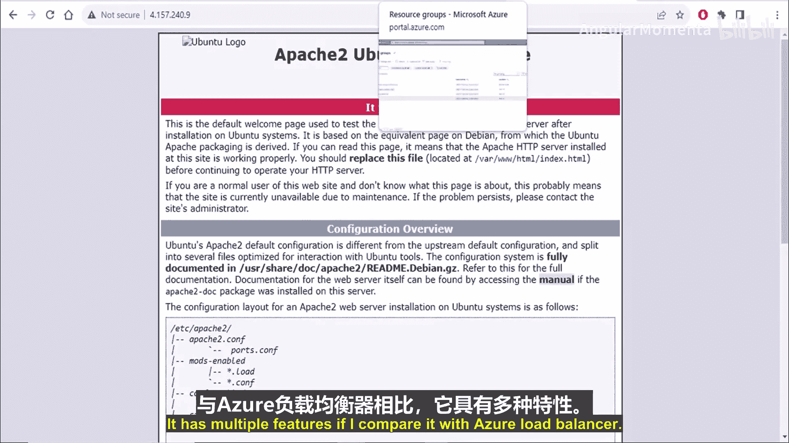