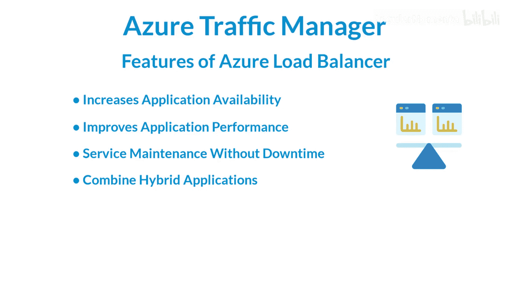
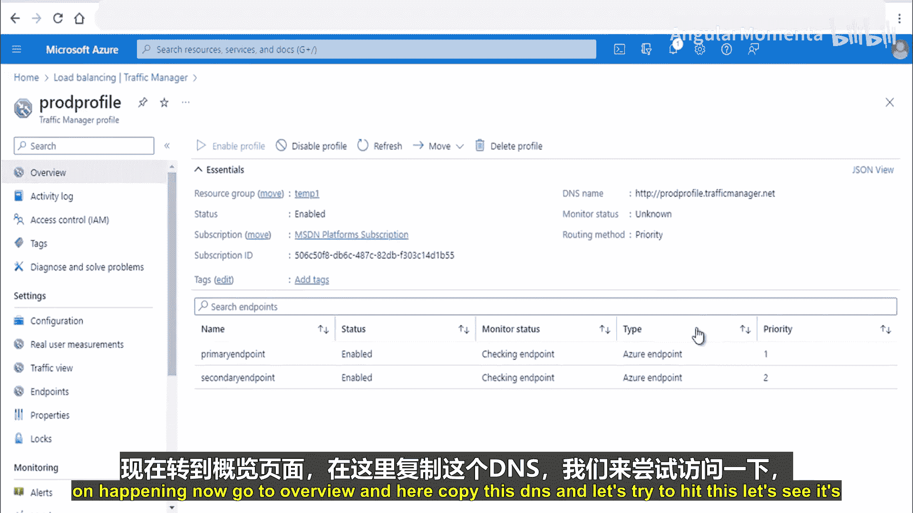
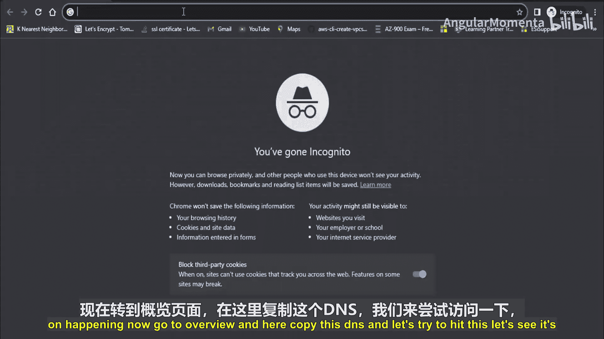
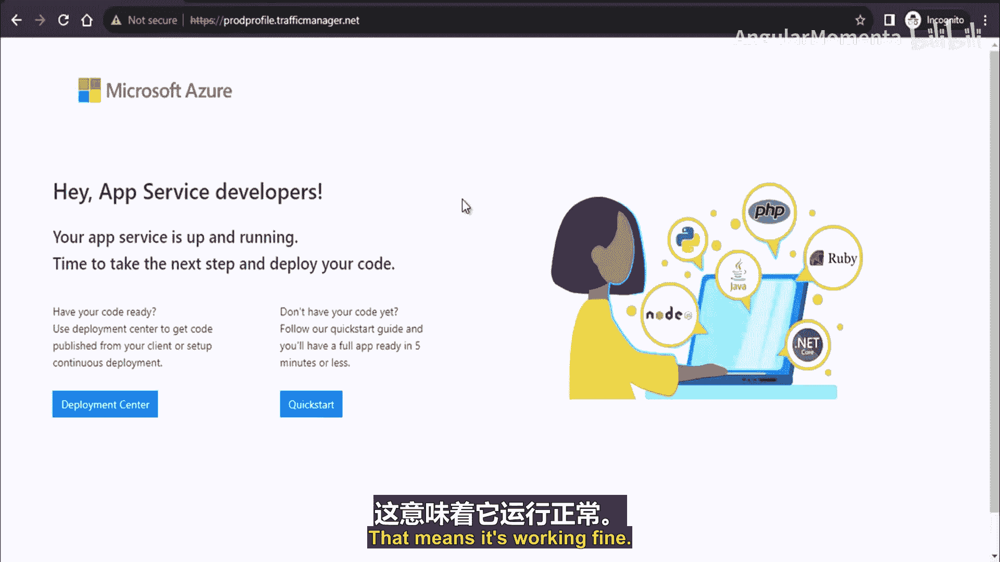

# 【EDUCBA】Azure网络基础 ｜ Azure Networking Fundamentals p09 03_03_01_Azure 流量管理器 -BV1twFSzNE5z_p9-

Hello， learners in this module， we'll see about azure traffic manager。

As your traffic manager is a DNS based traffic load balancer。

It allows you to distribute traffic to your public facing applications across the global。

 Azure regions。Traffic manager also provides you public endpoints with high availability and quick responsiveness。

Traffic manager uses DNS to direct client request to your appropriate service endpoint based on traffic routing methods。

 So we'll be discussing about traffic routing methods in our upcoming slides。

 but yeah it uses a routing method by which it will distribute the traffic to the public endpoints。

Also it provides you health monitoring it will keep on checking the health of every endpoint so it monitors your health as well。

 the health of the machines。The endpoint can be your Internet facing that is hosted inside or outside of Azure as well。

 So hybrid sort of thing。 also， it supports。Now let's see some of the features of Azure load balancer。

 So first of all， it increases application availability because traffic manager delivers high availability for your critical application and it keeps on monitoring your endpoints by providing automatic failure。

😊，Whenever your endpoint goes down， it will redirect your traffic to the available ones。

 so it provides application availability。 Second is。

 it improves application performance Azure allows you to run cloud services and websites in the data center located around the world traffic manager can improve your performance by directing traffic to the endpoint with the lowest latency。

 That's why it improves your application performance。Third is service maintenance without down time。

 You can have planned maintenance done on your application without downtime because traffic manager can direct your traffic to the endpoint while the maintenance is in progress。

 So it can redirect your traffic to the different endpoint。Also。

 you can combine hybrid applications as well。Traffic manager supports external loan Sr endpoints as well。

 You can use it for hybrid scenarios， as well。😊。

Thank you very much。

Hello， learners。In this part we'll see how traffic manager works with the help of an example。

 this example is there on the official Microsoft website。😊，I'll share this link with you。 Now。

 let's start here。 as you can see， we have a user or a browser is there。

 and this is the traffic manager。 This is the application which you want to access。

 We have the app virtual machines， and it can be any cloud service as well。

 It can be any external application as well。And this is your as yours Now let's say if client is hitting if client requests the page for example。

 partners do contoso do com slash lockin do asspx that's what client is doing。

 First of all what will happen the client will send a DNS query to its configured recursive DNS service as you can see here to resolve the name partners do contoso do com。

A recursive DNS service does not host DNS domain directly。

 Rather the client offloads the work of contacting the various author DNS service across the internet needed to resolve a DNS name Now what will happen to resolve the DNS name the recursive DNS service finds the name server for contoso dot com as you can see here and also the C name contoso。

 trafficmanager donet that will be returned。 This is the C name which is pointing to this one next the recursive DNS service finds the name server for traffic managerager donet domain which are provided by Azure traffic manager service。

😊，Then send the request for Con so dot traffic manager dot net attach the request request。Now。

 what will happen the。Chooosesn Dans point will be returned。

 and the traffic manager will return the request based on two things。 Basically。

 the current health of each endpoint， whether the particular endpoint is healthy or not。

 So as you can see， there are health checks。 Also on the basis of traffic routing methods There many traffic routing method that will be discussing。

 But based on that， it will return。The chosen endpoint is returned as DNS C recall。After that。

 what will happen， the recursive DNA service find the name server for cloud app。 domain。😊。

And it contacts the name server to request the contoso dotu cloud app dotnet this one it will request。

And finally， the recursive DNS service consolidates the results and returns a single DNS response to the client。

Ps receive the DNS results and connects to the given idea。

And the client connects to the application service endpoint directly。

 not through the traffic manager。Thank you very much。Hello， learners， in this part。

 well see about the different traffic routing methods of as your traffic manager。😊。

Will be discussing about four parity， weighted performance and geographic。

 Let me open the official page and let me explain with the help of a diagram。

Let's start with the parity traffic routing method。Priority traffic routing method with this。

 you can set the priority on which end point you want to direct your traffic and what will be the priority。

 Also， health will be the matter Use hits the browser and DNA query is there。

 Now what traffic manager will do。 So first of all。

 let's say primary is on priority 1 fail over a and fail over Bs there。

 which are on priority 2 and 3。😊，By default， what will happen every time your traffic will be directed to priority one only because this is on the priority。

 But what if this one fails if this is in degraded state as its written here。😊，Now。

 what is on priority2 fail over  aid， your traffic will be directed to this endpoint。

 So that is priority traffic routing method。Second is weighted traffic routing method。 here。

 what you can do。 You can set the weights for your endpoints。

As you can see here we have a region A with 50 wtage test 5 Reg B is 50。

 Now if a user is hitting the DNS， if it is doing the DNS query。

 what traffic manager will do region A is 50% vintaget and region B is also 50% vintaget and test is5 vintage。

😊，If this one is down now the next wetage is given to the region B。 your traffic。

 your client will connect to the region B。 That's what the weighted traffic routing is。 Now。

 the third one is performance traffic routing with performance traffic routing method。

 you can route traffic to the location that is closest to you。 If you can see via are 3 n。1。12 n3。

 and they are showing that the n。2 is best US 15 M not Europe is 75 M East Asia is 150 M S。

V US is the nearest one， so by default fault your traffic will be your request will be forwarded to this region。

 but what if it' is down， then whatever will be the next available closest endpoint you will get the response from there。

Now， let's move to the next one， the geographic traffic routing Based on the geographic location。

 your query is generating based on that。 also， you can check your track。

 if user is in Germany and it is originating from Germany， it will move to end。1， the Germany one。

And you can have nested profile as well。 Like， for example， Mexico and Asia， they are combining。

 And later on， you can set the priority as well， or you can have end。2 as well， which is the world。

 You can combine that way as well。 Thank you very much。😊，Hello， learners。In this video。

 we are about to see what we are about to create for the demo of as your traffic manager。

 What I'm about to do。 First of all， I'll be creating two Web app。😊，Folid this。 and this。

This is my Web app one。And this is my web up。I'll be creating those Web apps in two different regions。

 Say one will be in east US。Another one will be。This。Use。Also。

 I'll be creating as your traffic manager here and the routing， I'll be doing。😊。

Priority based routing， this web app 1， I'll be putting in priority 1 and this web app 2 I'll be putting in priority 2。

In the next video， let's see all these things in action。 Thank you very much。😊，Hello， learners。

Now let's explore the next topic in our discussion。First of all。

 let's create Web app 1 in east US region。Go to app services。Click on create， add a web。

And from here， create a new resource group。 Let's say temp 1。give it a name， Let's say。Fd 1，2，3。

And from here， select we can select code Docker container or static Web app。

 I'm just simply selecting Docker container and let it be Linux only。

I'm not going into the details of Webva。 how to create what are those options。 I'm just。

 I just want an endpoint。 That's why I'm using Webva。The region。

 let's select east to us and let it be the default plan。

Go to Docker and let it be the default template。 Go to networking， monitoring， keep a default。

 And let's just create this。Let's do one more thing。 Also， let's create the back to and west region。

Go here， gone。啊。Services。And click on create。At the above。From here。

 I just want to create a Web app in different regions。 So I'll be creating new resource group。

 Let's say temp 2。And here， give it a name Pro 4，5，6， for example。 And again。

 I'm selecting doctor container。And this time， let's select the region as risk U。Sst US。

And the plan and all， lets keep a default or to doctor， let's keep it default like working as well。

 monitoring， let's just create this。This one is complete。So you see here？

And this is the default domain。 If I hit this， it will show you some homeage。

This showing he have service developer， something， something like this。 It is showing。

This one is under deployment in the next video will do the further step。Yeah。

Now let's explore the next topic in our discussion。

Now I have created Web app 1 and Web app 2 in east to region and West U region if I show you this in the previous video we have seen。

 we have created Prot 123 which is in east to region and Prot 456 which is in West to West region if I hit the DNS of these2。

 you will see the same thing because I haven't added any code or anything like that in here。Rot 1，2。

3 is there already。 So if I hit this。You can see。The this page。 And if you go to broad for five sake。

Let it open。If you hit this here。 also， youll see the same thing。

Let's create traffic manager profile。 So if you go here， you go to traffic。Manasure files。Here。

 let's create a traffic manager profile。Here， give it a name。 Any name you can add like。Prod file。

 anything you can add。Routing method， let's select priority one。

 you can select any of the routing methods discussed let's go to priority one and from here select the resource group although you can select any resource group in T1 or T 2。

 this is just where your this particular traffic management profile will be situated It's not for like where your web apps where your endpoint are So you can have anywhere。

Create this。Creating。It might take a while to do so。 since when it is happening。

 let's meet in the next video。Now let's explore the next topic in our discussion。Now， as you can see。

 my。Traffic manager profile is ready， and I have my Web app。 and need to add the endpoint now here。

 this is my crowd profile。 There is no endpoint added here。 Let's add the two endpoint。

 and let's set the priority。😊，Lcorard。And here you can select as your endpoint。

 external endpoint or whatever type of endpoint you want。 This is as your endpoint。

 because my Web apps are in as your。Give it a name。 Maybe my N， or you can say， like primary。And。

Point thats what you can say if you want to enable disable it。

 you can do that as well and from here select the target is app service you can have cloud service。

 app service slot public I address anything but let's select app service and lets select the one which one you want to add say this temp1 and this is the one which I want to set as priority one thats what I want to do。

Health check you want to enable。 Let's add this。It's saving。It might take a while。It's done。 Now。

 let's add another endpoint because we have two web ups。 So as your are endpoint。Give it a name。

 Maybe secondary。And point。And here select app service and this time set， check this。来的地图。This one。

 and let it be default。 And let's add this。But it will also take a while to do。That。

So as you can see， the status is enabled。So it is checking the endpoint。 Mon will keep on happen。

 Now， go to overview。

And here， copy this DNS。 And let's try to hit this。

Let's see。It's because it is working on HTP。I'll have to allow this， as you can see here。

 Like this is responding。 It is giving me the response。

 You want to check whether it's working fine or not。 I need to set the status of the priority1 dis。

 So primary and quiteas enabled。 That's why it is it might be giving the response from here。

 Let's disable this。😊，And the status is enabled。Let's dis this， and save this。

Even after disabling this， if I'm getting the response， that means it's working fine。

 That has been saved。 And you can say this is disabled。 So if I hit that again。

 So I refresh this and hit that again。 So I'm still able to get the response。

 That means it's working fine。 Thank you very much。😊。

