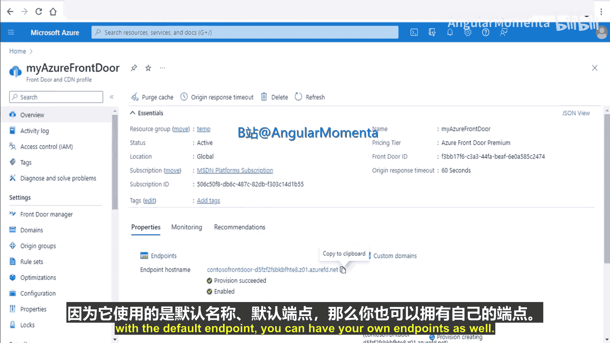
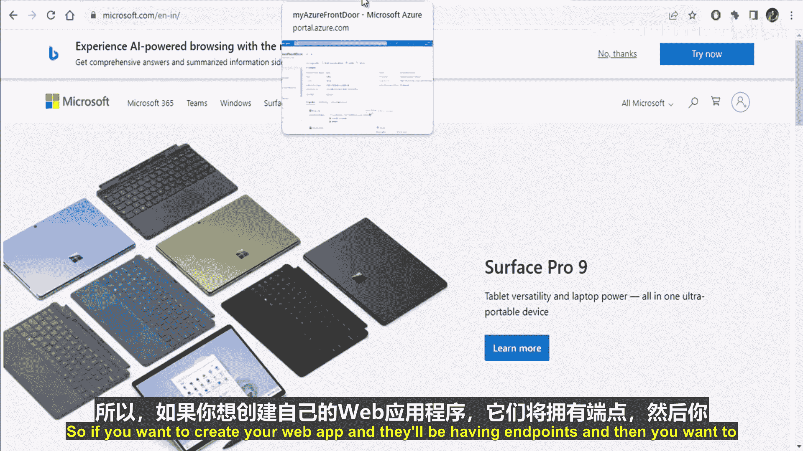
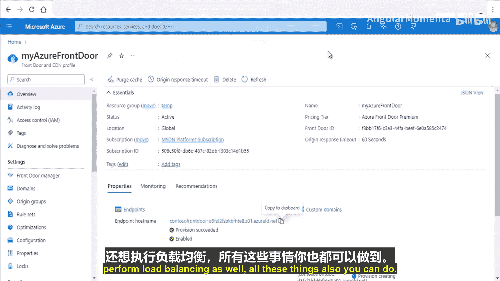
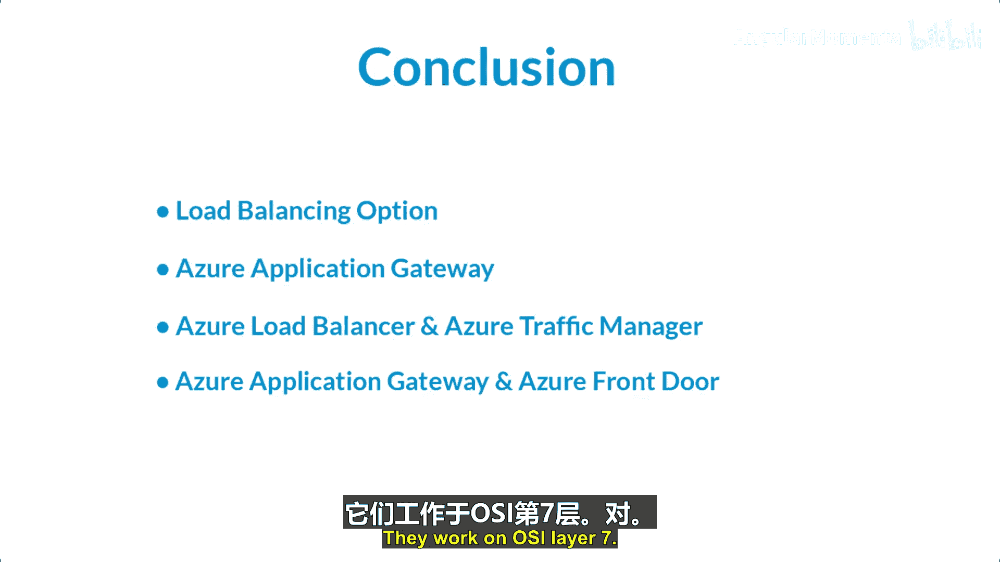

# 【EDUCBA】Azure网络基础 ｜ Azure Networking Fundamentals p10 03_04_01_Azure Front Door -BV1twFSzNE5z_p10-

Hello， learners in this lesson， willll discuss about as your friend door。

Your front door is nothing but a modern cloud content delivery network。

What is content delivery network， What's the benefit of that， If you are not aware。

 Let's first understand that。I'll give you an example。 what basically happens。 Actually。

 there are so many edge locations， or you can say point of presence available all over the world。

 which is of Microsoft。You can see that there are many data centers。

You have this is your origin server。 Let's call it origin server。We have so many points of presence。

 or you can call it many data centers， edge locations， different different names of the same thing。

They are presented all over the world at small， small distances， and it covers all over the world。

Something like that is there。 You can understand them as cashier as well。

 And let's say you have multiple users。 I'm just putting the line。 This is user 1， user 2， user 3。

 Let's call them。Edge locations。User  one and one images here。 Okay， let's circle it。

 This is one image here。 What will happen if you are making use of C DN content delivery network。

 What's the benefit， This user in is in the location， India， for example。

It wants to access this particular image。 I 1， let's call it。And much one。

If the user wants to access it。 So first of all， from here and for that particular user。

 the nearest edge location is this one， for example。

 So it will check this first because this case like cachehe。 the image is not here。 Now。

 what will happen for the very first time it will go to origin server。And。

Place this image here on the edge location。Next time。

 whenever someone from India is accessing that particular image， it can take from the such location。

 It do not need to go to that original server。 It will be faster。And similarly。

 if that particular image is being accessed by someone from USA， for example。

 it will happen the same。 Now， it will make use of this particular edge location。

It will go here if it's not there， it will check out the origin server， place it here。

 and next time whosoever is accessing it， it can access directly。

 That's the benefit of content delivery network。Like I told you as your front door is cloud content delivery network and it provides fast reliable and secure access between your users and your applications static as well as dynamic web content and that is also around the world globally it provides you delivers content using Microsoft global age network with hundreds of global and local points of presence which I'm saying edgedge networks as well edge locations as well you call it that's what it benefits whether you are delivering the content and files or building global applications and APIs as your front door can help you deliver high availability。

 low latency greater scale and more secure experiences to your users。😊。

That's the benefit of using Azure front door。 Now if you see what are the different benefits of using Azure friend door。

 it provides you global delivery scale using Microsoft's network here you can leverage over 118 edge locations we have across 00 metrocities connected to Azure using up private enterprise grid vans。

 It also delivers modern applications and architecture you can modernize your internet first applications on as yourre with native cloud experiences define your non custom domain with flexible domain validation。

 you can load balance and route your traffic as well globally。😊。

Like in as your application gateway that was also doing the load balancing at layer 7 only。

 but here you can do that globally it is simple and cost effective as well。😊，Now。

 let's see what are the Skus of as your friend of。If I go here， that is your comparison。 Okay。

 I'll share this link with you。 that is on the official side。

Stactastic file delivery standard premium as well as classic also provides so dynamic side delivery as well all provides custom domains if you say or standard DNSTxT record is valid for premium DNSTXT only for classic it was seen and based These are the different comparison if you say health pro log it's not presented here in the classic otherwise it is the Also let's see working off as your front door。

 how it will do the things。 first of all， it will select and connect as your front door edge location。

 whatever is the nearest that one it will select then it will match your front door profile and it will establish the T list connection。

 Then if you have done the web application that's not necessary。

 but if you have entered that also it will check then as your will match as your front door route and it will also select the origin group then evaluate the rule。

 whatever rules you have set return cached content select the origin from the origin group and it will forward。

😊，Request to the origin。 That's how it works。 Thank you very much。Hello， learners， Now。

 let's see how to create asure front door profile from here。

 you can search front door and Cdn profiles。 Go here Now。

 click on create front door and Cdn profiles Here you can see there are different options you can use as your front doors。

 like I told you， asure front door as a secure cloud Cdn。 and it provides static and dynamic content。

 acceleration， global load balancing and protection of your app。 We have other offerings as well。😊。

You can custom create as well， or you can use quick create as well。

 which will be having some default settings and all。 But if you want。

 you can create your custom solution as well in this particular demo I'll be showing you with quick create。

 Let's select this one。 Now continue to create a front door。From here。

 you need to select a subscription。 This is the one which I have。

 Now create a new resource group with the name T location you can select。

And here you can write any name。 Maybe my front door。Any name you can have。Here you need to do that。

 There are two tiers like we discuss standard and premium standard is content delivery optimized using the standard one only。

Here， give the endpoint name， let's say， Condoso。And point。

 any name you can write that should be available。 and audit type， let's select。

These are the options which you can select and selecting the custom one。Any name you can give。

 let's say， congo。得感。And from here， if you want， you can have add the application farwall policy as well。

But， that's not necessary。Now， go to this and review and create。Let it create。 Wait for a while。

Let's meet in the index video when it will be created。 I'll come to that。 Thank you。😊，Hello。

 learners， now， as you can say， my front door is ready。 Now， the previous video。

 we saw that was under deployment。 Now the deployment is complete。 deployment is succeeded。

 This is the endpoint post name。 If I hit that particular post name。😊。

Because it's working with a default name with a default endpoint。

 you can have your own endpoints as well。 So if I hit this。

I should be able to see something。That's how my asure front door works。

 So if you want to create your。

The app。 and they'll be having end pointss。 And then you want to perform load balancing as well。

 All these things also， you can do。 Thank you very much。😊。

Hello， learners in this lesson will be discussing about Aure Cdn。Content delivery network。

Contain delivery network， CN。 This is a distributed network of server that can efficiently deliver web content to the users。

Basically， a CdN store cash content on its servers in the point of presence locations。

Which are close to end users to minimize the latency。There are many edge servers。

 or you can say cashier servers all over the physical location。

 and we have our original servers as well。😊，If you use as your CN。

 you will get your content from your nearby location， nearby cacheier location， you can see。

It will make your service， your data traveling faster。And also。

 aszure CdN offers developers a global solution for rapidly delivering high bandwidth content to users by caing their k。

These， your data basically is placed on a physical note across the world。

Now let's see some of the benefits of as your CM， so first of all it will give you better performance and improved user experience for end users。

 especially while using applications where multiple round trips request are required by end users to load the content。

Then， it has large skill。In order to handle better， instantaneous high。

 such as the start of product launch event。Also， if we have distribution of user request and serving of content directly from the servers so that lets traffic get sent to the original so。

Let's see， like I told you， we have so many edge servers or cacheier servers or point of present。

 You have your main server here。 Let's say this is your。阿啲选手啊。And let's say you have this。

 your point of presence， your locations， edge locations you can call it。 So let's call it。Pooined。

Off presents。And inside that， you have your edge sos。Let me create you。These are yours。Edge so。

You have your users。Let's call it user A。 And then we have B。And then we have uses。

This particular user， and on the original， let's say you have one image。 Let's call it an image。

 Let's call it。X image， or let's call it image only。You have one image here。

And this particular user wants to access it。This ist， if I talk about India。

 let's say this is in Mumbai。And you are accessing it from Delhi， for example。 So this is user A。

 It wants to access particular image， which is on the server， which is in Mumbai。First of all。

 how C D and will work， how it will happen。 So user A will check on the cacheache content on the Ed servers。

 which is nearest to Delhi。 If it's not there first time， what will happen。

 then it will move to the origin。Then for the next time。

 this particular image will be stored there on the Ed servers。 Now， next time。

 if user B from Delhi wants to access that particular image， it can directly take it from here。

Even if users see or whatever how many users keep from coming。

 they can take it from the nearest location。 So that's the benefit of using content delivery network。

 Thank you very much。In this lesson， we'll see how to create as your CdN profiles and even the endpoints。

 So first of all， go to your CdN profiles。 if you search it out， you just open this page。

Azure front door and CdN profiles or just simply search for asz your。C点人。CD and search for this one。

After that， we can't create front door and CdN profiles here you get too many options as your front door explore other offerings but create custom create。

 I just want to search for explore other offerings。From here。

 you search for as your friend or as your C standard from Microsoft C DM premium from。

As your CdN standard from EdQ， I just want to select this one as your CdN standard from Microsoft。

 as you can see a description as well。 That is a global content delivery network that uses Microsoft Global network for content casing and acceleration。

 This is for global CdN platform that focus on media streaming and this one also for media streaming。

 as well as delivery。 Let's select this one only for this demo purpose。😊，From here。

 you need to select the resource group， whatever the resource group you want to select。

 or if you want to create new， just create new， Let's click on create new。Give it a name。

 You can give any name， for example。咪。CDN profile file。Let's say 3，2，5， anything with。

This name should be globally unique。 Reg， let it be east to。

 Let it be global only and the pricing here， you can check it out as well。

 But I'm selecting this Microsoft Cd and only I， I don't want to create a new endpoint。Let's just。

Create this。It is reviewing and it is creating it。As you can see， my Cn profile is ready。😊，Now。

 I need to create an endpoint here。 Let's create an endpoint。So from here， give it any name。

 for example。My。Enpoint。P face。Origin type， let's select。 We can select storage， storage。

 static website， cloud service， Web app， customer origin。Let's select storage。 And from here。

 I need to choose post name。 I can select， for example， This is my storage account。

 which I already have my account for 5，6 blockt code Windows do net。 I can choose this 1。

 I think it's sticking from my storage account。If I show you my storage account。

 I haven't done any settings in here， but I have one storage account here。Let me show it to you。

What did you go？And this is my account， my account for56。And this is my storage account。

 It is shown from that further if I want to choose that one， let's select this one。

 my account B dot code at Windows Re。 The origin path let it be this only。

 and this is automatically taking origin host leader， for example。

 the host header value sent to the origin with each request。To leave this blank。

 the request determines this value。 and as your CdN origins such as web apps， B storage。

 cloud services。It is required。 It is taken by default。 Let it read the default one。And from here。

 you can select a GtP port if you want， let it be default and let it also be open and lets add this。

It might take a while to do that。As you can see， my endpoint is ready now。 Now。

 if I go to my storage account as well。And under here， if you go to networking。

 even as your friend door and Syrian， it's there。You' will be able to see your endpoint here。

 Now how you will be able to check your profile。 That's what you need to check。

Let's copy this endpoint first， and if I open this as well。It will redirect you to your profile。

 So this is the same endpoint here。Now， if you want to access something on this end point。

 how to do that， let me just hit it there， let me just paste it there， how to do that。

 let me show you。 let's say I have one container here。

 That's what I have already created storage container。

 This is a public container container level access I have given it and inside that I have added one images just the random image。

You need to give complete parts， for example， this is your endpoint slash your container name that is my CO N T slash whatever the particular blob you want to check it out。

 let's copy its name。And。Let's do that。 See， you are able to see the file。 So first time。

 when I was accessing it， it took a while。 Now， it's very， it is。

 I'm able to access it within an instant。😊，Thank you very much。Hello， learners。Now。

 let's summarize whatever we have discussed in module number 3。

 We saw a different load balancing option。 So we saw that。The load balancers basically。

 it provides distribution of workloads across multiple computing resources。

And we saw that load balancer aims to optimize resource use， maximize the throughput。

 minimize response time， and avoid overloadding any single resource。

And load balancers also help you to improve availability by sharing a workload across redundant computing resources。

We saw different load balancing options in Azure we saw as your application gateway as your front door。

 as your load balancer and as your traffic manager。

These are the different load balancing options we saw and among them we saw as your load balancer and as your traffic manager。

 which is a non SGTP based solution Also we saw as your application gateway and as your front door these are your。

StTP is based solution。 they work on oversight layer 7 right。 Thank you very much。😊。

