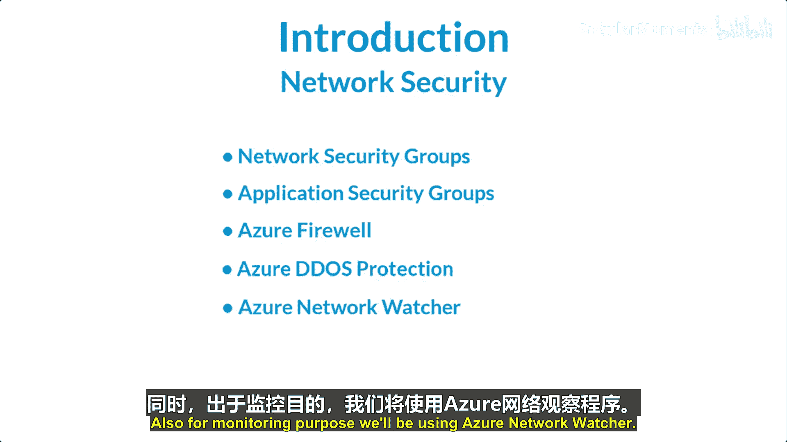
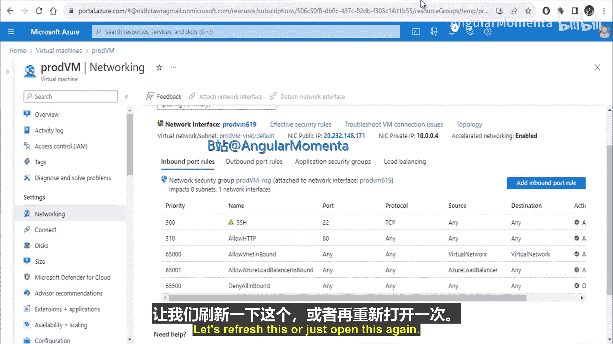
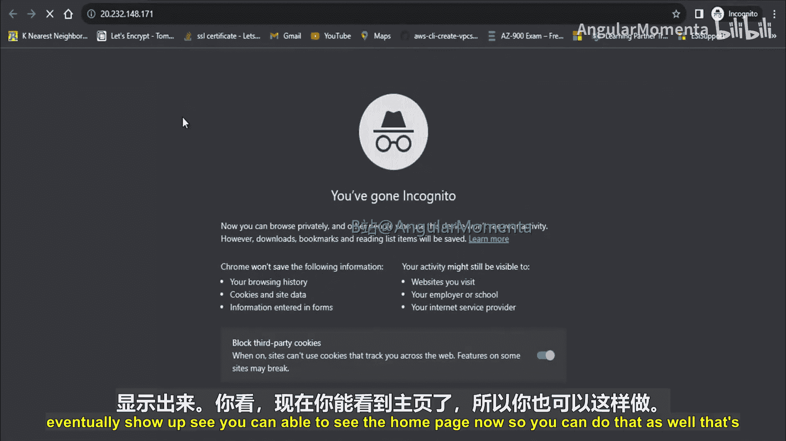
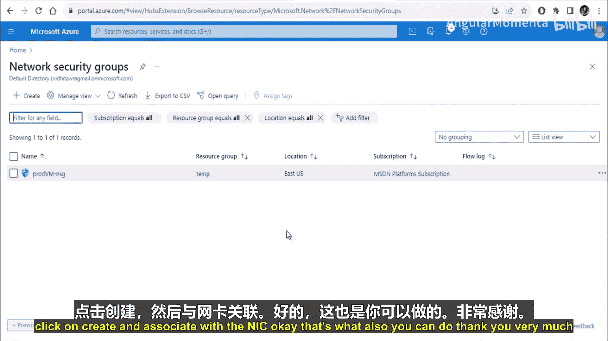

# 【EDUCBA】Azure网络基础 ｜ Azure Networking Fundamentals p11 04_01_01_模块简介：Azure 中的网络安全与监控 -BV1twFSzNE5z_p11-

Hello， learners in this module will be discussing about network security and monitoring in natureure。

Network security is the process of protecting your resources from unauthorized access or attack by applying controls to network traffic。

 and it allows only legitimate traffic request。In this module， in this particular part。

 we'll be discussing about as your resources， what are as your resources we have。

 which provides us network security， and your network security might include authentication and authorization。

 maybe URL filtering， application access control， distributed denial of service control。

 in and detection， as well as response。 So we'll be seeing those topics。 if I talk about。

Security special so well be discussing about network security groups。

 application security groups as your firewall and as your distributor denial of service protection。

 video protection as well。😊，Also， along with that， you need to monitor your traffic when you deploy your infrastructure。

 you also need to manage your network infrastructure。

 you will also need to monitor and analyze your environment。

In order to do the monitoring and troubleshooting the issues whatever have within your network。

 to use network watcher。 also for monitoring。 purposeers will be using as your network watcher。

 Thank you very much。

Hello learners in this lesson we'll be discussing about network security groups。

 So what is network security groups。Network security group is basically used to limit your network traffic。

Whatever traffic you want to allow， whatever traffic you want to block all these things you can do using network security groups and network security groups you can associate at a subnet level or at a network interface level multiple associations are also possible。

 This is network security groups。 the basic purpose is to limit your network traffic whatever you want to allow whatever you want to deny all this you can manage using network security groups。

Let's see what are network security group rules。Based on certain rules only you will be able to allow or block your traffic by default when you create network security groups by default。

 whenever you create a VM， one default network security groups is attached when energy get attached to your network interface card of your virtual machine。

By default。 What happens。 For about this first rule。 If you see here 6，5， triple 0，6，5，0，0，1，6，5，5，0。

0。 By default， those rules will be there。 Now， let's understand first what these three rules says，6。

5 triple 0 says name is allow V net inbound from any port to any protocol。

 If source is virtual network， destination is virtual network， that is allowed。

 That means within a virtual network。 If machines wants to communicate with each other。

 they can do using this rule， this is by default allowed。 Second rule 6，50，0。

1 says if protocol is any sources as your load balancer， destination is any。

 then this is also allowed。😊，Like from the load balancer to any destination， it is allowed。 Now。

 the third rule 6，5，5，0，0 says deny all inbound from any port， any protocol。

 apart from these two things， trust all are denied。

 That's what the default setting is similarly for outbound security rules is there。 First 1，6，5。

00 is allowed v outbound。 So from any port to any protocol。

 If source virtual network destination is virtual network。 that is also allowed。 Also。

 internet outbound is also allowed。 like any port， any protocol。

 any source and destination is internet outbound traffic。 if it is going the destination is internet。

 then this is also allowed， trust all are denied。 This is the default setting。

 One more thing about those default rules， you cannot delete those default rules。 Now。

 if I want to allow particular port and protocol， how will I do that if I cannot delete those rules。

 If it's not permitted to delete the rules。What we can do， I can override those particular rules。

 for example。You need to set up priority。 lower the number， higher the priority。 That's how it works。

 Let's say if you want to allow port 3，3，8，9， let's take， for example， forget about the first line。

 let's say you want to allow4 3，3，8，9。 If you see these three rules。 If you see port 3，3，8，9。

 It comes under which rule this is for within the virtual network。If let's say from my computer。

 any traffic wants to have an inbound traffic if you are hitting the URL from my laptop and that is of also this particular traffic if this particular machine which has these rules if traffic is coming by default。

 it will see these three rules traffic is not coming from the virtual network that means this rule won't be followed。

It's not coming from the lower balancer。 That means it's also not followed。

 will come under the third rule。 restest all are denied。In order to allow4，3，3，8，9。

 I need to have rule with higher par than this。 Like I'm telling you， lower the number。

 higher the priority， That's how it works。 Any number lower than 6，5，5，0，0。 they have put 00。

0red is lesser than this number。 That tool will be followed。 Now， what they are doing here name。

 you can put any name。 RDP inbound。 they have entered 3，3，8，9， any protocol， any source。

Any destination that is allowed。 Now， whenever from my laptop， from my system， for example。

Ill hit the public IP of this machine。 This rule will be there。 that will be allowed。3，3，8。

9 will be allowed in that case。 That's how you can override the rules。 Similarlyly。

 for ourbound willdo， We see， will' show you the demo of this as well。 But that's how you can work。

 There is one more thing called energy G effective security rules。Like I told you。

 network security group rules can be allowed at subnet level。

 as well as network interface part of your virtual machines。😊，Now。

 let me show you what this slide wants to say with the help of an example。This is my。

What should it work。Let's got it we it。Inside that， I'll be having sub networks partition it。

This is my sub， this is my one submit here。Inside that， I have N IC of my virtual machine。

 So I'm calling it virtual machine only， but this is virtual machines network interface card。😊。

Wr it VM， N I C。Now if you want that traffic should be allowed to that particular NIC how you should do and let's say I have one NSG here at subnet level。

 lets call it NSG1 and there is one NSG which is at。Network interface card。Let's call it NC 2。

In order to allow particular traffic。4 3，3，8，9， only you want to allow。

 It should be allowed from this rule。As well as from this level。

That's how a particular rule will be allowed。 If it is denied from submitnet level。

 then it will be denied if it is allowed from here。

And denied from here then also it will be denied in order to allow a particular traffic it should be allowed from NSG 1 level as well as NSG2 level。

😊，Here also， its written same for traffic to be permitted。 Both levels must have an allow rule。

 So that's how it works。 Thank you very much。😊，Hello， learners， in this module， in this lesson。

 well be discussing about application security groups in that previous video。

 we saw about network security groups。 Now， let's understand what are application security groups。

Normally， when you deploy your virtual machines and you have NSTs attached to that。

You apply NSG at a subnet level or network interface card level， that's what you do。

If you deploy NSG to a subnet level， that's what we do。

 then rules will apply to all the network interface cards or all the virtual machines within that subnet。

Application security groups are used within the network security groups。

 If you want to apply specific security rules to a group of virtual machines。

 only keeping the default groups same。 That's the use of application security groups。

If I explain it with the help of an example， let's take one example。If I do this。

 so I have created one diagram here， let's say I have this virtual machine and I have this virtual network and inside that virtual network。

 I have four virtual machines， VM 1， VM2， VM3 and VM 4。 that is a database VM。😊，Also。

 I have one NSG network security groups， which is attached to at subnet level。

 So it will be applicable to all the virtual machines。😊，In order to show you。

 N G 1 is here with these four virtual machines you can understand like that。 Also。

 these are the network interface cards of all the VM So V M1， and I Nick1， N2， Nick3， Nick4。

 you can call it。What's the use of application security groups。 So in an S1。

 we have the default rules。If you want to allow this is my internet and you want to allow a particular traffic using the default rules from the internet。

 everything is blocked to all the Vms， everything is blocked。

 but if you want to allow particular traffic from the Internet to a particular virtual machine using ASG web you can do that。

 for example this is the rule here at priority number100， if source is internet。

And destination is this particular application security groups。 We are applying here to2 Vms only。

As G web。 So if you want to allow quote 80 to these two Vms only so create one application security groups。

 My name is AS G Web and allow quote number 80。 This is what it is doing。

 Sources Internet Din is AS G Web and quote is80。 that is allowed。

Because this is a web and this is logic and this is database。

 if you want to by default what happens within a virtual network。

 Vms can communicate with each other by default， it is allowed。 But because this is a database Vm。

 that should not be there。 The communication should not be there with all the Vms。

 that's not required。 That's a unnecessary thing。 What you will do， you will apply one rule here。

 if you see the second rule here， any source， any word So within the virtual network。

 if destination is A GDB， this application security groups， that should be denied。

 So that's what it is doing。😊，From to the database， only from particular VM it should be allowed。

 Then also you can make use of grouping the Vms and ASG application security group from As G logic as the source and destination is AS G DB。

 that should be allowed。 This is what the third rule says if sources As G logic destination is As G DB on4 1。

4，3，3 but should be allowed。 That's how you can have the default security groups of network security groups。

 you don't need to touch that and to a particular group of Vms。

 if you want to add particular rule that makes the management easy as well。

 So for that purpose you can use application security groups。 Thank you very much。Hello， learners。

In this part， we'll see about NG's usage in practical in action。 Firsts of all。

 I need to create a virtual machine。 First of all， I'll show you with the default settings。

 So whenever you will create a VM。What are the default rules which gets applied to that。

 Then I'll show you how to overwride that。 This is the creation of virtual machine。

 although you have already seen that。 So let me do it quickly。

One particular thing I want to show here， Let's call it。Prod the。

East US only and let's say no inency required what I want image。 Let's select this open2 only。

Let it be default point。 Let's have a password。Use a name Niy。

 and let's enter us some random password。Similar lu， as well。And from here， if you see here。

There are allowed selected ports。In within your network， within the NSG， whatever default。

 NSG will be created， which particular rule you want to allow apart from the default one here it is STP STPS as well as S SH I required because in order to log in with the machines right now I'm just allowing SSH。

Go to disks。And let it be default。 Let it be the default disk。 only go to networking。

 Let it be default networking。 You see here。You can decide whether you want to have an IC network security group as well here I just want the basic one I'm allowing this because it will be created along with that you can separately as well later on as well you can create。

 but I am putting it with the basic settings。Management monitoring。

 let it be everything default and let's just create this machine。The validation is happening。

It's done， Let's create this。It might take a while to do that。Creating。This is in progress。

You can see here NSG has been created， clean net has been created。If duplicate this tab。

 something you should be able to see。Because these two things has been created。

 If I go to watchhe machines。Right， now， it's not chewing。It would show up。 It might take a while。

The Vnet has been created。 industry has been created。 I has been assigned。As you can see。

 it's under creation， although。To go here。And if you go to networking。So as you can see here。

 these are the default inbound rules， whatever I have explained to you has been assigned to that apart from that SS is also allowed and if you see application portal as well that is also there the same which we have discussed in the last part。

First of all， what you need to do， let's connect with that machine。

And let's install something on that。Let's do that。So these are the ways to connect。

I just want to do using CLA。It also shows you how you can connect using CI。

 But I remember all the things I just need a public I。Here。Let's check it out the public IP。

 Let me refresh this。 It has been assigned now。Go to my CI。So let's connect with that。

Just want to install Apache to one that machine。 Let's first connect with that。SSH。Ny。

At the public idea of the machine。Yes， I want to connect。 I need to enter the password。高。Now。

 let's update this。 So I get。Update that part also， we have done。Previously。Let it happen。

Install Apache worms。Now， let's get back in the next video。 Thank you。Hello， learners。Now。

 let's explore the next topic in our discussion。Now。

 Apache 2 has been installed on that particular bi。If I go to networking。Let it open。

If I go to networking， if I see the rules here you see here 300 is allowed。

 it says4 22 is allowed Now if I hit the IP of this particular machine should I be able to see the patchache2 homepage which I have installed。

Let's check it out。 So if I hit that。I won't be able to see that Why because on the browser。

 it works on HtP port number 80， which is not allowed according to these rules。

 I should not be able to do that Now， because of this particular rule deny all inbound because cost1 says within the load balancer。

 but I am hitting it from my system and this one says from Az load balancer that is also not the case and this is deny all inbound and this rule says4 22 is allowed only press all I denied。

 So here this site cannot be reached， it will show us Now。

 if I want to override this particular rule， I need to add another inbound Port rule from here add another inbound Port how do we do that。

From here， you can select any source or you want you can allow from a particular IP address from your IP address service tag or anything you can use apart from that and you can select the port ranges as well。

 you can select the destination as well destination can be any IP address service tag or application security group service you can select H DP DP SS RDP and all these complete list there you can select according to you Now I want to allow port number。

 port number 8， I want to allow So protocol you can select anyTCP UDP ICMP whatever you want to do allow or deny like I told you any number and the number can be。

 let me show you。Any random number。 So the priority can be from 0 to 4，0，9，6。 you can have。

Any number lesser than this， Any number lesser than this will work for me。

 because this is what is restricting us right now。 Let's say 3，10。So treatment is fine for me here。

 write any name， allow。Is should T P， you can say。If you want to allow that。

 you can do that Any name you can have。 So this is what I want to do。

 I want to allow port 80 add this。Now， if I refresh this， I should be able to do that。

 See here you can see that now at priority number 3，10， port 80 is allowed。😊，Previously。

 it was not allowed。Now this for particular vote number 80 that should overwrite this now if I hit this again。

 it might take a while， but I should be able to see that。😊，Let's refresh this。

Or just open this again， cockogni on trying because it takes a while to circulate the changes in all。

But it will eventually show up。

See， you can able to see the home page now。 So you can do that as well。 That's how you can have。

 So here also it is showing now。 That's how you can have security， energy rules。If I go to NS here。

 network。Security groups。Did you see her。This is the in she。

And if you want to associate this rule here also you can see inbound security rule。

Ourbound security rule as well you can see。 And what are the subnets associated if you want associated to the subnet。

 the list is your network interfaces。 If you want to create another network security groups as well。

 because that has been created by defaultpot。 you can do that as well。 So from here。

 you can simply click on create and associate with the。 And I see。 Okay， that's what also you can do。

 Thank you very much。

