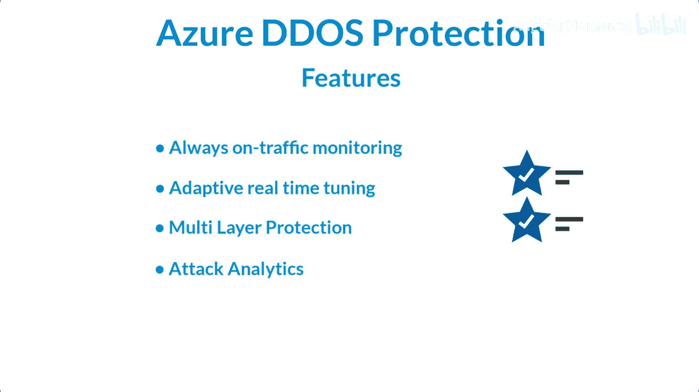
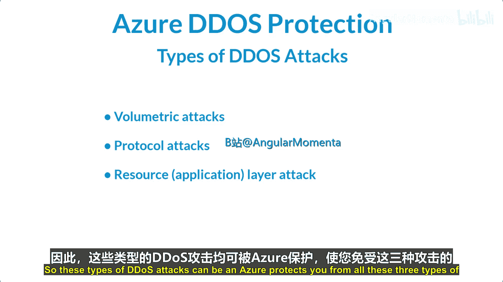
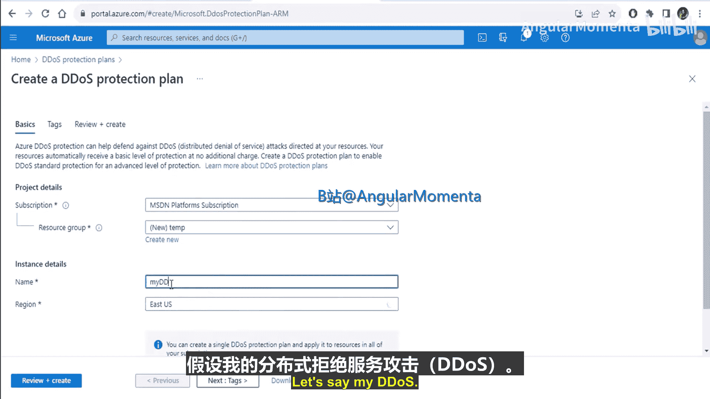
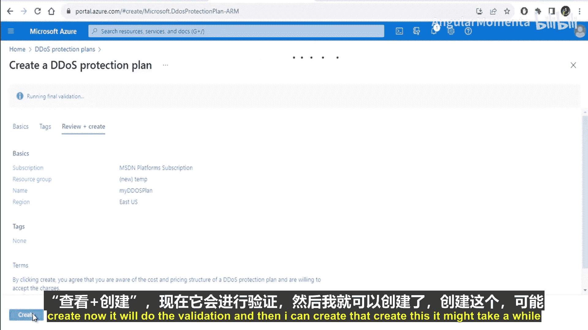
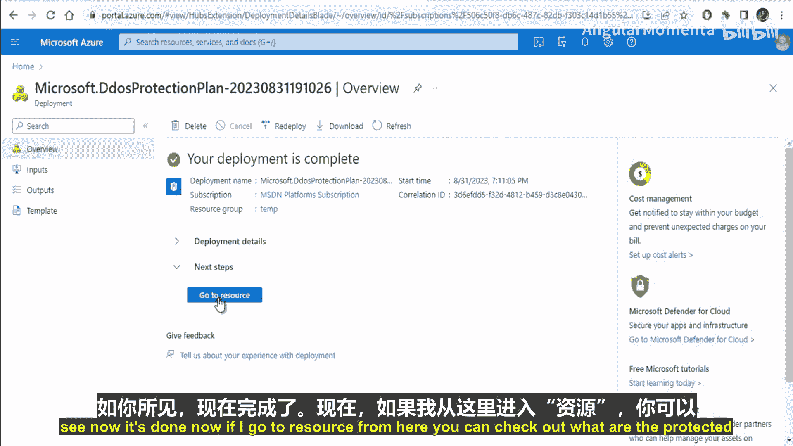
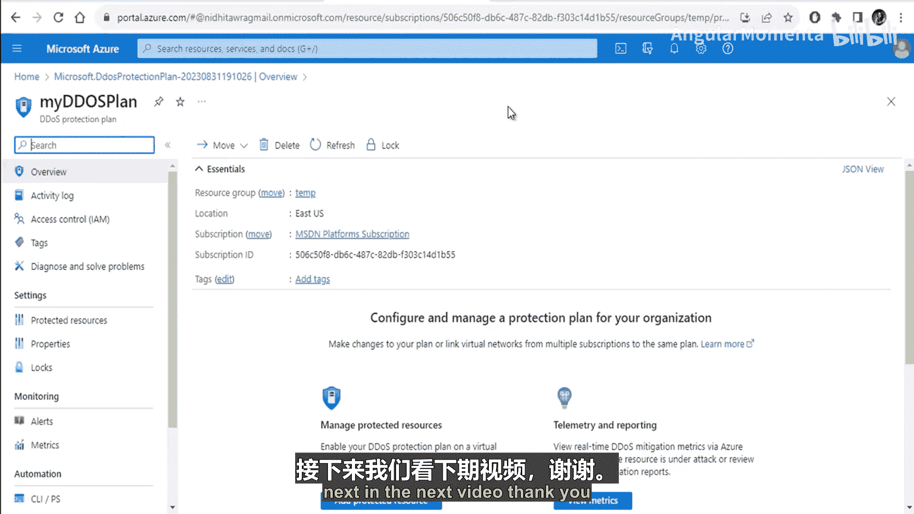
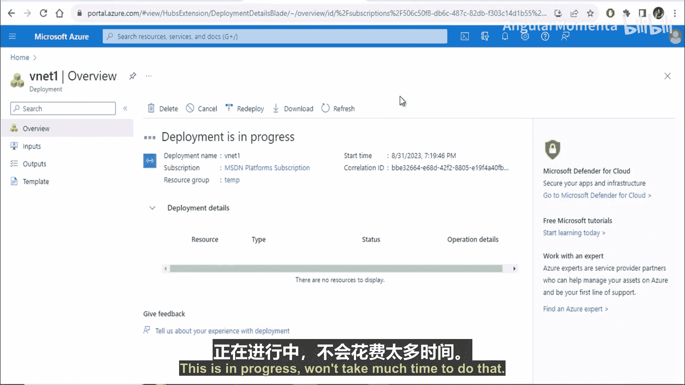
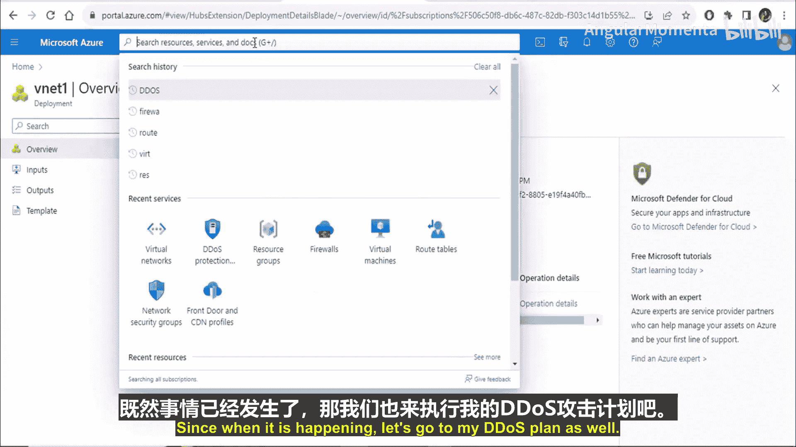
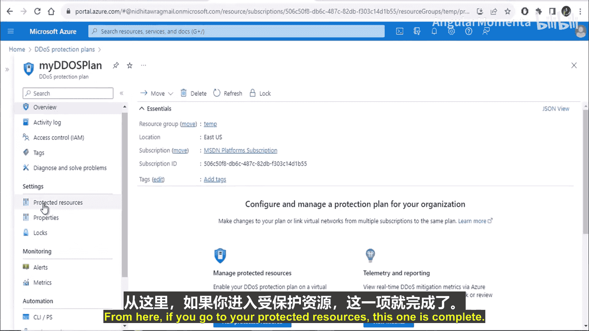
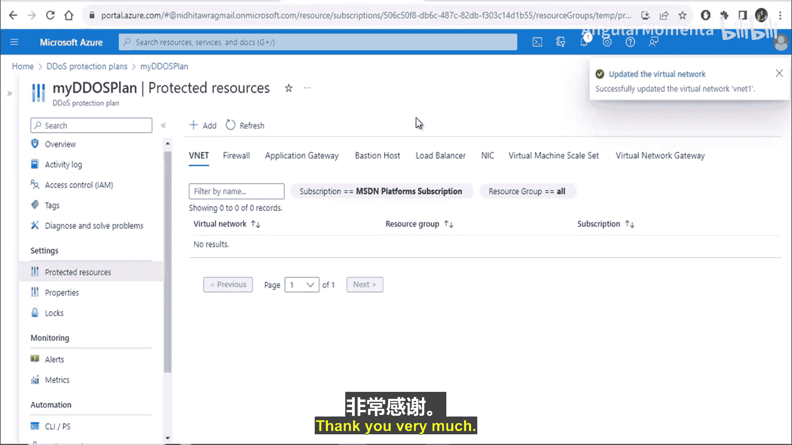

# 【EDUCBA】Azure网络基础 ｜ Azure Networking Fundamentals p13 04_03_01_Azure DDoS 防护 -BV1twFSzNE5z_p13-

Hello， learners in this lesson， we'll be discussing about AR distributed denial of service prediction。

So， let us first understand what is denial of service attack so attacks which has the intent to deny access to services or systems。

 this is called denial of service attack。😊，Basically。

 a denial of service attack is the one that has single point of origin。

 but if I talk about distributed denial of service attack BD that。😊。

That is a type of attack that comes from multiple locations from various networks and systems that is worth distributed denial of service attack。

 Basically as your distributed denial of service protection it protects you from this sort of attack。

😊，So it combines with application design best practices and it provides enhanced DDOS distributed denial of service mitigation features to defend against distributed denial of service attacks it is automatically tuned to help protect your specific as resources within the virtual network。

Now lets see some of the features of DDS protection in Azure what are the features this is what we are about to see so we have always on traffic monitoring。

😊，Basically， your application traffic patterns are monitored 24 hours a day， seven days a week。😊。

For any indicators of the diverse attack also it has adapted real time tuing so it basically adjusts to your services traffic Other features are also there like multi layer protection also it provides you like layer three layer four layer 7 all these things it provides you it has。

Pack analytics as well。 Other features are also there。

Also， lets see what are the different types of distributed denial of service attacks Basically there are three types of attacks number one is volumetric attack so these attacks flood the network layer with substantial amount of seemingly legitimate traffic。

😊，They include UDP flooding amplification floods and other spoof packet floats as well second one is protocol attacks so these attacks render a target inaccessible by exploiting a weakness in OI layer 3 and layer 4 protocol stack。

It can have a sink flood attacks， reflection attacks。

And other protocol attacks as well third one is a resource or application layer attack。

 So these attacks target your web application package。😊。

And this tend to disrupt the transmission of data between the hosts。

They include HGtP protocol violations， SQL injection。Acrosite is scripting and something like that。

 So these types of de attacks can be。 and as well protects you from all these three types of attacks。

 Thank you very much。😊。

Hello， Las， in this lesson we'll see how we can enable DDOS protection for our virtual networks。

First of all， you search for Dious protection and here you get it。Here。

 click can create DDs protection plan。Click the subscription， whatever you want to select。

 create a resource group。 let's say temp。Give it a name。 Let's say， my DD， O S。

Plan something like that。 you can say this is east to us。

 Next go through tag and click on review plus create。Max will do the validation。

 and then I can create that。

Create this。 It might take a while。Let it complete。It's about to happen。 It might take a while to do。

This is in progress， as you can see。 Now it's done。 if I go to resource。

From here you can check out what are the predictive resources， what are the logs and all。

Whatever it is， that's what you can check it out。 And let's see next in the next video。 Thank you。😊。

Hello， learners。In our previous video， we have seen how to create Ddo protection plan。

 This is what it is。Here we'll see how to add。This protection plan to my virtual network。

First of call。Create a virtual network。And here， click， create a virtual network。From here。

 select the resource group it's same。And give it a name。 Let's say unit it one。From here， also。

 you can select your firewall and your will D US protection plan。 You can check from here as well。

 So just click on checkbox if you want to enable。As your deep US protection plan。

Not selecting it from here。 I just want to show you from here as well。 you can click。

 because this is。Preak service。It is giving me a warning。Let it be the default space。

And click on create。Duringing the validation。Now let's create it with the default Hyspace and the default sub network。

 I have created a virtual network。Might take a while。When quickly happened。

This is in progress won't take much time to do that。

Since when it is happening， let's go to my G plan as well。

 and let me show you from where you can add this plan from here。

 if you go to your protected resources。

This one is complete。 From here， you can add。And whatever is your virtual network。

 it should show here by thenet 1， and you can simply add that。Let's hand it。That's how you can add。

 you can protect your resources within the virtual network using this DDs protection plan。

 Thank you very much。

