# 【EDUCBA】Azure网络基础 ｜ Azure Networking Fundamentals p14 04_04_01_Azure 网络观察器 -BV1twFSzNE5z_p14-

Hello， learners， in this lesson， well be discussing about az your network watches。

Let's first understand what is as your network watcher as your network watcher provides a suite of tools。

To monitor， diagnose， view mates and enable or disable locks to for your azure resources。

So basically， as your network watcher enables you to monitor and repair the network health of your resources。

You can monitor your virtual machines， virtual networks， application gateways， load balancers。

 all these resources you can monitor。Basically， infrastructure as a service sort of resources you can monitor yes resources。

What are the different tools you can use to monitor your resources。 So here is the list。

 So first of all， we have I flow Ver。I P flow verify it diagnose your connectivity issues。

 Next one is next hope。 So next hope determines if the traffic is being correctly routed or not。

The route for routing purpose we use next。 Then we have VPN diagnostics， VPN diagnostics。

 troubleshoot gateways and the connections。 Next one is NSG flowlocks。

 NSG flowlocks maps your I traffic to our network security groups。

 Then we have connection troubleshoot connection troubleshoot shows connectivity between your source Vm and your destination Vm。

 Last one is topology topology generates a visible diagram of resource。

 All these things we see in demo as well。

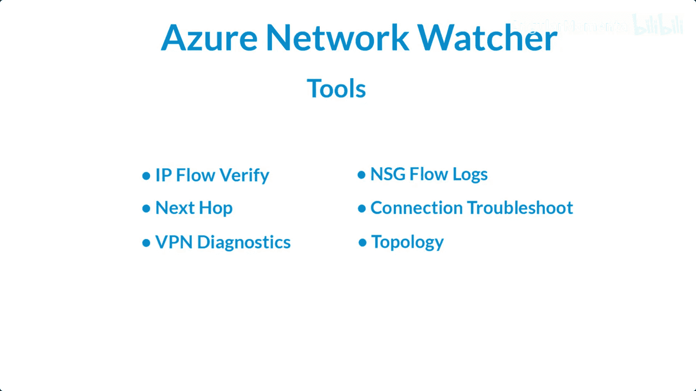

Thank you very much。

Hello， everyone。In this demo Im about to show you some of the network v diagnostic tools。

 So for that purpose what I have done already I have created one virtual network。

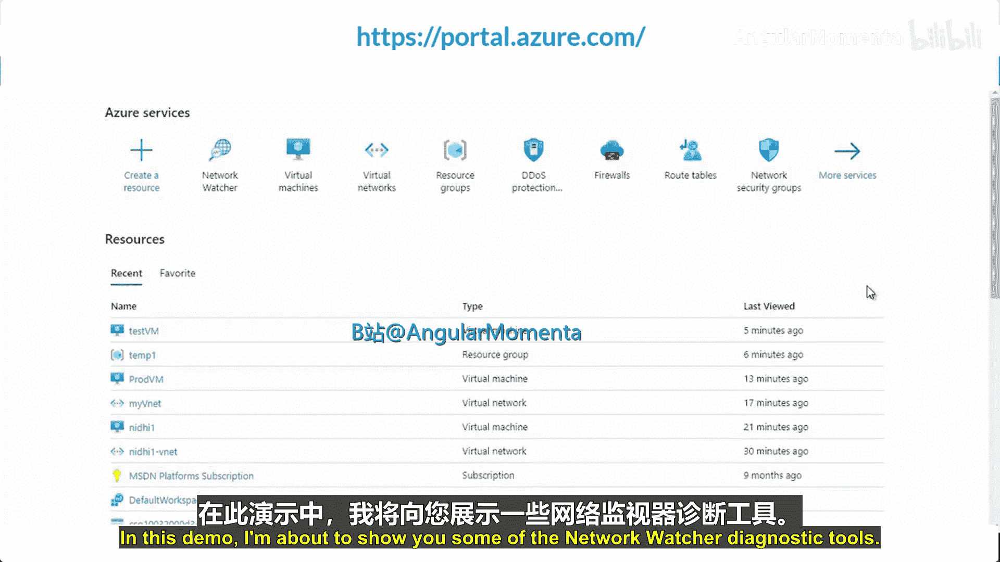

And in that virtual network， I have two virtual machines， broad VM and testVM。

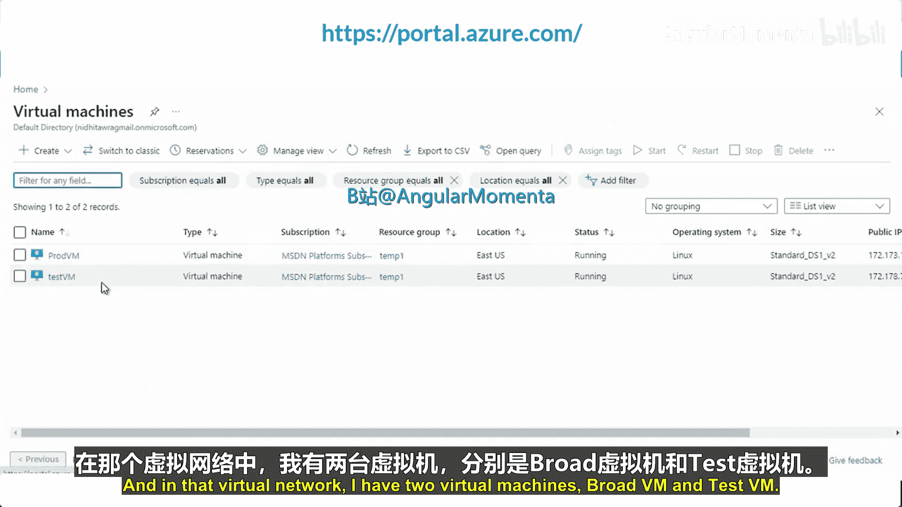

So now， directly go to Le。

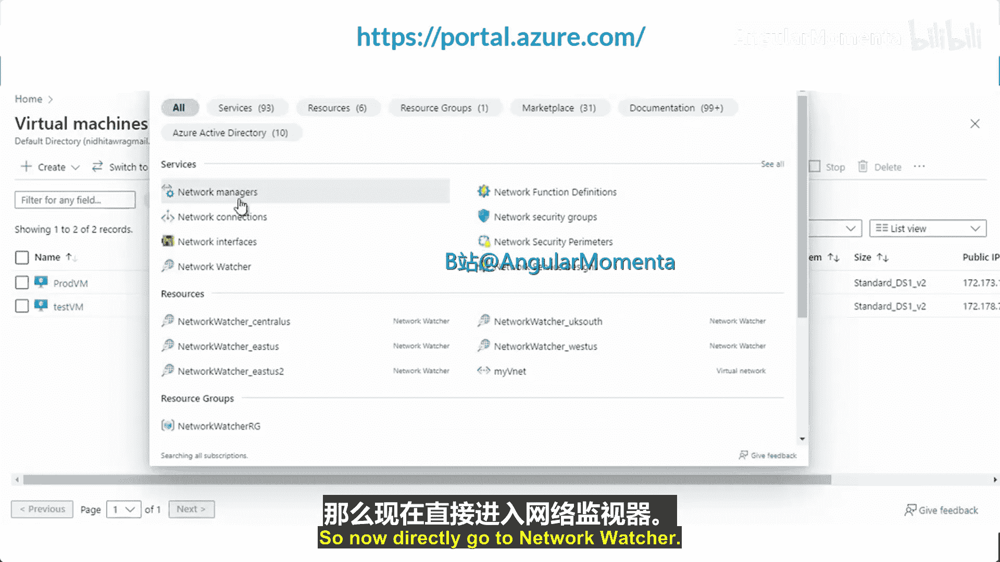

Watchers。So if I go here， see， these are the diagnostic tools we have。 Let me show you some of these。

 So first of all， just a moment。Let me duplicate this。And it's opening。And here。

 let me open my virtual missions。So I have two VMs broad VM and test V， let me open this one。

So first of all， let me show you IP flow Ver。So what I flow Ver does and how does it works。

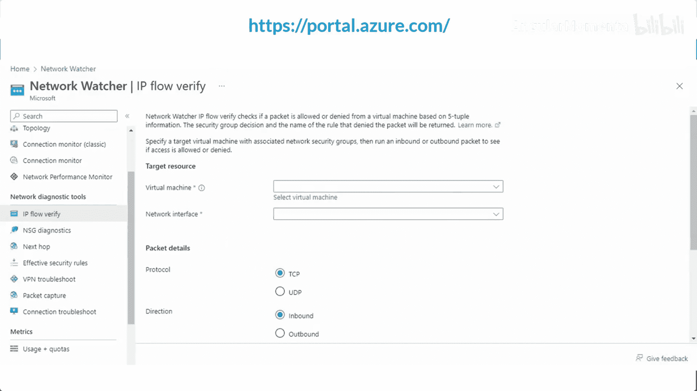

Normally， let me give you an example first， So let's say normally let's go to networking your。

And from here， go to。Effective security rules。

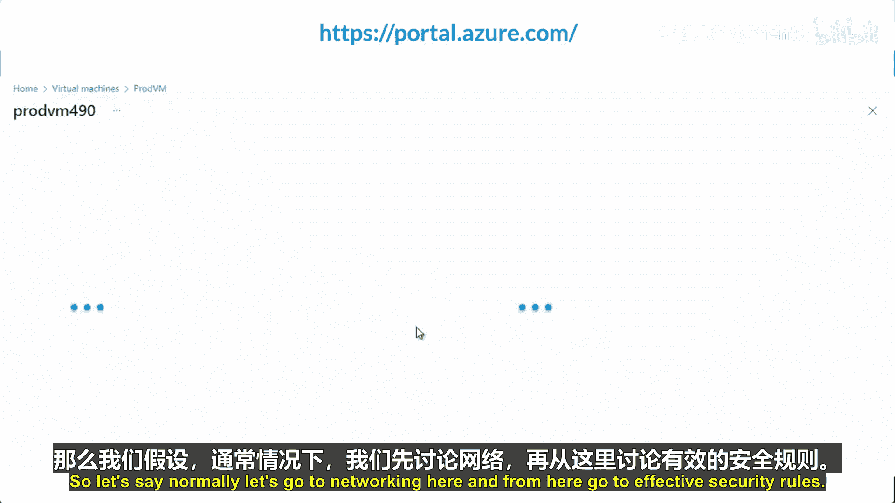

ネちョピです。

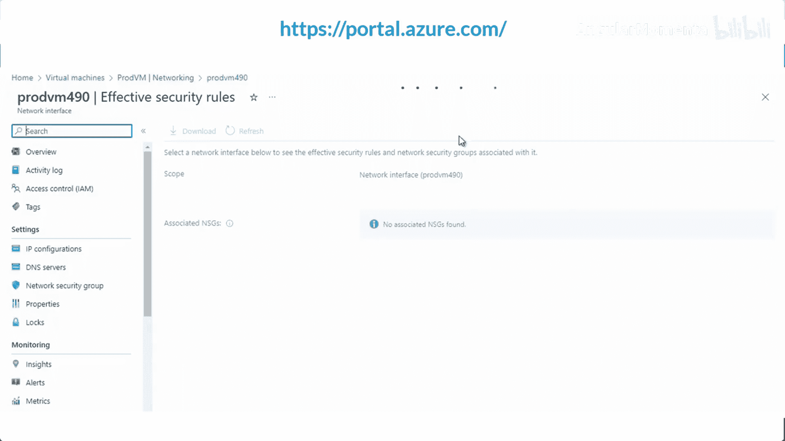

So if I open this， these are the associated NSCs broad game NSG and that's what it is。

 So if I go again here and if I go to。

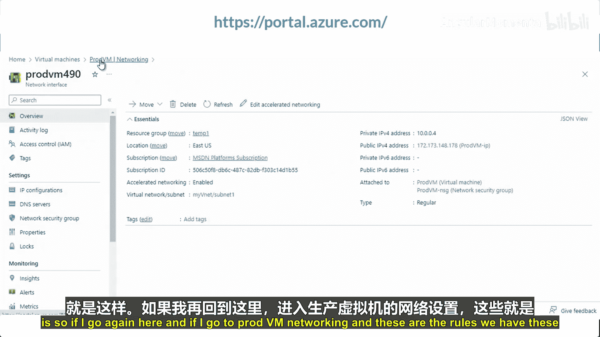

Cd BM networking。 And these are the rules we have。 These are inbound rules as well as outbound rules。

 So this is outbound port rules。 So let's say， for example， if I say if from any machine， if I hit。

On2 3，3，8，9， whether that will be allowed or denied。So think about that。 Yes， so it will be denied。

 Why， because of which security rules。 So if you check here， this one says S SH is allowed。

 This one says H T TP is allowed。So these three are the default ones。

This one is within a virtual network， everything is allowed that's saved from the load balancer if any destination is there that is allowed。

Rest all are denied， so if I talk about port 3389， that comes under this particular security rule。

One thing what you can do， you can manually come here and check it out。

 So if you have lots of security rules。 And if you keep checking manually。

 that will be a difficult task for you。 So what network watcher IP flow verify will tell you。

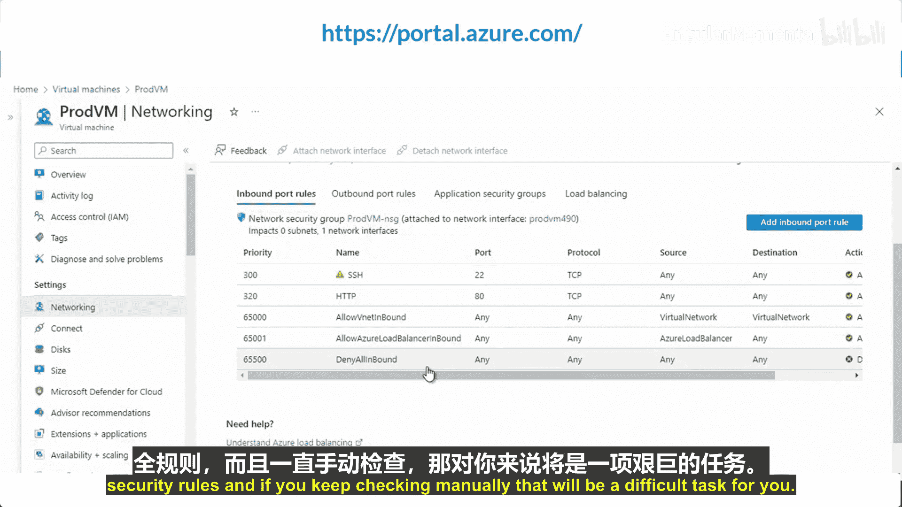

It will tell you， because of which particular NG rule it is allowing or denied。 Well。

 whether that particular traffic will be allowed or denied。 That's what you can do。

 So this is IP P for verified。 So first of all， you need to select your virtual machine。

 Let's say broad BM。

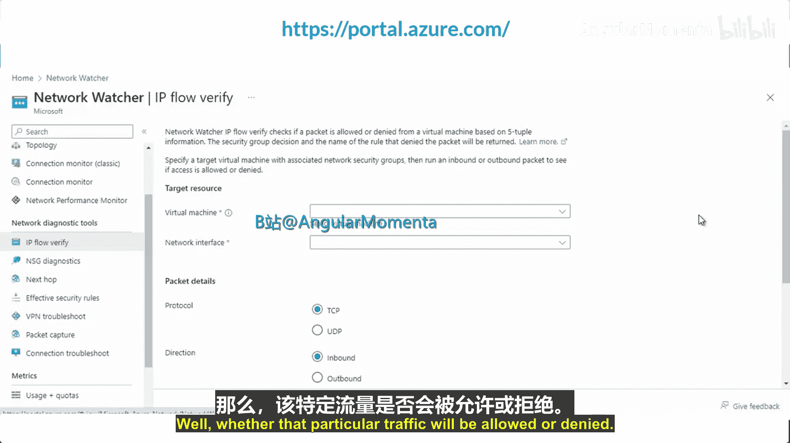

Select the network Inter Officer the same BM。

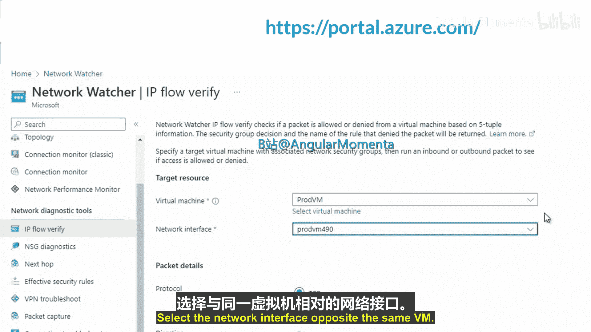

Switch protocol， which direction whether you want to check inbound or outbound traffic right。

 So this is the local IP address So on which port you want to check， let's say port 3389。

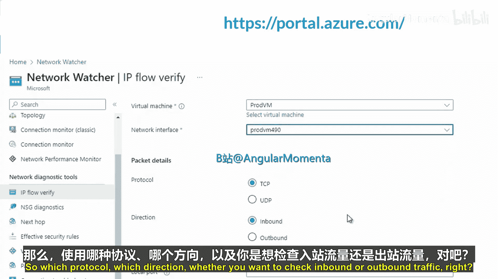

As we saw 3，3，8，9 is not allowed here， it is denied because of this rule。

 so it should tell me this so from there maybe from any I you are checking it。

 let's say I'm checking it from my systems IP， let's say my I address。😊。

And this is the IP address of my system， let's check it out。And let's paste this and port。

 I'm checking on port 3，3， again。Let's verify IPF。may take away。So if you check here。

 it is showing X is denied and because of which rule， deny all in。😊。

So this is what your I flow verify does。 Next thing， let's check it out。 connection， troubleshoot。

So what connection troubleshoot does So if I show you if I go to again my crowd BM。And here。

 let's go to。Lettwork interface or effective security rules。From here Bu。Effective routes。

So well continue remaining part of the topic in the next video。Now。

 let's explore the next topic in our discussion。In one of my videos we discussed about the effective routes we discussed how we can override the default routes that is what we discussed and there can be one more route table associated with that or you can have a default route table associated with that。

😊，Now， if you want to check out like， if you have a hierarchy of next hope and all those things if you have。

 So let's say here you can see from the Internet， next type is Internet if traffic is coming or from this particular next hope type is。

Your virtual network。Roouting related thing， if you want to check out and if you want to check if you are accessing one machine from another machine within a virtual network to virtual machine。

 whether they are connecting or not， what will be the next hope and how many drops you have sent and how many are responding all these things you can check out using this network watchher。

 let's check it out。

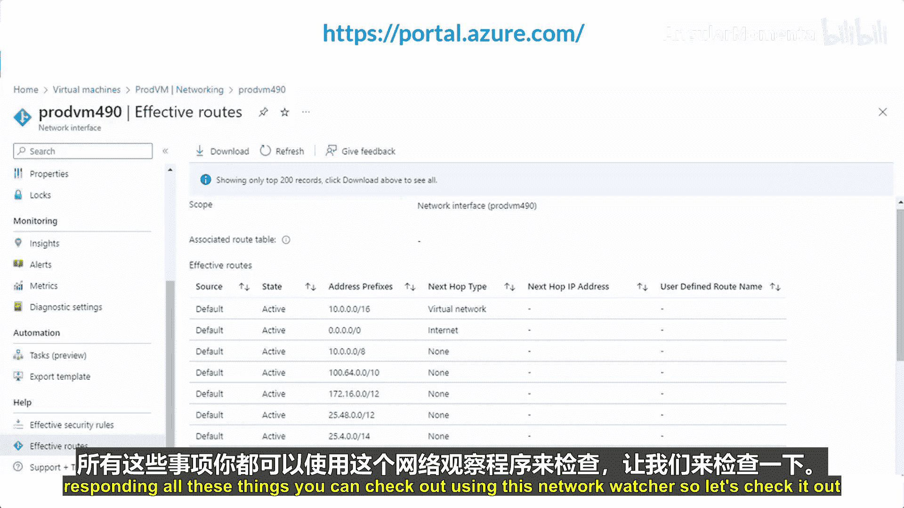

This is from resource group and from Pra VM， I have another virtual machine as well。

 You want to check on。The test Vm。 So this is the test Vm I have selected。

And if you want to check it out let's say on port 80 I want to check out whether it is having or not so these are the diagnostic tests I want to do connectivity network security groups next or port scanner everything you can run it out just run diagnostic tests and it will give us the results if anything is success or failure everything it will tell you。

Just read away。Won't take much time。So it's happening。It is succeeded as you can see here。

 So connectivity test is a success， and they have sent 66 crops 0 failed。

 So this is the latency average minimum or maximum latency。 And is she outbound also its success。

 Next hope is also a success destination port is accessible。 Hope by hope detailstail as well。

 it shows you like， for example， Pro VM test Vm。 So next hope is your 10 0 do0 do5。😊。

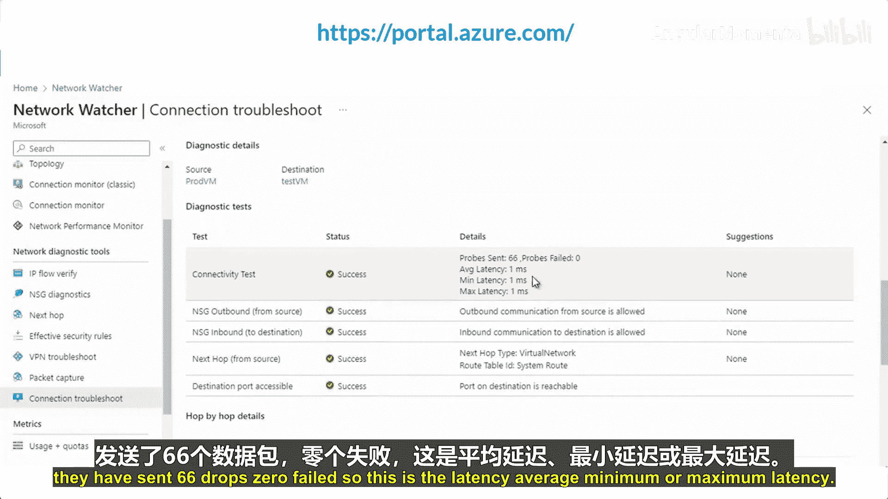

So it shows you all those things， so this is a topy view as well。And the next diagnostic tool is。

 like I have。올 you as well。

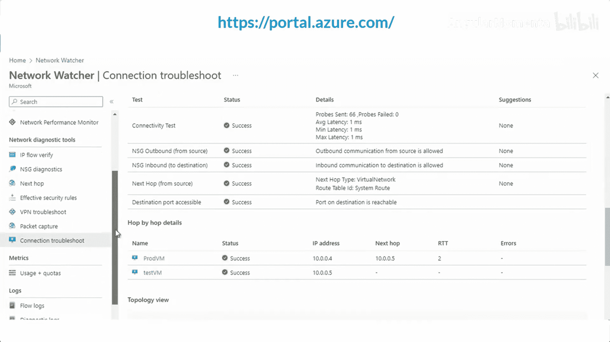

Let's check out this。 next hope。

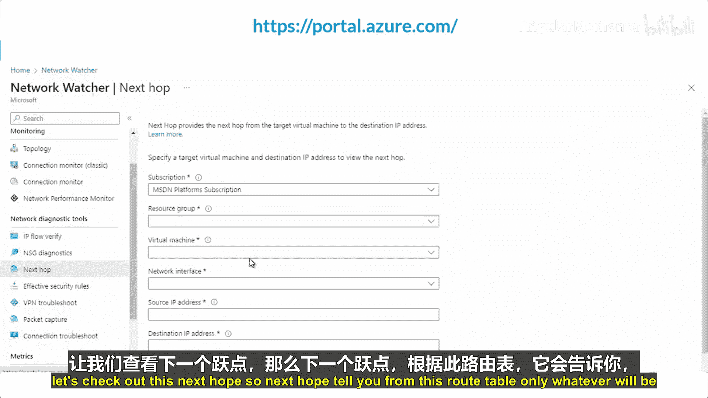

So next hope tell you from this route table only whatever will be your next hope according to this route table。

 it will tell you that one let's check it out let's say from。

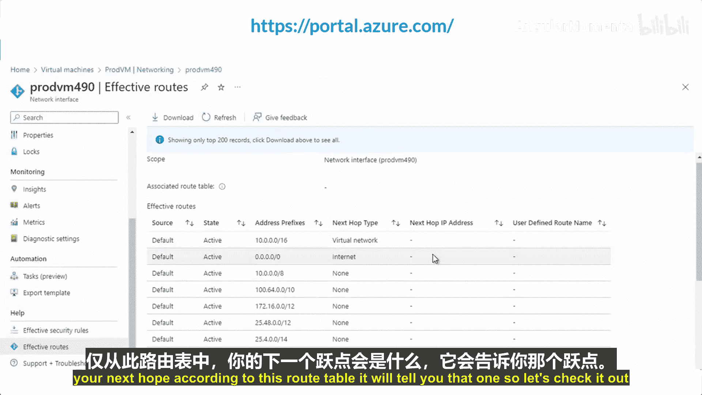

This is the subscription from。Proad VM2， this is the source IP address and to the destination。

 let's say on my machine， I want to check it out。

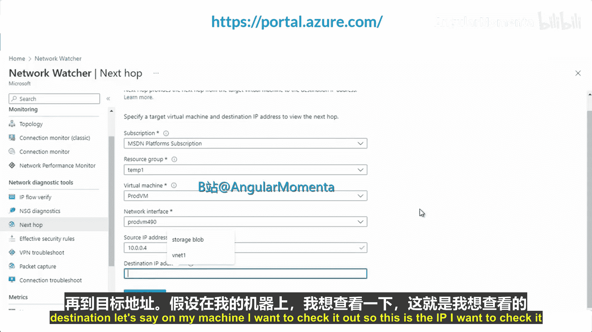

So this is the I。 I want to check it out。是的。Okay。Because of space actually。So if you check it out。

It will show me。Okay， because of rich route table and all， I take a while。But it will' show me see。

So， according to this particular。Roout table， according to this particular version machine。

 next stop type is internet because from my machine， if I am hitting this particular machine。

 next stop type should be internet and because of which route because there is no route table associated with that。

 it is because of system route as you can see here。This is the route。

 This is the addresss and next like this Internet。 That's what it is showing because of this default。

Great。

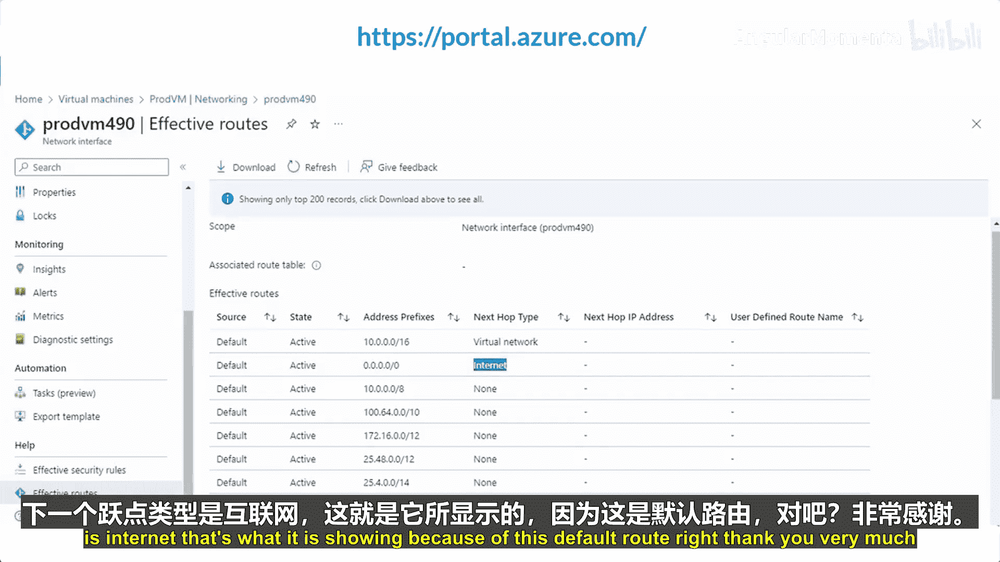

Thank you very much。

Hello， learners， now let's conclude whatever we have discussed as of now。 So in this module。

 we saw about network security， as well as monitoring and Azure。

And security is very necessary to protect your resources so that only legitimate users will allow to access your resources。

So in network security we saw about network security groups。

 application security groups as your firewall distributed an N of service， all these things we saw。

Also。😊，Monitoring is also very important。 Second thing we considered in this particular module was about monitoring。

As a network engineer in your company， maybe you need to diagnose your network connectivity。

 You need to。Know dark connectivity issues。To a VM。

 you need to learn how to troubleshoot and fix the problem so you can establish reliable connections to the VM。

 So we saw about network watch and different diagnostic tools of network watch。

 We saw about connection， troubleshoot。IP flow logs， right， And next hope。

 all those tools we discussed。 Thank you very much。😊。

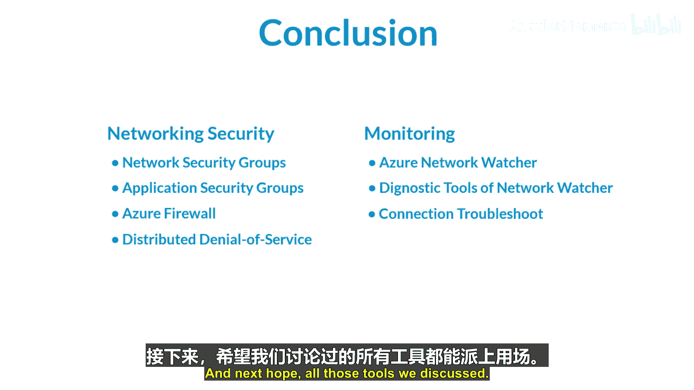