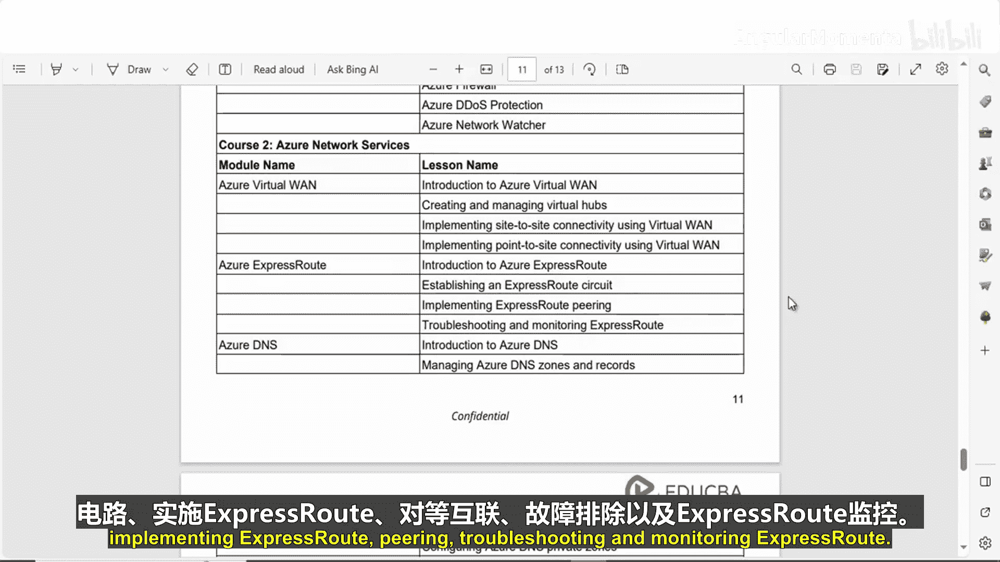
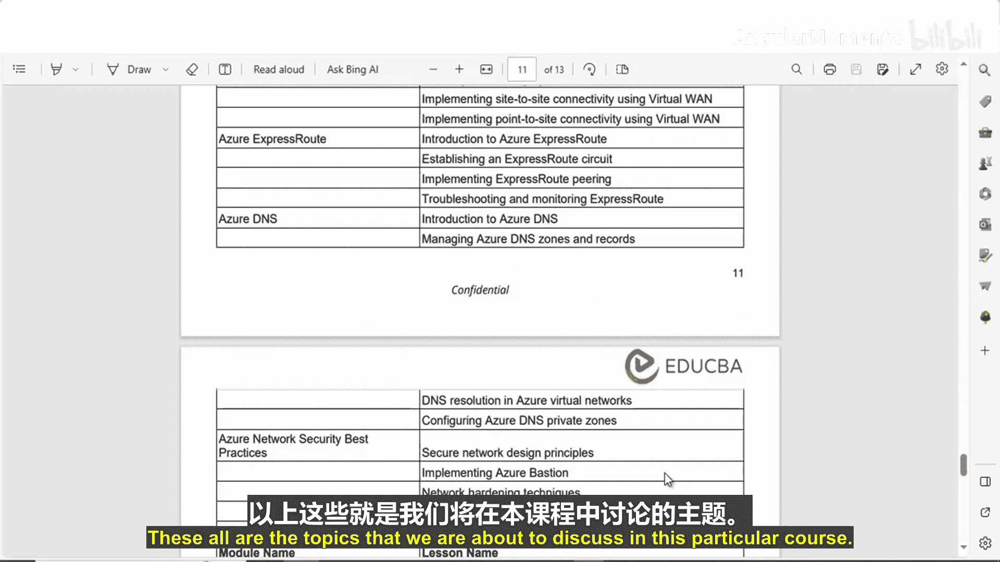
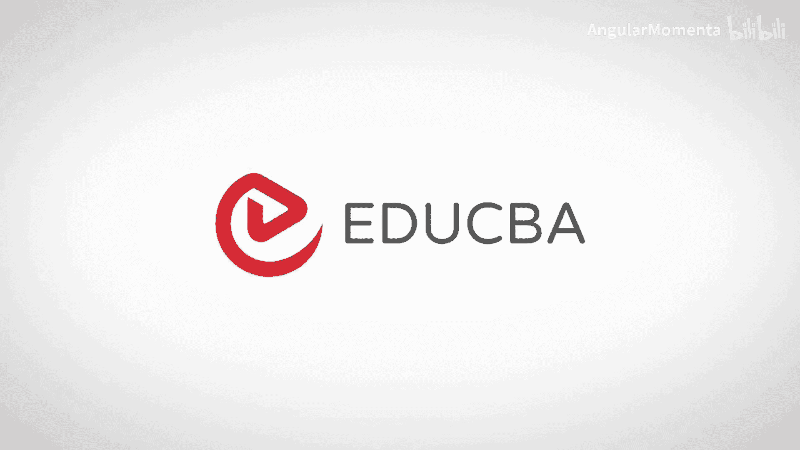
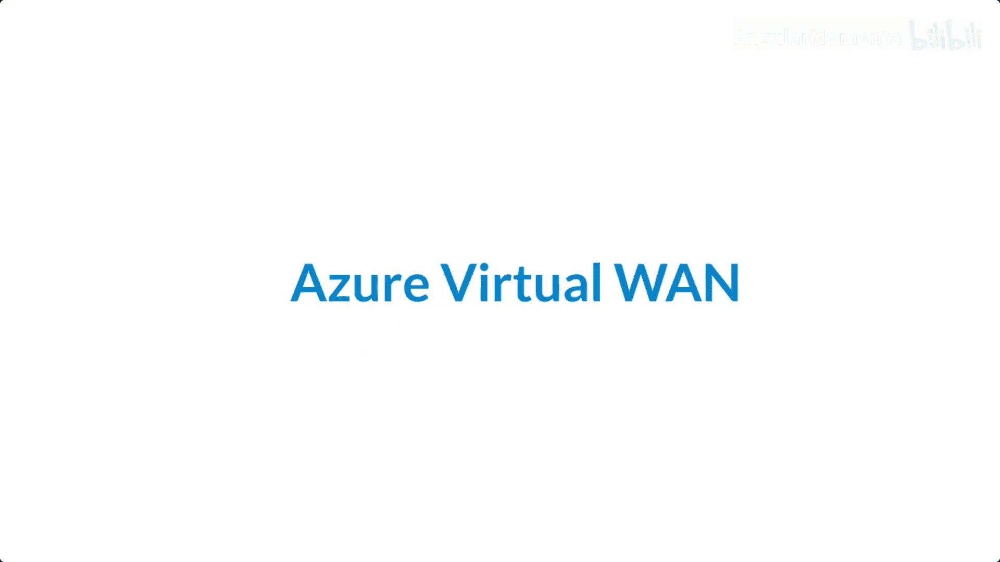
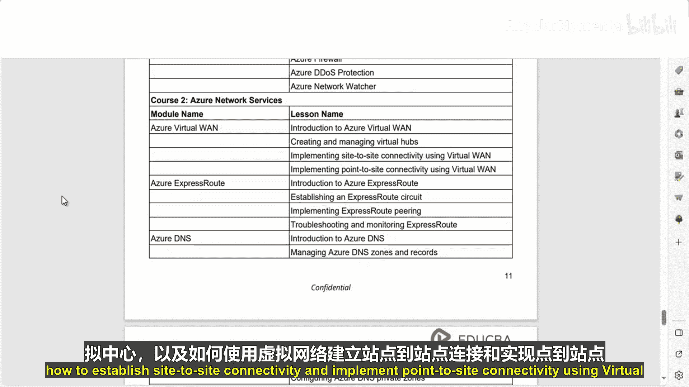
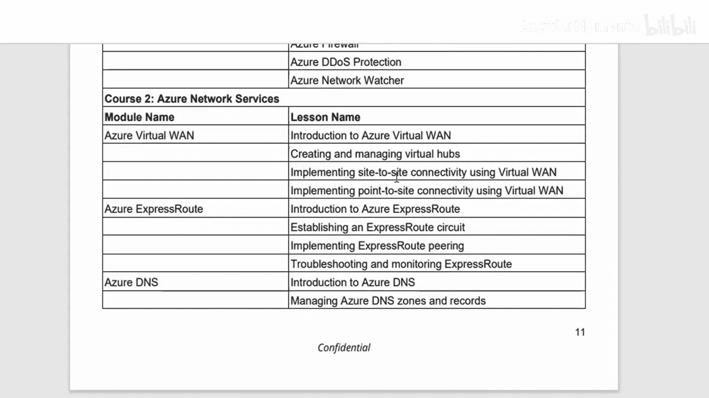
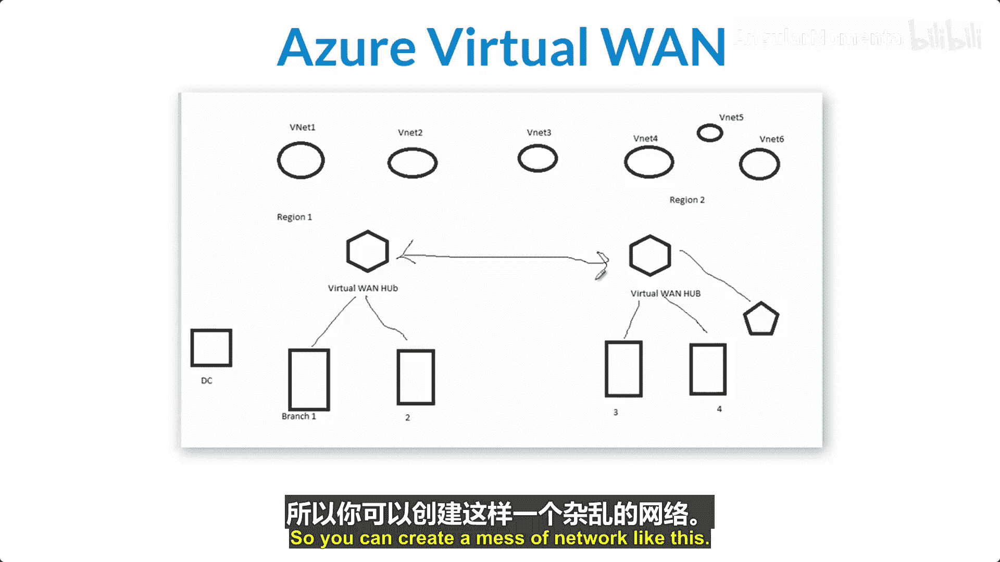
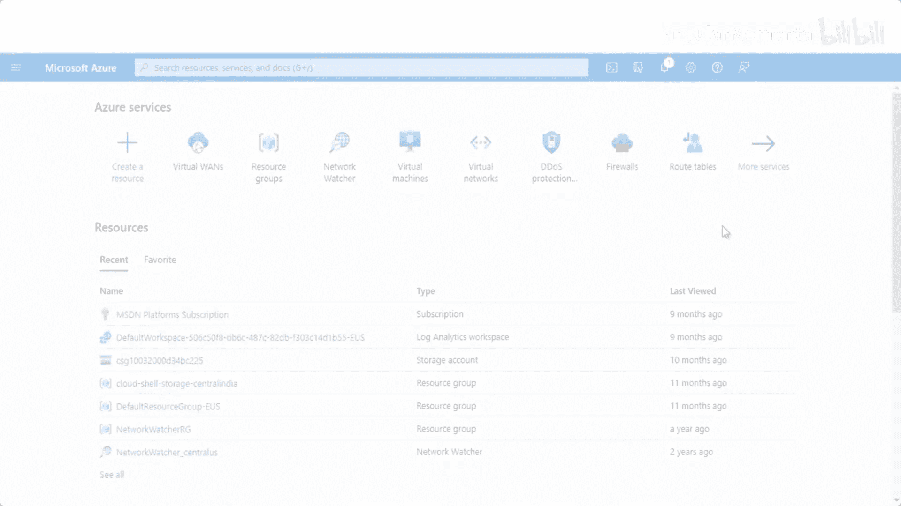
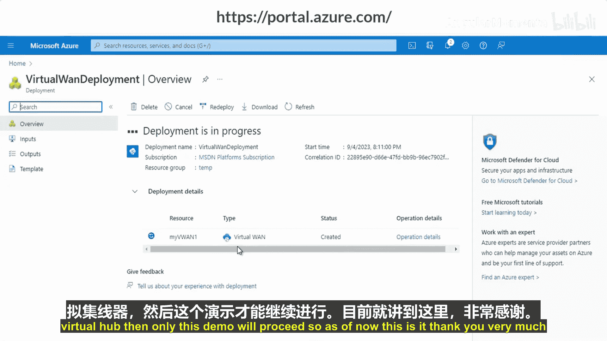

# 【EDUCBA】Azure网络服务 ｜ Azure Network Services p01 01_01_03_课程介绍：Azure网络服务 -BV1mwFSzNE2s_p1-

Hello， learners， let's begin with our second course that is about aszure network services。

 So Microsoft， as your networking services， offers various capabilities to connect and manage cloud resources so beyond virtual networks and a number of connectivity options Az your offers tools to monitor and manage traffic。

 perform load balancing and ensure secure user connections。

 This module will be discussing about very few services。😊，First of all。

 we'll be discussing about as your virtual ban。Here。

 will we see how introduction to us your virtual van， creating and managing virtual hubs。

 I site to site connectivity， using virtual van， I point to site connectivity。

 using virtual van also will see about aszure express route So privately。

 if you want to connect to as your services even from on premises。

 you can use express route for the same Here will see about introduction to aszure express route。

 establishing express route circuit， I express route， clearing。

 troubleshooting and monitoring express route。😊。

Also， we have a DNS service in Azur， Az DNS。Romain name system， like we generally refer to。

Azure also hazards on DNS。 So we'll be discussing about that。 like， for example。

 introduction to Az your DNS managing Azure DN S zones and records DN resolution in asz your virtual network。

 how we can create a records and all and how we can configure as your DN private zones。

 So within a virtual network if you want that DNS sort of thing within your virtual network。

 then we can use private zones that also will be discussing Also I'll be showing you demos as well。

 And the last one is as your network security best practices Well see how we can create a secure network design principles。

 how we can implement as your vision network hardening techniques Also we'll see about as your privately these are are the topics that we are about to discuss in this particular course。

 Thank you very much。😊。

Hello learners in this module we will be discussing about as your virtual van Asz your virtual van is a networking service that brings many networking security and routing functionalities together to provide a single operational interface。

😊，So in this module we'll be discussing aboutzure virtual van and its benefits for connecting and managing large scale networks will' also learn how to deploy and manage virtual hubs。

 how to establish site to site connectivity and implementing point to site connectivity using virtual van So these are the topics that we'll be discussing introduction to azure virtual van creating and managing virtual hubs I site to site connectivity using virtual van implementing point to site connectivity using virtual van so that's what we be looking into Thank you very much。

Hello， learners in this lesson， we'll be discussing about a your virtual van。

So what is as your virtual van as your virtual van is a networking service that brings many networking security and routing functionalities together to provide a single operational interface。

😊，You can get started with Azure virtual when you can use using Az portal。Basically。

 as your virtual when architecture is a hub and scope architecture。

 So which have scale and performance built in for the branches。 Your branches can be your。VPN， your。

Point to site connections， your express route search and your virtual network。

 I'll show you with the help of a diagram， as well。

You can enable a global transit network architecture， as well。

Where the cloud hostted network hub enables transit connectivity between endpoints that may be distributed across different types of spokes。

And as your regions you might be aware about as your regions。

 as your region serves as hub that you can choose to connect to and all hubs are connected in a full matchsh and standard virtual pan。

 making it easy for the user to use the Microsoft background for any to any connectivity。

 any spoke to any spoke connectivity。And if I talk about the virtual when SkuU， basically。

 we have two types of SkuUs。😊，Basic and standard。 So if I talk about the basic one here。

Basic only supports site to site VTm， but standard supports expressed route。

VPN point to side side to site， enter hub and v to village transiting as you are farwell and all these things that support。

 But the basic only side to site VPn。Also one more thing I would like to add here that a virtual network gateway VPN is limited to only 30 tunnels if you are only using VPN you can use only 30 tunnels but for connections you should use a virtual land for large scale VPN。

😊，So you can connect to per region virtual hub with aggregate of 20 G G per hub that also you can do。

 Let's say you have。Multiple virtual networks。 So let， let me create this， is。This。

And let's say one more this。 Let's say these are my virtual network。Let me call it what will。

Let me call it V V let1。This is V。Do。We need to。 This is your。Be neck 3。This is your vt4。

This is your v at5。And this is your vet，6。And。Like I told you that each as your region serves as a virtual network hub。

So， let's say you have this。Region 1 and region 2。 And in those two regions， I have two hubs。So。

 let's call it。Region1。 and let's call it three network in one region，3 network in another region。

Let's call it region 2。And let's say this is my。😊，Virtual van hub。Okay， let's call it。What。Xn。

Ran hop。And that is also for region2， that is also virtual。😊，烦。好。

And like I told you you can have side to site or point to site and express out sort of connectivity as well。

 so let me also create few branches let's say this is branch1 branch2 branch 3 branch4。😊，So。

 let's call it。Branch。1。Let's call it branch。Do。Let's call it branch 3。Let's call it branch 4。

Let's say you have some headquarters here or your data center。 Let's call it。Bc。So with that。

 you can have your。Site to site VPN， let's say this is connected via site to site VPN。

 Let's say this is also via site to site VPN。 and let's say here you have your point to site VPN as well。

😊，So here you can have point to site VP and also， you can have hub to hub connectivity as well。

 So you can create a mess of network like this。 Thank you very much。😊。

Hello， learners in this video， we'll see how to create a virtual van。😊，So let's go for virtual vans。

 create a virtual van here you need to select the subscription， need to select the resource group。

 lets click on。Create new and let's create this。 select the region of your choice and give it a name。

 let's say。My virtual van， one you can call it here， you can select the type standard and basic。

Like basic only support site to site VPN。 So I'm using standard。 Now。

 let's click on review and create。That's doing the validation first。

And then I need to click on create。That's how you can create the virtual bands。

In the subsequent videos， we'll show you。 first of all， we'll be discussing about virtual hub。

Well be creating a virtual hub。😊，And after that， I'll be connecting。

Your virtual hub to the virtual network。 That's what I'll be showing in the subsequent videos。

So first of all， we need to understand about virtual will hub， then only this demo will proceed。

 So as of now， this is it。 Thank you very much。😊。

