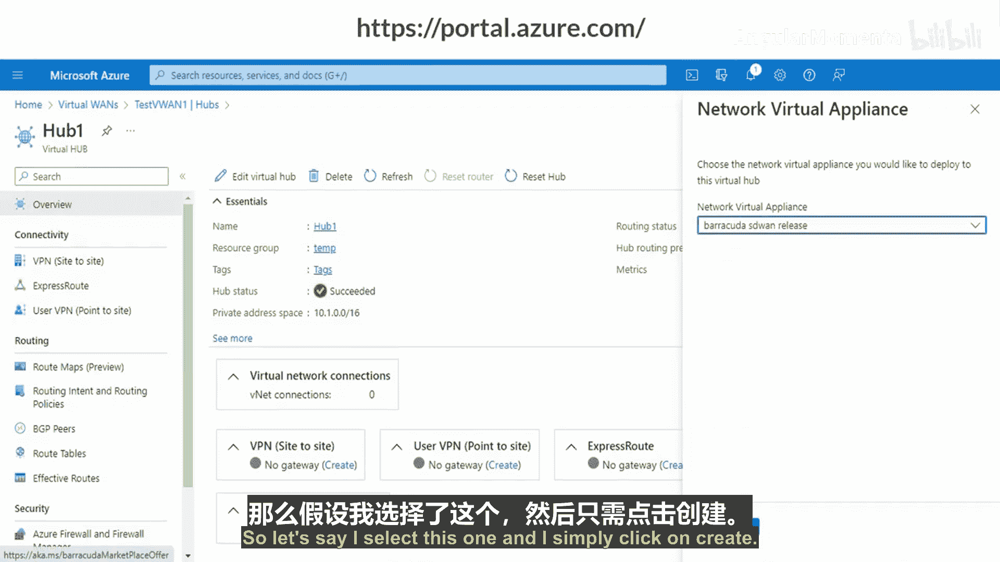
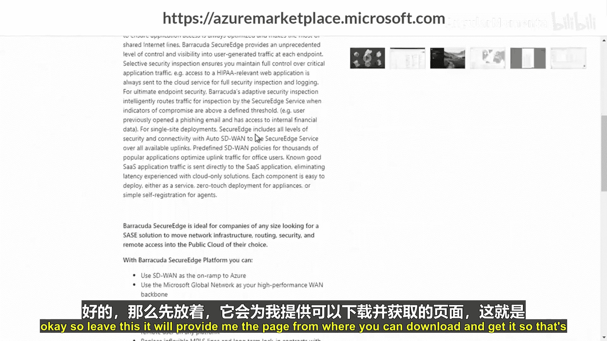
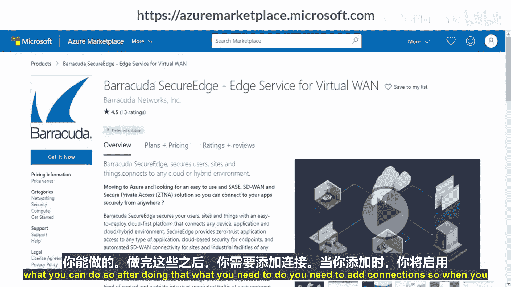
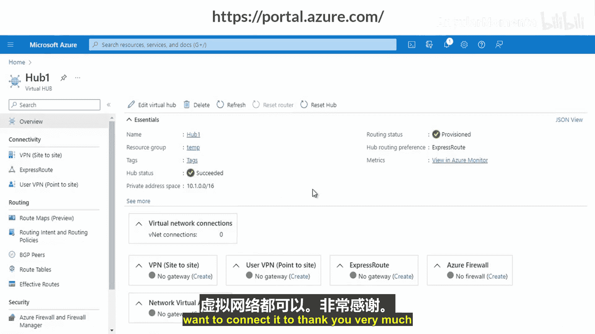

# 【EDUCBA】Azure网络服务 ｜ Azure Network Services p02 01_02_01_Azure 虚拟中心 -BV1mwFSzNE2s_p2-

Hello， learners， in this lesson， we'll be discussing about as your virtual hub。Now。

 let's foresee what is your virtual hub。 A virtual hub is a Microsoft managed virtual network that enables connectivity from other resources。

😊，When a virtual hub is created from a virtual van in our previous video we saw about virtual van whenever a virtual van is created and from that you want to create a virtual hub in the Azure portal as your virtual hub Vet and gateways are created as its component it will happen well see in demo as of now we have just seen how to create a virtual van。

After that， I'll be creating a virtual hub as well， So it will happen that way。

 so you can understand the hub is a virtual network in AzR that acts as a central point of connectivity to your on premises network in the previous diagram I have shown you the hub and spoke technology here。

 the virtual network connect act as a central hub as well。 So that is what your virtual hub is。 Now。

 let's see virtual hub routing。😊，We have three types of things here。So we have hub round tables。

 connections and associations。Hub a virtual hub route table can contain one or more routes。

 you can add multiple routes to your hub route table。You can have。Theout table can have your name。

 a label destination type。List of destination prefixes。

 next of information and all these different things that we be having。 Second is connections。

Conneions are nothing but the resource manager resources that have routing configuration There are four types of connections VPN connections that connect a VPN site to a virtual hub VPN gateway express route connection that connects an express route circuit to a virtual hub Express route gateway if you are not aware about express route as of now don't worry we'll be discussing about and in detail Also we have point to site configuration connection it connects a user VPN to your virtual hub user VPN Also we have hub virtual like connection。

So it connects your virtual network to a virtual hub。Also， we have associations。

 each connection is associated to one route table。Associating a connection to a route table allows the traffic to be sent to the destinations indicated as routes in the route table。

So that's what the association is。 Thank you very much。Hello， learners in this lesson。

 we'll see how to create a virtual hub。In our virtual van video。

 we saw how to create a virtual bands。 if I show you this。So this is the virtual van I have created。

You need to create a virtual van first。Follow the steps of the previous video。

 And after that from here， you can see the connectivity options。

 So we have multiple connectivity options， hubs， VPN sites， user VPN configuration。

 express route circuits， virtual network connections， whatever you want to create， you can do that。

 So if I go to hub。😊，As of now， I have created one hub because it takes some time to create that。

 let me show you the steps how we can create the hub。So if you go here。It's simply。

 So because it takes around 30 minutes to create that。 That's why I have already created it。

For this video， you need to enter the name， you need to enter the private address please。

 whatever you want to take， I have taken 10 do 1 do0 do0 slash 6。

And from here you can select the capacity。 So two routing infrastructure units。

3GT router okay the these many Vm that support right So we have multiple options in there。

 So according to a requirement， you can select and from here routing preference， you can select VPN。

Express or whatever you want。 And I simply created it。 I haven't set any site to side。

 point to sight。 Nothing I have done Everything else I have this good default。 No。 So if you go here。

 that's what it has been created。 So this is my hub1。From here， if you go inside at hubVM。

 so if you want to configure anything like for example。

 VPN side to side VPN point to side expressed out as your firewall or network or virtual appliance。

 let's say if you want to create this one。So we have already available list you can select any of this。

 so let's say I select this one。And I simply click on create， okay， so leave this。

Will。Provide me the page from where you can un download it， get it。

That's what you can do。 So after doing that， what you need to do。

You need to add connections。 So when you will add that。

You will have this option enable and you can have Vnet connections。

 whatever V net you want to connect it。Thank you very much。😊。

