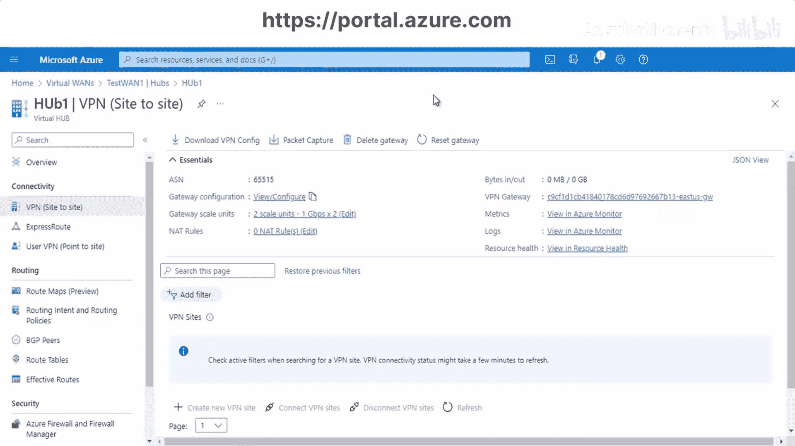

# 【EDUCBA】Azure网络服务 ｜ Azure Network Services p03 01_03_01_站点间广域网连接演示 第1部分 -BV1mwFSzNE2s_p3-

Hello， learners， in this lesson， we'll see how to create a side to side connection using Azure virtual band。

 So what we are about to do here。 Firsts of all， I'll be creating a v。😊，是。

There will be one virtual network， which is on A side who。And the configuration I have taken like。

1000。Slash 16， that's what I have taken。 And I also created one subnet inside that。 So subnet。

 let me call it。 And this is with the configuration 10 do 0 dot2 do 0 slash 24。

 That's what I have taken。 After that， I'll be creating a virtual hub。 So。😊。

There will be one virtual hub。 Let's call it virtual hub。And of course side to side connection。

 there should be some on site configurations。 So that will be my on premises site。😊。

So let's call it on premises site on。P in sight。Alright。

Here I'll show you steps to do that because I don't have actual site here so I won't be showing you site to site connectivity but with the point to site I'll be showing you called connectivity but here in this particular demo I'll be showing you what I'll be showing you here first of all I'll be showing you how to create a virtual van inside that how to create a virtual hub the basic settings I'll be showing you configuring site to site B and gateway settings also how to create a site。

 how to create a site to a virtual hub basically how to connect with that。😊。

I'll show you how to connect the Vp and site to a virtual hub， connect the Vnet to a virtual hub。

 that connectivity also I'll be showing you。😊，And how to download a configuration file and how to view or edit your D and making。

 That's what arell be showing in this particular demo will continue remaining part of the topic in the next video。

Hello， learners。Now， let's explore the next topic in our discussion。 Now。

 let's see everything in action。 So few things I have already created because it takes some time to do that。

 but I'll show you the complete steps。So， first of all。

 like I told you this diagram we saw last time。 So I have created one virtual network with this。😊。

Contiegration， if I show you here。If I go here， this is my virtual network。And this is my notebook。

And let the two in。 So this is 10 do0 do 0 slash 16。 like I was telling you。

 And if I show you its subs。So like we have already seen in the course1 how to create a virtual network。

 That's why I'm not training you this particular step。 And this is the virtual submit。

 We have turned not0 do do0 slash 24。 That's what I have taken。Then I have created one virtual van。

 So I have gone ahead to the virtual van， and I clicked on。Create。😊。

So these are the settings I have taken。 I have created one resource group T。

 which is in the same resource group in which I have my virtual network and I have given it some name Okay。

 so I have given it name as as you can see your test when that's what I have done。😊。

And I simply created it nothing else I have done After that， what I have done。

 So that was the first step of creating virtual van。

 Then our first thing is to create a virtual hub from here， if you go inside that virtual van。

 I have created one hub。 So I went inside that hubs。😊，And as you can see， one hub here。

 So what I have done here， what was the first step。So I have gone ahead and used hub1 as the name。

 so I selected resource which is automatically coming then I have given it a name called hubub1。And。

Then hub private address speed。 So I have taken 10。0。1。

0 slash 16 capacity I have chosen two routing units and three GBT router support。2000 views。

 That's what I absolutely selected。 And the rout in preference。

 I have quoted at as express route only。 That's what。但我。And side to side， I haven't done it。The姑还。

That's what I haven't done。Clearly， so I just click on create， and I have created that how。

And if you go to basics。 So next option is your site to site。 So what I have done here， A S number。

 A S number is nothing。 but， but that is an autonomous system number。

 which is assigned to side to site， B T and gateway。 That's what it is。 And the gateway scale units。

 So this is the gateway scale units。😊，That is， they support highly available gateways。

This is the unit it is。 so two instances deployed when we in gate is prosant and a virtual hub。

 So 10 scale unit is equals to 5 GB and two instances basically so that's what the configuration is So what I have selected from here I have selected two scale units。

And we have the my routing preference， either you can use Microsoft network or Internet。

 So I have selected Microsoft network。So point to sight and express out， I haven't configured。

And that's what I've done。 And I have created。That's how it is succeeded。 That's what I have done。

After that， what I have done。I have created， I have two hub settings。 So what I' have done already。

I went to hubs。And I have created all those things， preferences and all I have done。

 Then next step is to configure a site to site gateway for that what I have done。😊。

I gone ahead to the hub。And well， I was configuring side to side。 That's what I've done。I went to Vn。

 side to site。So from here， as you can see， I already have one site。😊，What I've done here。

I have clicked on create a new Vp In。And from here， what I've done。I， I have。Given little name。

I have given a device vendor。A name I have given us the site 1 device vendor name I have written like Cisco。

So if you move ahead， So I have given a private address space， which is 10 dot0。

2 dot 0 dot 0 slash 24。 So let me show you。 Let me just do it for you。 So test。

Let's call it this site。1， that's what I have done。 vendor name I have written as Cico。

 and this is the address piece I have written， which is 10 dot。ラ几了ラ几路。Slash 24。

 that's what the configuration I have added。And then I will head to the links。

At least one link is mandatory。 So I have given link name as。For example， my link one。Link speed。

 I have taken 50 link provider name。 I have added AD。

 You can write whatever the provider name I pay risk。 you can write whatever it is。

 So I have written something thought on also。😊，Docom， that's what I have I。

And then I have gone ahead and click on review plus screen。 So after doing that。Yeah， fine。

 I don't want to do that。I can see this test site one here。 That's what I was about to do。

 Next steps we'll see in the next video。 Thank you very much， very much。😊，Hello， learners， Now。

 let's explore the next topic in our discussion。After creating your site。

 you can check it out whether it has been created or not。 So from here， this is your virtual event。

 go to Vi insight。😊，Sloing， so you should be able to see that site here。

 So what I'm about to do here， I will connect the VPn site to a wash hub now for that。

 when I need to do go your hubs。Should be able to go inside that top one。

 which we have previously created。And from here， go to VN side to side。So from here。

Not able to see that。 So sometimes you're not， you are not able to see that。

 So you need to remove this particular filter。 I'm able to see my site here now is site 1。

 which I have previously created。I need to click on connect with insights。So from here。

 you can add your pre shirt if you have any， otherwise， Microsoft will it should create for you。

 So we have protocol。 You can use like E even or me do。

 at least like you can use pre or you can use your custom one。 You can project。Deport route as well。

 You can enable it as well。 Hey， if you want to use anything called option on policy based traffic selector。

 if you want to enable， you can do that。You want to configure traffic selector that also you can add like connection mode。

 you can use any of those mode basically precon modes you have recall for both as you are an on premises VPN gateways responder only only as your VPN gateway will never initiate the connection onprem VPN connection initiate the connection in that case and initiator only that means as your VPN gateway will initiate the connection and restrict connection if it is coming from on premises。

 So I'm just putting a default。 So any of that can do that That's what I'm about to do here。

 So let's click on connect。坐认了几个位老弟。So let's catch up in the next video。Hello， learners。

Now let's explore the next topic in our discussion。

Now you can see the connection Pro state is succeeded because that's what I have done。

So now what we need to do， I need to connect the V net to this virtual hub。

 So as your side Im showing you so how to connect V net to this particular hub that's what I'm about to show here。

 So what I need to do I need to go to my。我 should run。Go back。And from here。

 I need to go to V connections So from here under connectivity。

 I'll be able to see virtual network connections。Like I told you。

 I have already created one virtual network， Let it open in。Let it drop in。

 so I only have one direction here。So if I want to add a connection， so how do I do that？

So what I've given， I have added name of my connections， I've added like the next。😊，Connection。

 so that's what I have already done because I just wanted to show you So I have selected my hub。

 I have selected my resource group。So from here you can select the virtual network which I have already created so that does be net 1 for example。

And if you want to do the routing configuration， if you want to associate your route table。

 if you want to propagate through the route tables， all these things if you want to add。

 you can add on， haven't done that。So you can add satty crouchs as well if you want。

 So that's what I have done。 and I have created that。😊，I'll be able to see that。

And that's how I have done so。 it is showing you one minute， and this is succeeded and connected。

An associated route table is the default route table and propagating also default。

You can customize that thing， as well， if you want。

That's how you can do that After that what you can do。

 you can download your Vp and configuration because if you are doing site to site connectivity so you need to do some configuration on your own premises as well。

 So how do you do that So from here you need to go to your virtual van。And from here。

 go to your hubs， virtual hub。眼管细得。From here， go to BPL side to site。So from here。

 you can download your VTN configuration。It will generate， and you can simply downloaded it。

 I have done it previously。 So let me show you。To my download。 So this is the configuration file。

So let me open it with paint So all these things will be the your IP address。

 that's what something do contoa。 co the link pay my link one that's what I have added。

The hub configuration， Id， is enabled or not， all these things， all these parameters are in there。

That's what it will do。 It will also generate one storage account。

 You can also add existing account as well， but it will automatically generate one storage account for you。

You can use that， as well。For clicking my clicking on that that also you can。And then you need to。

Do you need do。Configure your DTN device if you're working with a virtual band partner solution， VPN。

Vice configuration automatically happens。 Otherwise， whatever European device you might be using。

 you need to configure that as well to do the connection。That's what is， is， is done。 Okay。

 and after that， you can view your gateway settings as well if you want。 So from there。

 you need to go to that in side to side。 Let me just。Keep on that。Right。

 so from here you can what you can do， this is my Vn side to side。不计。

if you want to configure that that also you can do so as you can see here。

 this is gateateway configuration view are configured。

So you can see this is your S number that cannot be changed so if you want to change your date schedule if you can do that。

Public I will be fixed。 Private I will be fixed。And if you want to have a custom V GP address。

 you can do that as well。 you can have。This also you can edit if you want。

 so updating might take 30 minutes to do that， but yeah， you can do that。Okay。

 so this is from as your sites how you can do using point to site connectivity will be showing you complete thing。

 Thank you very much。😊。

