# 【EDUCBA】Azure网络服务 ｜ Azure Network Services p04 01_04_01_广域网演示第一部分：点对站连接 -BV1mwFSzNE2s_p4-

Hello， learners in this lesson， well see how to create point to S VN connection。😊。

That's what we are about to do。First of all， what we need to do。

 I'll be creating one virtual machine。 That's what some of the things I have already done。

 because this is a big demo。 Also， it takes。😊，More time to do individual steps。

 So what I have done already， as you can see on my screen， I have created one virtual machine。

 which is a Windows virtual machine。 So if you don't know the steps。

 let me show you quickly how to create Vm。😊，So what I have done。I have selected one subscription。

 and one resource group。And I give it some name。 Let's say， select my resource group， Tim， Tim。

 and give it a name。 Let's say ABC， for example。I haven't selected any availability zones。

 No redundancy required location I have taken as east to us。And from here。

 I have selected Windows machine。So I have selected any Windows machine。

 You can select any from here。 you can add any username or password， Let's sayity and some password。

 random password。Yeah。And let's confirm the password， as well。And from here， I have added HTtP。

And then I went ahead to the desk。 I kept the settings default and then I went ahead to the networking。

 so I already have one virtual network。 I'll show you its configuration as well。

 So that's what I have already created， and that's what it is selecting。

 After that management I kept a default monitoring I kept a default and I just disabled both di and remaining all the things I have put same。

 and I have created the virtual machine。 So that's what I have already done。😊。

So this is the virtual machine here。 Also， let me show you。 I have one virtual network。

So this is my virtual network， as you can see。And this is the address space I have taken 10。0。

0 slash 16 and inside that I have one default submit。😊，And this is the submitmnet10 dot0。

2 do0 slash 24。 that' is what I have taken。😊，Now let's go back to my virtual machine and let's connect to the machine。

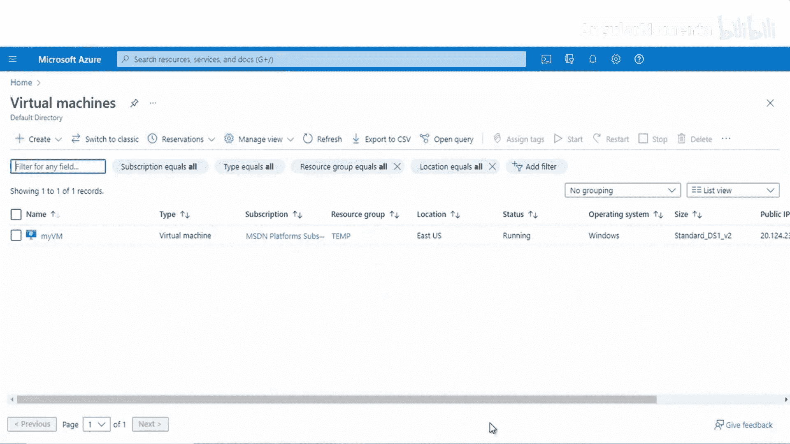

I have gone ahead and connected with that machine on that machine what I have done already。

 So after connecting using RDP， if you are not aware how to connect using RDP。

 don't worry about that。 I'll create a separate video for the same。 but how you can do that。😊。

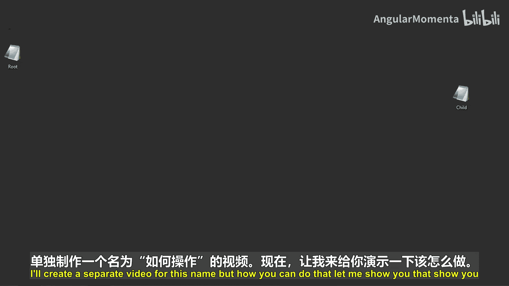

Let me show you show you that as well。 Okay， so from here， go to your B。And from here。

 what you need to do， go to connect。And you first recall you need to add one RDP file just click on select and from here well get the option。

 download RDP file so I have downloaded that file so as you can see here as well。

 this is my RDP file。And from here， you click on connect。You need to enter the password。

And you need to click on O。 and then you will be connected。 So that's what you need to do。

 I have connected to that PM。 After that， what I have done。

 I have gone ahead and I have added I server to that。 So how to do that from here。 Go to this page。

 Okay， it will automatically open when first time it will open。

 You need to click on add roles and features。 You need to click on next。😊。

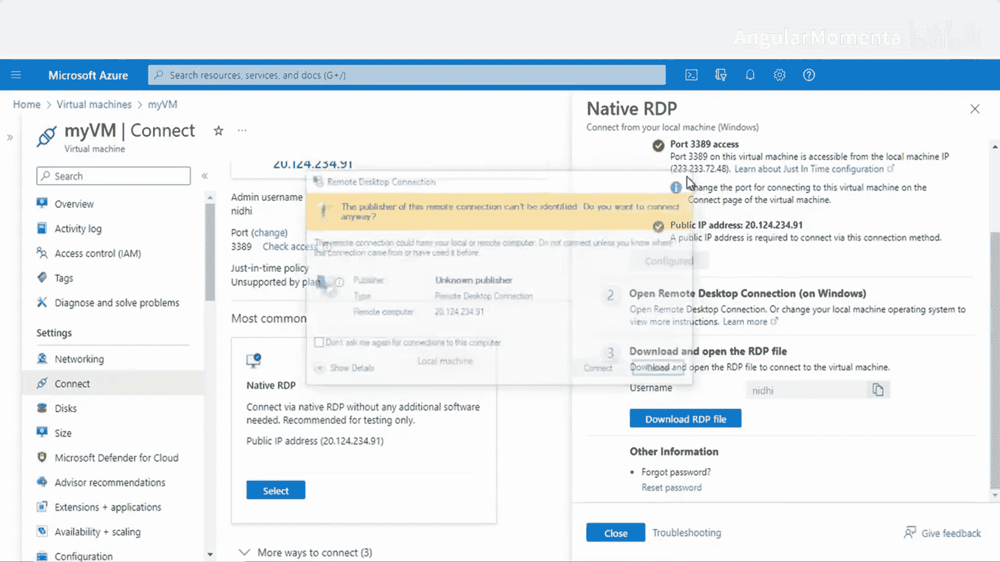

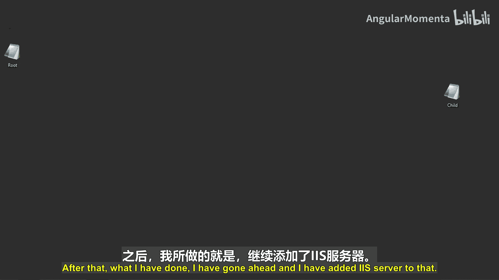

And next， from here， you select。That's server IIS and simply click on install。

 So that's what I have already done。

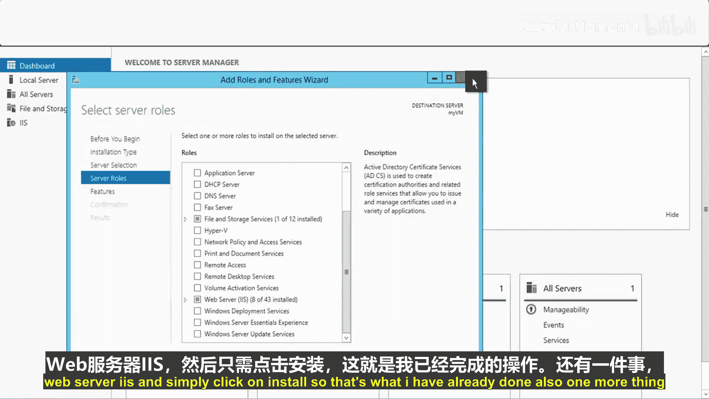

Also， one more thing I have done default page I have changed， so I have gone ahead from here。

 I went to Windows C and I went to in pub and from here I got went to root。 And this is the one。

 Let me open this with。A no bad。So this is what I have changed。 There was some defaultpot file。

 That's what I have changed。 Welcome to EducCA Nty class， right， that's what I have done already。

 So if I hit the public IP of this machine。😊，So， let me copy this。I should be able to。See this file。

 right。 So my next step is， so I have configured all my PM， and I have added two things there。 Now。

 what I need to do， like in the previous steps we have seen。 First of all。

 I need to create a virtual van。😊，So that's what I have already done。

 but let me show you the steps as well。😊，So I have selected the resource group。

 the same resource group， and I have given it a name， like for example， ABC。Okay。

 and then I have gone ahead， I have selected the previous as well and then I have created that。😊。

Next steps， we'll see in the next videos。Hello， learners， welcome back。

What we have done into previous。Video we have created one virtual van now what I need to do I need to create one hub I have gone ahead。

 that's what I have done already。😊，I have created these things。

 subscription and resource group it was automatically taking I created。😊。

One virtual hub so I have entered name as hub one you can write any name and you can write like any address space whatever you like 10。

0 do 1 do0 slash 16 for example that's what I have taken capacity you can select according to you I have selected two routing infrastructures and this one only I have selected preference I have selected express route only Next is site to side point to side express route whatever you want to configure。

I am interested in point to site if I want I can do from here as well like I can select gateway scale units point to site server configurationration。

 Microsoft network or whatever you want to do so you can select that as well。But。

I can do it later on as well or now as well。 I have done， let me just tell you。

 I have selected the gateway configuration。 I need to select。Point to site configuration。

Microsoft Network， that's what I need to select。You see that that is what also you can do。

 but I have gone ahead and created it without any of these things because as you can see02 side central for server configuration is required that is what I have shown you yet。

😊，That's how I have created my virtual hub。😊，After that， what I need to do。

 I have created one virtual network connection as well that also will be required。😊。

We have done that in the previous part as well。So you need to do the same step here as well。

 let me show you， let it load first。Yeah its done if you add one connection so as you can see here it is already here so give it a name like for example02 site let's write pS select your hub。

 whatever it is， select your resource group。Select your virtual network so I have one VNe one。

 which I have shown you。So， from here you can associate route table I have selected default rest all the things I have put as same so that is how I have created that so as you can see here。

😊，I have one virtual network here。This is my V one that is what I have gone ahead and done Next step is I need to create user VPN configurations like I have shown you while I was creating the virtual network hub and when you do the point to site connections you require one user VPN configuration what you need to do you go ahead and create a user VPN configuration。

😊，So let it open first， I already have one。From here as you can see this in subed state and it takes around half an hour to complete that so let me show you the steps only first of all what you need to do you need to select the subscription resource group so you you can give it any name for example。

😊，My configurationary name you can give and from your tunnel type IKEV to VPN only haveve selected open VPN or anything you can select Ive selected this one only next is either you can use as your certificate radio authentication or as your active directory so I have gone ahead and used as your certificate for that we require certificate。

😊，I have already created some certificates I'll create a separate video how to create certificates and on but let me show you what are the steps so I have taken the commands from here this is the commands so what do you need to do these are the commands okay。

😊，You need to run from the partial you can change this name as well if you want like PS2 root set you can if you want you can change that so this is the root。

And this is for。Your child one from for your client one so Ive gone ahead and ran those two commands After that I got these two certificates I'll show you the demo as well。

 Don't worry about that。😊。

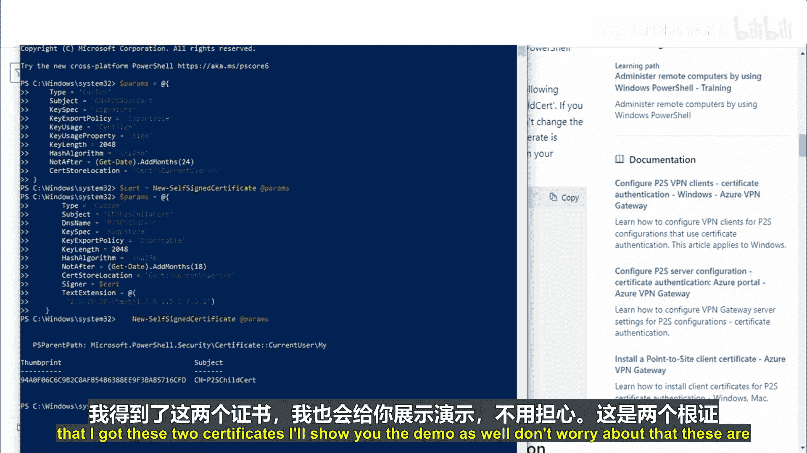

These are the two root and child I have got it。 So what Ive done here。

 let me just open it with notad。 So if I open this with notad you will see these things So what Ive gone ahead you need to copy this。

😊，And。While you will be creating this thing， so what I have gone ahead。

 I have added root here and this thing。😊，I have added here。So， that is what I have done。

 radiod authentication， A or active directory， everything else I have kept a default and I have created it。

😊，That's what I have done already。 After that， what I have gone ahead， I have， I went to my。😊，Hos。

And I have gone to my hub one。And from here， I went ahead to point to sight。😊，As you can see。

 there is already one configuration， right？😊，What were the steps there。

 Let me show you while you create the hub same steps you can see there as well。

 So if I go to your S 1 hubs。And if you go， if you create a new hub。😊。

And when you select point to site these were the steps that have gone ahead and completed so from here the gateway scale units I have selected one scale unit so lets select that and from here this is the point to site configuration the VPN configuration we have created okay where we have added the keys and all certificates and all so that is what this thing is and I have selected Microsoft network and if you want to configure your address pool。

😊，You can configure whatever the client at school you want I have gone ahead and selected。1，9，2。

 dot 1，6 dot0 do0 slash 24， that' is what I have added。And I have gone ahead and created that help。

 That's what I have done already。 remaining part we'll see in the next video。 Thank you very much。😊。

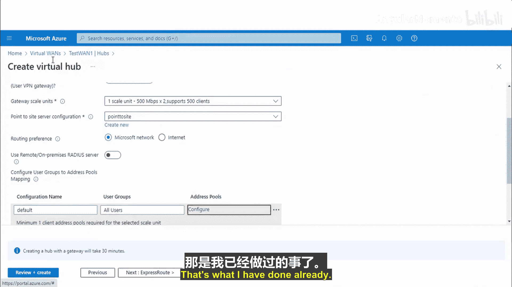

Welcome back， everyone。😊，What I have done now I have created my hub。

 I have created usability and configuration。😊，I have added virtual network connection as well。😊。

And inside my hub， I have created point to sight connection as well。

 So if I have gone ahead and let me show you， this is point to sight。😊。

So here you can see one scale unit and all these things have done。What I need to do now。

 I need to show you the connectivity now。First of all， what I need to do。

 I need to go to my virtual machine。I need to remove its public IP then only I will show you using the private IP we are able to do that so how to do that go to your public IP virtual machine。

 go to networking。And from here， go to your network interface。And。Go to IP configurations。From here。

 select click on your IP config1。And I need to remove its IP， so I need to。

 I don't need to associate， I need to dissociate， lets save this。Public IP I need to dissociate。

 so it is updating my network interface， let it update。Might take a while。

So that has been updated so if I go ahead， if I go to my virtual machine now。😊。

And if I click on its overview。I won't be able to see any。Public I。

 only thing I'll be able to see is the private IP of the machine。 So that is 10 dot0 do 2 dot 5。

 That was the previous public I。 If I refresh this。

 I won't be able to see anything because there is no public I P associated with that。

 So how long you keep trying。 You won't be able to see that。 Now， I need to do the configuration。

 Let me show you final。😊，What I need to do， go to your。What your van。And click contest1。From here。

 what to your user VTN configurations。😊，Let it open。And from here， select this。

 this is and I need to download this。😊，So select authentication type as this and generate and download the profile。

😊，So let it download。😮，Might take a while。It is blocking， but I need to continue the download。

Yes done if I open this， I'll be able to see this。😮，🎼So from here I need to go to Windows AMD 64。

 I need to open this application and I need to install this on my system Yes。

 I want to continue this。So it might have done。Now， I need to go to。

VPN settings from your search for VPN settings and you will be able to see the VPN settings。Okay。

 so from here， go to VPN settings。 So Im able to see that test when。😊，Point to site。

 so let's open this and click on Connect。Now click on Connect。🎼Continue。Yes。😊，SoIt will take a while。

 so it's done。So， as you can see， it is connected。Now， if you go ahead。😮。

And go to your virtual machine。And copy its private IP。😊，So let me open its private IP。

Let me refresh this is this 10。0。2。5， let's copy this。And from my system。It doesn't have anything。

 And still I' am able to connect with that。 Welcome to AucCDA Niy class。

 same thing I' am able to see using VPN point to side connection。 Thank you very much。😊，Hello。

 learners， in this lesson， we'll see how to generate certificates that we have used for points like connectivity。

😊，I'm using this is the Microsoft link。So I share the play for you。Well use these comments。

 This is for who certificate and second one life certificate or child certificate whatever you want。

 So if you want to can change this name。😊，俺是不的一国出。Your child husband， your client husband。

 you want can change this name。 Do they have written at who and strive So you can change this things。

 I'm putting this in。 So let me copy this command。 and I need to open partial to the partial I'm opening。

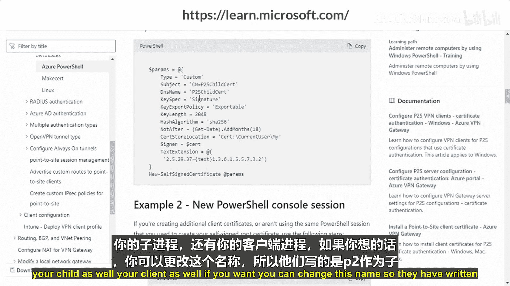

Run this command。Yeah。

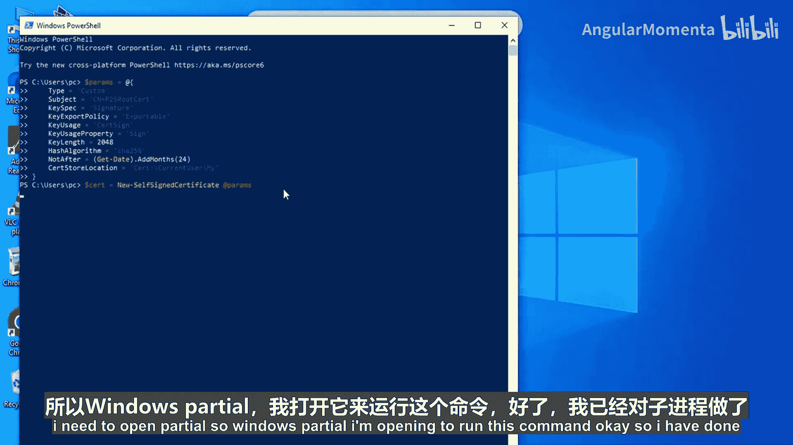

Yeah。So I have done similarly。 I need to do for my。Plan as。 So let me copy this。

And this face is hell。嗯。最s doneNow what I need to do。The certificates might have been generated。

 I need to dress。Windows are and I need to enter M， click on。Yes。The problem you go open fight。

Add and move snapping。And from here， Go certificates。And click on add from here。

 you can select the certificate code for my user account， service account， computer account。

 I'm using it for my user account， right。😊，Now， pick on cookie。I'm from you。 go to your。7ific。And。

From here to do certificates。 And as you can see， these two files here。 PS who。

 PS who charge that's what the name was there。 And whatever name you do， you can do that。

 if I go to here again， and I need to export it to my system to see the content of the file。

 which I have to paste in my point to anything。😊，From here go to all tasks and from here。

 go to each school。Click on next and do not the credit key next from here。

 you need to select J 64 and codinging。 Otherwise， we won't be able to write to that step necessary。

 give it a name， to browse it。 Okay， and do it to next。And let's new folder's。

Okay and let's do that and take on next。 and let's finish this。This is for blue1， similarly。

 do the same for to orex。Be on next， next。Let this see for Next browse for the file。

 Okay the same thing。 That's all child。Seat。Next， and finish If I go to that particular folder。

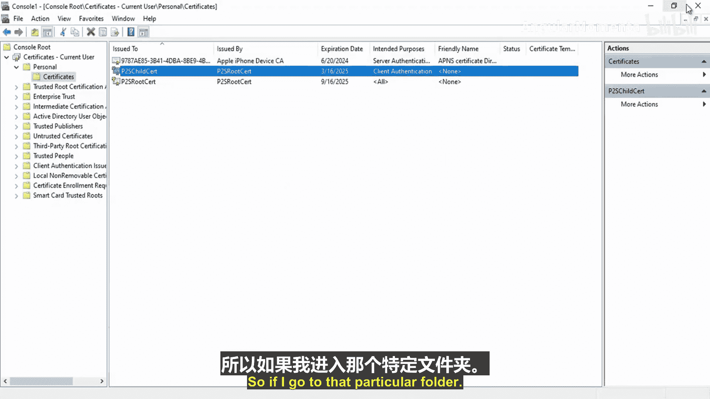

So this is the new folder。 and we are the child and group。 if I go ahead and interact with Note。

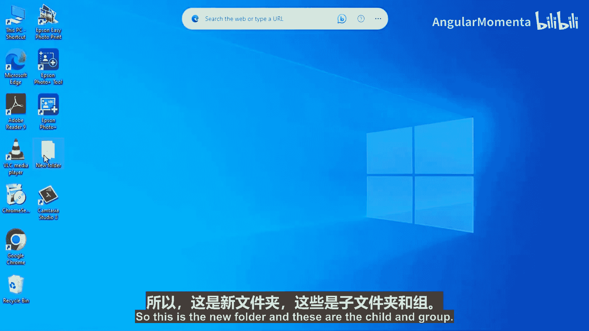

I'll be able to see the same content。 So that's what I was testing while I was creating the authorization。

 right， the certificate thing I was doing while I was creating the point of。 Thank you very。😊，Hello。

 learners， now， let's summarize whatever we have discussed on this particular module。In this module。

 if you think about yourself as a network engineer to an organization and you are in the process of migrating to Azure and evaluating the adoption of a global transit network architecture。

 then if you have a growing number of distributed offices。

 it will be easy to address the work from home initiatives and you may require to control cloud centric modern。

And maybe the global enterprise IT footprint is required so as a network engineer。

 you need users to be able to access the resources， maybe your storage databases。

 maybe applications whatever on your on premises and your all these things you want to access it so you may require a hybrid connectivity solution that make you short about your short term goals as well as long- term goals。

😊，So that may be required and basically if your organization wants to migrate your resources to Azure。

 then you must ensure that the communication between un premises environment and Azure is both secure and reliable。

😊，In this module， we saw different services for hybrid connectivity。 So we saw about virtual vans。

 We saw about site to side connectivity。 We saw about point to side connectivity。

 We saw about authentication for point to side connections。😊。

And how to design and implement all those things。 That's what we discussed。 Thank you very much。😊。

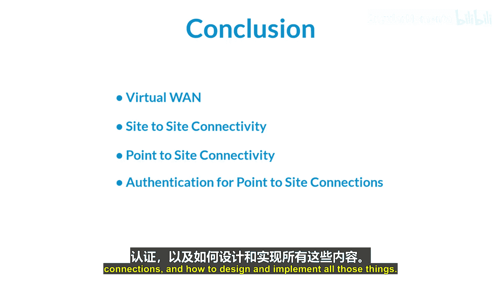