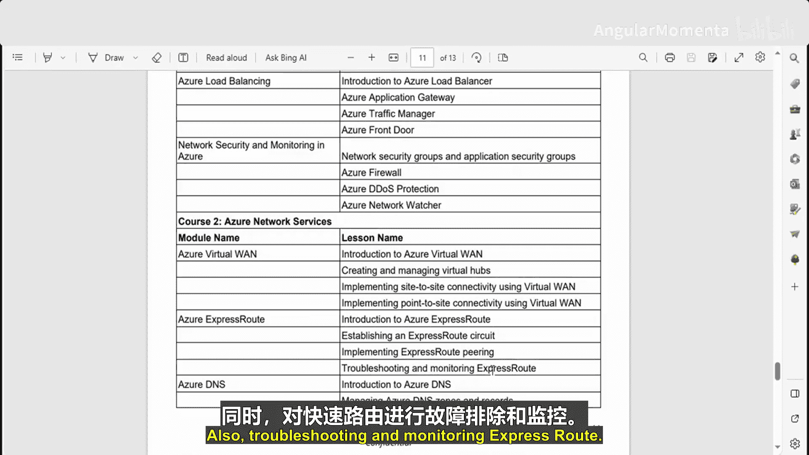
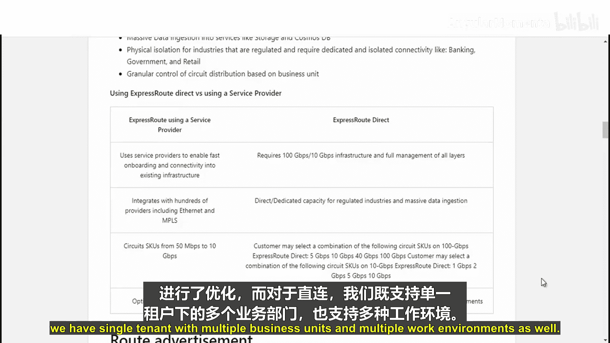

# 【EDUCBA】Azure网络服务 ｜ Azure Network Services p05 02_01_01_模块介绍：Azure ExpressRoute -BV1mwFSzNE2s_p5-

Hello learners in this module we will be discussing about Azure Express route so as your express route is a service that enables you to create private connections between Azure data centers and infrastructure that is on your premises or in colocation environment。

😊，In this module well be discussing how we can explore Azure express routes and its roles in establishing private and dedicated connection between on premises networks and Azure well also see how to plan configure and troubleshoot express route circuits as well as implement express route peering to optimize network performance so we'll be discussing so these are the topics that we see in introduction to usz your express route establishing and express route circuit implementing express route peering that's what we' be discussing also troubleshooting and monitoring express route Thank you very much。

😊。

Hello， learners。In this lesson， we'll be discussing about aure express route。

Lets first understand what is Azure Express route as your express route is used to create private connections between Azure data centers and infrastructure on your own premises environment。

So express route connections do not go over a public internet。And they offer more reliability。

 faster speeds and low latency than the typical internet connections Basically Microsoft they have their own lines or they might have taken it on the leash your traffic will be moving through those private lines only your traffic won't ever go on your public internet that's the benefit of using as your express route。

And AzR gives you layer 3 X， so there will be layer 3 connectivity between your on premise misss network and the Microsoft Cloud through a connectivity provider and your connectivity options can be point to point ethernet connections。

 any to any networks， virtual cross connections made to internetthernet exchanges。

 all these things you can have。And also it has a belt in redundancy in every peering location for high availability and you can access to Microsoft cloud services from any geopolitic confusionsions this is what you as you are expressed out is。

😊，Now let's see what are the two types of connectivity models we have for Azure Express route basically we have two service provider model and direct model so service provider model you can have connectivity from cloud exchange colocation to your Microsoft Azure and in service provider you can have point to point ethernet connection to your express route or it can be any to any connection it can be your van directly to Microsoft Azure and the second one is direct model so it will be there will be express route site and you will have express route direct connection to Microsoft Azure。

😊，So basically two types of models are there。😊，Service provider and direct model。

Now let's see some of the use cases of Azure Express route， first of all。

 it gives you faster and reliable connection to Azure services。

Public internet is dependent upon many environments。 So using express route。

 you can have private connections between uszure data centers and infrastructure to your premises。

 So it gives you faster and reliable connections。 Second use cases， storage backup and recovery。

 Basically backup and recovery are important for an organization for business continuity and also for recovering from the outages and all express route gives you a fast and reliable connection to uszure with bandwidth of 200 GB。

😊，And which makes it excellent for scenarios such as periodic data migration， replication。

 and all those things。😊，Also， it extends your data center capabilities so express route can be used to connect and add compute and storage capacity to your existing data centers。

 Also it gives you predictable， reliable and high throughput connections your enterprise can build application then can that can span on premise infrastructure and as your without compromising your privacy or performance that's why it's reliable as well as high throughput Thank you very much。

😊。

Hello， learners。 Now in our previous video， we discussed about two types express route direct and using a service provider connectivity models to be discussed。

 So let's see some of the differences between the two。 So first of all。

 we have express route using a service provider and express route direct。

 So if you want to use express route using service provider。

 it uses service provider to enable fast onboarding and connectivity into existing infrastructure。

 But for direct， it requires hundred GB slash1 GB infrastructure and full management of all the layers。

 for service provider， you can integrate it with hundreds of provider， including internetthernet MPs。

 But using express route direct， you can use direct or dedicated capacity for regulated industries and massive data engine。

 And if we talk about the Skuus。 So this one， the service provider1， you can have Sku。😊。

Supports 50 MB to 10 GB， but for direct， we have different different options，5 GB，104000。

So customer may also select combining the following circuits as well on 10 GB express route plus 1 GB 2 GB 5。

10 all these things。 Also you can do for a service provider， it is optimized only for single tenant。

 and for direct one， we have single tenant with multiple business units and multiple core commandments as well。

 Thank you very much。😊。

